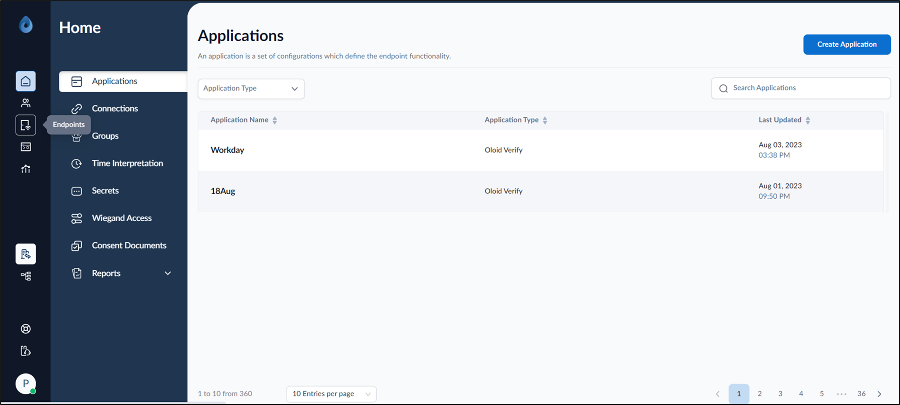
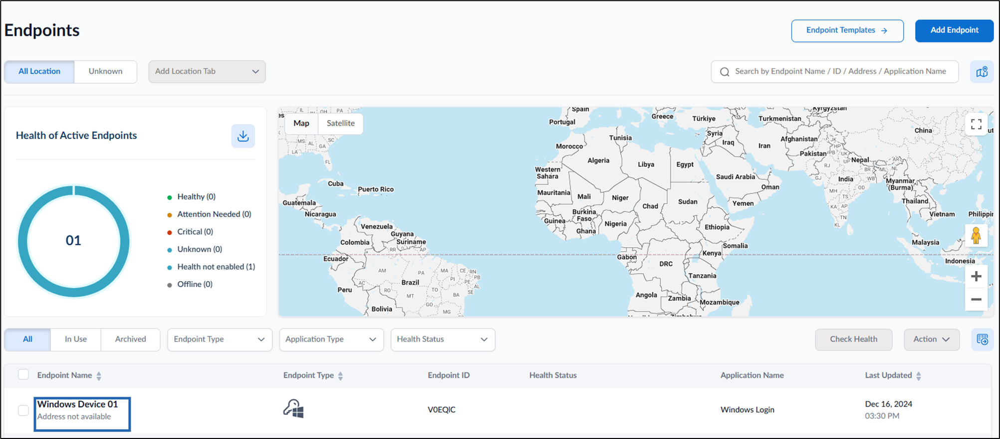
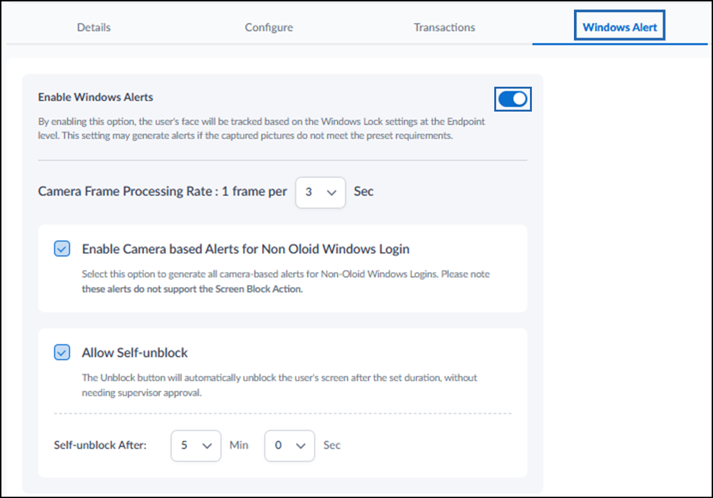
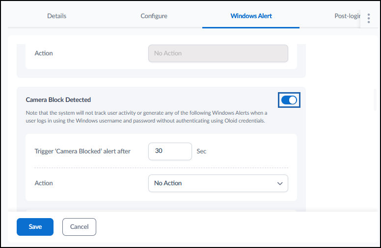
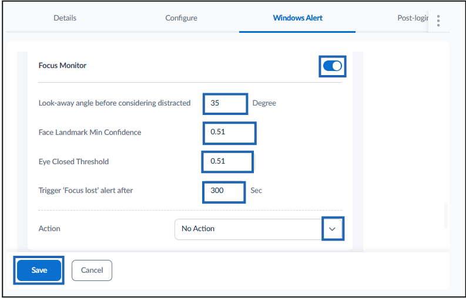
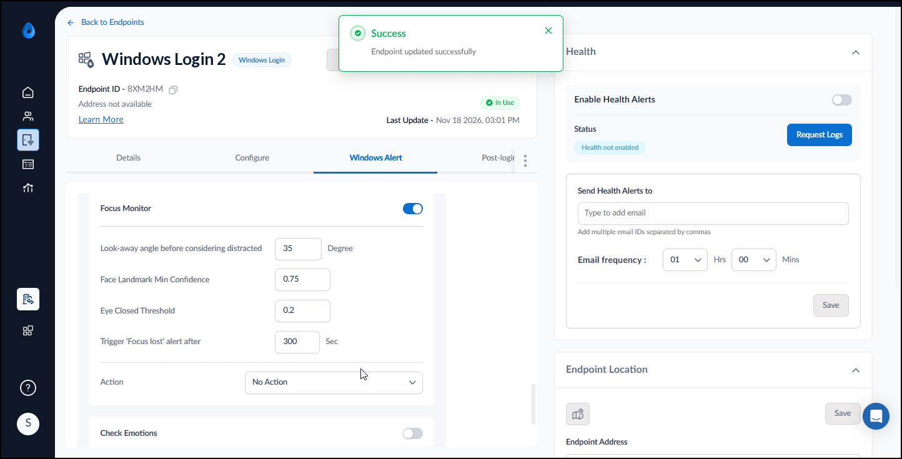
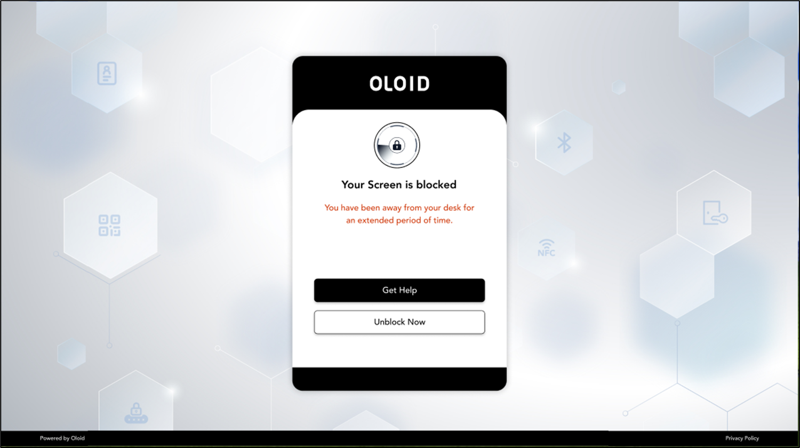

{/* Source: Intercom article 16012060 - https://oloid.help/en/articles/16012060-windows-login-v2-0-how-to-enable-focus-monitor-for-presence-detection */}
{/* Generated by intercom_to_mintlify.py - re-running overwrites this file. */}

## Introduction

This document explains how to configure Focus Monitor for a Windows Login endpoint in the Tenant Admin Portal. Focus Monitor helps make sure users stay attentive while using a Windows device. It checks whether the signed-in user looks away from the screen beyond a set angle, or closes their eyes, for longer than a set time, and triggers the configured action when that limit is exceeded.

## Prerequisites

- You must have admin access to the Tenant Admin Portal.
- The endpoint must be paired with the Windows Login application. For more information, refer to [How to pair endpoint using Pair as Supervisor in Supervisor App](/platforms/windows/supervisor-app/windows-login-how-to-manually-pair-the-supervisor-app)
- The system must be unlocked.
- The system’s camera must be working.

## Steps to configure Focus Monitor

1. Log in to Tenant Admin Portal.
2. On the home page of the portal, click **Endpoints** on the left menu panel.

   

   The Endpoints page is displayed.
3. Click endpoint name (Windows Login) to edit from the listed endpoints.

   

   The Endpoint details page is displayed.
4. Go to **Windows Alert** tab > **Enable Windows Alert** toggle.

   

5. Enable the **Camera Block Detected** toggle.

   <Note>
     **Note:** If **Camera Block Detected** is turned off, no alert is triggered when the camera is blocked.
   </Note>

   

6. Do the following:
   1. Enable the **Focus Monitor** toggle.
   2. Do the following:
      1. **Look-away angle before considering distracted :** Enter the maximum angle in degrees that the user can turn away from the screen before they’re considered distracted.
      2. **Face Landmark Min Confidence** : Enter the minimum confidence value needed to detect the user’s facial features.
      3. **Eye Closed Threshold** : Enter the value at which the user’s eyes are considered closed.
      4. **Trigger ‘Focus lost’ alert after** : Enter how long in seconds the user can stay distracted before the alert is triggered.
      5. Select an action from the **Action** list.
   3. Click **Save**.
      Focus Monitor is configured for the endpoint.

      

The **Success** message “Endpoint updated successfully” is displayed, and Focus Monitor is configured for the endpoint.

---

##### Sample Screen

