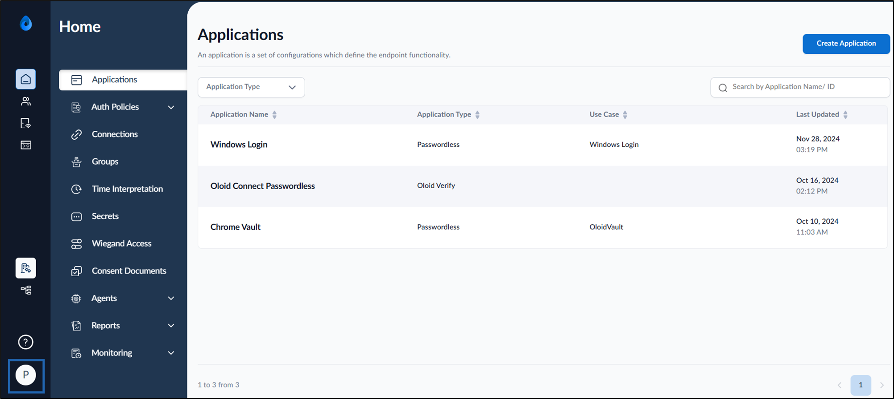
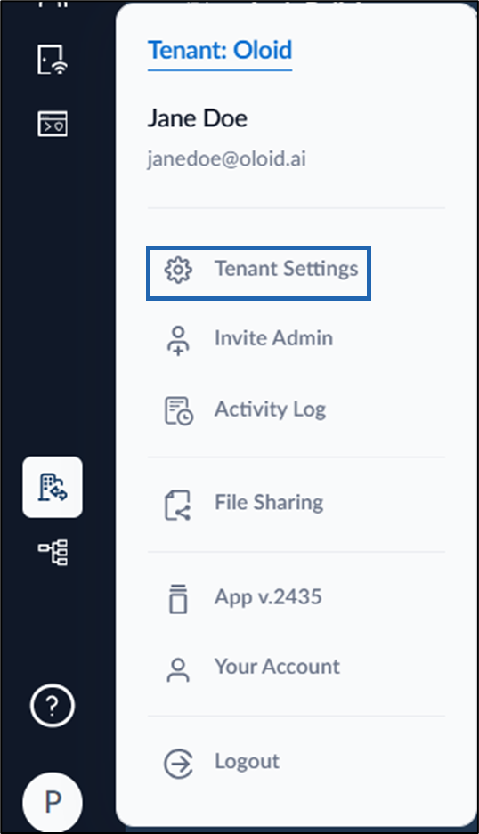
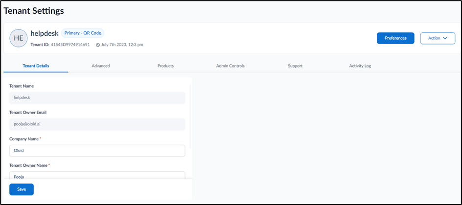
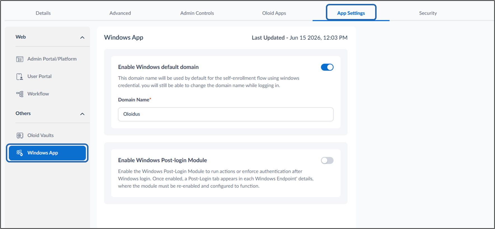
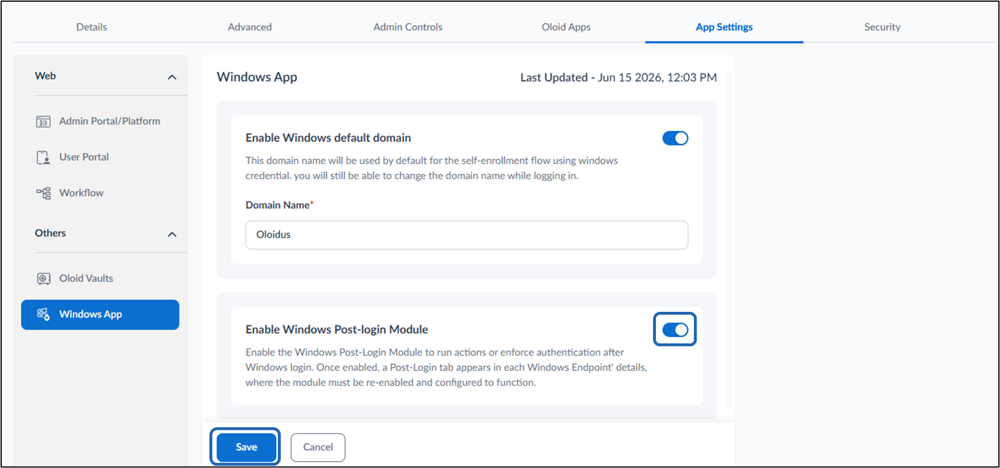
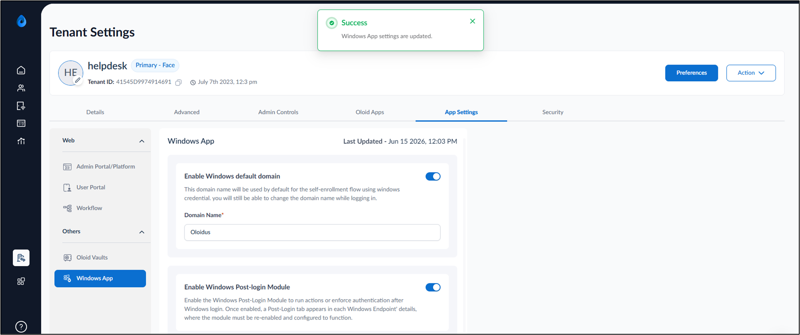

{/* Source: Intercom article 15457971 - https://oloid.help/en/articles/15457971-windows-login-v2-0-how-to-enable-windows-post-login-module */}
{/* Generated by intercom_to_mintlify.py - re-running overwrites this file. */}

## Introduction

The Windows Post-login Module allows the admin to control post-login behavior on Windows devices after user authentication. Enabling this feature helps customize the user experience by triggering specific actions or workflows immediately after login.

## Prerequisite

You must have access to the Tenant Admin Portal.

## **Steps to Enable** Post Login page

1. Log in to the Tenant Admin Portal.
2. On the homepage of the portal, click **User profile icon** on the bottom left corner of the menu panel.

   

   The user profile menu is displayed.
3. Select **Tenant Settings**.

   

   The **Tenant Settings** screen is displayed.

   

4. Go to **App Settings** tab > **Windows App**.

   

   The Windows App settings page is displayed.
5. Turn on the **Enable Windows Post-login Module** toggle.
6. Click **Save.**

   

   The Windows Post-login Module is enabled.

