{/* Source: Intercom article 13670102 - https://oloid.help/en/articles/13670102-windows-login-v2-0-how-to-install-and-auto-pair-windows-login-v2-0-app */}
{/* Generated by intercom_to_mintlify.py - re-running overwrites this file. */}

## Introduction

The Windows Login App provides secure, passwordless access to your Windows machine, making it easy to log in without the need for traditional passwords.

## Prerequisites

- You have local administrator access on the Windows machine.
- Check System Requirements. For more information, refer: [Windows Login Version 2 - Hardware and Software Requirements](/platforms/windows/windows-login/v2/windows-login-v2-0-hardware-and-software-requirements)
- The installer file must be downloaded. For more details, see: [Windows Login v 2.0 - How to download Windows Login v 2.0 installer file from Tenant Admin Portal](/platforms/windows/windows-login/v2/windows-login-v2-0-how-to-download-windows-login-v2-0-installer-file)

## Steps to Install Windows Login App

1. Double-click on Oloid Passwordless Login file.

   

   The **Oloid Passwordless Login Setup** pop-up box is displayed.
2. Click **Start**.

   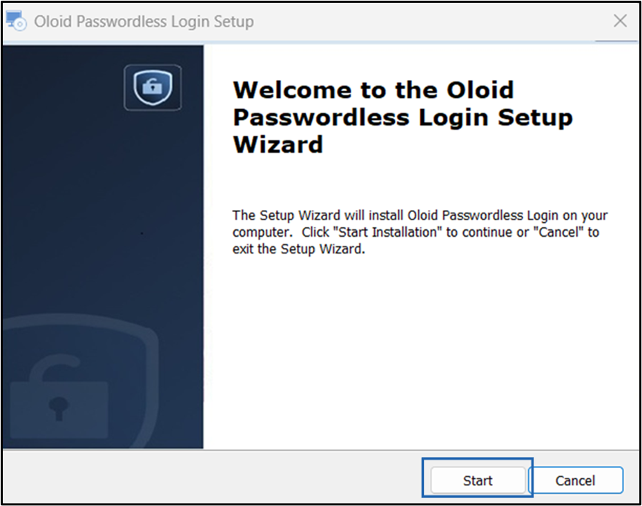

   The **End-User License Agreement** page is displayed.
3. Select **License Agreement** checkbox and click **Next**.

   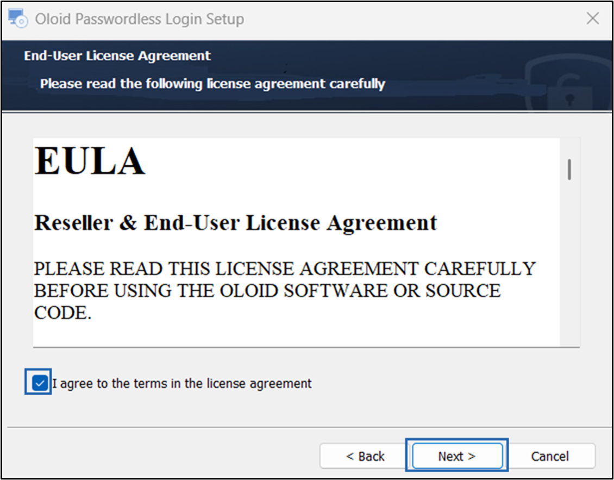

   The **Destination Folder** screen is displayed.
4. Use the default path to install the application and click **Next**.

   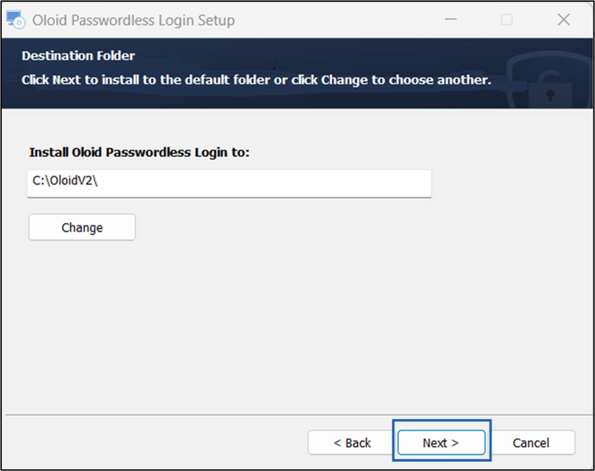

   The **Capabilities** pop-up box is displayed.
5. Select the required feature check box(es) and click **Next**.

   <Note>
     **Note:** The following provides additional details about each capability:
   </Note>

   1. **On-device Face Recognition:** Authenticates users locally using facial recognition even if the device is offline.
   2. **Local Cache Server:** Enables users to log in and authenticate using locally stored data when the network is unavailable or experiencing connectivity issues. This option is **selected by default**.
   3. **Presence Detection:** Detects user presence to enable hands-free login and auto-lock when the user leaves.
   4. **Oloid Launcher:** Provides a central interface to launch apps and workflows after authentication.
   5. **EPIC Integration:** Enables secure, passwordless access to Epic workflows through seamless authentication.

      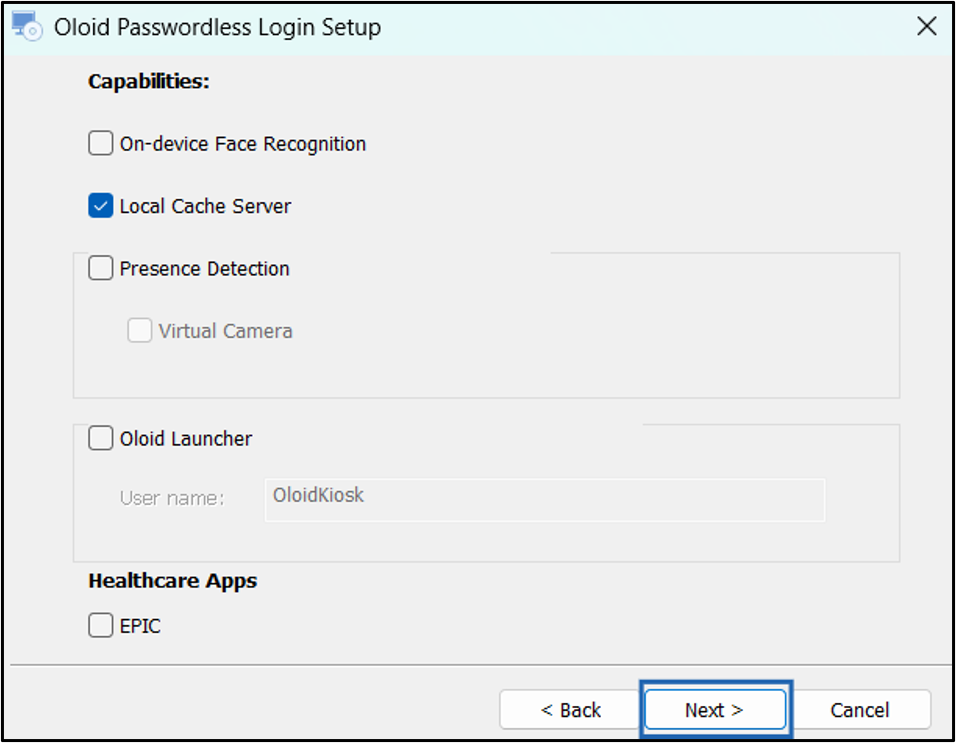

      The **Proxy Settings** screen is displayed.
6. Select one of the following:
   1. **None:** Connects to OLOID services without using a proxy.
   2. **Use Local System Proxy:** Uses the proxy settings already configured on the Windows device to connect to OLOID services.
   3. **Use Explicit Proxy:** Uses a specific proxy server to connect to OLOID services. Enter the proxy server address in the **URL** field.
   4. Click **Next**.

      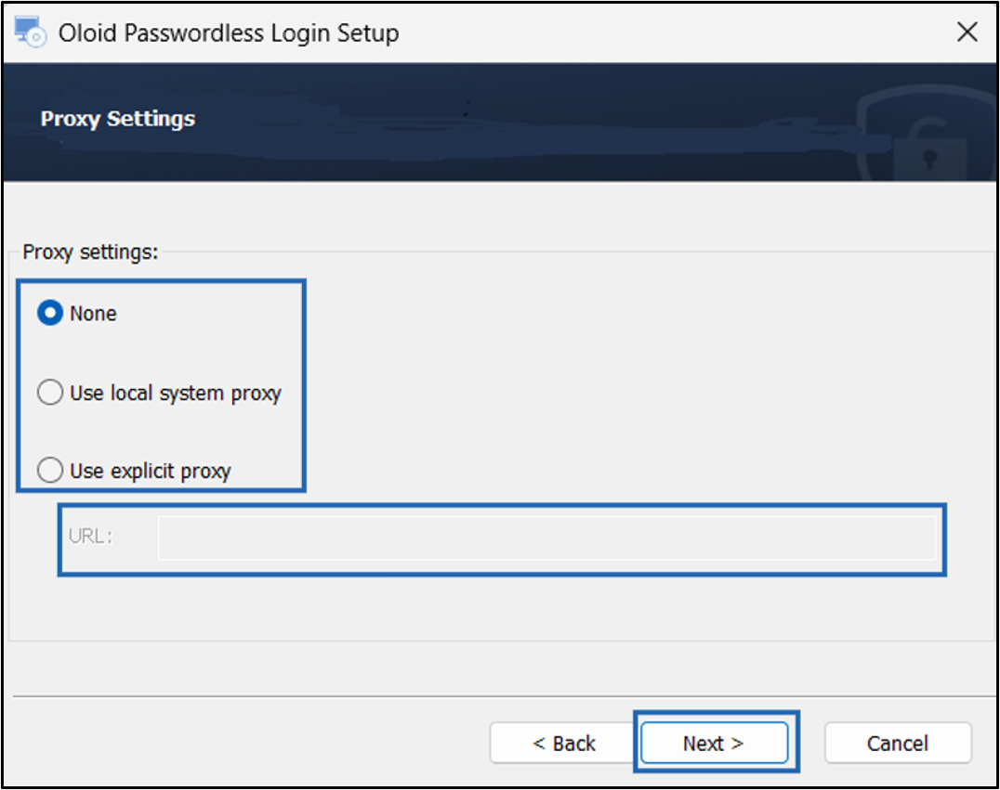

      The Autopair Settings screen is displayed.
7. Do one of the following:
   1. Select **Manual** > click **Next.**

      <Note>
        **Note:** Select this option to pair the Windows Login App after installation. Once installed, you can pair the application using one of the following methods:
      </Note>

      - **Supervisor App:** Pair the Windows app using the **Supervisor App.** To pair the Windows app via supervisor app**,** refer [Windows Login - How to Manually Pair the Supervisor App](/platforms/windows/supervisor-app/windows-login-how-to-manually-pair-the-supervisor-app) or
      - **Automatic Config File:** Pair the Windows app using the **Auto-Pair Config File.** To pair the Windows app via Auto-Pair Config File, refer [Windows Login - How to pair Supervisor App using auto-pair config file option](/platforms/windows/supervisor-app/windows-login-how-to-pair-supervisor-app-using-auto-pair-config-file) or [Windows Login - How to Pair Windows Login App in Lock Screen using Auto-Pair Config File](/platforms/windows/windows-login/windows-login-how-to-pair-windows-login-app-in-lock-screen-using-auto)

        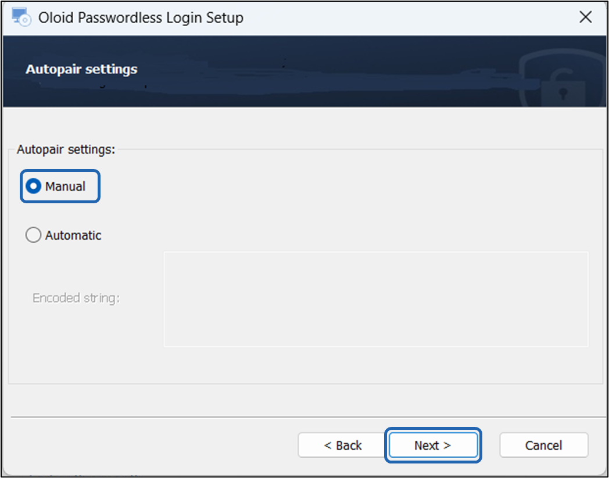

        (Or)
   2. Select **Automatic** > Enter **Encoded String** in Text Box> click **Next.**

      <Note>
        **Note:**

        - The **Automatic** option enables the endpoint to pair automatically during installation. The pairing is completed after the Windows device restarts.
        - To get the **Encoded string**, go to the Tenant Admin Portal and select **TEXT** as the Auto-pair config file format. Then, copy the config text or download the TEXT file. To copy or download the Text format refer, [Windows Login - How to Generate and Download Auto-Pair config file for Windows Login in Tenant Admin Portal](/platform/tenant-admin-portal/windows-login-how-to-generate-and-download-auto-pair-config-file-for)

          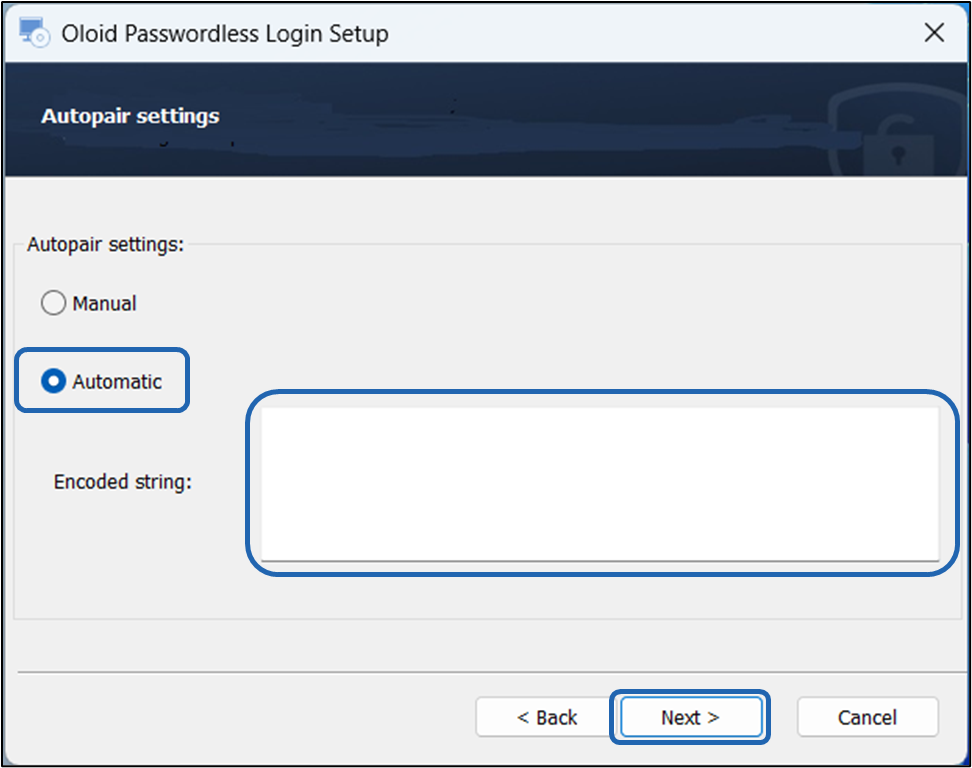

          The **Ready to Install** screen is displayed.
      </Note>

8. Click **Install**.

   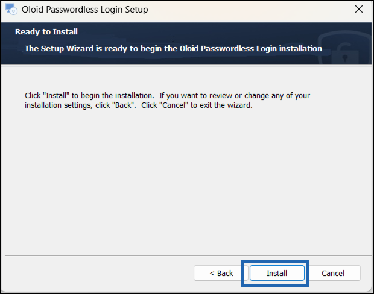

   <Note>
     **Note:** If prompted, follow steps 8–13 to install the required components. If not, proceed to step 14 to continue the installation.
   </Note>

   The **Microsoft Visual C++** screen is displayed.
9. Select **License terms and conditions** checkbox and click **Install.**

   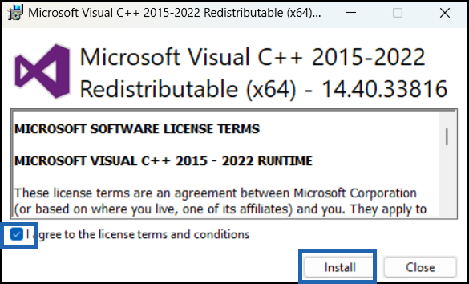

   The **Setup Successful** screen is displayed.
10. Click **Close**.

    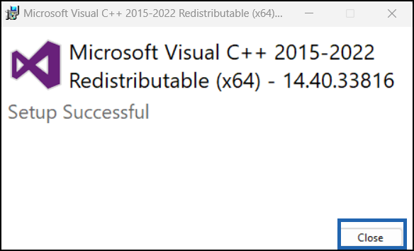

    The **Microsoft ASP.Net** screen is displayed.
11. Select **License terms and conditions** checkbox and click **Install.**

    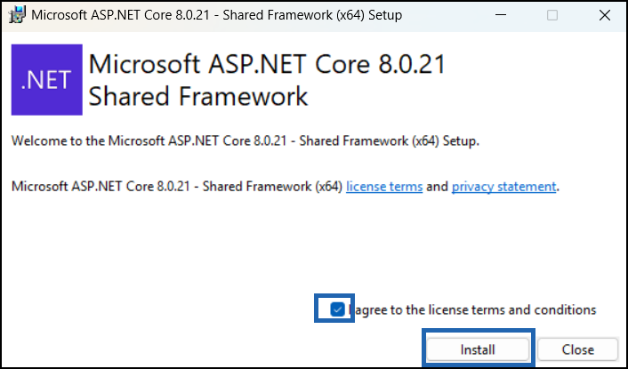

    The **Setup Successful** screen is displayed.
12. Click **Close**.

    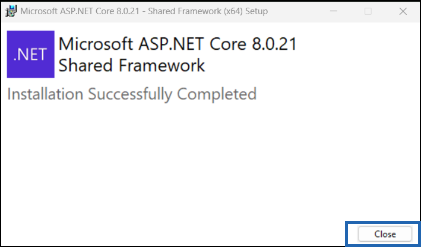

    The **Windows Desktop Runtime** screen is displayed.
13. Click **Install**.

    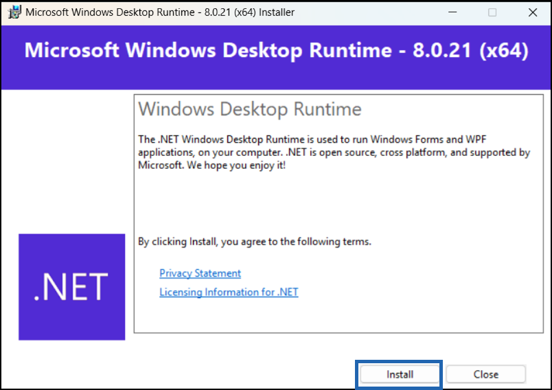

    The **Installation was successful** screen is displayed.
14. Click **Close**.

    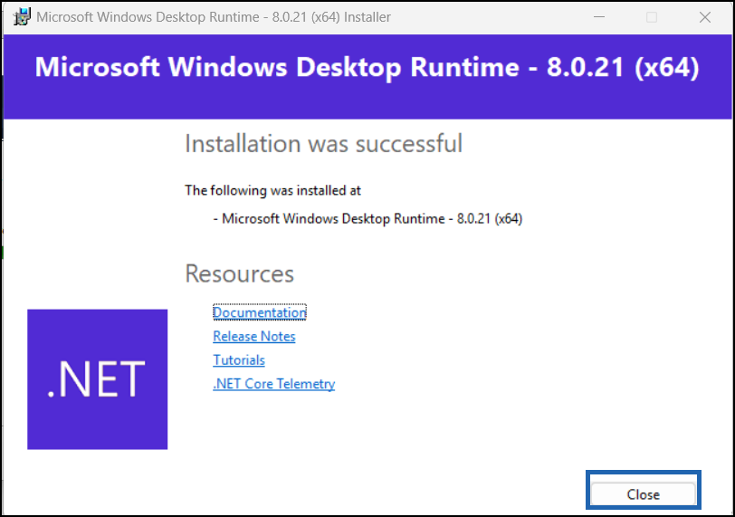

    The **Completing the Oloid Passwordless Login Setup Wizard** screen is displayed.
15. Click **Finish**.

    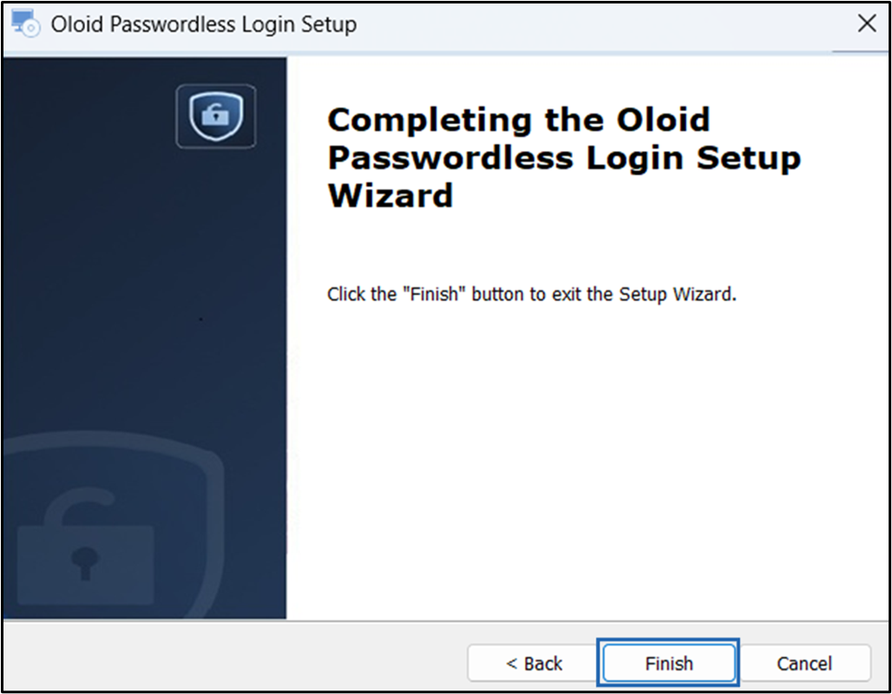

    The **Oloid Passwordless Login** pop-up box is displayed.
16. Click **Yes** to restart the system.

    <Note>
      **Note:** You must restart your system after successful installation.
    </Note>

    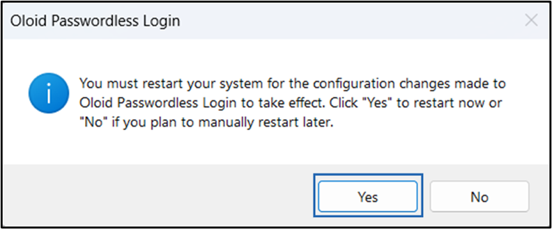

    After successful installation, you can find the Oloid app icon 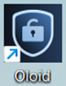 on your desktop.

    <Note>
      **Note:** The **Apache CouchDB** is installed on the system by default.
    </Note>
