{/* Source: Intercom article 17132215 - https://oloid.help/en/articles/17132215-windows-login-v2-0-install-pair-and-configure-oloid-launcher-on-citrix-virtual-desktop-vdi */}
{/* Generated by intercom_to_mintlify.py - re-running overwrites this file. */}

## Introduction

This document provides step-by-step instructions on how to set up Oloid Launcher on a Citrix Virtual Desktop. You'll install Citrix Workspace and connect to the virtual desktop. Then you'll install the Oloid Windows Login v2.0 app with the Oloid Launcher capability, pair the endpoint, and assign it to a group. Finally, you'll configure Launcher settings in the Tenant Admin Portal.

## Prerequisites

- You must have admin access to the Tenant Admin Portal.
- You must have the Citrix Store URL, and a username and password with access to a published virtual desktop.
- You must have administrator rights in the Citrix virtual desktop session to run the installer.
- The customer's Citrix policy must allow clipboard copy-paste, or the virtual desktop must have internet access, so you can transfer the installer into the session.
- To use Automatic pairing, you must have the encoded string from the Auto-Pair config file in the Tenant Admin Portal.
- The group you want to assign the endpoint to must already exist in the Tenant Admin Portal.

## Steps to Install and Configure the Oloid Launcher in Citrix VDI

- [Install and Configure Citrix Workspace](#install-and-configure-citrix-workspace)
- [Install Oloid Windows Login v2.0 on Citrix VDI](#install-oloid-windows-login-v2-0-on-citrix-vdi)
- [Add a Citrix VDI Endpoint to a Group](#add-a-citrix-vdi-endpoint-to-a-group)
- [Configure Oloid Launcher Settings](#configure-oloid-launcher-settings)
- [Set Oloid Launcher as the Default UI](#set-oloid-launcher-as-the-default-ui)
- [Verify Oloid Launcher Starts Automatically on VDI](#verify-oloid-launcher-starts-automatically-on-vdi)

### Install and Configure Citrix Workspace

1. On your **local** machine, go to [https://www.citrix.com/downloads/workspace-app/windows/workspace-app-for-windows-latest1.html](https://www.citrix.com/downloads/workspace-app/windows/workspace-app-for-windows-latest1.html)

   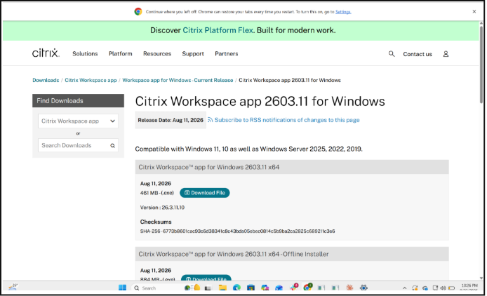

   The **Welcome to Citrix Workspace** app screen is displayed.
2. Click **Continue**.

   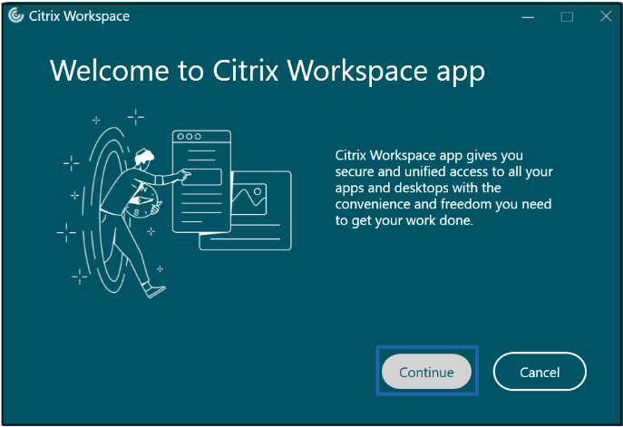

   The **Citrix License Agreement** screen is displayed.
3. Select the **I agree** checkbox and click **Continue**.

   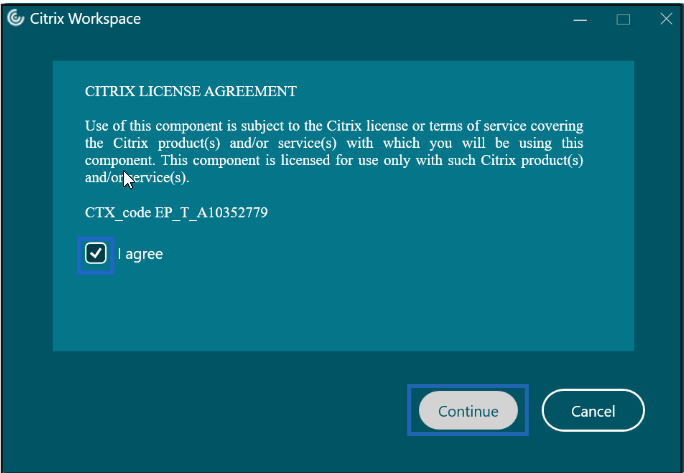

   The **Add-on(s)** screen is displayed.
4. Select the preferred Add-on(s) and click **Install**.

   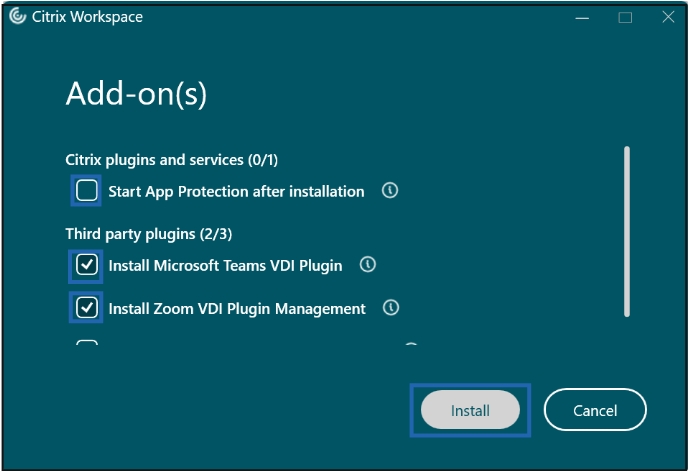

   If prompted, restart your Windows device.
5. Launch **Citrix Workspace**.
   The Welcome screen is displayed.
6. Enter the **Store URL** > **Continue**.

   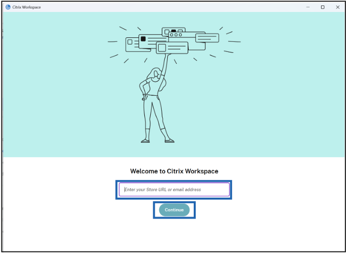

   The **Citrix Workspace** pop-up box is displayed.
7. Do the following:
   1. Enter the **User name**.
   2. Enter **Password**.
   3. Click **Log On**.

      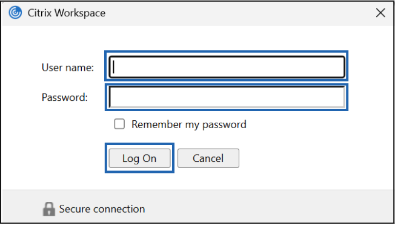

      You are successfully logged into Citrix Workspace.
8. In the Citrix Workspace app, go to the **DESKTOPS** tab and select the published virtual desktop to connect.

   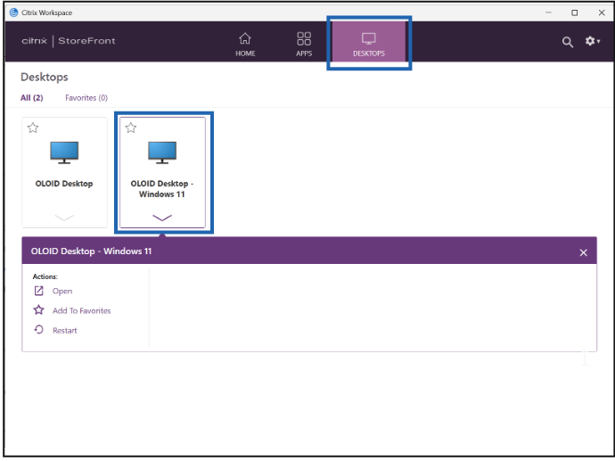

   The wait for the Windows VDI session to start.
9. You have successfully logged into the Virtual Desktop.

   <Note>
     **Note:**

     - Citrix should automatically use your Workspace credentials to sign in to the Windows session. If Windows prompts you for credentials, enter the same username and password.
     - If Microsoft Edge prompts you to create or configure a profile when you first access the VDI, complete the required setup before proceeding.
   </Note>

### Install Oloid Windows Login v2.0 on Citrix VDI

1. Download the latest **Windows Authenticator app v2** installer from Tenant Admin Portal. To download the app, refer [Windows Login v2.0 - How to download Windows Login v2.0 installer file from Tenant Admin Portal](/platforms/windows/windows-login/v2/windows-login-v2-0-how-to-download-windows-login-v2-0-installer-file).
2. Transfer the installer from your local machine to the Citrix virtual desktop using one of the following methods:
   1. **Clipboard copy-paste:** Copy the installer from your local machine and paste it into File Explorer in the virtual desktop session.
   2. **Browser download inside the session:** If the virtual desktop has internet access, open a browser in the session and download the installer from the Tenant Admin Portal. To download refer [Windows Login v2.0 - How to download Windows Login v2.0 installer file from Tenant Admin Portal](/platforms/windows/windows-login/v2/windows-login-v2-0-how-to-download-windows-login-v2-0-installer-file).

      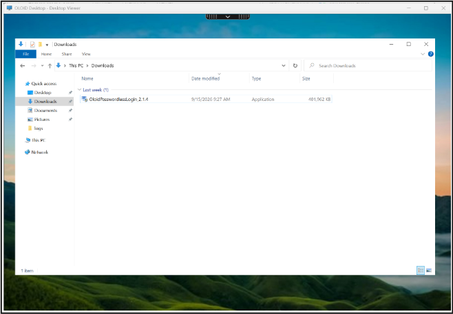

3. Run the installer inside the session (as administrator if not prompted automatically) and step through the wizard.
   The **Oloid Passwordless Login Setup** pop-up box is displayed.
4. Do the following:
   1. Click **Start**.

      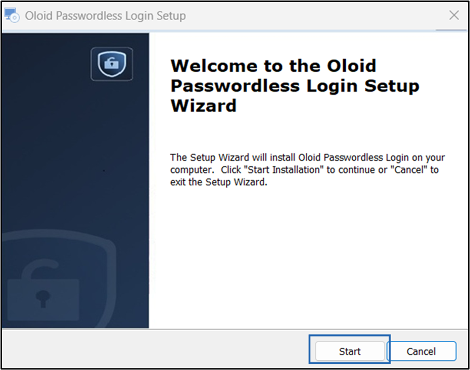

      The **End-User License Agreement** page is displayed.
   2. Select the **License Agreement** checkbox and click **Next**.

      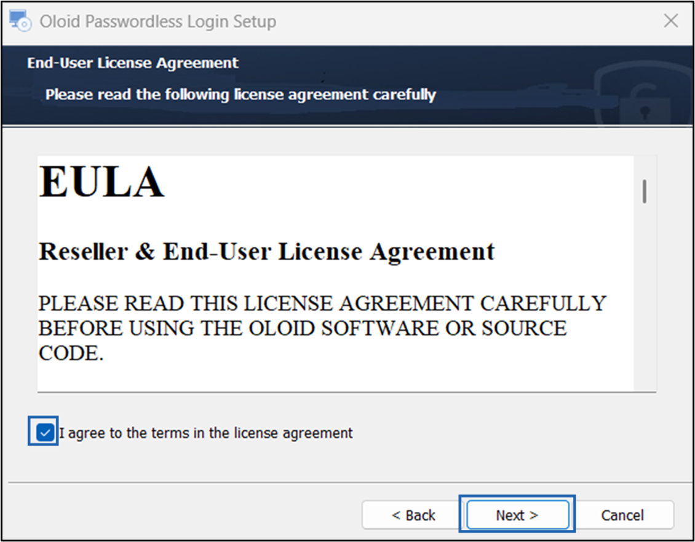

      The **Destination Folder** screen is displayed.
   3. Use the default path to install the application and click **Next**.

      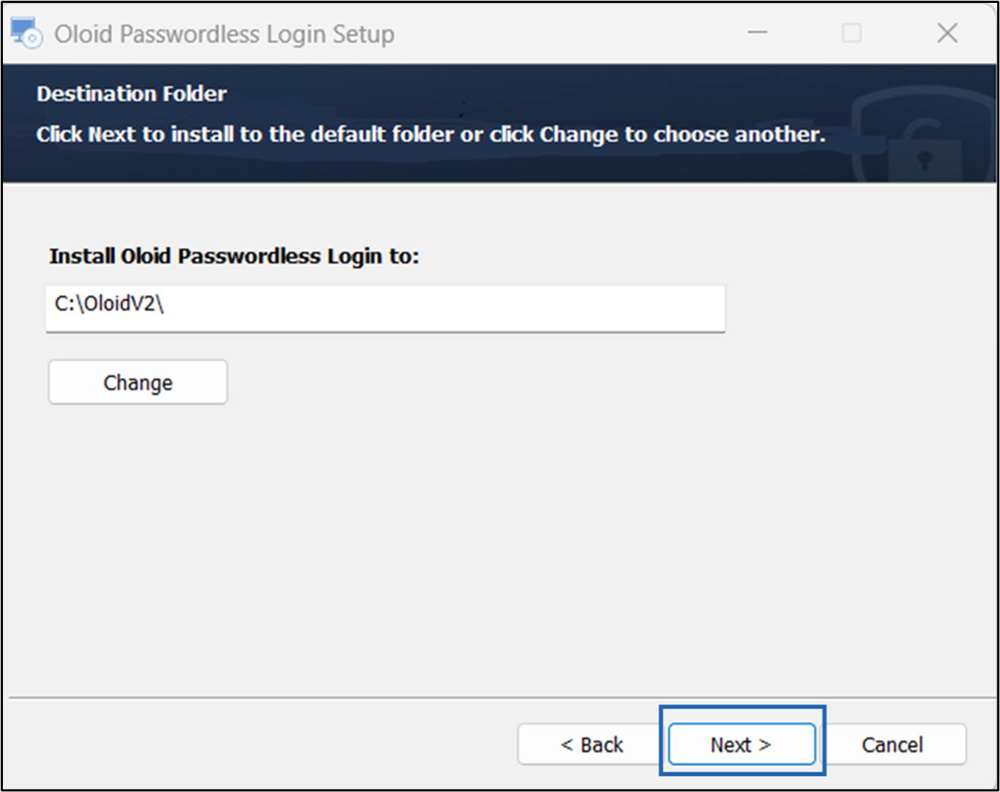

      The **Capabilities** pop-up box is displayed.
   4. Select the required capability check box(es) and click **Next**.
      1. **Local Cache Server:** Enables users to log in and authenticate using locally stored data when the network is unavailable or experiencing connectivity issues. This option is selected by default.
      2. **Oloid Launcher:** Provides a central interface to launch apps and workflows after authentication.
      3. **EPIC Integration:** Enables secure, passwordless access to Epic workflows through seamless authentication (Optional).

         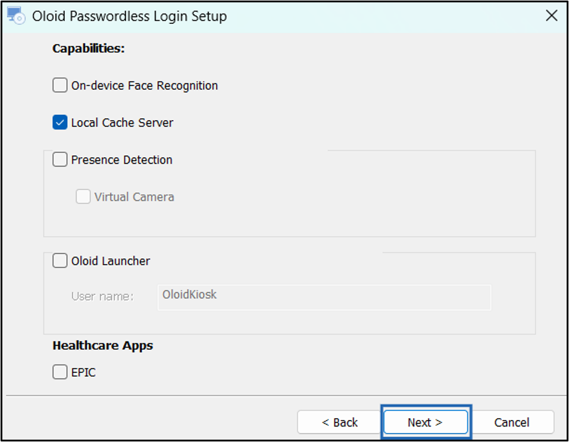

         The **Proxy Settings** screen is displayed.
   5. Select one of the following:
      1. **None:** Connects to OLOID services without using a proxy.
      2. **Use Local System Proxy:** Uses the proxy settings configured on the Windows device to connect to OLOID services.
      3. **Use Explicit Proxy:** Uses a specific proxy server to connect to OLOID services. Enter the proxy server address in the **URL** field.
      4. Click **Next**.

         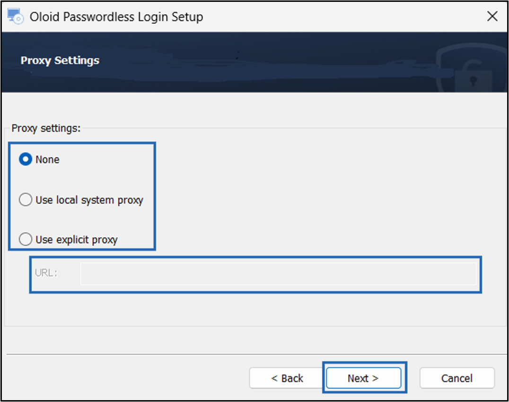

         The **Autopair settings** screen is displayed.
   6. Do one of the following:
      1. Select **Manual** > click **Next.**

         <Note>
           **Note:** Select this option to pair the Windows Login App after installation. Once installed, you can pair the application using one of the following methods:
         </Note>

         - **Supervisor App:** Pair the Windows app using the **Supervisor App.** To pair the Windows app via supervisor app**,** refer [Windows Login - How to Manually Pair the Supervisor App](/platforms/windows/supervisor-app/windows-login-how-to-manually-pair-the-supervisor-app)
           OR
         - **Auto-Pair Config File:** Pair the Windows app using the **Auto-Pair Config File.** To pair the Windows app via Auto-Pair Config File, refer [Windows Login - How to pair Supervisor App using auto-pair config file option](/platforms/windows/supervisor-app/windows-login-how-to-pair-supervisor-app-using-auto-pair-config-file).

           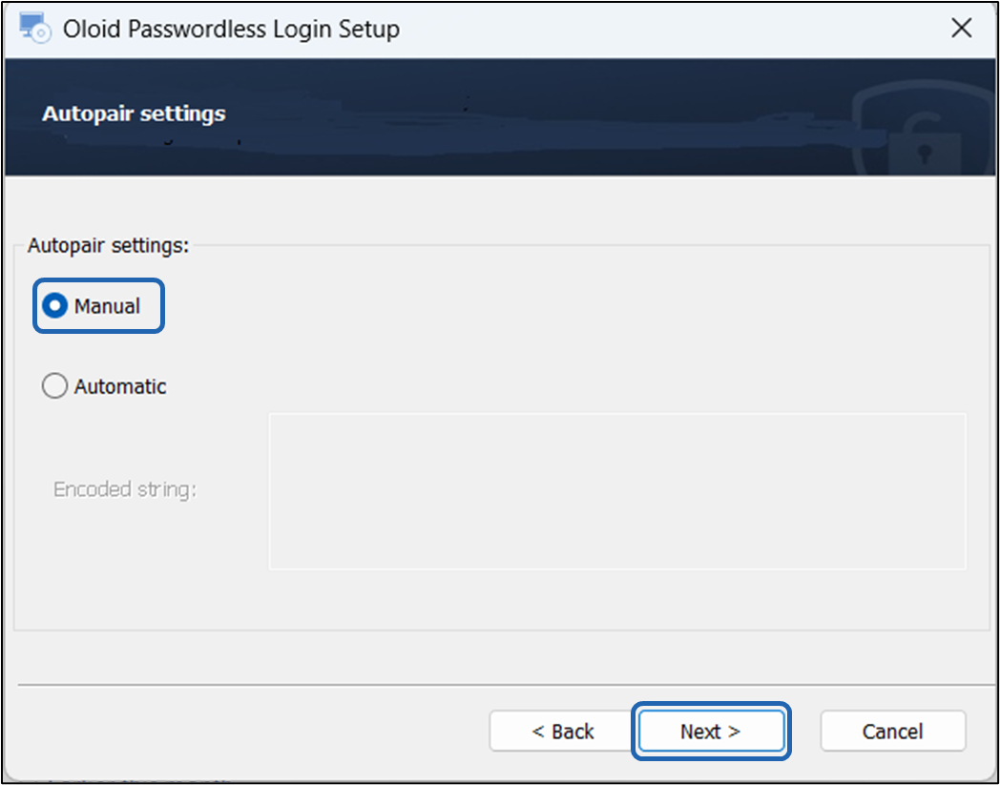

           (Or)
      2. Select **Automatic** > Enter **Encoded String** in Text Box> click **Next.**

         <Note>
           **Note:**

           - The **Automatic** option enables the endpoint to pair automatically during installation. The pairing is completed after the Windows device restarts.
           - To get the **Encoded string**, go to the Tenant Admin Portal and select **TEXT** as the Auto-pair config file format. Then, copy the config text or download the TEXT file. To copy or download the Text format refer, [Windows Login - How to Generate and Download Auto-Pair config file for Windows Login in Tenant Admin Portal](/platform/tenant-admin-portal/windows-login-how-to-generate-and-download-auto-pair-config-file-for).

             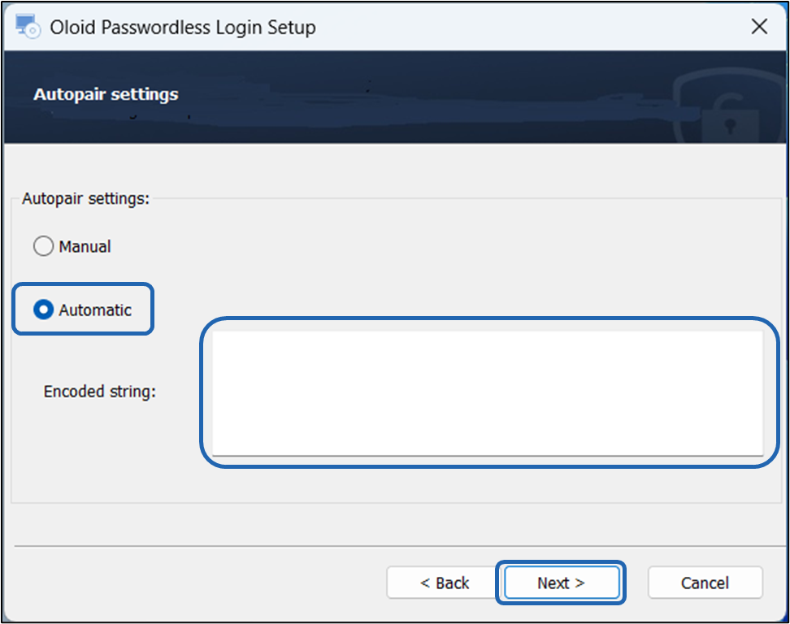

             The **Ready to Install** screen is displayed.
         </Note>

      3. Click **Install**.

         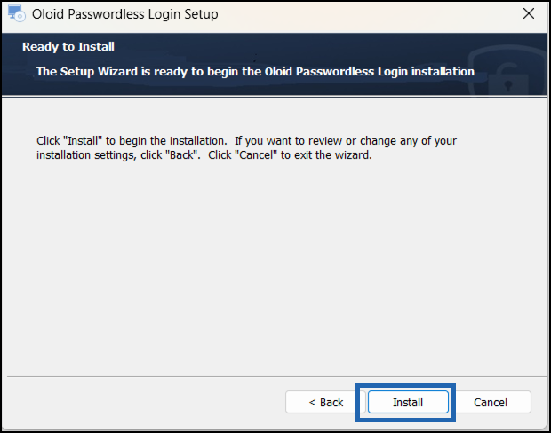

      4. Restart the Windows virtual desktop when prompted.

         <Note>
           **Note:** Restarting the virtual desktop ends the Citrix session. Reconnect to the virtual desktop through Citrix Workspace after the restart.
         </Note>

         Installation is complete once the machine has restarted. This restart ends your Citrix session. **OloidPasswordlessAdminNew** should be installed on the desktop in the VM Windows session.

### Add a Citrix VDI Endpoint to a Group

After the endpoint has been paired, assign it to the appropriate group in the Tenant Admin Portal.

<Note>
  **Note:** Ensure that you know the **Endpoint ID** of the VDI endpoint you recently paired. To get the **Endpoint ID**, log in to the Supervisor App. To login refer [How to log in to Supervisor App](/platforms/windows/supervisor-app/how-to-log-in-to-supervisor-app).
</Note>

You can assign the Citrix VDI endpoint to a group in either of two ways:

1. **From the endpoint:** Open the Citrix VDI endpoint and add a group to it. For steps, see [Tenant Admin Portal - How to Add a Group to an Endpoint](/platform/tenant-admin-portal/tenant-admin-portal-how-to-add-a-group-to-an-endpoint).
2. **From the group:** Open the group and add the Citrix VDI endpoint to it. For steps, see [Tenant Admin Portal - How to Add an Endpoint to a Group](/platform/tenant-admin-portal/tenant-admin-portal-how-to-add-an-endpoint-to-a-group).

   <Note>
     **Note:** If your deployment uses a card reader for badge authentication, configure the card reader after adding the endpoint to the group. To setup, refer [How to Set Up the Card Reader for Oloid Launcher on VDI](/drafts/unassigned/intercom/how-to-setup-the-card-reader-for-vdi-oloid-launcher).
   </Note>

### Configure Oloid Launcher Settings

Oloid Launcher configuration can be applied at three levels:

- **Group:** In the Tenant Admin Portal, open the required group, select the three-dot menu, and select **Raw JSON** to configure Launcher settings.
- **Application:** Open the required application, go to **Configure**, select the three-dot menu, and select **Raw JSON**.
- **Endpoint:** Open the corresponding endpoint and configure the Launcher settings using **Raw JSON**.
  Refer to the **Oloid Configuration Guide** for the complete list of supported Launcher configuration keys and values.

### Set Oloid Launcher as the Default UI

Before configuring Oloid Launcher to start automatically, verify that it runs correctly as the Windows shell.

1. Reconnect to the Citrix virtual desktop and sign in to Windows.
2. Download the Start-OloidLauncherShell.ps1 script from [https://drive.google.com/file/d/1AcA9TYaDZ8mBDK3HbDRD4t02EIVdU4Mw/view?usp=drive_link](https://drive.google.com/file/d/1AcA9TYaDZ8mBDK3HbDRD4t02EIVdU4Mw/view?usp=drive_link) and transfer it into the Citrix session. For transfer methods, see **Install the Oloid Windows Authenticator App on Citrix VDI**.
3. Open PowerShell as an administrator.

   <Note>
     **Note:** Open the PowerShell in the folder where you saved the script.
   </Note>

4. Run the following command:
   `powershell -ExecutionPolicy Bypass -File .\Start-OloidLauncherShell.ps1`
   The script stops `explorer.exe` and starts `OloidLauncher.exe` in its place.
   The Oloid Launcher is displayed instead of the Windows desktop.

### Verify Oloid Launcher Starts Automatically on VDI

After you confirm that Launcher displays correctly, restart the virtual desktop to verify that Launcher starts automatically when users connect.

1. Restart the Citrix virtual desktop.
2. Reconnect to the virtual desktop through Citrix Workspace. For steps, see **Install and Configure Citrix Workspace**.
   Oloid Launcher opens directly, without the Windows desktop, and prompts you to the authentication screen.

   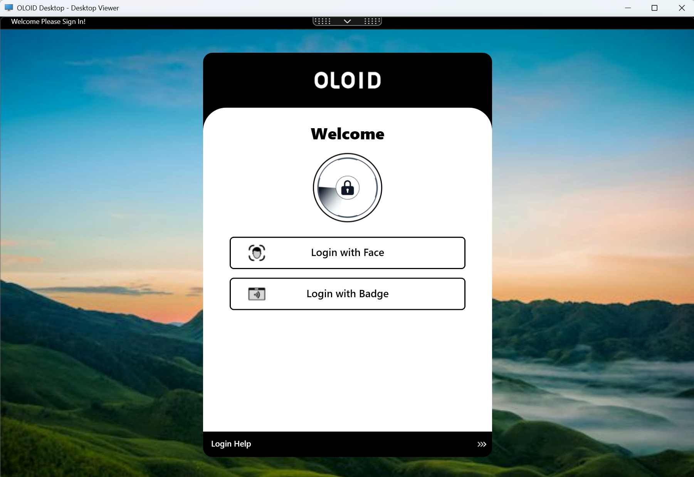

This confirms that Oloid Launcher is configured to start automatically when users connect to the virtual desktop.

---

##### Related Document

[Windows Login v2.0 - How to download Windows Login v2.0 installer file from Tenant Admin Portal](/platforms/windows/windows-login/v2/windows-login-v2-0-how-to-download-windows-login-v2-0-installer-file)

[Windows Login - How to Manually Pair the Supervisor App](/platforms/windows/supervisor-app/windows-login-how-to-manually-pair-the-supervisor-app)

[Windows Login - How to pair Supervisor App using auto-pair config file option](/platforms/windows/supervisor-app/windows-login-how-to-pair-supervisor-app-using-auto-pair-config-file)

[Windows Login - How to Generate and Download Auto-Pair config file for Windows Login in Tenant Admin Portal](/platform/tenant-admin-portal/windows-login-how-to-generate-and-download-auto-pair-config-file-for)

[How to log in to Supervisor App](/platforms/windows/supervisor-app/how-to-log-in-to-supervisor-app)

[Tenant Admin Portal - How to Add a Group to an Endpoint](/platform/tenant-admin-portal/tenant-admin-portal-how-to-add-a-group-to-an-endpoint)

[Tenant Admin Portal - How to Add an Endpoint to a Group](/platform/tenant-admin-portal/tenant-admin-portal-how-to-add-an-endpoint-to-a-group)

[How to Set Up the Card Reader for Oloid Launcher on VDI](/drafts/unassigned/intercom/how-to-setup-the-card-reader-for-vdi-oloid-launcher)
