{/* Source: Intercom article 13615607 - https://oloid.help/en/articles/13615607-windows-application-how-to-enroll-face-and-pin-credentials-through-windows-default-domain */}
{/* Generated by intercom_to_mintlify.py - re-running overwrites this file. */}

## Introduction

Enable Windows Default Domain: Allow the use of the default Windows domain for authentication. Users can enroll credentials to the default Windows domain.

## Prerequisite

- Email ID must be created for the user account.
- Default domain must be enabled for the application.
- Face + PIN credentials should be enabled for the user account.

## Steps to Enroll Face and PIN as credentials

Users can Enroll credentials:

1. [Before Authentication](#steps-to-enroll-credentials-using-default-domain-before-authentication)
2. [During Authentication](#steps-to-enroll-credentials-using-default-domain-during-authentication)

<Note>
  **Note:** Other credentials like **Badge** and **NFC** can also be enrolled using the process mentioned here, refer: [How to enroll credentials using Windows Login app](/platforms/windows/windows-login/windows-login-how-to-enroll-credentials)
</Note>

### Steps to Enroll Credentials using Default Domain before authentication

1. Launch the Windows User Application.
2. Click the **Three Arrows icon.**
3. Select **Enroll Credentials.**

   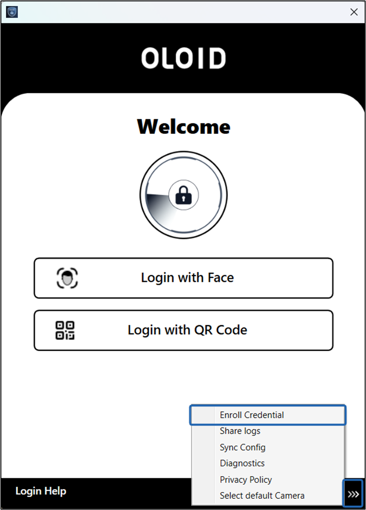

   The Verification screen is displayed.
4. Do the following:
   1. Enter Domain Name (Auto filled by default)
   2. Enter **Username**
   3. Enter **Password**
   4. Select the Enroll Windows Credentials to your account checkbox. (optional)
   5. Click **Continue**.

      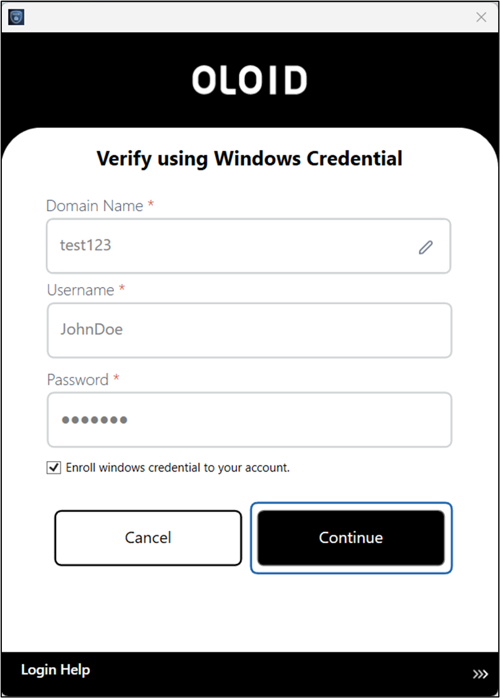

      The Credential Enrollment screen is displayed.

      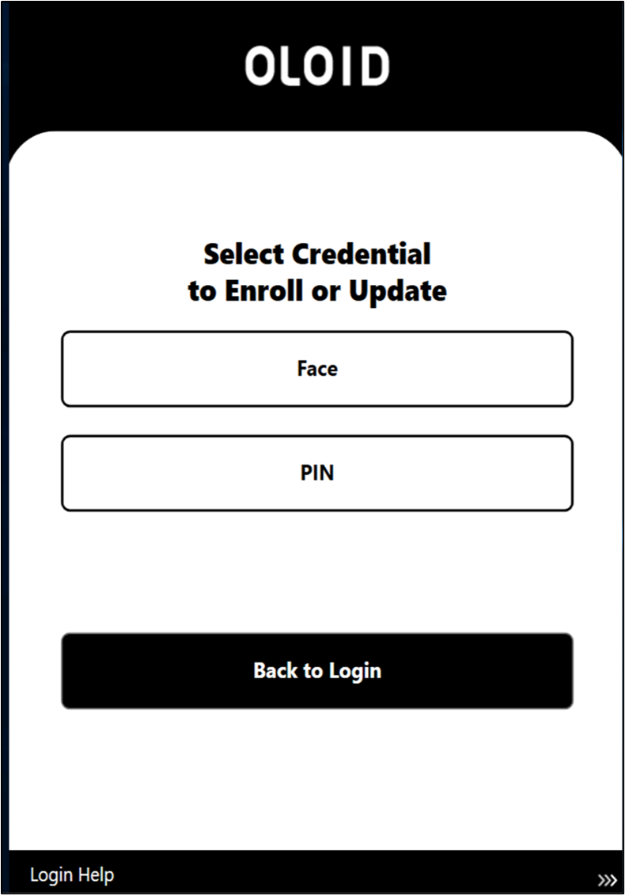

5. Select **Face** or **PIN**
   1. For Face
   2. For PIN

### Steps to Enroll Credentials using Default Domain during authentication

1. Launch the Windows User Application.
2. The Camera opens.
3. Position your face in front of the camera and tap the **Capture** button to enroll your face.
   Missing credentials screen is displayed
4. Click **Manage Credentials**.

   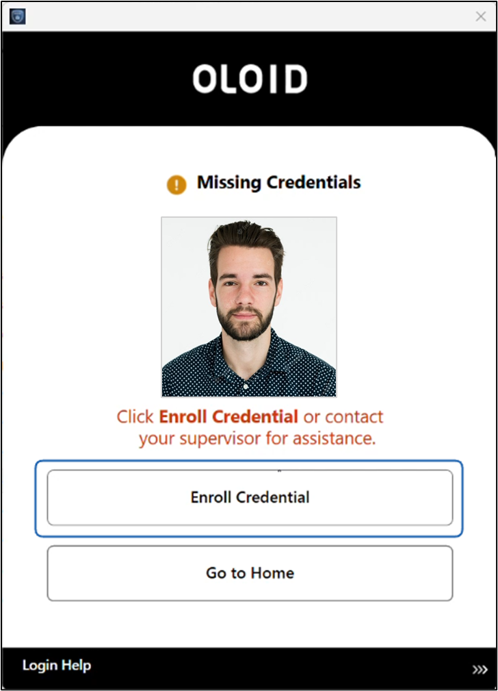

   The Verification screen is displayed.
5. Do the following:
   1. Enter Domain Name (Auto filled by default)
   2. Enter **Username**
   3. Enter **Password**
   4. Select the Enroll Windows Credentials to your account checkbox. (optional)
   5. Click **Continue**.

The Credential Enrollment screen is displayed.

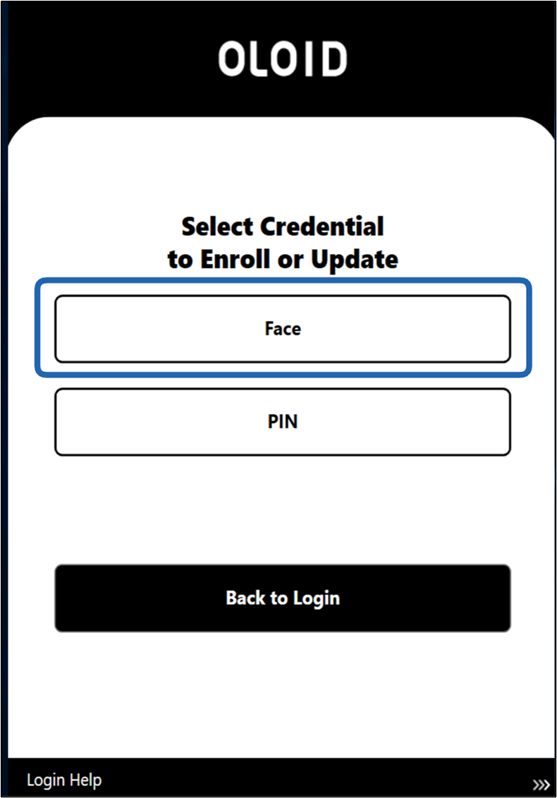

### Steps to Enroll Face

1. Click **Face**.
2. The Camera turns on.
3. Position your face in front of the camera and tap the **Capture** button to enroll your face.

   <Note>
     **Note:** If you do not tap the **Capture** button, the app automatically captures your face after a few seconds.
   </Note>

   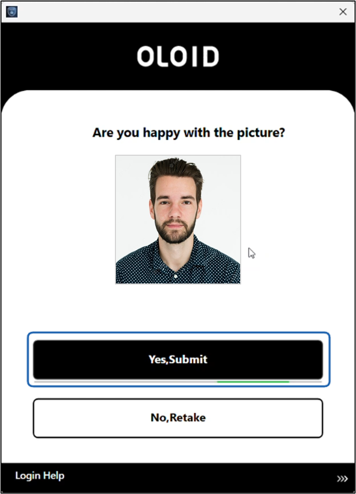

4. Do one of the following:
   1. Tap **Yes- Submit** to submit the image.
      The face is submitted successfully and is displayed on the details screen.
   2. Tap **No- Retake** to take the photo again.
      The camera turns on to retake the photo.

      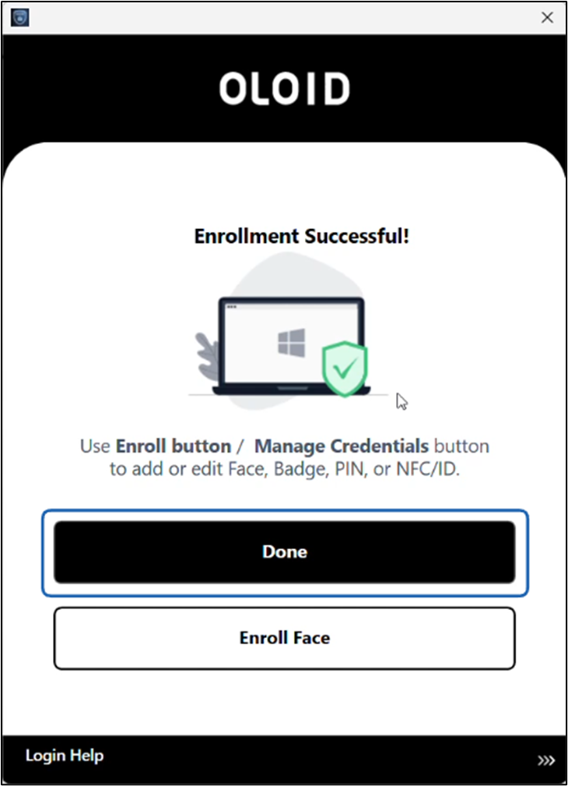

      Enrollment Successful screen is displayed.
5. Click **Done** to finish enrollment.
6. To Enroll other credentials click **Enroll Button / Manage Credentials**.

   <Note>
     **Note:** The Manage Credentials button may have different UI lables based on the credentials enabled for the user.
   </Note>

### Steps to Enroll PIN using Default Domain during authentication

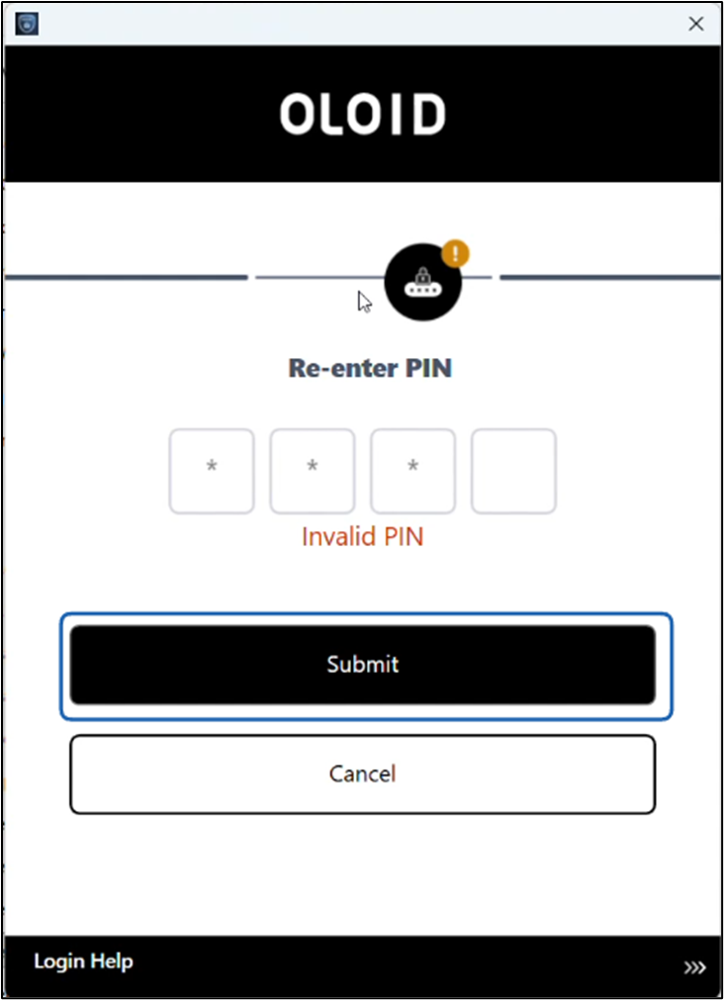

The Enter PIN page is displayed.

1. Enter **PIN** and click **Submit**.
   Invalid PIN message is displayed.

   <Note>
     **Note:** After maximum PIN attempts have been used. User is redirected to enroll PIN.
   </Note>

   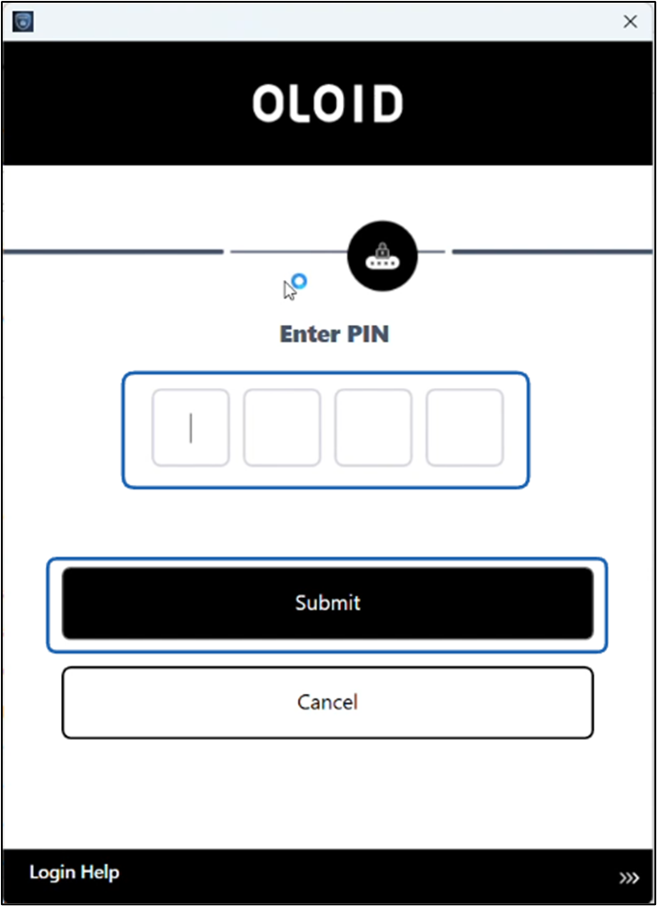

   Missing Credentials screen is displayed.
2. Click **Enroll Credential**.

   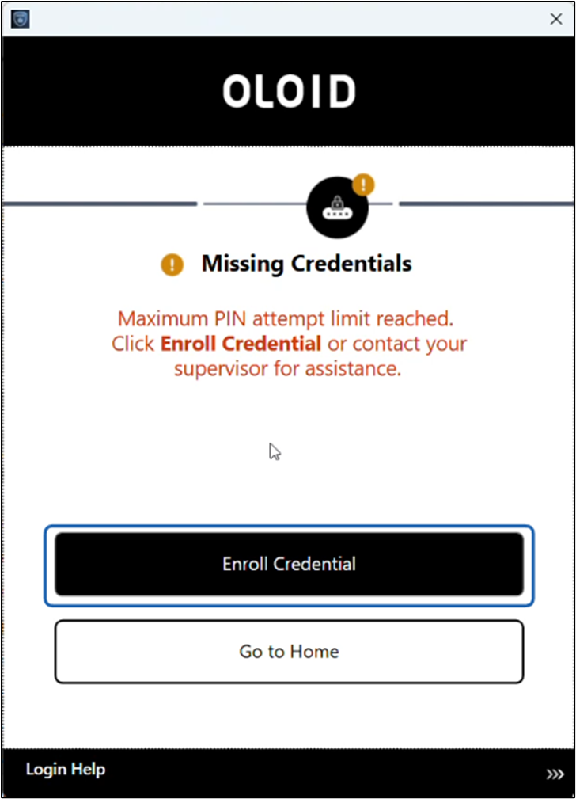

   The Verification screen is displayed.
3. Do the following:
   1. Enter Domain Name (Auto filled by default)
   2. Enter **Username**
   3. Enter **Password**
   4. Select the Enroll Windows Credentials to your account checkbox. (optional)
   5. Click **Continue**.

The Credential Enrollment screen is displayed.

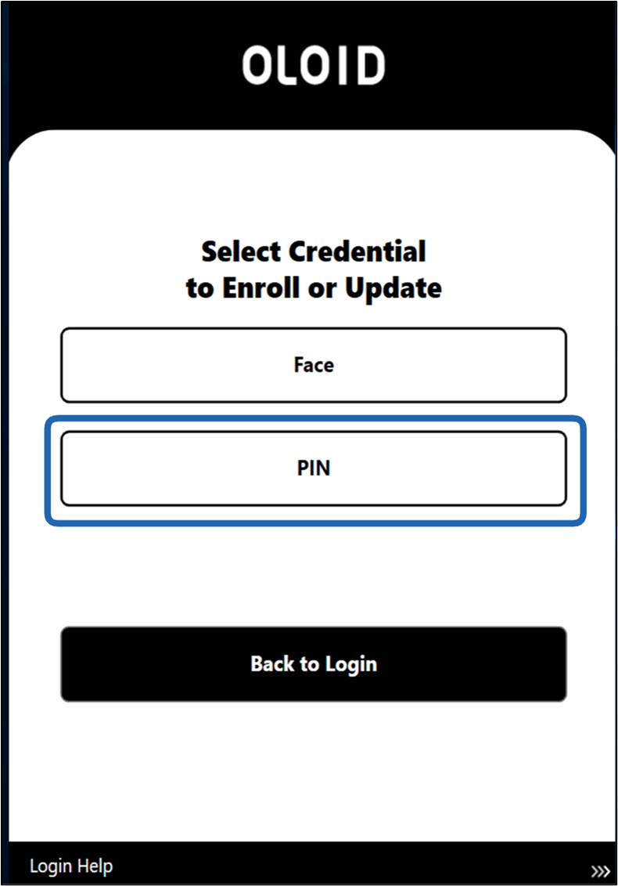

### To Enroll PIN

4. Click **PIN**.
   The Add/Update PIN screen is displayed.
   1. Enter **New PIN**
   2. Re-Enter **New PIN**
   3. Click **Submit**.

      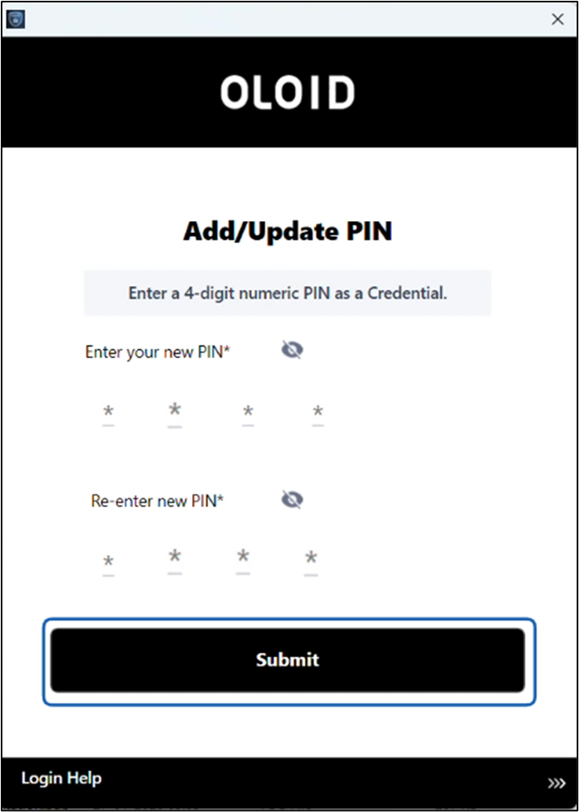

      Enrollment Successful screen is displayed.
5. Click **Done** to finish enrollment.

   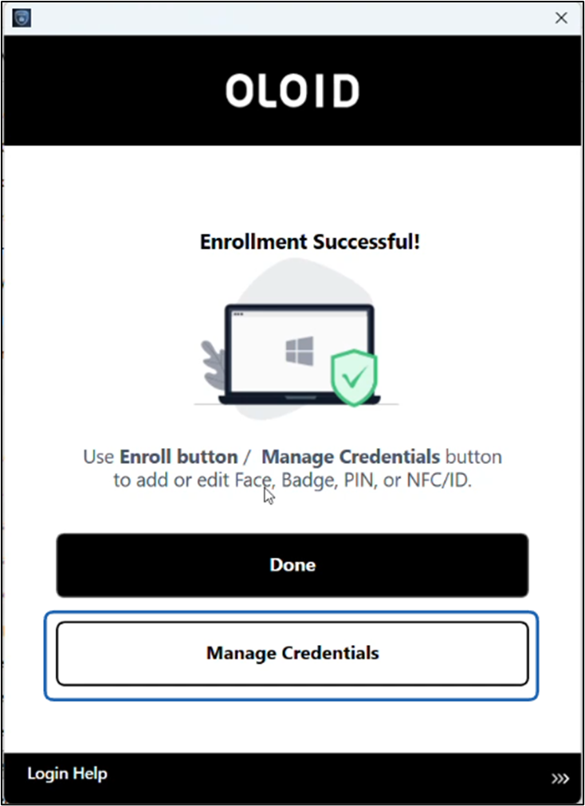

---

##### Related Documents

[How to enroll credentials using Windows Login app](/platforms/windows/windows-login/windows-login-how-to-enroll-credentials)
