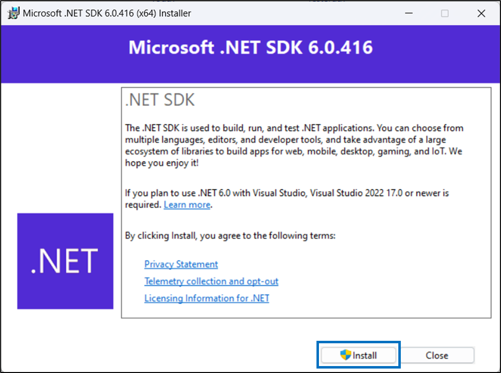
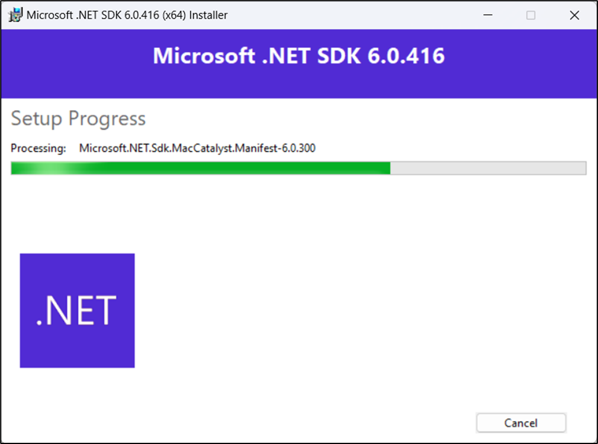
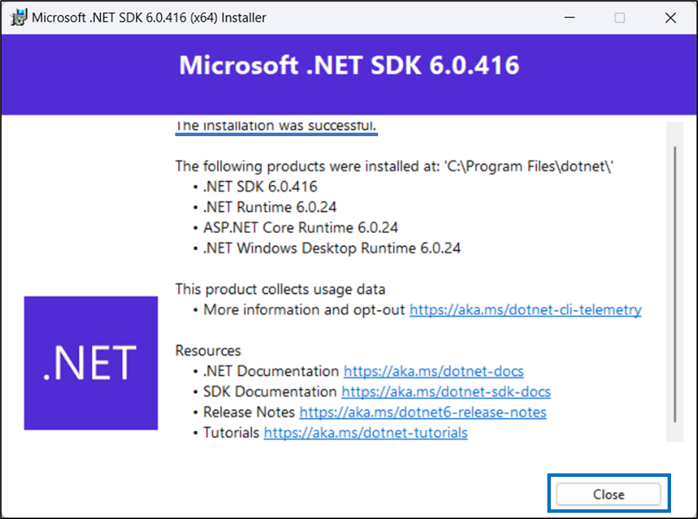
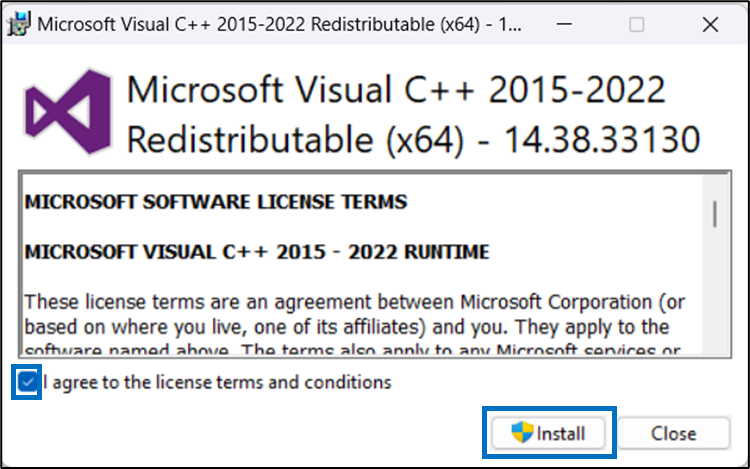
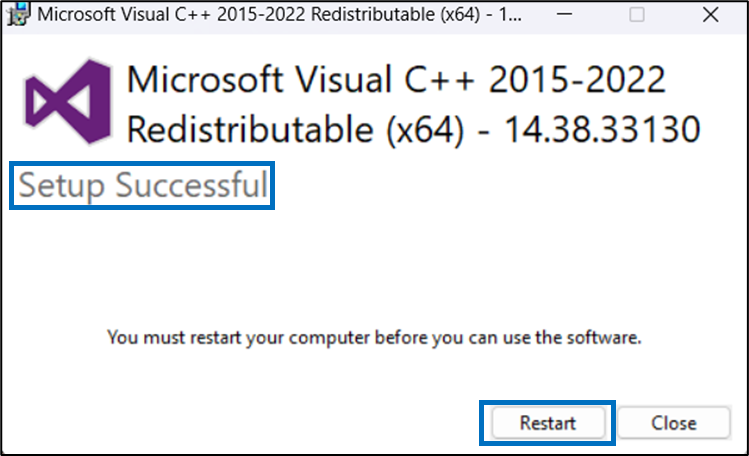
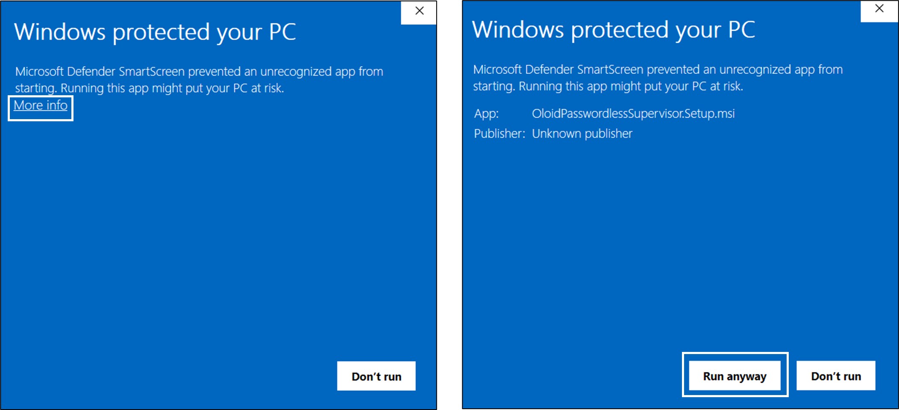
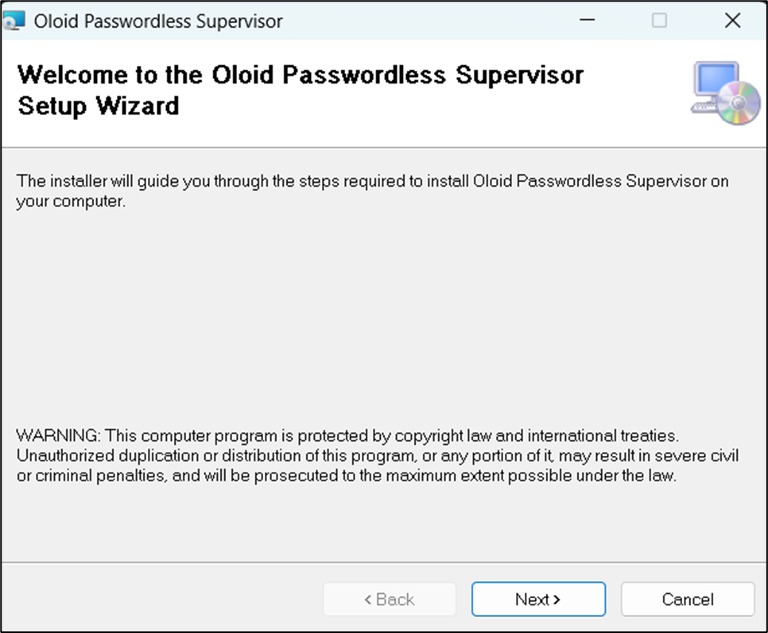
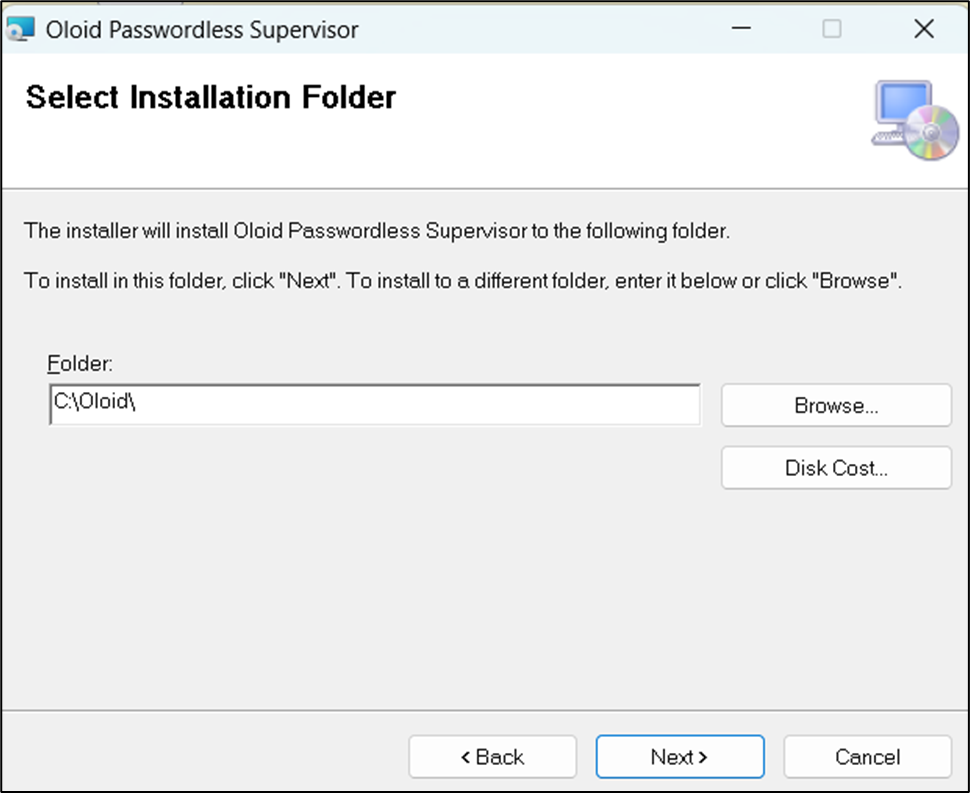

{/* Source: Intercom article 10430185 - https://oloid.help/en/articles/10430185-windows-authenticator-app-download */}
{/* Generated by intercom_to_mintlify.py - re-running overwrites this file. */}

Applications to be installed:

1. [.Net SDK](/platforms/windows/supervisor-app/windows-login-how-to-install-windows-authenticator-app)
2. [C++ Redistributable](/platforms/windows/supervisor-app/windows-login-how-to-install-windows-authenticator-app)
3. [Supervisor App](/platforms/windows/supervisor-app/windows-login-how-to-install-windows-authenticator-app)

All the above files are available for download in Oloid platform, refer to [How to download Supervisor App?](/platforms/windows/supervisor-app/how-to-download-supervisor-app)

**Installation Procedure**

## Steps to install .Net SDK

1. Download the **dotnet-sdk-6.0.416-win-x64** file on your system.
2. Click **dotnet-sdk-6.0.416-win-x64** file to open.
3. Click **Install**.

   

   The installation process begins.

   

4. On successful installation, click **Close**.

   

## Steps to install Microsoft Visual C++ Redistributable

1. Download the **VC_redist.x64** file on your system.
2. Click **VC_redist.x64** file to open.
3. Select the license agreement checkbox and click **Install**.
   The installation begins.

   

4. On successful installation, restart your system.

   

   <Note>
     **Note:** You must install the Windows installer file before restarting your system.
   </Note>

## Steps to install Supervisor App file

1. Download **OloidPasswordlessSupervisor.Setup.msi** file on your system.
2. Select **OloidPasswordlessSupervisor.Setup.msi** file.
3. Select **More info**, then click **Run anyway**.

   

4. On the **Oloid Passwordless Supervisor** Setup wizard, click **Next**.

   

5. Use the default path to install the application and click **Next**.

   

6. Click **Next** to confirm the installation.

   

7. Click **Close** after the installation is complete.

   

   You can find the app icon on your desktop. For first-time installation, it is recommended to restart your system.
