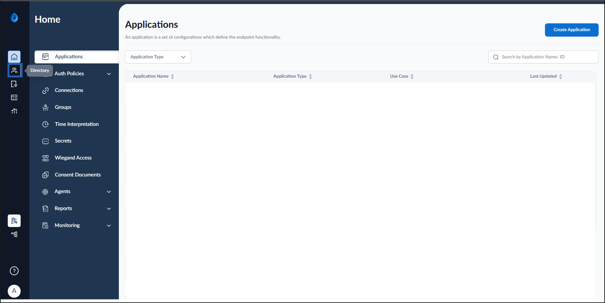
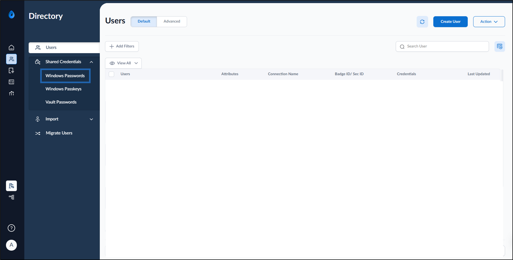
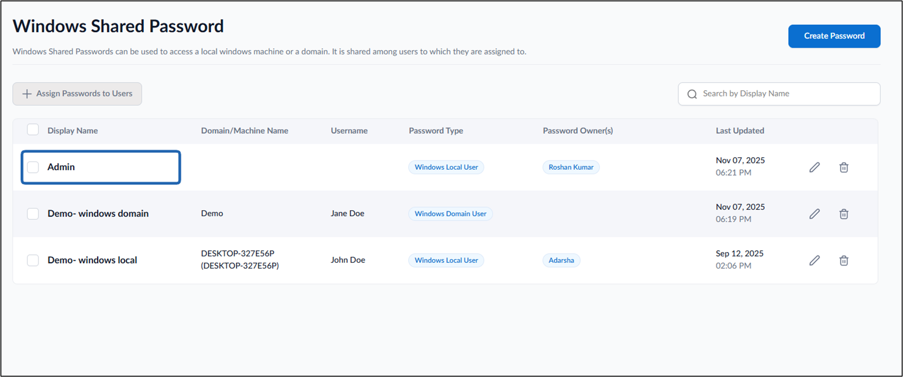
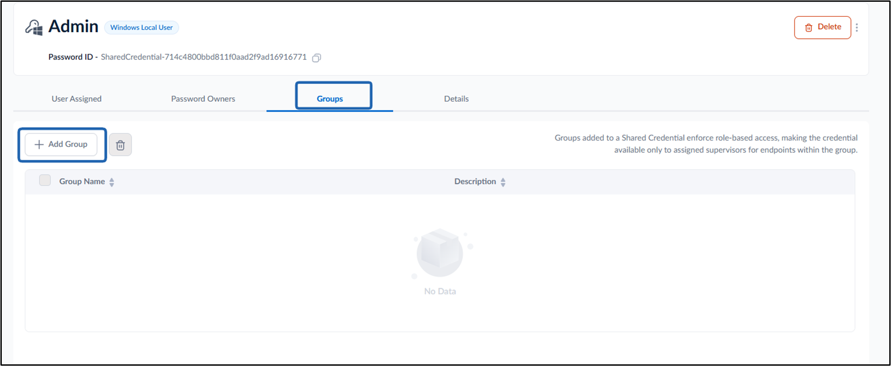
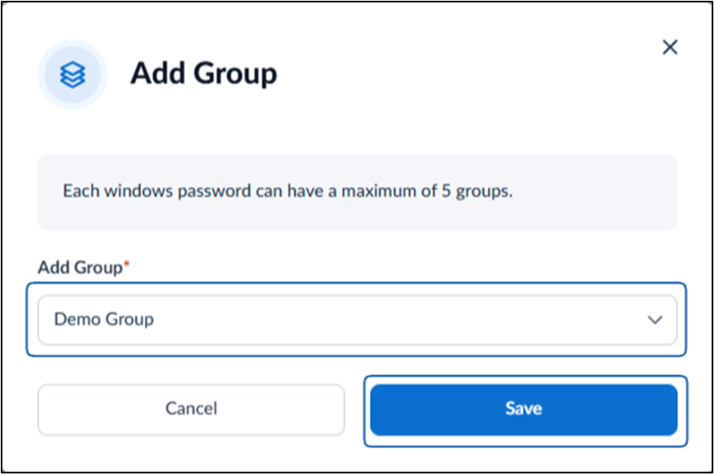
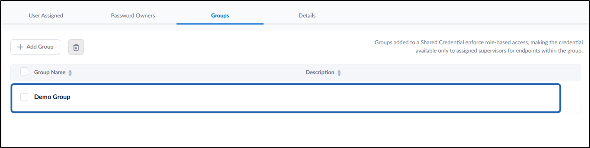

{/* Source: Intercom article 13348724 - https://oloid.help/en/articles/13348724-windows-login-how-to-add-a-group-to-windows-shared-passwords */}
{/* Generated by intercom_to_mintlify.py - re-running overwrites this file. */}

## Introduction

The Add Group to Windows shared password features allows the admin to add a Group to shared windows password, this allows all users within the group to use the windows shared password.

## Prerequisites

You must have a Tenant Admin account.

## Steps to Add Group to Windows Shared Password

1. Log in to the **Tenant Admin Portal**.
2. On the home page of the portal, click **Directory** on the left menu panel.

   

   The **Users** page is displayed.
3. Click **Shared Credentials > Windows Password** on the left menu panel.

   

   The **Windows Shared Password** page is displayed.

   

4. Select Shared Password from the list.
   The Windows shared password details page is displayed.

   

5. Select **Groups** tab > click **+ Add Group**
   The Add Group pop-up box is displayed.

   

6. Select Group from dropdown list.
7. Click **Save**.
   The Group is successfully added to the shared windows passwords

The group users will be able to login using the shared password.
