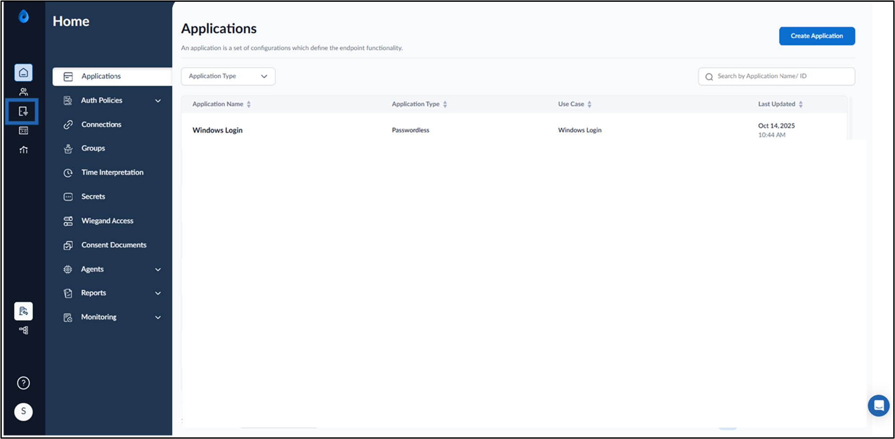
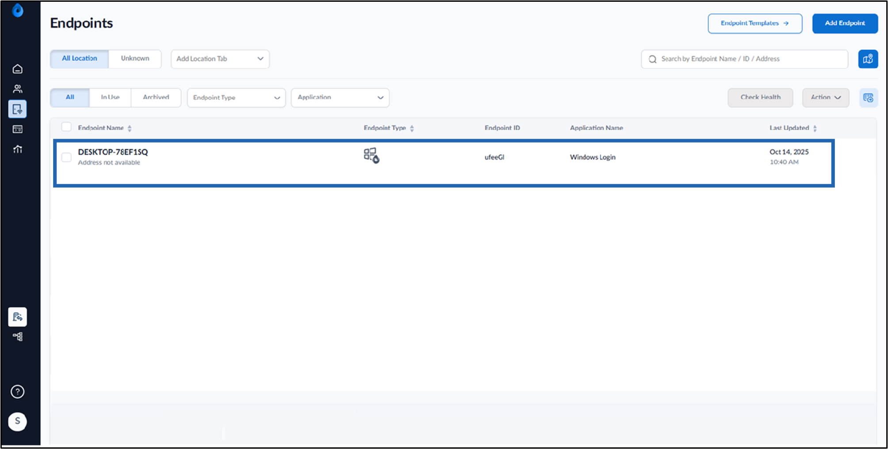
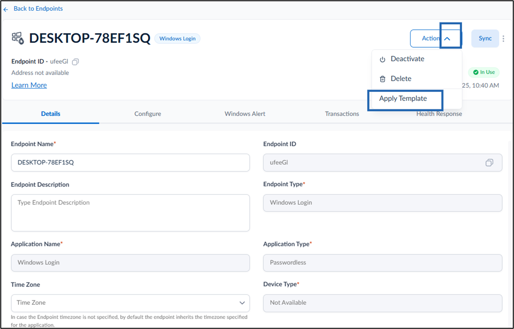
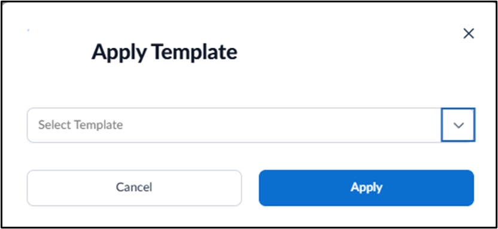
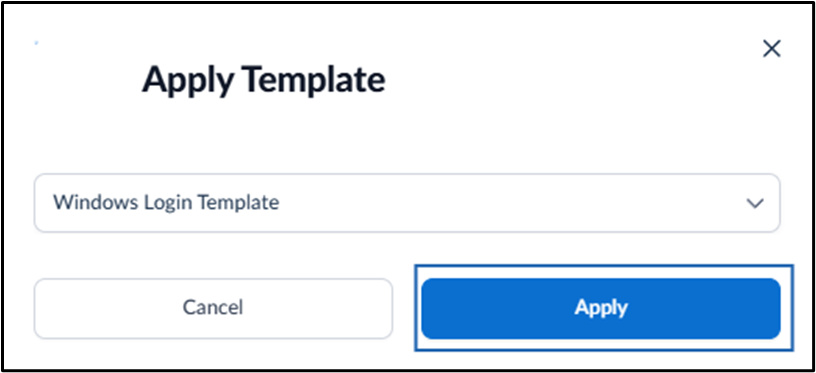
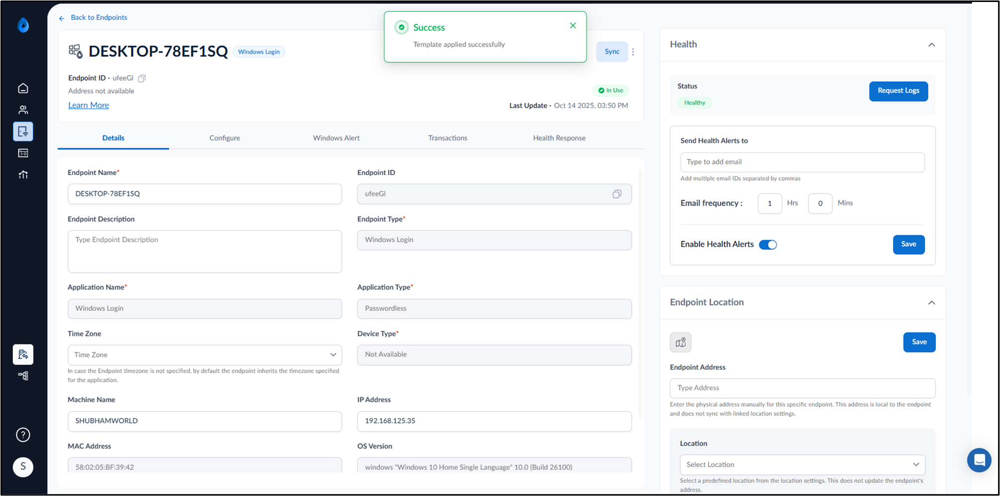

{/* Source: Intercom article 12576484 - https://oloid.help/en/articles/12576484-windows-login-how-to-apply-endpoint-template-after-auto-pair-for-windows-login-in-the-tenant-admin-portal */}
{/* Generated by intercom_to_mintlify.py - re-running overwrites this file. */}

## Introduction

This document describes how to apply an endpoint template in the Tenant Admin Portal after completing auto-pair configuration on the Windows Login application. Applying an endpoint template ensures that predefined settings are consistently and automatically applied across all applicable device(s).

## Prerequisites

- You must have a Tenant Admin Account.
- The Windows Login App must be auto paired. To auto-pair refer [How to Install and Auto-Pair Windows Authenticator App through MDM](/platforms/windows/windows-login/windows-login-how-to-install-and-auto-pair-windows-authenticator-app)
- An Endpoint template must be created. To create refer [How to create an endpoint template](/platform/tenant-admin-portal/tenant-admin-portal-how-to-create-endpoint-template).

## Steps to apply Endpoint Template after Auto-pair

1. Log in to the **Tenant Admin Portal**.
2. On the Home page of the portal, click **Endpoints** from the left panel menu.

   

   The endpoint screen is displayed.
3. Select the **Endpoint**.

   

   The **Endpoint Detail** page is displayed.
4. Select **Action** dropdown > **Apply Template**.

   

   The **Apply Template** pop-up box is displayed.
5. Choose the applicable template from the **Select Template** dropdown.

   

   The selected template is displayed in the **Select Template** field.
6. Click **Apply**.

   

   The template is successfully applied to the endpoint.

   
