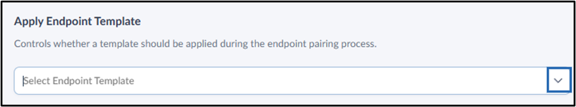
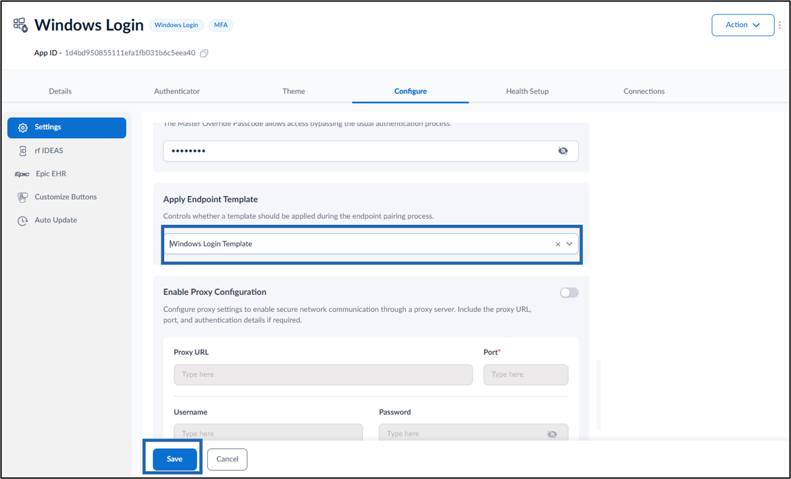
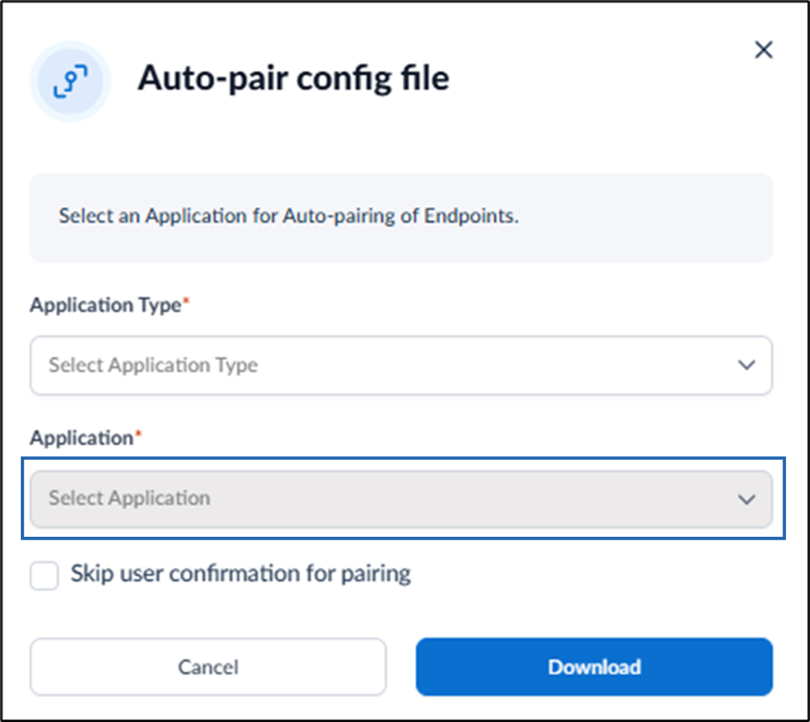

{/* Source: Intercom article 12586251 - https://oloid.help/en/articles/12586251-windows-login-how-to-apply-endpoint-template-during-auto-pair-process-for-windows-login */}
{/* Generated by intercom_to_mintlify.py - re-running overwrites this file. */}

## Introduction

This document explains how to apply an Endpoint Template during the auto-pair configuration process for the Windows Login application. Applying the Endpoint Template ensures that predefined settings are automatically assigned to devices as part of the pairing process.

## Prerequisites

- You have **Tenant Admin** access to the **Tenant Admin Portal**.
- An **Endpoint Template** has been created. To create refer [How to create and configure Windows Login Endpoint Template](/platforms/windows/windows-login/windows-login-how-to-create-and-configure-windows-login-endpoint).
- Windows Login Application must be created in the Tenant Admin Portal. For more information, refer: [How to create and configure Windows Login application in the Tenant Admin Portal](/platforms/windows/windows-login/windows-login-how-to-create-and-configure-windows-login-application)

## Steps at a Glance

1. Create the Windows Login application in the Tenant Admin Portal and select the desired endpoint template in the **“Apply Endpoint Template”** field.
2. Generate and download the auto-pair config file; ensure it is mapped to the application with the predefined template.
3. Install the Windows Login app on the endpoint using the auto-pair option. The endpoint template is applied automatically.

## Steps to Apply Endpoint Template During Auto-Pair Process

### Step 1: Create and Configure the Windows Login Application

1. Log in to the **Tenant Admin Portal**.
2. Create the windows login application. Refer [How to create and configure Windows Login application](/platforms/windows/windows-login/windows-login-how-to-create-and-configure-windows-login-application).

   <Note>
     **Note:** If window login application is already created then select the desired application from the application list.
   </Note>

3. In the **Settings section**, select the applicable template from **[Apply Endpoint Template](/platforms/windows/windows-login/windows-login-how-to-create-and-configure-windows-login-application)** dropdown.

   <Note>
     **Note:** Endpoint template must be added to apply template when using auto-pair option to pair the endpoint.
   </Note>

   

   The endpoint template is selected.
4. Select **Save**.

   

   The Endpoint Template is successfully applied to the selected Windows Login Application.

### **Step 2:** Generate and Download the Auto-config File

1. Generate and download the auto-pair config file. Refer [How to generate Auto-Pair config file for Windows Login in Tenant Admin Portal](/platform/tenant-admin-portal/windows-login-how-to-generate-and-download-auto-pair-config-file-for)

   <Note>
     **Note:** Ensure that the **Application Mapping** includes the application where the **Endpoint Template** is specified. This mapping ensures that auto-pair applies the correct endpoint configuration.
   </Note>

   

### Step 3: Pair the Windows Login Application with Auto-pair config file.

1. On the target Windows device, launch the **Oloid Windows Login Installer**.
2. Pair the endpoint using auto-pair option. To auto-pair refer [How to pair Supervisor App using auto-config option](/platforms/windows/supervisor-app/windows-login-how-to-pair-supervisor-app-using-auto-pair-config-file)

Once the auto-pair process completes, the **Endpoint Template** settings is automatically applied to the paired endpoint.
