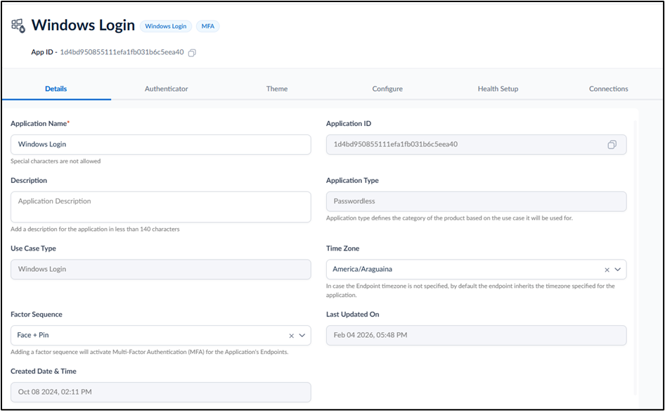
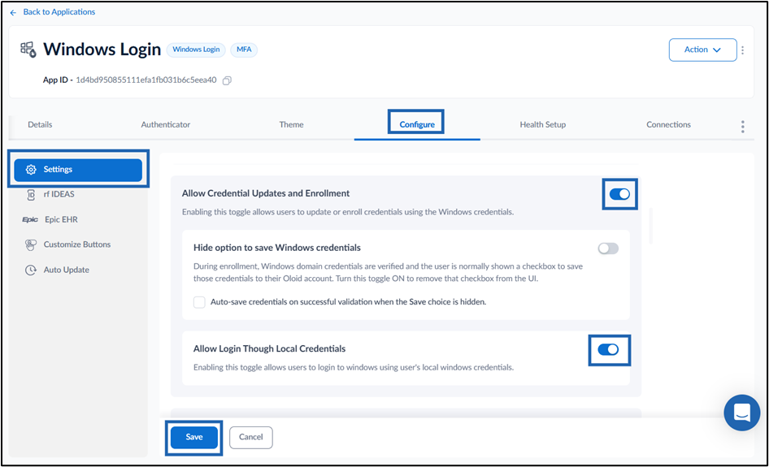
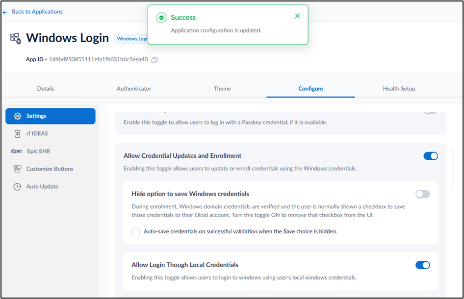

{/* Source: Intercom article 13615407 - https://oloid.help/en/articles/13615407-windows-login-how-to-configure-allow-login-through-local-credentials */}
{/* Generated by intercom_to_mintlify.py - re-running overwrites this file. */}

## Introduction

This document explains how to configure **Allow Login Through Local Credentials** for the Windows Login application in the Tenant Admin Portal. Enabling this setting allows users to sign in to Windows using their local Windows credentials.

## Prerequisites

- Tenant Admin access to the **Tenant Admin Portal.**
- You must create and configure Windows Login application. For More, refer to [How to create and configure Windows Login application in the Tenant Admin Portal](/platforms/windows/windows-login/windows-login-how-to-create-and-configure-windows-login-application)

## Steps to Configure Allow Login Through Local Credentials

1. Log in to the Tenant Admin Portal.
2. Go to **Applications** > select **Windows Login** application.

   

   The **Details** page is displayed.

   

3. Go to **Configure** > **Settings** tab.
4. Enable **Allow Credential Updates and Enrollment** toggle to allow users to update or enroll credentials using Windows credentials.
   - Enable **Allow Login Through Local Credentials** to allow users to log in to Windows using their local Windows credentials.

Click **Save**.

The **Allow Login Through Local Credentials** setting is enabled successfully.

### Sync Configuration to Apply Changes

You must sync the configuration in the **Supervisor App** to apply the changes. For detailed steps, see [How to sync configuration in Supervisor App](/platforms/windows/supervisor-app/how-to-sync-configuration-in-supervisor-app).
