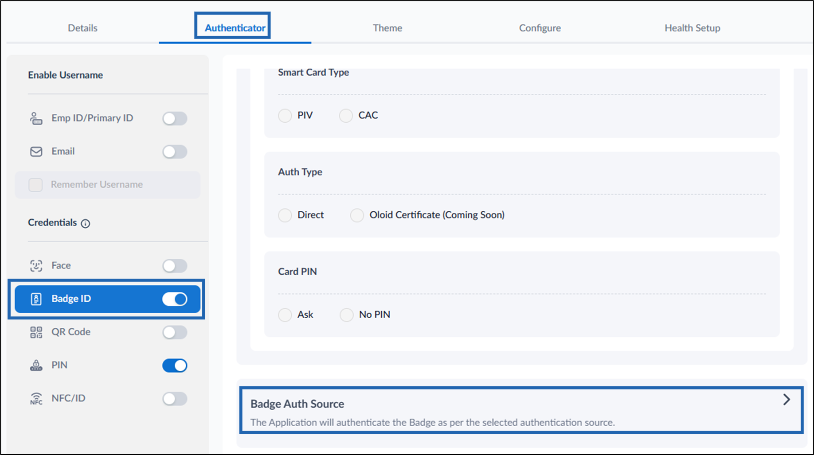
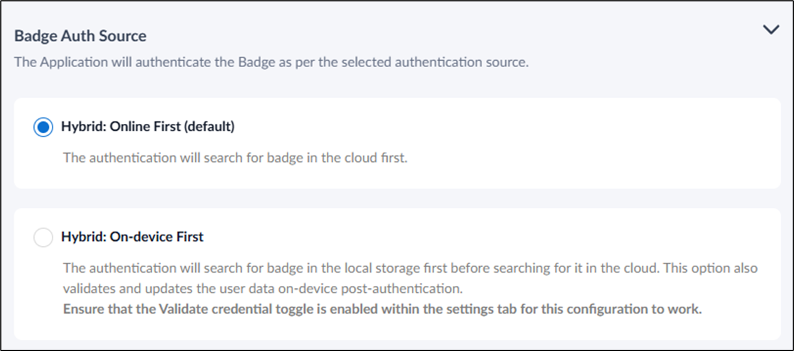

{/* Source: Intercom article 11274692 - https://oloid.help/en/articles/11274692-windows-login-how-to-configure-badge-auth-source */}
{/* Generated by intercom_to_mintlify.py - re-running overwrites this file. */}

**Introduction:**

Set up the *Badge Auth Source* in the Tenant Admin Portal to define whether badge credentials for the Windows Login application are verified using local storage or cloud-based data.

**Pre-requisite:**

In the Tenant Admin Portal, you must enable Validate Windows Credential option in the Windows Login Application. For further details, refer [How to enable Validate Windows Credential in Windows Login application](/platforms/windows/windows-login/windows-login-how-to-enable-validate-windows-credential-for-windows)

Steps to enable Badge Auth Source:

1. Log in to the **Tenant Admin Portal**.
2. On the **Applications** page, click on the Windows application to edit.

   

   The application page is displayed.

   

3. Go to **Authenticator** > **Badge ID** > **Badge Auth Source**.

   

   The Badge Auth Source section is displayed.

   

4. Select the following:
   - **Hybrid: Online First (default)-** This option allows the Windows Login application to check the cloud first for badge authentication. You must use this option when real-time cloud data is preferred.
   - **Hybrid: On-device First-** This option allows the Windows Login application to check the local device storage first. If the badge is not found, it then checks the cloud. This option also updates and validates user data on the device after authentication.
5. Click **Save** to save the configuration successfully.

   <Note>
     **Note:** In **Windows Authenticator** app, you must sync the configuration to Validate Windows Credential to work properly. For more details, refer [How to sync configuration in Supervisor App](/platforms/windows/supervisor-app/how-to-sync-configuration-in-supervisor-app)
   </Note>
