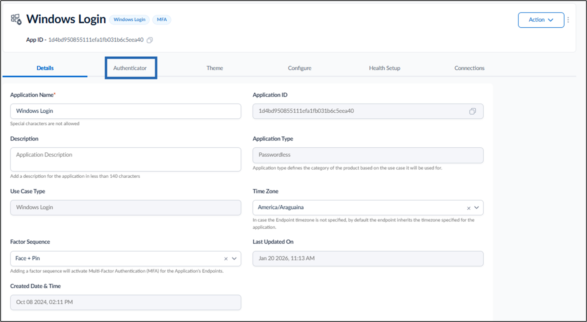
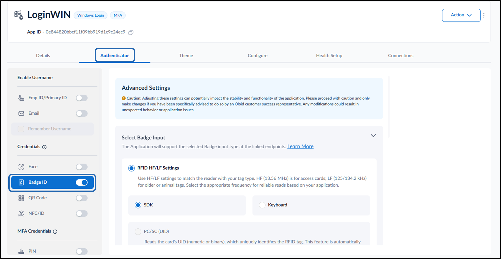
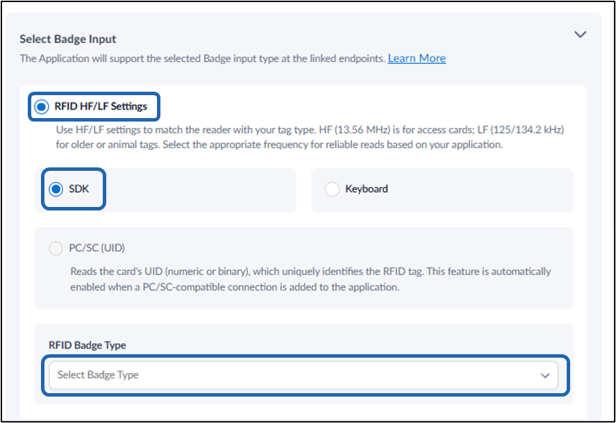
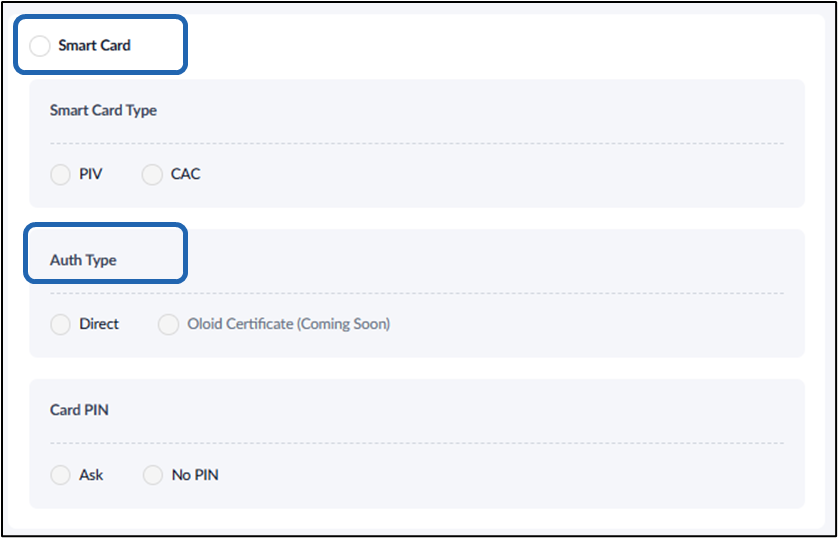
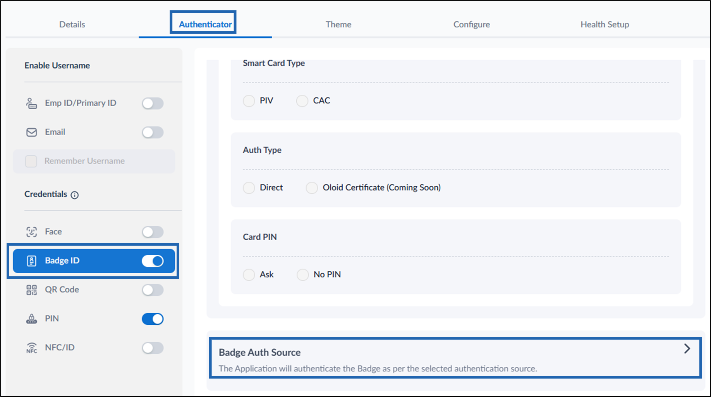
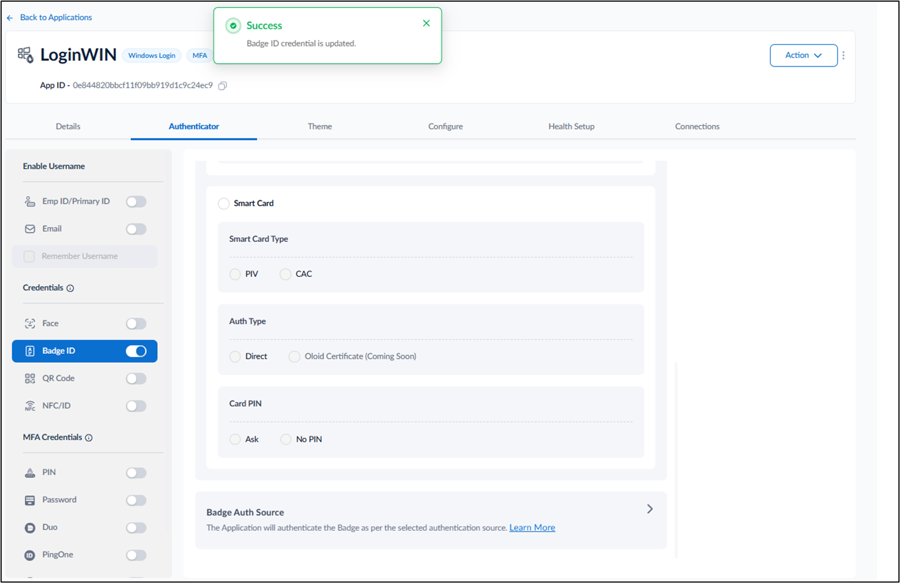

{/* Source: Intercom article 14698260 - https://oloid.help/en/articles/14698260-windows-login-how-to-configure-badge-id-for-windows-login */}
{/* Generated by intercom_to_mintlify.py - re-running overwrites this file. */}

## Introduction

This document explains how to enable and configure **Badge ID authentication** for the Windows Login application in the Tenant Admin Portal. Badge-based authentication allows users to log in by scanning an RFID badge, providing a fast and efficient alternative to traditional credentials.

## Prerequisite

- You must have Tenant Admin Access.
- Windows Login Application must be created in the Tenant Admin Portal. For more information, refer: [How to create and configure Windows Login application in the Tenant Admin Portal](/platforms/windows/windows-login/windows-login-how-to-create-and-configure-windows-login-application)

## Steps to Configure Badge ID credential

1. Log in to the **Tenant Admin Portal**.
2. On the **Applications** page, click the **Windows Login** application.

   

   The application page is displayed.
3. Go to the **Authenticato**r tab.

   

   The Authenticator page is displayed.
4. Turn on the **Badge ID** toggle.

   

   The **Badge ID** is enabled successfully.
5. Do the following:
   1. [Configure **Select Badge Input**](#configure-select-badge-input)
   2. [Configure **Select Badge Auth Source**](#configure-select-badge-auth-source)
6. Click **Save** after configuration changes to apply the configuration.
   The Badge Input source is successfully configured.

### Configure **Select Badge Input**

1. Select Badge Input
2. RFID HF/LF Settings
   Use this option to configure RFID badge input based on frequency type.
   - **HF (13.56 MHz)**: Typically used for access cards and modern RFID systems.
   - **LF (125 / 134.2 kHz)**: Used for older or legacy animal tag systems.

     <Note>
       **Note:** Select the appropriate frequency based on the badge type used in your environment.
     </Note>

     

3. Input Method
   Choose how badge data is received by the application:
   • **SDK**
   Enables badge reading through the integrated SDK. This is the recommended option for most deployments where native reader integration is used.
   • **Keyboard**
   Uses keyboard emulation mode where badge data is input as keystrokes (commonly used in wedge-based readers).
4. PC/SC (UID)
   Reads the card’s **UID (Unique Identifier)** in numeric or binary format.
   This uniquely identifies the RFID tag.
   - This option is **automatically enabled** when a PC/SC-compatible connection is added to the application.
5. RFID Badge Type
   - Admins must select the specific RFID badge type from the dropdown.
   - This ensures compatibility between the reader and badge format.

     

6. Smart Card
   Enable this option when using smart cards for authentication.
   Smart Card Type
   - **PIV (Personal Identity Verification)**
   - **CAC (Common Access Card)**
     Select the appropriate card type based on organizational requirements.
7. Authentication Type
   Defines how authentication is performed using the smart card:
   • **Direct**
   Authentication is handled directly through the configured system.
   • **Oloid Certificate (Coming Soon)**
   Future capability for certificate-based authentication managed via Oloid.

### Configure **Select Badge Auth Source**

This setting allows admins to define the source used to validate badge authentication. It determines how the scanned badge data is verified.

Refer to: **[How to configure Badge Auth Source in Windows Login Application](/platforms/windows/windows-login/windows-login-how-to-configure-badge-auth-source)**

The Badge ID is successfully configured.

---

##### Sync Configuration

<Note>
  **Note:** In **Windows Authenticator** app, you must sync the configuration to Validate Windows Credential to work properly. For more details, refer [How to sync configuration in Supervisor App](/platforms/windows/supervisor-app/how-to-sync-configuration-in-supervisor-app)
</Note>
