{/* Source: Intercom article 10616183 - https://oloid.help/en/articles/10616183-windows-login-how-to-configure-badge-out-option */}
{/* Generated by intercom_to_mintlify.py - re-running overwrites this file. */}

## Introduction

The **Enable Badge Out** option allows users to securely lock or sign out of a Windows system using a badge.

<Note>
  **Note:** This feature is available only in the healthcare and presence detection build (V1).
</Note>

## Prerequisites

- The Windows Login application must be created and configured. For more, refer to [Windows Login - How to create and configure Windows Login application in the Tenant Admin Portal](/platforms/windows/windows-login/windows-login-how-to-create-and-configure-windows-login-application)
- **Badge ID** must be enabled in the **Authenticator** tab of the application. For more, refer to [Windows Login - How to Configure Badge ID for Windows Login](/platforms/windows/windows-login/windows-login-how-to-configure-badge-id-for-windows-login)
- The Badge Reader must be connected to the Windows system.

## Steps to Configure Badge Out Option

1. Log in to the **Tenant Admin Portal.**
2. On the home page of the portal, click **Applications** on the left menu panel
3. Select the preferred **Windows Login** application that configured in the Supervisor App (Windows Authenticator App).

   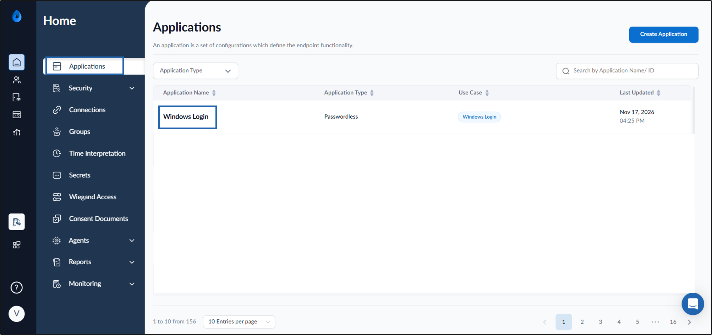

   The application details page is displayed.

   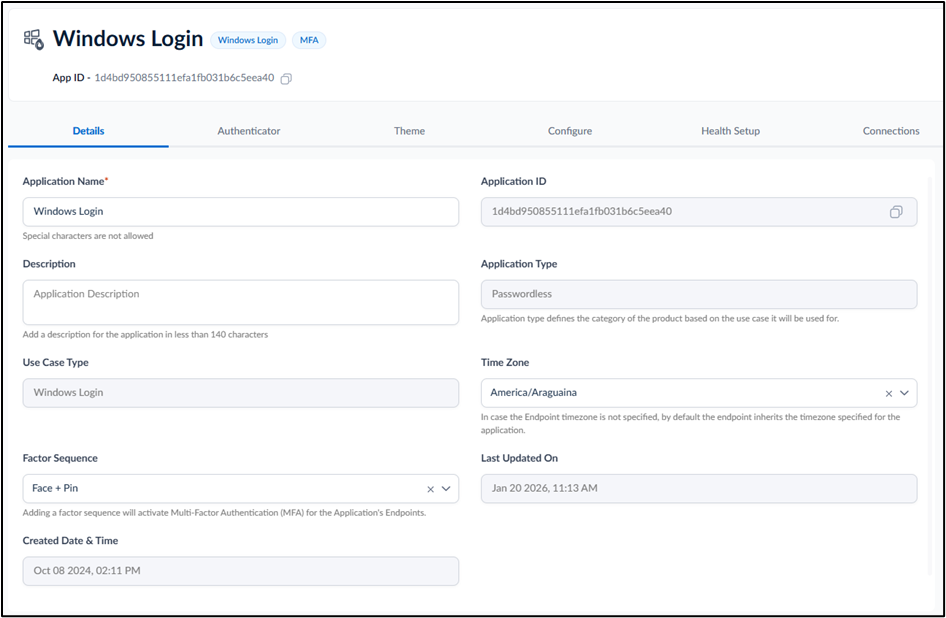

4. Click **Configure** tab> **Settings**.

   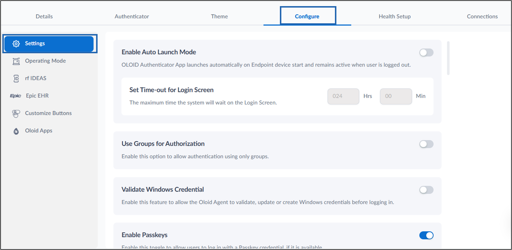

   The Settings page is displayed.
5. Enable the **Enable Badge Out** toggle.
   This option allows user to lock or sign out of a Windows system using a badge, either by **tapping the badge on the reader** or by **removing the badge from the reader**.
6. Select one of the following options:
   - **Tap to Badge Out:** The user badges out by tapping the badge on the reader.
   - **Remove Badge to Badge Out:** The user logs in by placing the badge on the reader and badges out by removing it.

     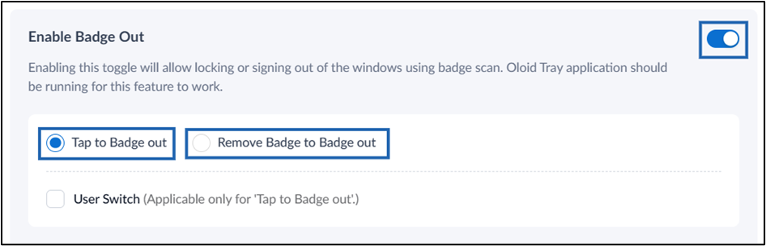

7. Click **Save.**

   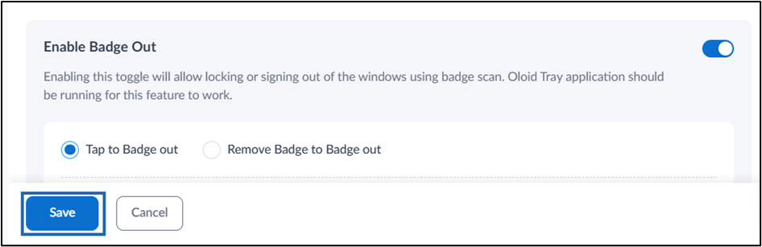

   The Badge Out option is enabled successfully.

### Configure Windows Badge Out Options

The **Windows Badge Out Options** section allows you to choose what happens to the Windows session and Epic EHR when the user badges out.

1. Select one of the following options based on your requirement:
   1. **Lock Windows PC:**
      In the **Windows Badge Out Options** section, turn on the **Lock Windows PC** toggle.
   2. Select or clear the checkbox below the toggle:
      - **Checked:** The next user sees a confirmation prompt before the previous user is logged out. If they continue, the previous user is signed out of both Windows and OLOID, all open apps are closed, and any unsaved work may be lost.
      - **Unchecked:** The previous user is not signed out. The next user may be able to see the previous user's open browser tabs and files.
   3. Click **Save**.

      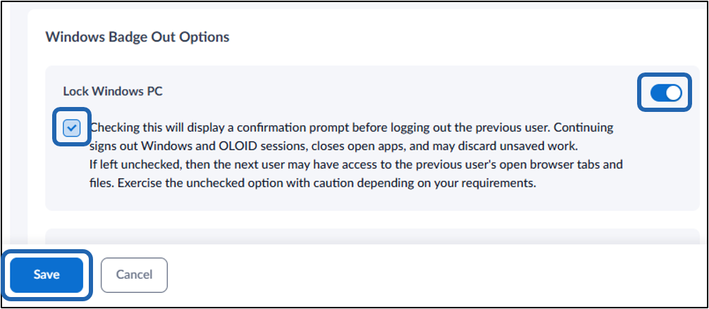

      - **Tap to Badge Out + Lock Windows PC**
        When the user taps the badge on the reader, Windows is locked.

        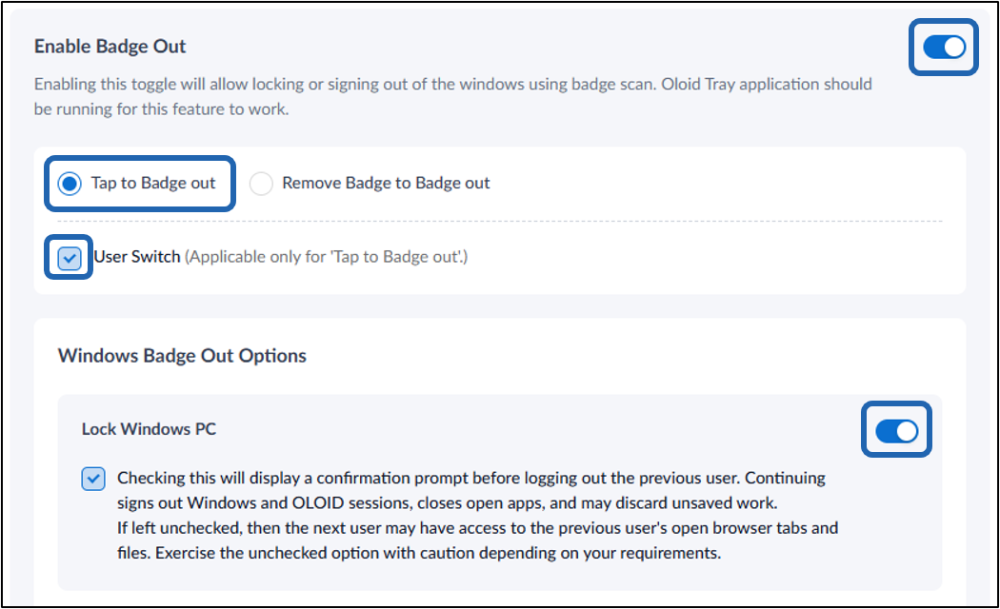

<Note>
  **Note:** To enable **User Switch**, select **Tap to Badge out** and **Lock Windows PC**, then select **User Switch**. When this is configured, if one user is already signed in to the Windows system and another user taps their badge on the reader, the first user’s session is locked automatically, and the second user is signed in successfully to use the system.
</Note>

- **Remove Badge to Badge Out + Lock Windows PC**
  When the user removes the badge from the reader, Windows is locked.

  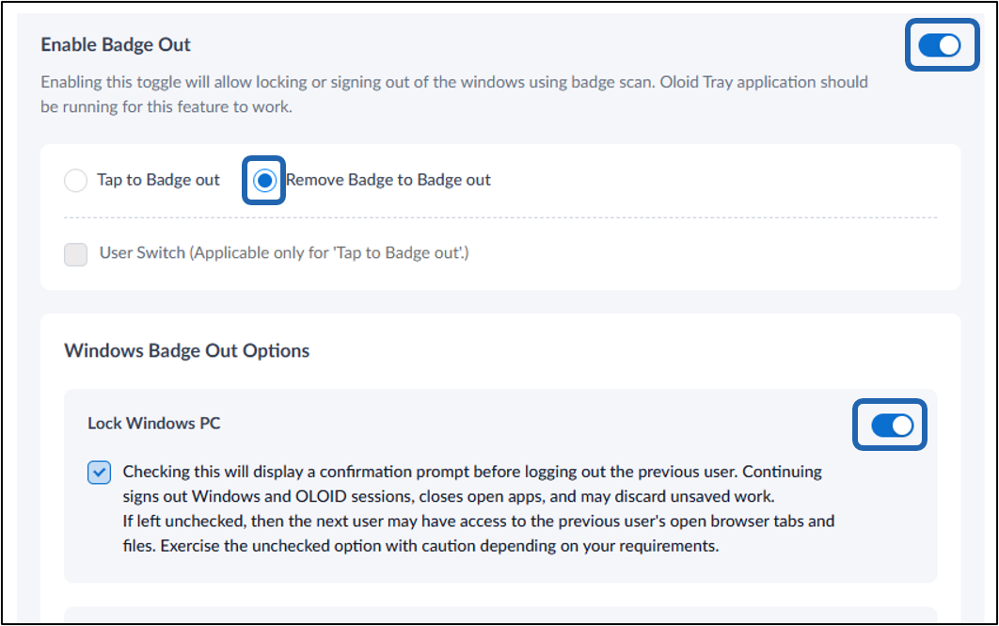

4. **Sign-out of Windows**
   Select this option to **sign the user out of Windows** when a user badges out. All open applications are closed, and the user session ends.
   - **Tap to Badge Out + Sign out of Windows**
     When the user taps the badge on the reader, all running applications are closed and the user is signed out of Windows.

     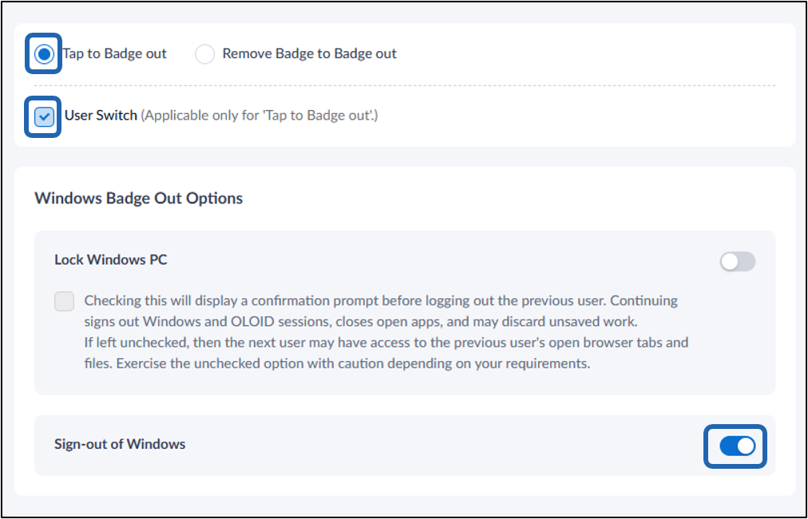

   - **Remove Badge to Badge Out + Sign out of Windows**
     When the user removes the badge from the reader, all running applications are closed and the user is signed out of Windows.

     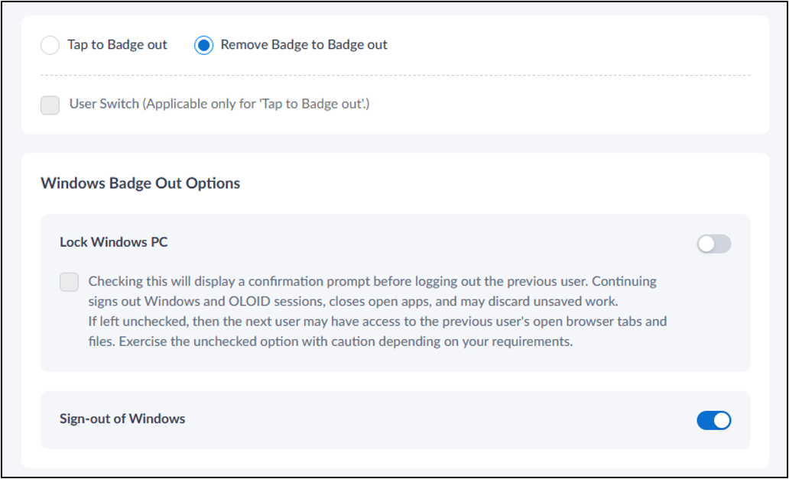

5. Select the required Epic logout behavior:
   - **Secure Epic EHR**
     - Secures the Epic session without fully signing out
     - Allows quick reauthentication
   - **Sign-out of Epic EHR**
     - Completely logs the user out of Epic
     - Ends all active sessions

       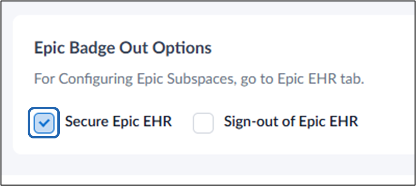

2. Click **Save** to apply the configuration.

   

   The **Badge Out** configuration is saved successfully.

   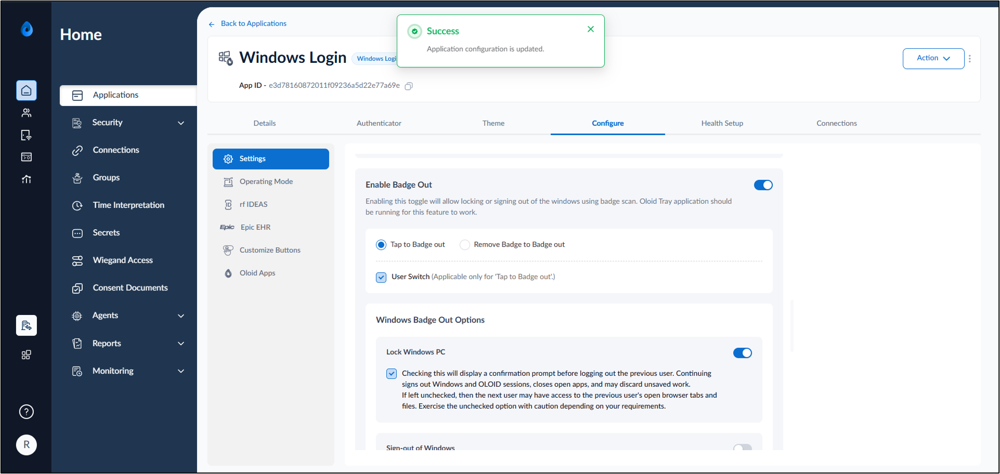

---

#### Sync Configuration to Apply Changes

The configuration must be synced in the **Supervisor App** to apply the changes. For more, refer to [How to sync configuration in Supervisor App](/platforms/windows/supervisor-app/how-to-sync-configuration-in-supervisor-app)

<Note>
  **Note:** This step applies only to V1. After syncing the configuration, close the Supervisor App.
</Note>

---

##### **Keywords**

|Enable Badge Out |Badge Out configuration |Windows Badge Out option | How to Configure Epic Badge Out options|
