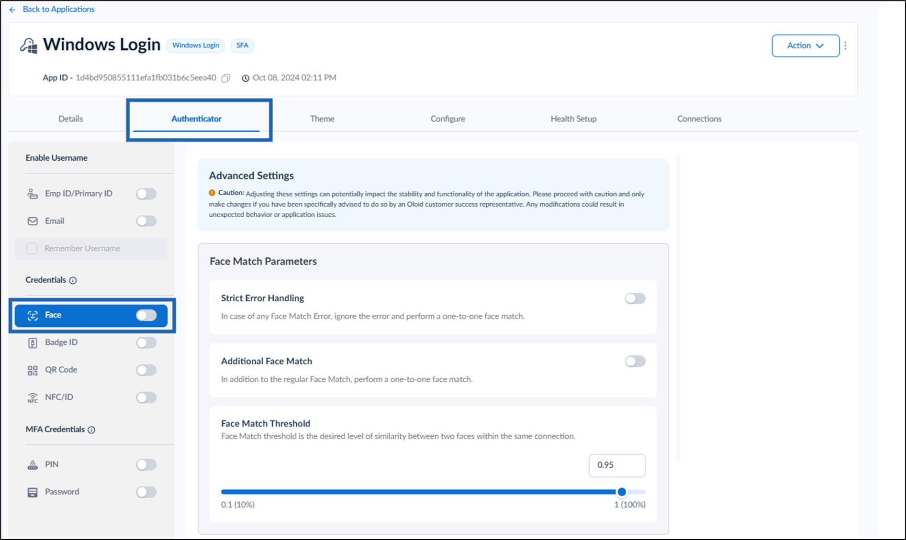
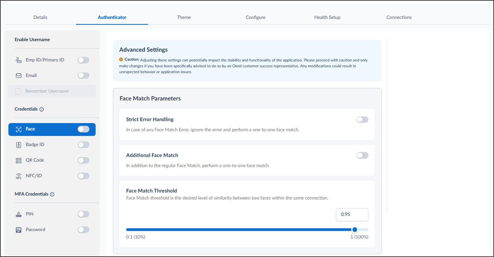
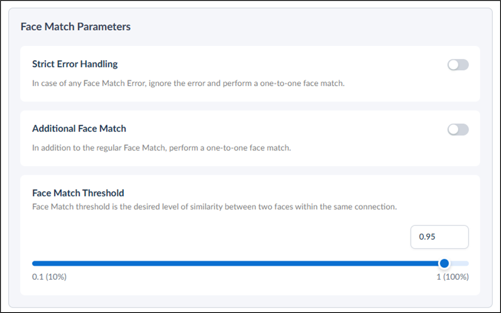
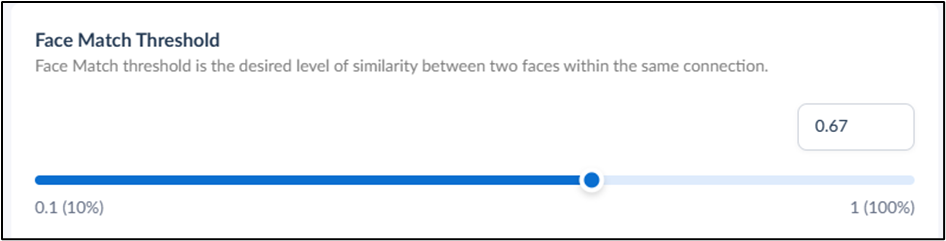
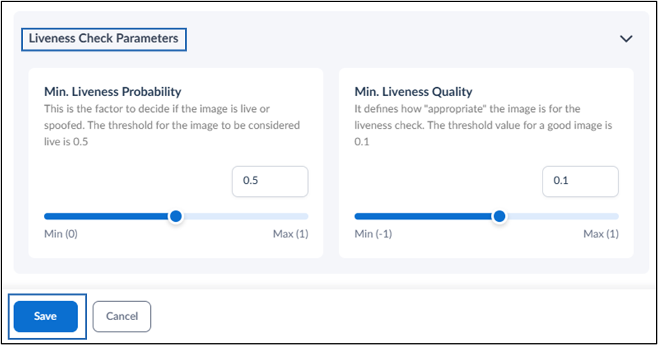
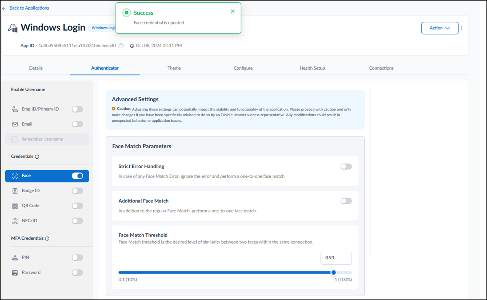

{/* Source: Intercom article 11476775 - https://oloid.help/en/articles/11476775-windows-login-how-to-configure-face-credential-for-windows-login-in-the-tenant-admin-portal */}
{/* Generated by intercom_to_mintlify.py - re-running overwrites this file. */}

## Introduction

In the Tenant Admin Portal, enabling and configuring face credentials for the Windows Login application allows users to log in using facial recognition with advanced configuration options for enhanced security.

## Prerequisite

- You must have access to the Tenant Admin Portal.
- You must create and configure Windows Login application in the Tenant Admin portal. For more, refer to[How to create and configure Windows Login application in the Tenant Admin Portal](/platforms/windows/windows-login/windows-login-how-to-create-and-configure-windows-login-application)

## Steps to Configure face credential

1. Log in to the **Tenant Admin Portal**.
2. On the **Applications** page, select the Windows Login application.

   

   The application page is displayed.

   

3. Go to **Authenticator** tab > **Face** menu > Turn on **Face** toggle to use face as credential.

   

   The **Advanced Settings** page is displayed.

   

4. Adjust the following setting for **Face Match Parameters**.

   <Note>
     **Note:** You must consult your Oloid representative before making any changes to the **Face Match Parameters** to ensure optimal authentication performance.
   </Note>

   

   1. Turn on **Strict Error Handing** toggle to skip the error and perform a direct one-to-one face match.

      

   2. Turn on **Additional Face Match** toggle to perform a one-to-one face match alongside the standard face matching process.

      

   3. Adjust the **Face Match Threshold** slider or enter a value directly into the input box to set the face match threshold value.

      

5. Adjust the following setting for **Liveness check parameters**.

   <Note>
     **Note:** You must consult your Oloid representative before making any changes to the **Liveness check parameters** value to ensure optimal authentication performance.
   </Note>

   - **Min Liveness Probability**: Specifies the threshold used to determine whether an image is live or spoofed.
     - Default value: 0.5
     - Images with a liveness probability of **0.5 or higher** are classified as live.
   - **Min Liveness Quality**: Specifies the minimum quality required for an image to be suitable for a liveness check.
     - Default: 0.1
     - Images with a quality score of **0.1 or higher** are considered suitable for liveness verification.

Click **Save**.

The Face recognition for Windows Login application is configured successfully.

##### Sync Configuration to Apply Changes

After enabling, you must sync the configuration in the **Supervisor App** to apply the changes. For detailed steps, see [How to sync configuration in Supervisor App](/platforms/windows/supervisor-app/how-to-sync-configuration-in-supervisor-app).
