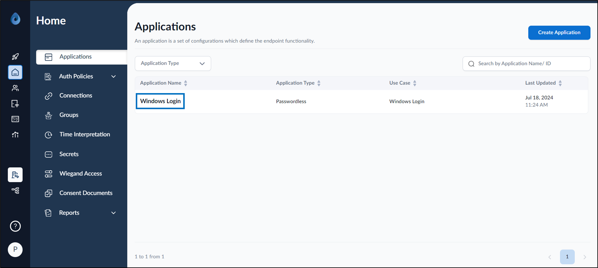
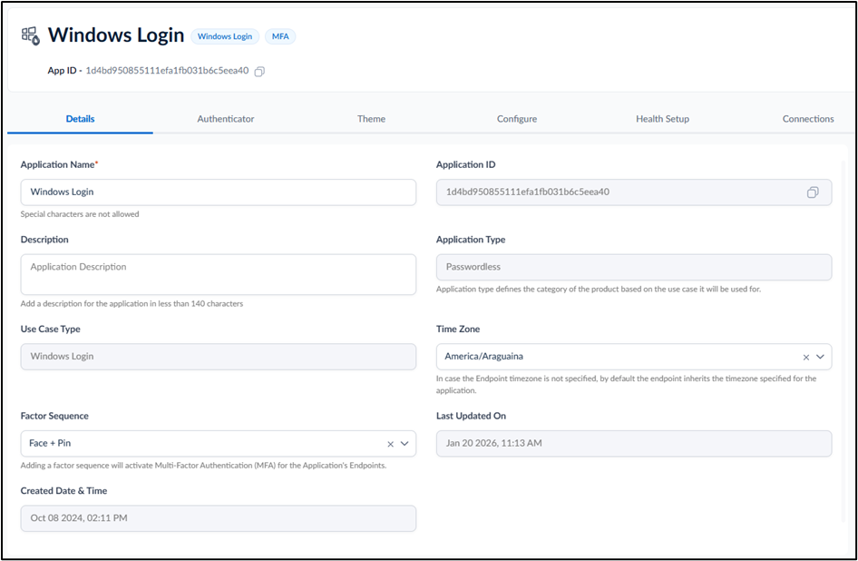
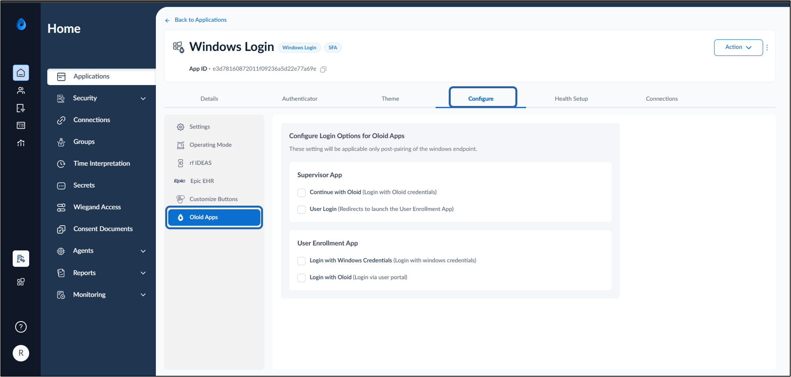
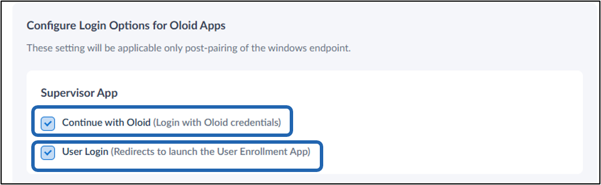
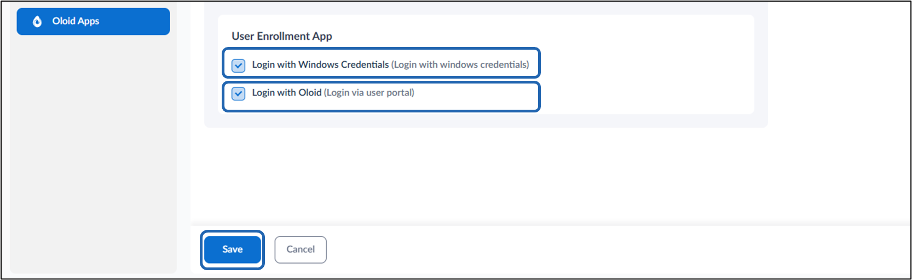
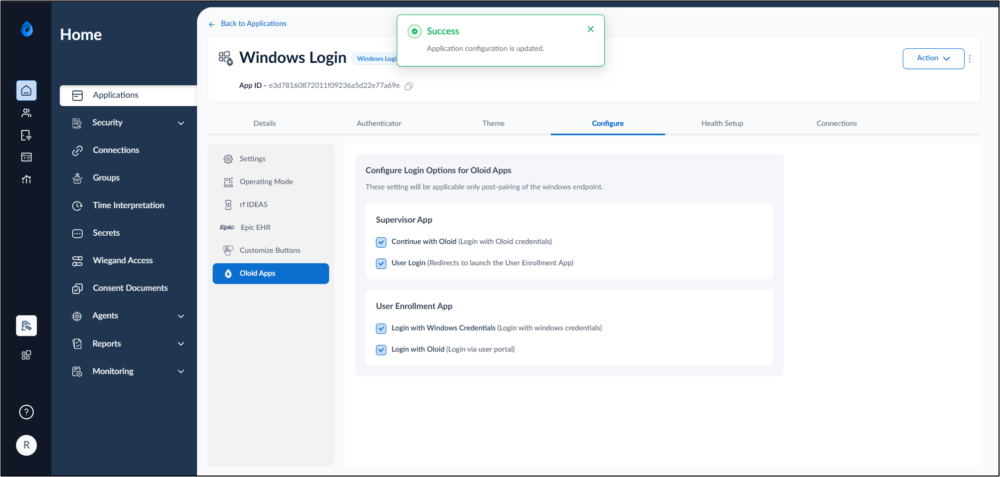

{/* Source: Intercom article 15390851 - https://oloid.help/en/articles/15390851-windows-login-how-to-configure-login-options-for-oloid-apps */}
{/* Generated by intercom_to_mintlify.py - re-running overwrites this file. */}

## Introduction

This document explains how to configure login options for Oloid Apps in the Tenant Admin Portal. These settings determine how users access the Supervisor App and User Enrollment App after the Windows endpoint is paired.

## Prerequisites

- You must have access to the **Tenant Admin Portal**.
- Windows Login Application must be created in the Tenant Admin Portal. For more information, refer: [How to create and configure Windows Login application in the Tenant Admin Portal](/platforms/windows/windows-login/windows-login-how-to-create-and-configure-windows-login-application)
- Ensure the endpoint is paired with the Windows Login application. refer [Windows Login - How to Manually Pair the Supervisor App](/platforms/windows/supervisor-app/windows-login-how-to-manually-pair-the-supervisor-app)

## Steps to configure the login options

1. Log in to the **Tenant Admin Portal.**
   Home page is displayed.
2. Select the application that is configured in the Supervisor App (Windows Login App).

   

   The application details page is displayed.

   

3. Click **Configure** tab> **Oloid Apps**.

   

   The **Oloid Apps** page is displayed.
4. Do the following:
   1. In the **Supervisor App** section:
      - Select **Continue with Oloid** to enable login using Oloid credentials.
      - Select **User Login (Redirects to launch the User Enrollment App)** to allow users to be redirected to the User Enrollment App during login.

        

   2. In the User Enrollment App section:
      - Select **Login with Windows Credentials** to allow users to log in using their Windows credentials.
      - Select **Login with Oloid** to allow users to log in via the Oloid user portal.

        <Note>
          **Note:** Choose one or both login options based on your authentication requirements.
        </Note>

5. Click **Save**.

   

   The Login options are configured.

   
