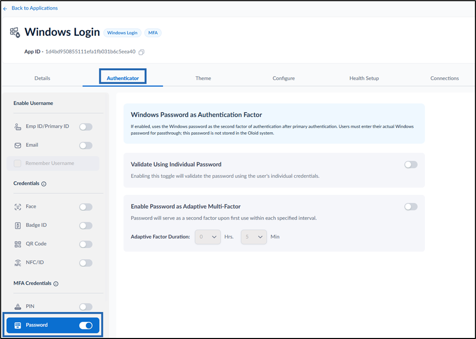
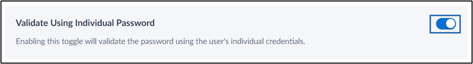
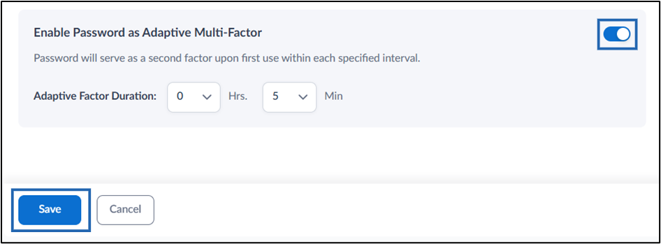
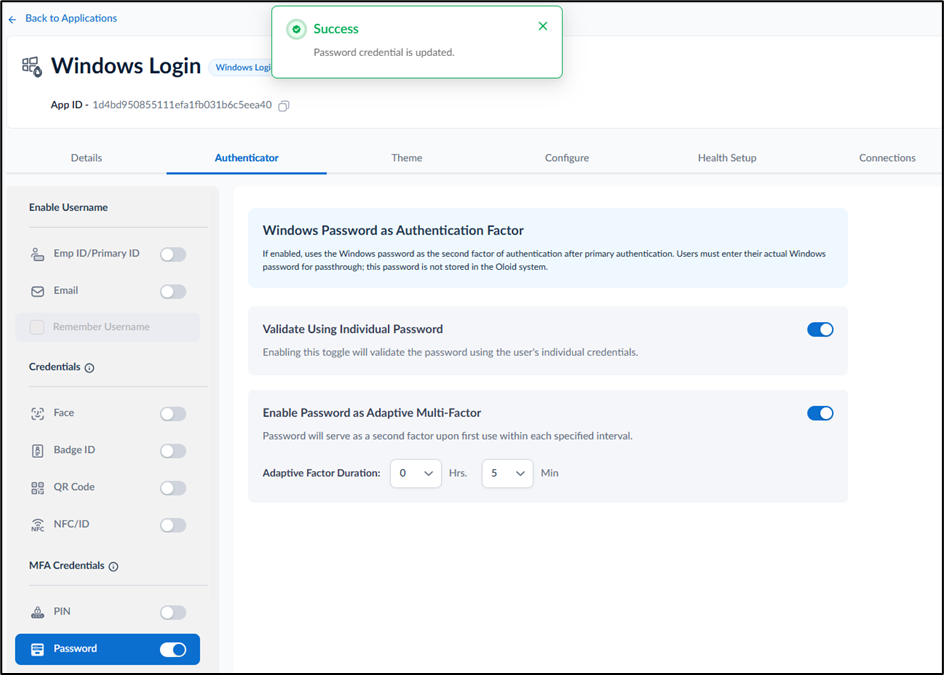

{/* Source: Intercom article 11507597 - https://oloid.help/en/articles/11507597-windows-login-how-to-configure-password-credential-for-windows-login */}
{/* Generated by intercom_to_mintlify.py - re-running overwrites this file. */}

## Introduction

The Password credential feature in the Tenant Admin Portal allows admin to enable Password-based multi-factor authentication (MFA) for the Windows Login application. Once enabled, users can log in to Windows endpoints by entering a secure Password.

## Prerequisite

- A individual password must be created for the user. For more, refer to [How to create Password for Windows Login](/platform/tenant-admin-portal/how-to-create-password-for-windows-login)
- After making any updates in the Windows Login application, make sure to sync the configuration in the Supervisor App to apply the changes. For more, refer to [How to sync configuration in Supervisor App](/platforms/windows/supervisor-app/how-to-sync-configuration-in-supervisor-app)

## Steps to configure Password credential

1. Log in to the **Tenant Admin Portal**.
2. On the **Applications** page, select the Windows Login application.

   

   The application page is displayed.

   

3. Go to **Authenticato**r tab.
4. Turn on **Password** toggle.

   

5. Turn on **Validate Using Individual Password** toggle to validate the individual password during authentication.

   <Note>
     **Note:**

     - If no individual password is created or assigned to the user, the login will fail and an error message will be displayed.
     - If multiple individual passwords are assigned to the same user, login will fail and an error will be displayed.
     - Make sure each user has only one individual password created or configured.

       

   </Note>

6. Turn on **Enable Password as Adaptive Multi-Factor** toggle to skip asking for password after one successful login using Badge, QR Code, or NFC within the **Adaptive Factor Duration**.
7. Set the **Adaptive Factor Duration** (in hours and minutes) to define the time interval during which the system will not prompt for a password after a successful login.

Click **Save**.

The Password authenticator for Windows Login application is configured

successfully.

