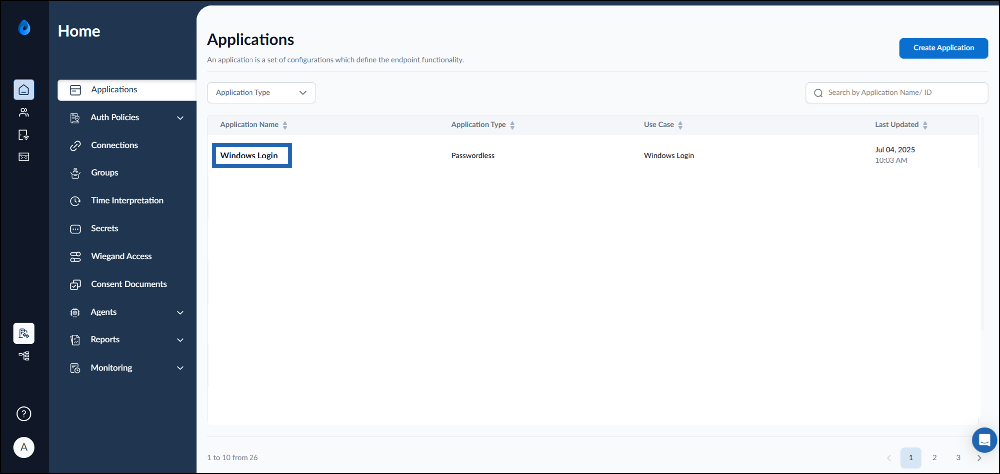
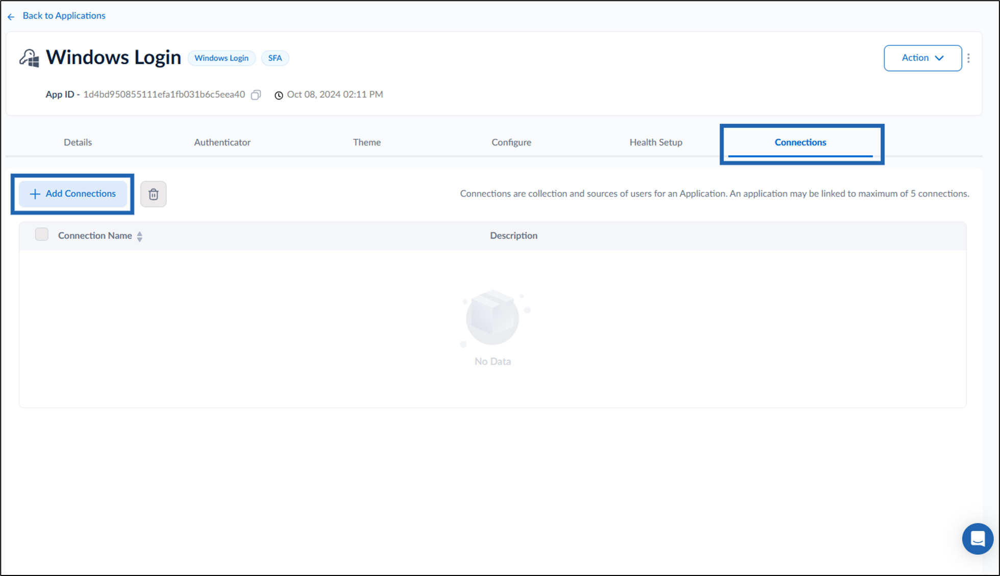
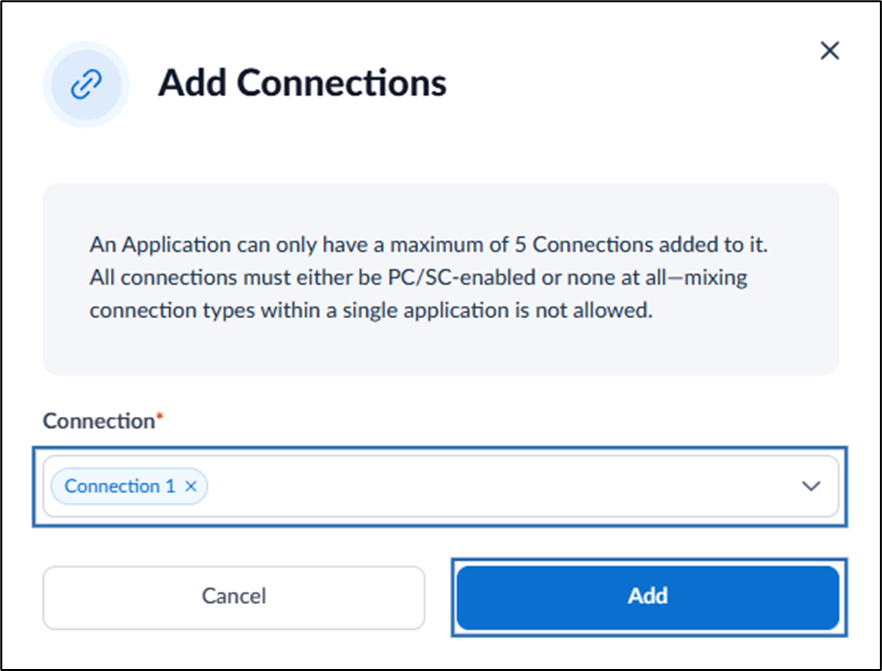
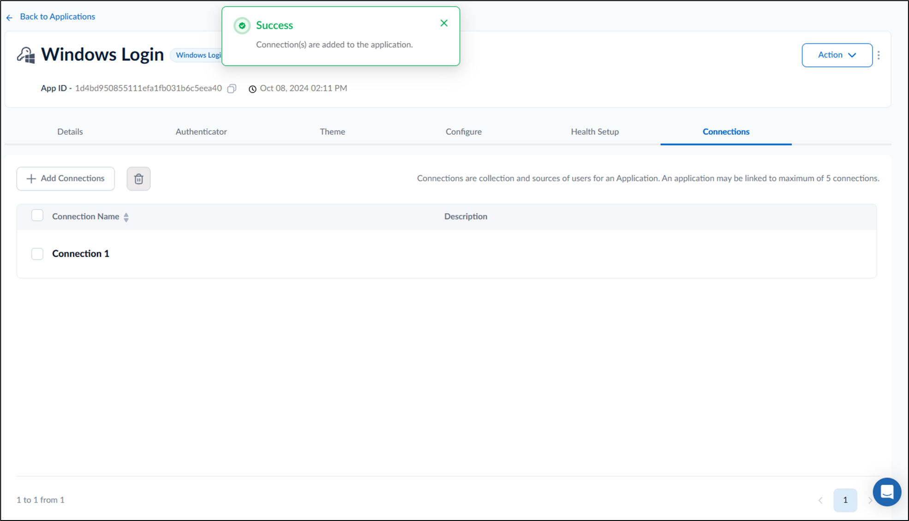
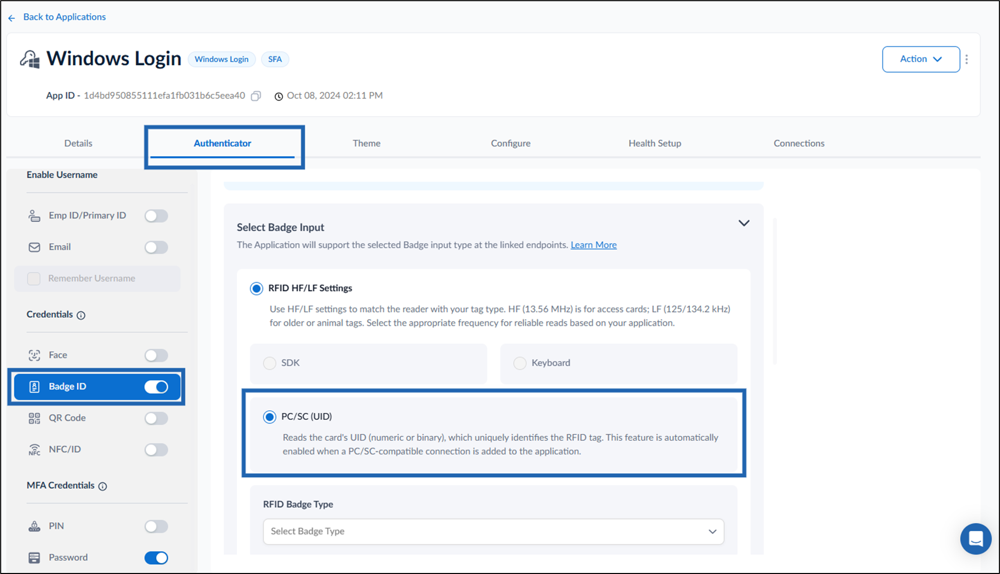

{/* Source: Intercom article 11722938 - https://oloid.help/en/articles/11722938-windows-login-how-to-configure-pc-sc-badge-configuration-in-the-tenant-admin-portal */}
{/* Generated by intercom_to_mintlify.py - re-running overwrites this file. */}

## Prerequisite

PC/SC Badge input enabled connection must be created. For more details refer [How to create PC/SC Badge Input enabled Connections in the Tenant Admin Portal](/platform/tenant-admin-portal/tenant-admin-portal-how-to-create-personal-computer-smart-card-pc-sc).

## Steps to add PC/SC Badge input enabled Connection

1. Log in to the **Tenant Admin Portal**.
2. On the home page of the portal, click Application name to edit.

   

   The **Application** details page is displayed.
3. Go to **Connection** tab > select **Add Connections**.

   <Note>
     **Note:** Before adding a **PC/SC Badge input enabled connection**, ensure that the connection is already created and listed in the connection list. To create a **PC/SC Badge input enabled connection**, refer to this link [How to create PC/SC Badge Input enabled Connections in the Tenant Admin Portal](/platform/tenant-admin-portal/tenant-admin-portal-how-to-create-personal-computer-smart-card-pc-sc).
   </Note>

   

   The **Add Connections** pop-up box is displayed.
4. On the pop-up box, do the following:
   1. Select a **PC/SC Badge input enabled connection** from **Connection** dropdown menu.
   2. Click **Add**.

      <Note>
        **Note:** An application can have a maximum of **5 Connections**. You can add only **PC/SC Badge input enabled** connections.
      </Note>

      

      The **PC/SC enabled connection** is added successfully

      

5. Go to **Authenticator** tab > select **Badge ID** from left panel menu.

Verify that the **PC/SC (UID)** section is selected.

The PC/SC Badge for Windows Login Application is configured successfully.

## Related Document

6. [How to create and configure Windows Login application](/platforms/windows/windows-login/windows-login-how-to-create-and-configure-windows-login-application).
