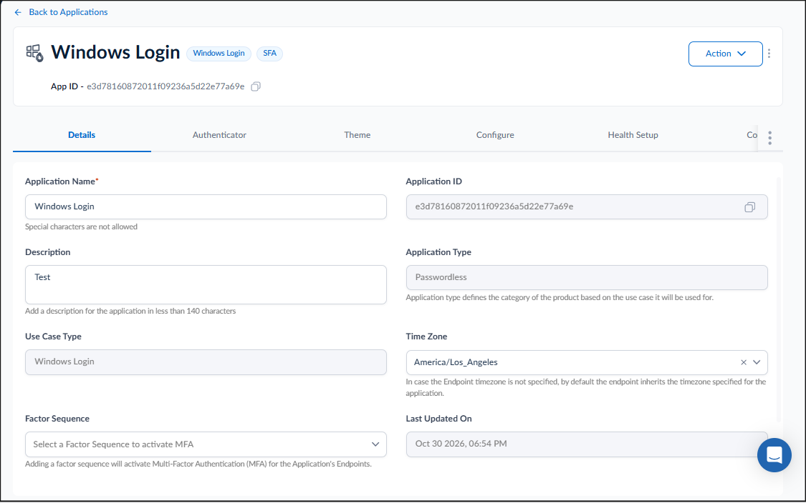
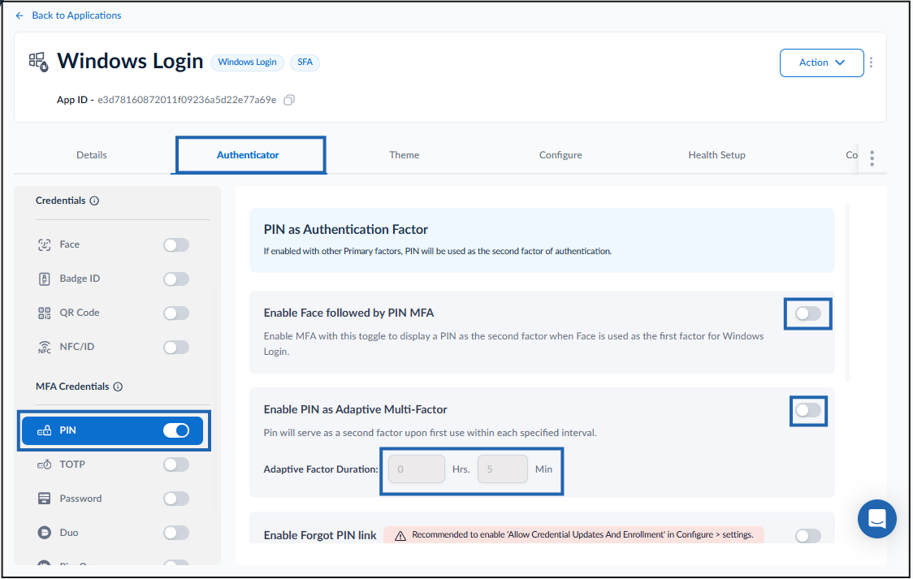
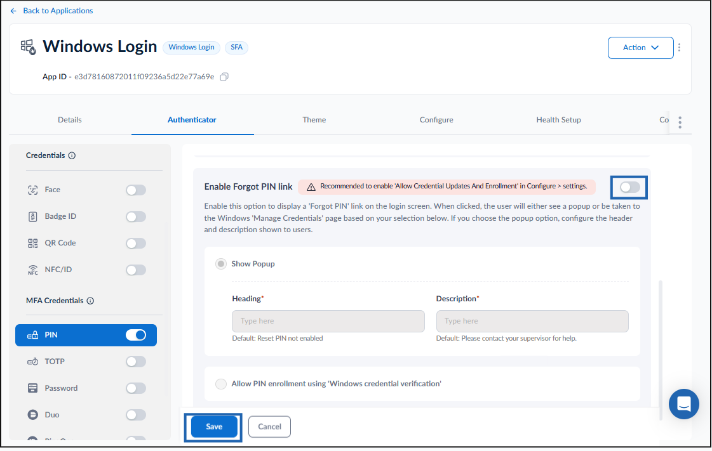
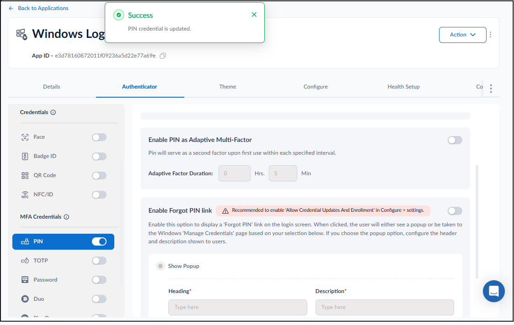

{/* Source: Intercom article 11484425 - https://oloid.help/en/articles/11484425-windows-login-how-to-configure-pin-credential-in-the-tenant-admin-portal */}
{/* Generated by intercom_to_mintlify.py - re-running overwrites this file. */}

## Introduction

The PIN credential feature allows admins to configure PIN-based multi-factor authentication (MFA) for the Windows Login application. When enabled, users must enter a secure PIN as a secondary authentication factor after successful primary authentication.

## Prerequisites

- You must have **Tenant Admin** access to the Tenant Admin Portal.
- The **Windows Login application** must be created and configured in the Tenant Admin Portal. For More, refer to[How to create and configure Windows Login application in the Tenant Admin Portal](/platforms/windows/windows-login/windows-login-how-to-create-and-configure-windows-login-application)

## Steps to Configure PIN Credential

1. Log in to the **Tenant Admin Portal**.
2. On the **Applications** page, select the Windows Login application.

   

   The **Details** page is displayed.

   

3. Go to **Authenticato**r tab.
4. Click **Pin** Tab in the left menu.
   Pin configuration page is displayed.
5. Enable the **PIN** toggle.
6. **Enable Face followed by PIN MFA** toggle to enable **multi-factor authentication (MFA)** by requiring a **PIN as the second authentication factor** when **Face** is used as the first factor.
7. Do the following configuration on **Adaptive Multi-Factor** which skips second factor authentication after first successful login: (Optional)
   1. Turn on **Enable PIN as Adaptive Multi Factor** toggle.
   2. Set **Adaptive Factor Duration** (in hours and minutes) to define how long the system skips prompting for second-factor authentication after a successful log in.

      

8. **Enable Forgot PIN link** toggle. For more, refer to [How to Enable Forgot PIN Link in Windows Login Application](/platforms/windows/windows-login/windows-login-how-to-enable-forgot-pin-link-for-windows-login)

Click **Save**.

The PIN credential is configured successfully.

<Note>
  **Note:** For setting up PIN rules, see [How to Configure PIN Settings in the Tenant Admin Portal](/platform/tenant-admin-portal/tenant-admin-portal-how-to-configure-pin).
</Note>

**Sync Configuration to Apply Changes**

You must sync the configuration in the **Supervisor App** to apply the changes. For detailed steps, see [How to sync configuration in Supervisor App](/platforms/windows/supervisor-app/how-to-sync-configuration-in-supervisor-app).
