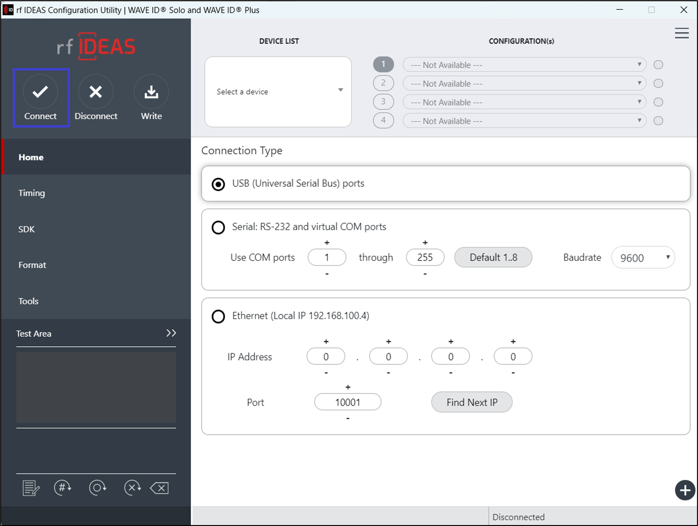
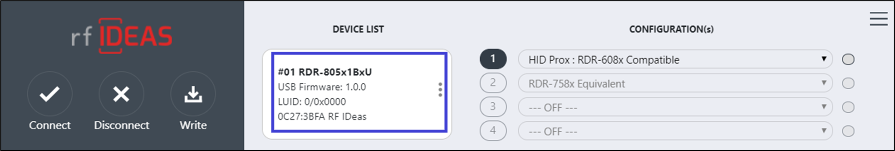
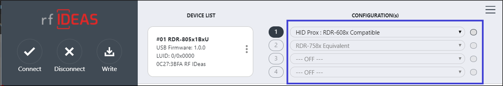
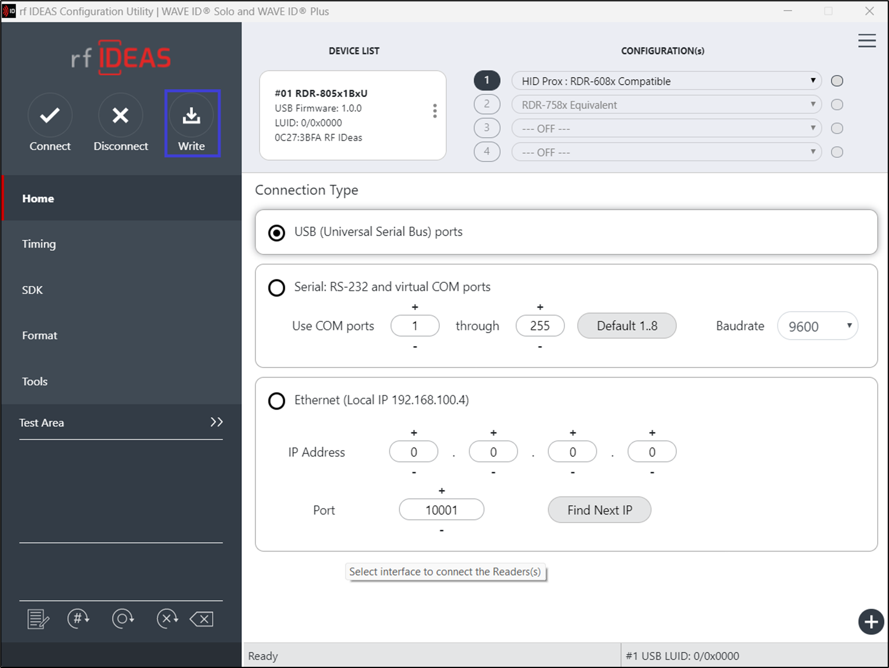
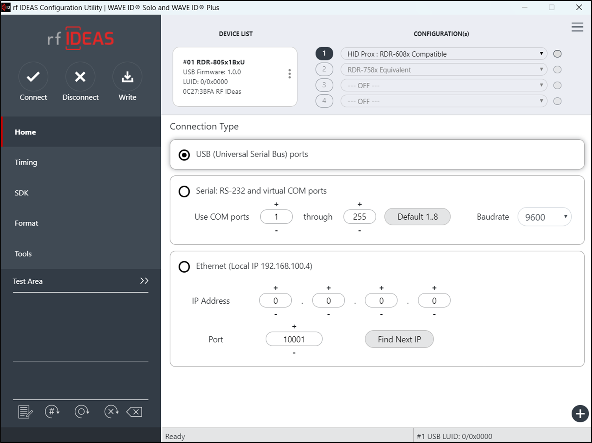
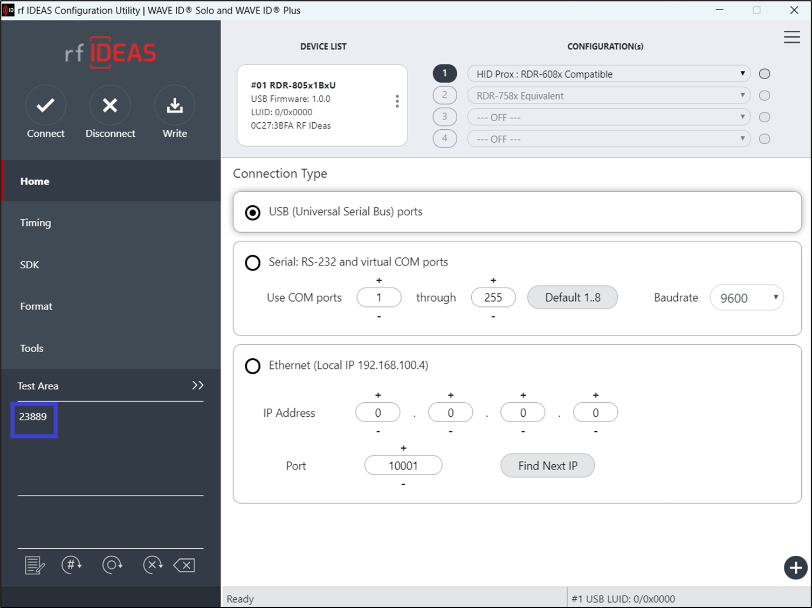

{/* Source: Intercom article 9398720 - https://oloid.help/en/articles/9398720-windows-login-how-to-configure-rf-ideas-readers-for-badge-card */}
{/* Generated by intercom_to_mintlify.py - re-running overwrites this file. */}

It is recommended to contact your Oloid Account Manager for configuration support to ensure a smooth setup.

**Pre-requisite:**

- Download the latest "rf IDEAS Configuration Utility" from the [RF IDEAS website](https://www.rfideas.com/support/tools/downloads).

To configure your card reader:

1. Launch the rf IDEAS configuration utility app.
   Make sure the card reader is connected to the system.
2. Select **Connect** from the top menu bar.

   

   The DEVICE LIST is configured and displayed.

   

3. Select the preferred configuration from the **CONFIGURATION(s)** dropdown list.

   

4. Select **Write** from the top menu bar.

   

   The badge reader is updated with the new settings.
5. Select the **Test Area** to scan your badge card with the card reader.

   

   The badge number is displayed in the Test Area.

   

   The card reader is configured for the badge card. You can click icon in the bottom right corner to download the .hwg file.
