{/* Source: Intercom article 9352266 - https://oloid.help/en/articles/9352266-windows-login-how-to-create-and-configure-windows-login-application-in-the-tenant-admin-portal */}
{/* Generated by intercom_to_mintlify.py - re-running overwrites this file. */}

## Introduction

This section explains how to create a Windows Login passwordless application in the Tenant Admin Portal and configure the required settings to enable secure user authentication on Windows endpoints.

## Prerequisite

You must have Tenant Admin Access.

## Steps to create and configure Windows Login application

1. Log in to the **Tenant Admin Portal**.
2. On the **Applications** page, click **Create Application** in the top right corner.

   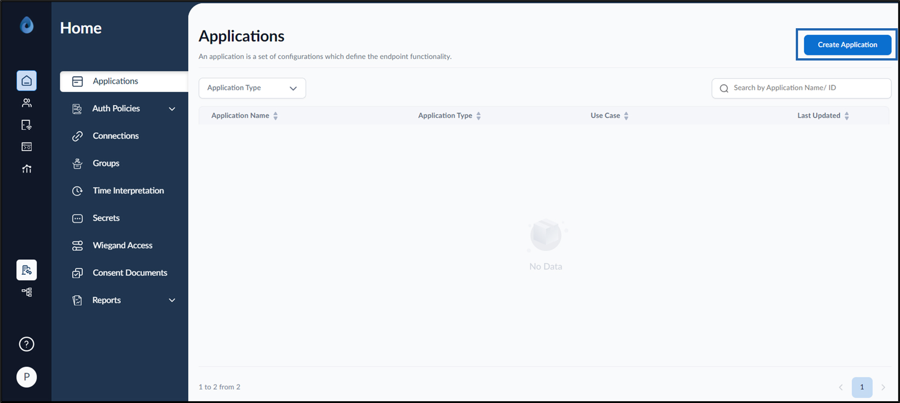

   The **Create New Application** pop-up box is displayed.
3. Do the following:
   1. Enter **Application Name.**
   2. Select **Application Type** as **Passwordless**.
   3. Click **Next**.

      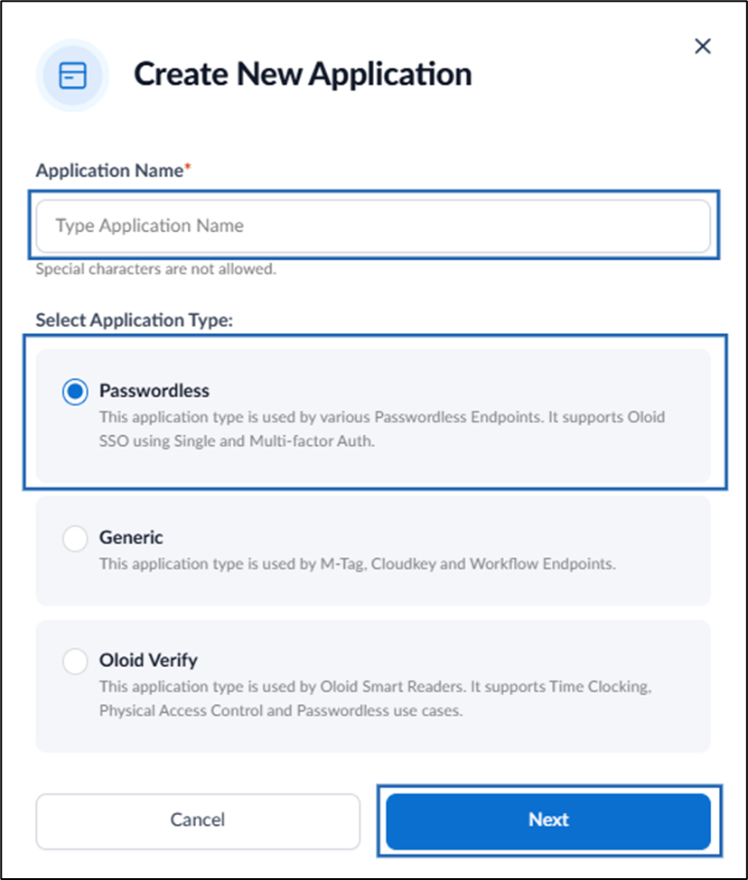

      The **Select Passwordless Use Case** page is displayed.
   4. Select **Windows Login** > click **Create**.

      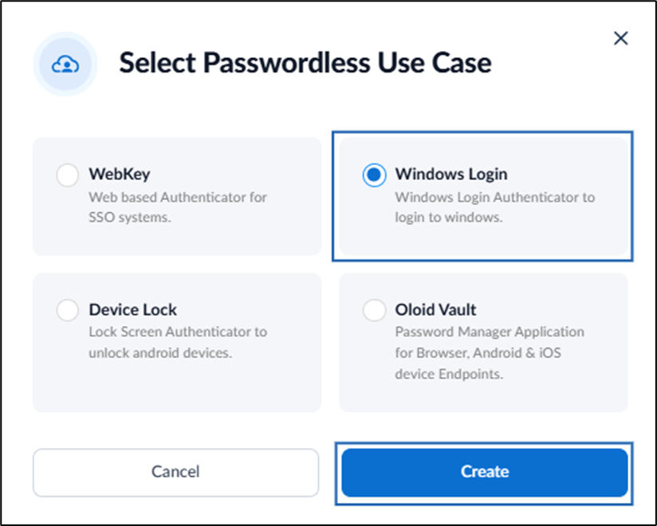

      The Passwordlessapplication of type **Windows Login** is created and the configuration page is displayed.
4. Configure the following:
   1. [Details tab](/platforms/web/webkey/webkey-how-to-create-and-configure-a-webkey-application-in-tenant)
   2. [Authenticator tab](/platforms/web/webkey/webkey-how-to-create-and-configure-a-webkey-application-in-tenant)
   3. [Theme tab](/platforms/web/webkey/webkey-how-to-create-and-configure-a-webkey-application-in-tenant)
   4. [Configure tab](/platforms/web/webkey/webkey-how-to-create-and-configure-a-webkey-application-in-tenant)
   5. Health Setup tab
   6. [Connections tab](/platforms/web/webkey/webkey-how-to-create-and-configure-a-webkey-application-in-tenant)

<Note>
  **Note:** These are one-time settings and all the default settings are recommended.
</Note>

## Configure Details Tab

1. Modify **Application Name** (if required).

   <Note>
     **Note:** Special characters are not allowed in Application Name.
   </Note>

2. Add **Description**. (Optional)

   <Note>
     **Note:** The description should be less than **140** characters.
   </Note>

3. Select your **Timezone** based on your country and region from dropdown list. (Coming Soon)
4. Select **Factor Sequence** from drop down list to activate Multi-Factor Authentication (MFA) for the Application's Endpoints. (Coming Soon)

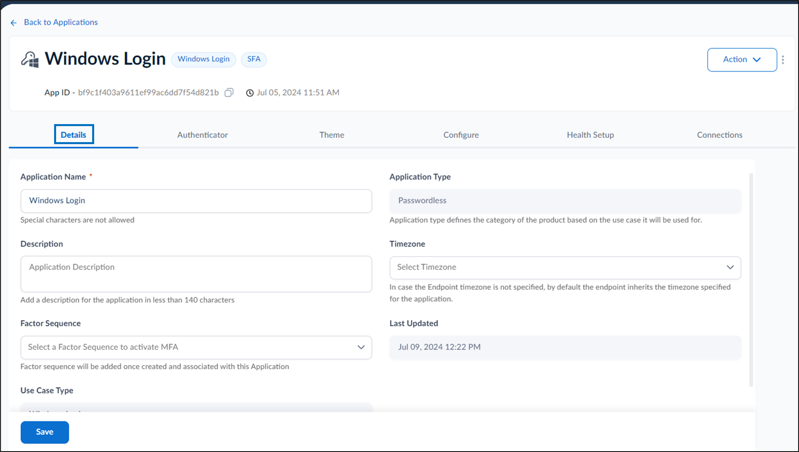

## Configure Authenticator Tab

You may enable username and one or more credential options based on your requirements.

### Enable Username

**Emp ID/Primary ID:** Enable this option to prompt the user to enter their Employee ID or Primary ID before authentication.

- (Optional) In the **Custom Label** field, enter a label that appears on the login screen instead of **Emp ID / Primary ID**.

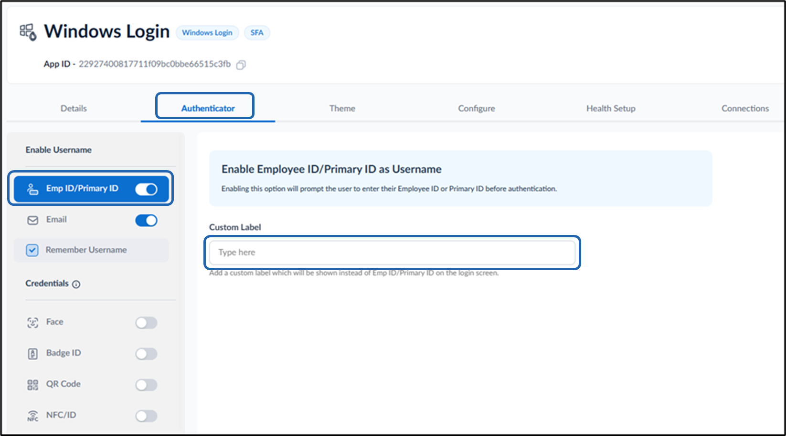

Email: Enable this option to allow users to enter their email ID before authentication.

- Select the **Remember Username** checkbox to save the user after the first login. Next time, the app skips the ID entry screen and opens the authentication screen directly.

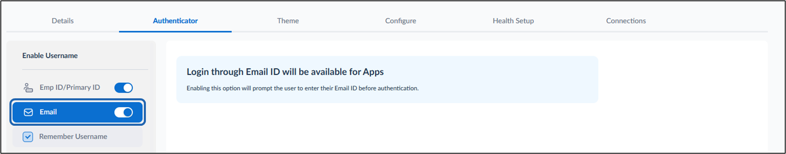

## Configure Credentials

### Face

Do the following:

1. To use face as credential, enable **Face** option.
   The **Advanced Settings** page is displayed.
   1. Enable the **Take Re-consent During Transactions** Toggle.
   2. Take Re-consent During transactions: When enabled, shows the re-consent form to users with invalid consent during every face authentication until they re-sign.
2. Configure **Face Match Parameters**, and **Liveliness Check Parameters** on the Advanced Settings page. For more, refer to [How to configure Face credential for Windows Login Application in the Tenant Admin Portal](/platforms/windows/windows-login/windows-login-how-to-configure-face-credential-for-windows-login-in)

   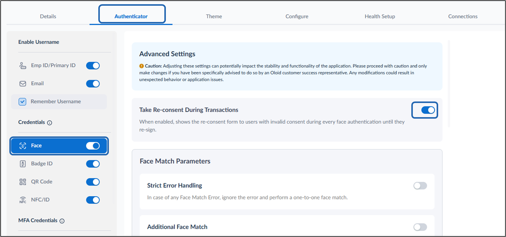

### Badge ID

To use **Badge ID** as credential, enable **Badge ID**.

- To configure **Select Badge Input** refer to: [How to Configure Badge ID for Windows Login Application](/platforms/windows/windows-login/windows-login-how-to-configure-badge-id-for-windows-login)
- Configure **Badge Auth Source** refer to: [How to configure Badge Auth Source in Windows Login Application](/platforms/windows/windows-login/windows-login-how-to-configure-badge-auth-source)

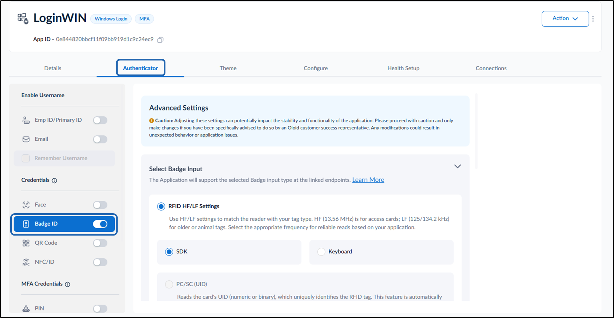

### QR Code

To use **QR Code** as credential, enable QR Code for multi-factor authentication to sign into Windows Login application. For more, refer to [How to enable QR Code credential for Windows Login application in the Tenant Admin Portal](/platforms/windows/windows-login/windows-login-how-to-enable-qr-code-credential-for-windows-login-in)

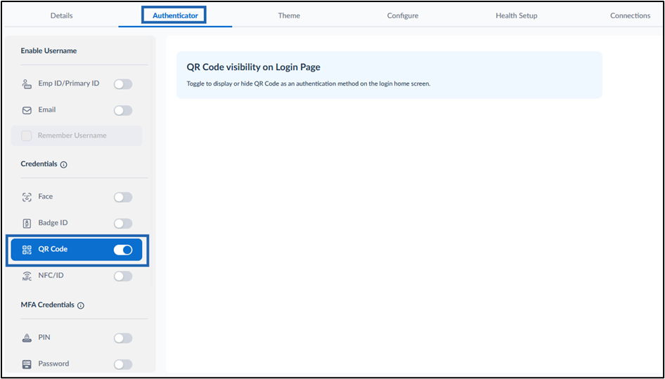

#### NFC/ID

To use **NFC/ID** credential, enable NFC/ID to sign into Windows Login application. For more, refer to [How to enable NFC/ID credential for Windows Login application in the Tenant Admin Portal](/platforms/windows/windows-login/windows-login-how-to-enable-nfc-id-credential-for-windows-login-in)

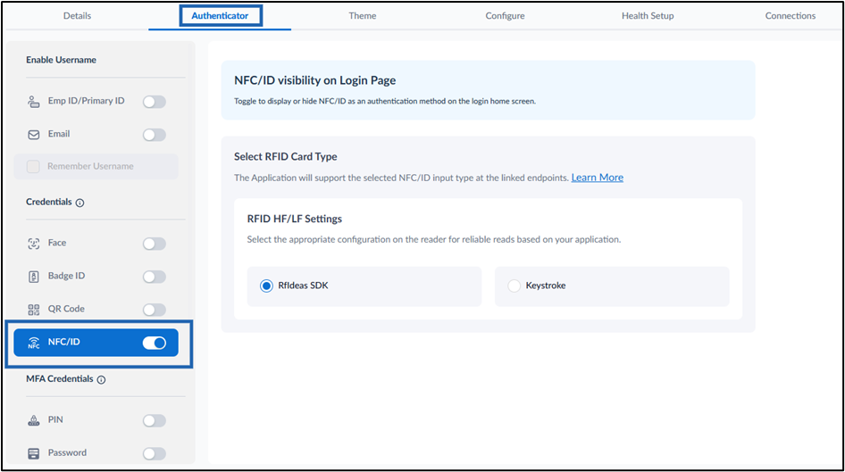

## Configure MFA Credentials

### PIN

To use **PIN** as credential, enable PIN for multi-factor authentication to sign into Windows Login application. For more, refer to: [How to enable and configure PIN credential for Windows Login application in the Tenant Admin Portal](/platforms/windows/windows-login/windows-login-how-to-configure-pin-credential-in-the-tenant-admin)

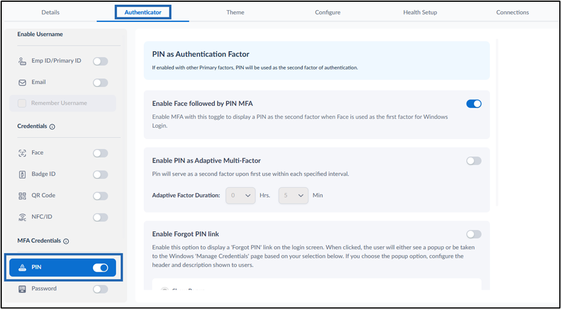

### Password

To use **Password** as credential, enable Password for multi-factor authentication to sign into Windows Login application. For more, refer to: [How to configure Password credential in Windows Login Application](/platforms/windows/windows-login/windows-login-how-to-configure-password-credential-for-windows-login)

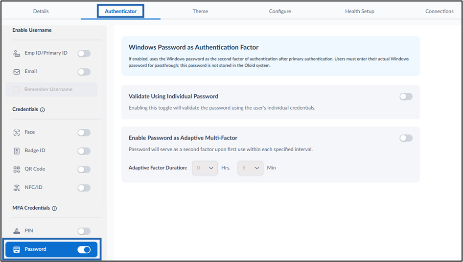

### Duo

To use **Duo** as credential, enable Duo for multi-factor authentication to sign into Windows Login application. For more, refer to: **[How to enable Duo MFA credential for Windows Login Application in the Tenant Admin Portal](/platforms/windows/windows-login/windows-login-how-to-enable-duo-mfa-credential-for-windows-login-in)**

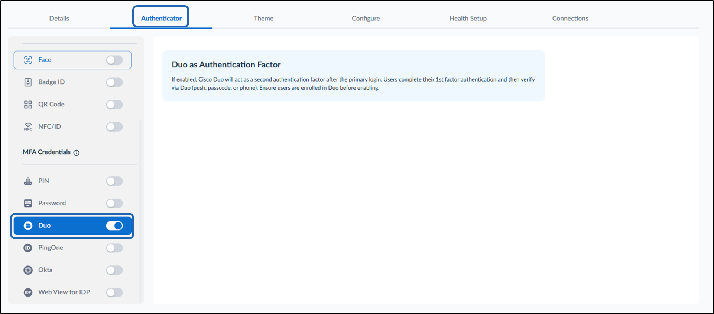

### PingOne

To use **PingOne** as credential, enable PingOne for multi-factor authentication to sign into Windows Login application. For more, refer to: [How to Enable PingOne Multi Factor Authentication (MFA) for Windows Login Application in the Tenant Admin Portal](/more/sso-and-mfa/windows-login-how-to-enable-pingone-multi-factor-authentication-mfa)

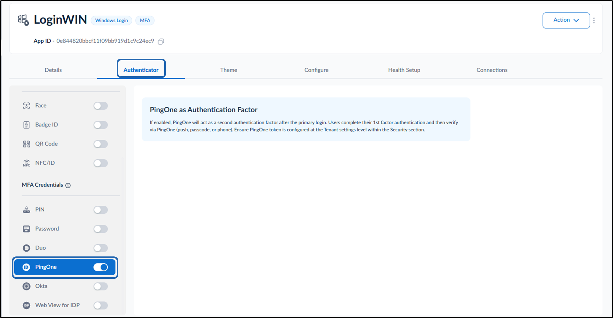

### Okta

To use **Okta** as credential, enable Okta for multi-factor authentication to sign into Windows Login application. For more, refer to: [How to Enable OKTA Multi-Factor Authentication (MFA) Credential for Windows Login Application in the Tenant Admin Portal](/more/sso-and-mfa/windows-login-how-to-enable-okta-multi-factor-authentication-mfa)

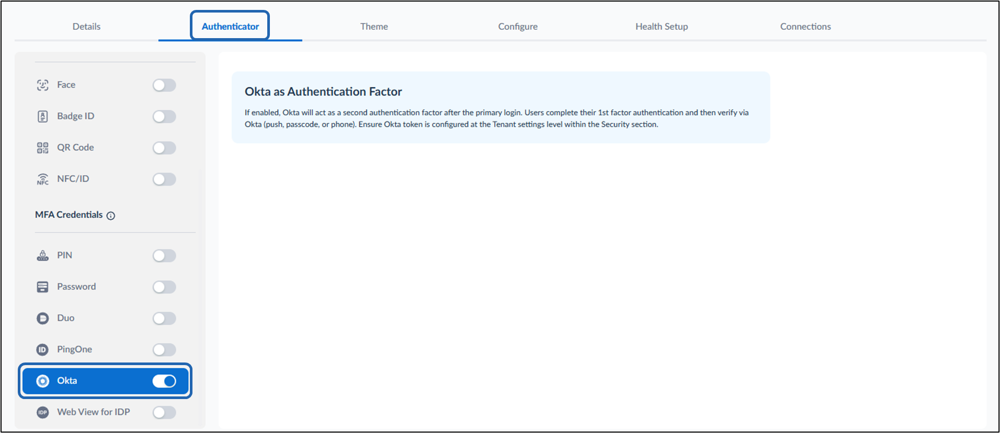

## Configure Theme Tab

You can customize theme of your login page of the Windows Login application by following the onscreen instructions. Refer **[How to Edit Theme tab for Windows Login Application in the Tenant Admin Portal](/platforms/windows/windows-login/windows-login-how-to-edit-theme-tab-for-windows-login-application-in)**

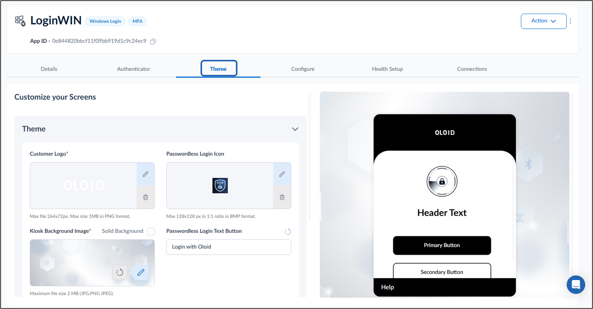

## Design Configure Tab

Do the following:

1. [Configure Settings tab](#configure-settings-tab)
2. [Configure rf IDEAS tab](#configure-rf-ideas-tab)
3. [Configure Epic EHR](#configure-epic-ehr)
4. Configure Customize Buttons

### Configure Settings Tab

- **Enable Auto Launch Mode:** Select this option to auto-launch the Windows Login app in the login screen.
  - **Set Time-Out for Login Screen:** Select this option to allow users to configure the maximum time the system will wait on the login screen before timing out.

    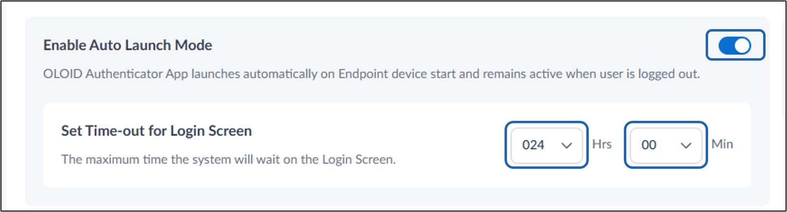

- **Use Groups for Authorization:** *Coming Soon*
- **Validate Windows Credential:** Select this option to ensure Oloid Agent checks the validity of the user’s Windows credentials before logging in.

  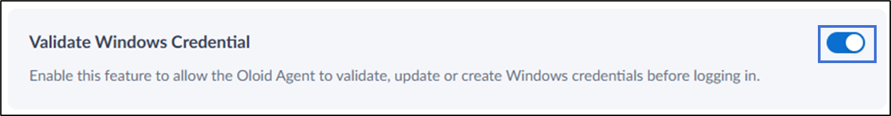

- **Enable Passkey:** Turn on **Enable Passkeys** toggle button to allow users to log in using Passkey credential.

  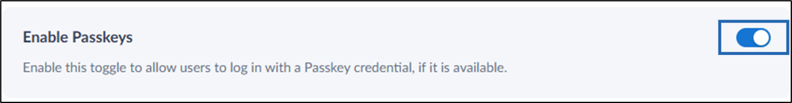

- **Allow Credential Updates and Enrollment:** Select this option to allow users to self-enroll or update their credentials.
  - Enable **Hide Option to Save Windows Credentials** toggle to hide the Save credentials option from the enrollment screen after Windows domain credentials are validated.
  - Select **Auto-save credentials on successful validation when the Save choice is hidden** checkbox to automatically save validated Windows credentials to the user’s Oloid account when the Save credentials option is hidden.
  - Enable **Allow Login Through Local Credentials** to allow users to log in to Windows using their local Windows credentials. For more, refer to [How to Configure Allow Login Through Local Credentials](/platforms/windows/windows-login/windows-login-how-to-configure-allow-login-through-local-credentials)

    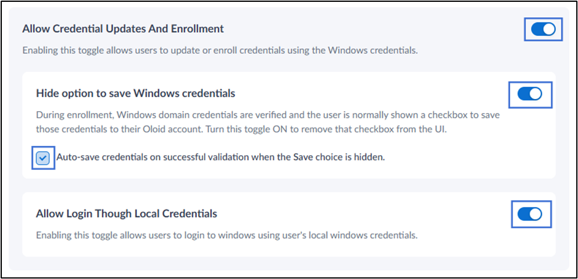

- **Capture Windows User Events:** Select this option to capture Windows events for user logins, logouts, locks, unlocks, and credential provider details. All captured data is stored in the transaction tab.

  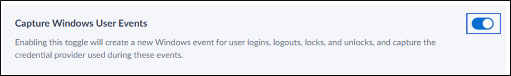

- Enable **Auto-recover Endpoint** to automatically validate and sync the endpoint configuration during login module launch.

  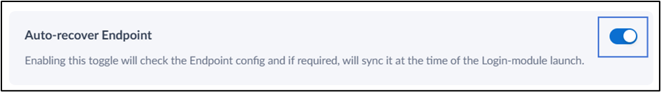

- **Enable Manual Capture Accessibility:** Turn on this option to allow users to manually capture their face during face authentication.

  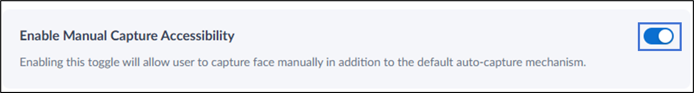

- **Enable Auto Authentication of Oloid Apps Using Oloid Session toggle.**
  Enabling this toggle will allow user to auto-authenticate the user using the Windows session, into Oloid apps after device login.

  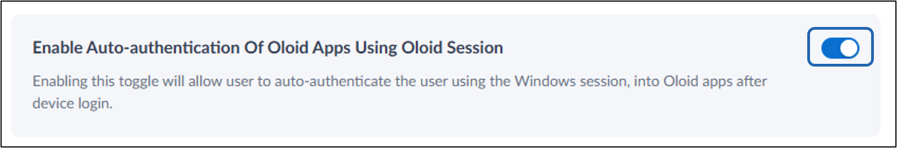

- **Enable Badge Out:** Select **Badge out using Windows Service** option to allow users to log out of their Windows system using their badge. For details, refer to [Windows Login - How to configure Enable Badge Out option](/platforms/windows/windows-login/windows-login-how-to-configure-badge-out-option)

  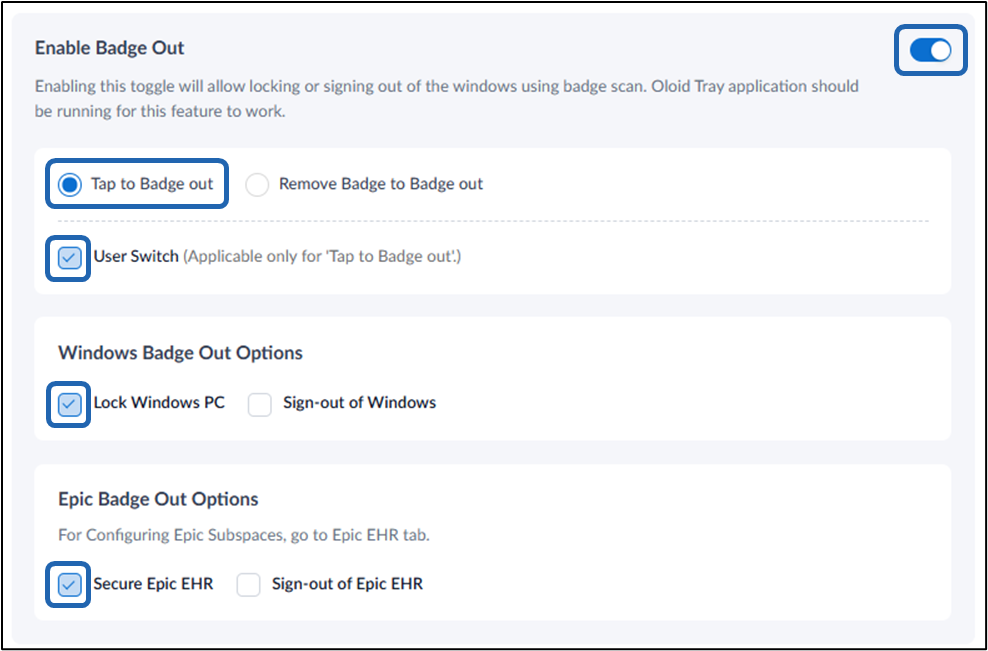

- **Master Admin override passcode:** Follow the onscreen instruction to create master admin override passcode. For details, refer [How to create device-admin passcode for Supervisor App](/platforms/windows/supervisor-app/windows-login-how-to-create-device-admin-passcode-for-supervisor-app)

  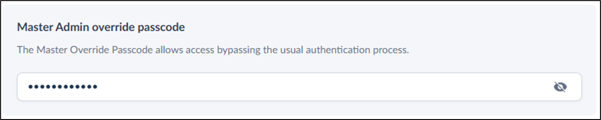

- **Apply Endpoint Template**: Select a Windows Login endpoint template that is applied during the endpoint pairing process.

  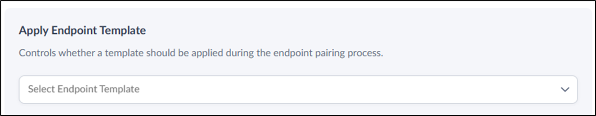

- **Enable Proxy Configuration** to configure proxy settings for secure network communication through a proxy server.
- Do the following:
  - Enter **Proxy URL**.
  - Enter **Port**.
  - Enter **Username**.
  - Enter **Password**.
- Click **Save**.

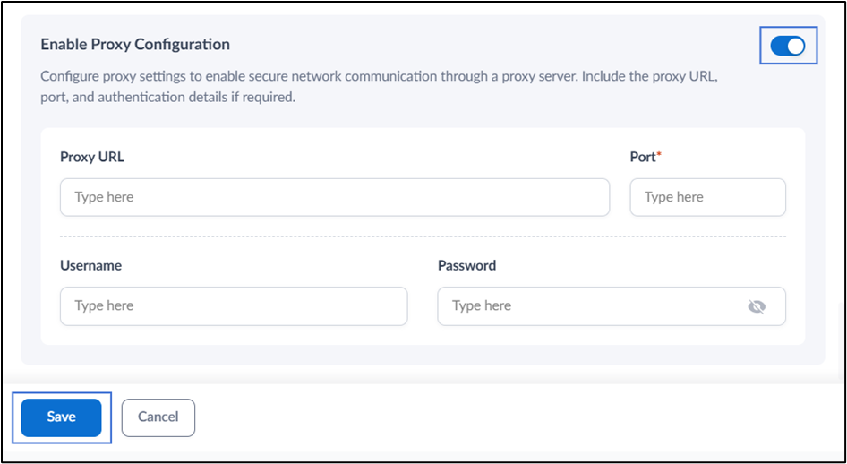

### Configure rf IDEAS Tab

1. Do the following:
   1. Select **RFID Reader Type** from the **Select RFID reader type** dropdown .
   2. Enter **Description**. (Optional)
   3. Click to browse the file or drag the file to upload/download.
   4. Click **Save**.
      The application is updated successfully. For more details, refer [How to upload/download HWG file in Oloid Portal](/platforms/windows/supervisor-app/windows-login-how-to-upload-download-hwg-file-in-tenant-admin-portal)

      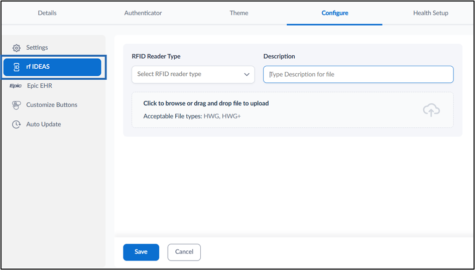

### Configure Epic EHR

**Epic EHR for Windows Login** in the Tenant Admin Portal which enables secure authentication into Epic applications using Windows Login. For more information please refer to: [How to Configure Epic EHR in the Tenant Admin Portal](/platforms/windows/industry-workflows/healthcare/windows-login-healthcare-how-to-configure-epic-ehr-in-the-tenant)

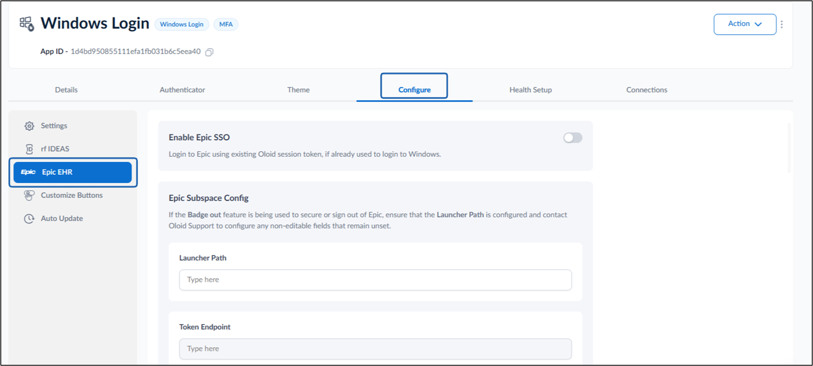

### Customize Buttons Tab

- **Customize Authentication Button Labels**: Enter customized **Button Label** to display on the Windows application.
- Select **Enable Badge Options** to display on the Windows Login app.
  - Do one of the following:
    - Select **Enroll Badge Only** to enable Badge login
    - Select **Enroll Badge + Pin** to enable Badge and Pin login.

      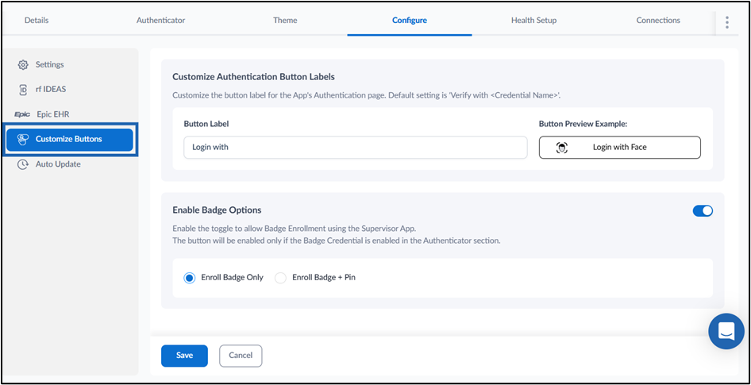

## Configure Health Setup

Do the following:

1. Enter **Server Name**
2. Enter URL in the **Add URL that needs to be monitored** field and click **Add**
   The Health Setup tab is configured.

   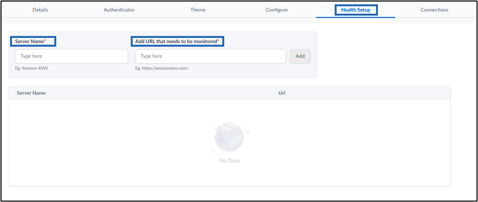

## Configure Connections

Do the following:

1. Select **+ Add Connections** to map a connection to the application.

   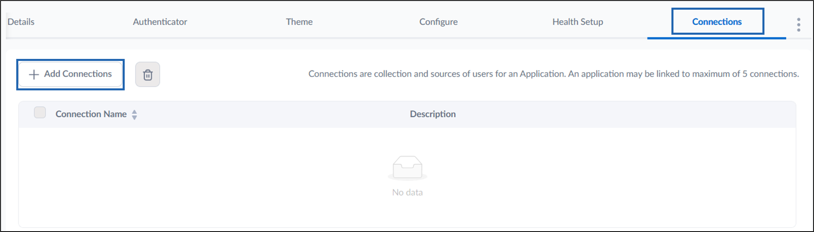

2. On the **Add Connections** pop-up box, select connection name(s) from the **Select Connection** dropdown list and click **Add**.

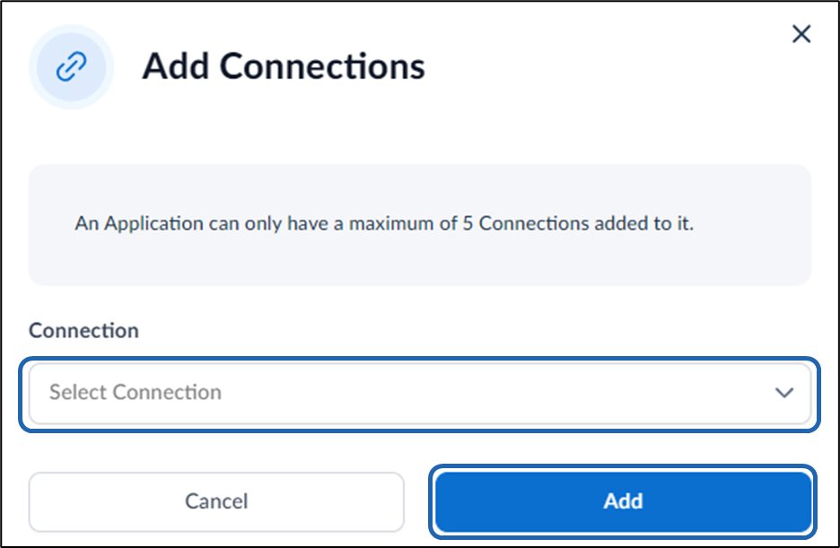

<Note>
  **Note:** Click **Save** after each action to save your configuration.
</Note>

The **Windows Login** application is configured and listed on the Application page.

---

##### Video Tutorial

Watch the videos to create and configure Windows Login App:

1. [How to create Windows Login application - Video Tutorial](/platforms/windows/videos/how-to-create-windows-login-application-video-tutorial)
2. [How to configure Windows Login application - Video Tutorial](/platforms/windows/videos/how-to-configure-windows-login-application-video-tutorial)

---

##### Keywords
