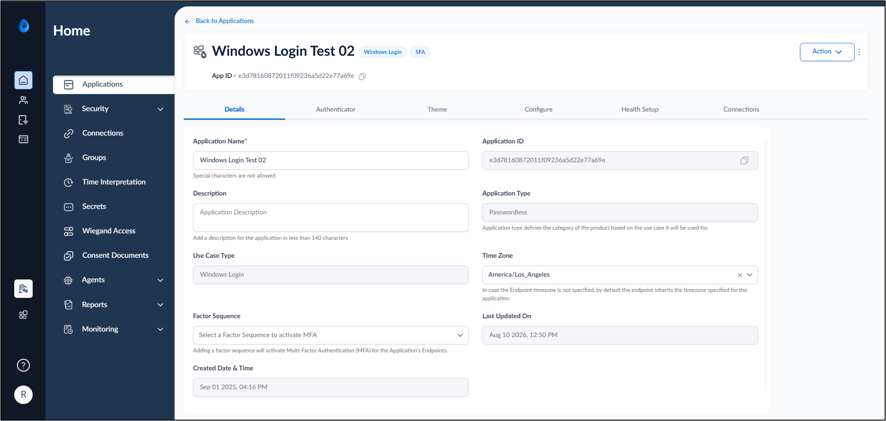
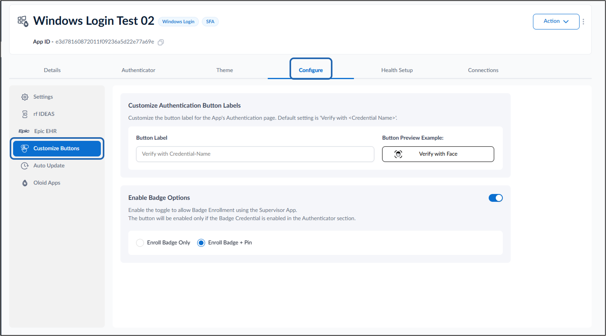
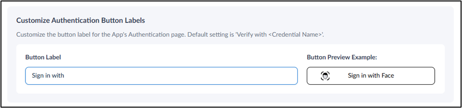
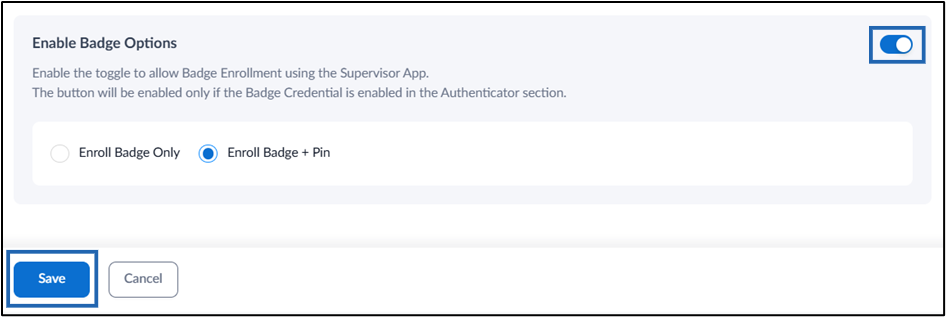
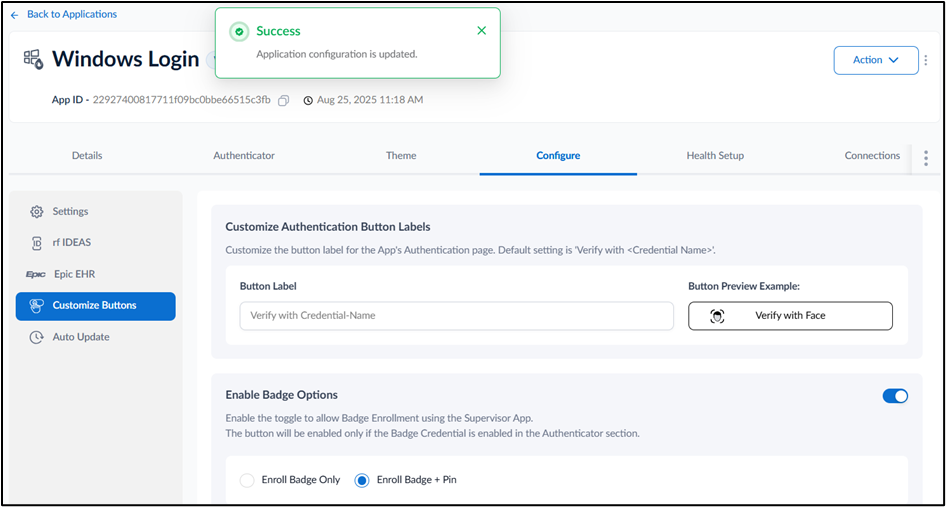
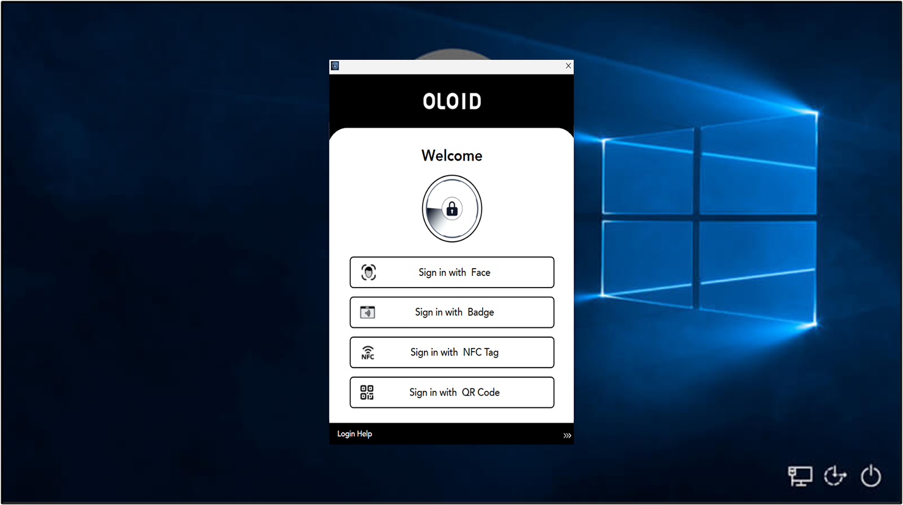

{/* Source: Intercom article 11069364 - https://oloid.help/en/articles/11069364-windows-login-how-to-customize-buttons-in-windows-login-application */}
{/* Generated by intercom_to_mintlify.py - re-running overwrites this file. */}

## Introduction

The Customize Buttons section allows Tenant admin to rename the authenticator button label displayed on the Windows Login app.

## Prerequisites

- You must have Tenant Admin Access.
- Windows Login Application must be created in the Tenant Admin Portal. For more information, refer: [How to create and configure Windows Login application in the Tenant Admin Portal](/platforms/windows/windows-login/windows-login-how-to-create-and-configure-windows-login-application)

## Steps to configure Customize Buttons

1. Log in to the **Oloid Portal**.
2. On the **Applications** page, select the application paired in the Supervisor App (Windows Authenticator App).

   

   The application page is displayed.

   

3. Go to **Configure** > **Customize Buttons** tab.

   

4. In **Button Label** field, enter the text to be displayed on the Windows Login app.
   Example- Sign in with, Login with, Authenticate with.

   

5. **Enable Badge Options** toggle to allow badge assignment through the Supervisor App.

   <Note>
     **Note:** You must enable Badge Credential in the Authenticator tab of the Windows Login application.
   </Note>

   After enabling Badge option, select one of the following modes:
   **Default:** Enroll Badge + PIN
   - **Enroll Badge Only**
     Select this option to enroll badge using the Supervisor App.
   - **Enroll Badge + PIN**
     Select this option to enroll badge with PIN credential using the Supervisor App.
6. Click **Save**.

   

   The configuration is saved successfully. See, [Sample screen for customized button](#sample-screen-for-customized-button)

   

   <Note>
     **Note:** This note applies only to **Windows Login Version 1**. In the Windows Authenticator app, you must sync the configuration for the function to work. For more details, refer [How to sync configuration in Supervisor App](/platforms/windows/supervisor-app/how-to-sync-configuration-in-supervisor-app)
   </Note>

---

##### Sample screen for customized button

---

##### Video Tutorial

Watch the video [How to Customize Buttons in Windows Login application-Video Tutorial](/platforms/windows/videos/how-to-customize-buttons-in-windows-login-application-video-tutorial)

---

##### Related Document

[How to enroll Badge using Supervisor App](/platforms/windows/supervisor-app/windows-login-how-to-enroll-badge-using-supervisor-app)

[How to enroll Badge and PIN using Supervisor App](/platforms/windows/supervisor-app/windows-login-how-to-enroll-badge-and-pin-using-supervisor-app)
