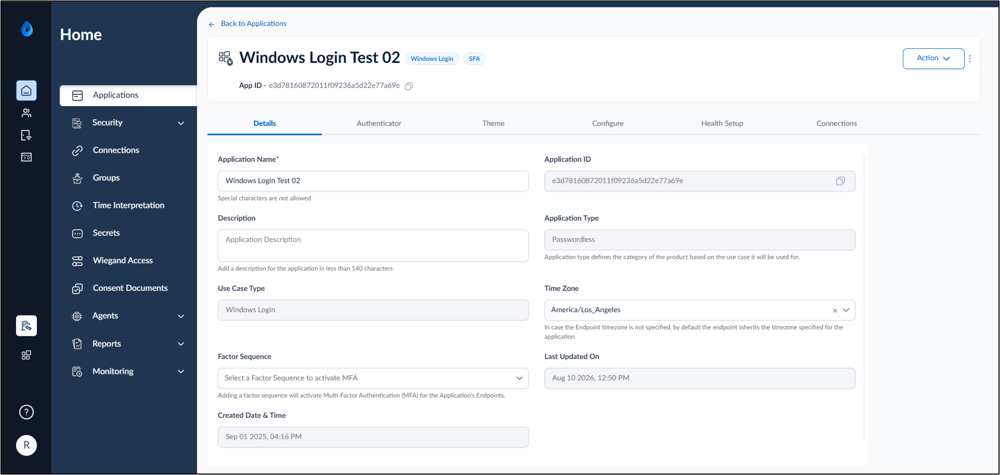
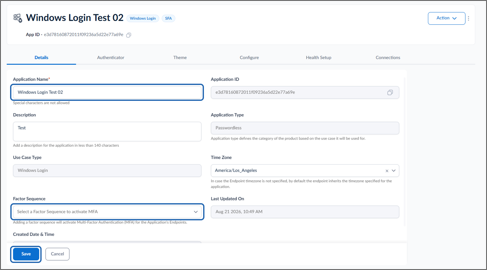
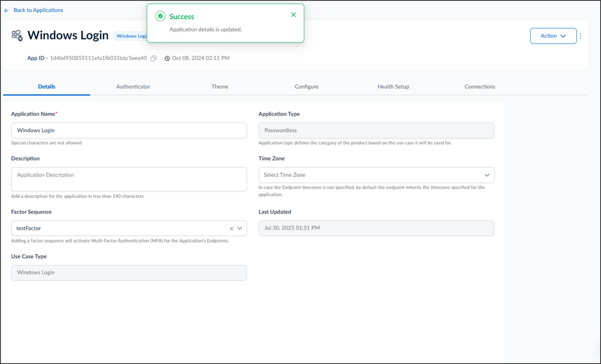

{/* Source: Intercom article 10749338 - https://oloid.help/en/articles/10749338-windows-login-how-to-edit-details-tab-for-windows-login-application-in-the-tenant-admin-portal */}
{/* Generated by intercom_to_mintlify.py - re-running overwrites this file. */}

## Introduction

This document provides step-by-step instructions for editing the Details tab of a Windows Login application in the Tenant Admin Portal. You can update the application name, description, and factor sequence to configure the application based on your authentication and deployment requirements.

## Prerequisites

- You must have Tenant Admin Access.
- Windows Login Application must be created in the Tenant Admin Portal. For more information, refer: [How to create and configure Windows Login application in the Tenant Admin Portal](/platforms/windows/windows-login/windows-login-how-to-create-and-configure-windows-login-application)

## Steps to edit details Tab

1. Log in to the **Tenant Admin Portal**.
2. On the **Applications** page, click on the preferred Windows login application to edit.

   

   The application page is displayed.

   

3. Do the following:
   1. Modify **Application Name** (if required).

      <Note>
        **Note:** Special characters are not allowed in Application Name.
      </Note>

   2. Add **Description**. (Optional)

      <Note>
        **Note:** The description should be less than **140** characters.
      </Note>

   3. Select your **Timezone** based on your country and region from dropdown list. (Optional)
   4. Select **Factor Sequence** from drop down list to activate Multi-Factor Authentication (MFA) for the Application's Endpoints.

      <Note>
        **Note:** These are one-time settings and all the default settings are recommended.
      </Note>

      

The Details tab for Windows Login Application is edited successfully.

