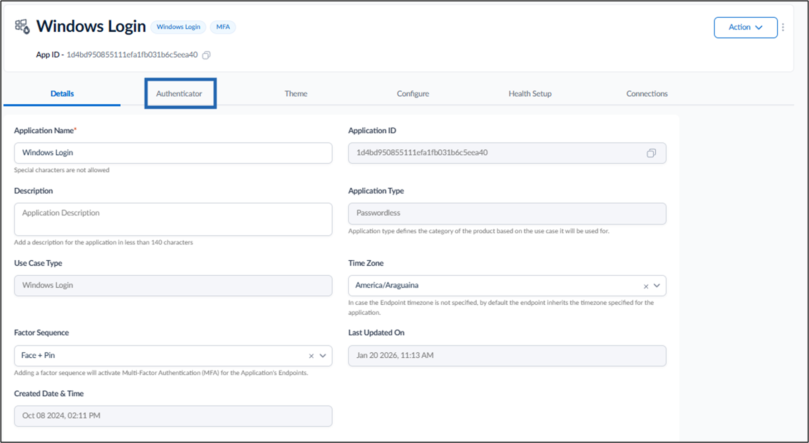
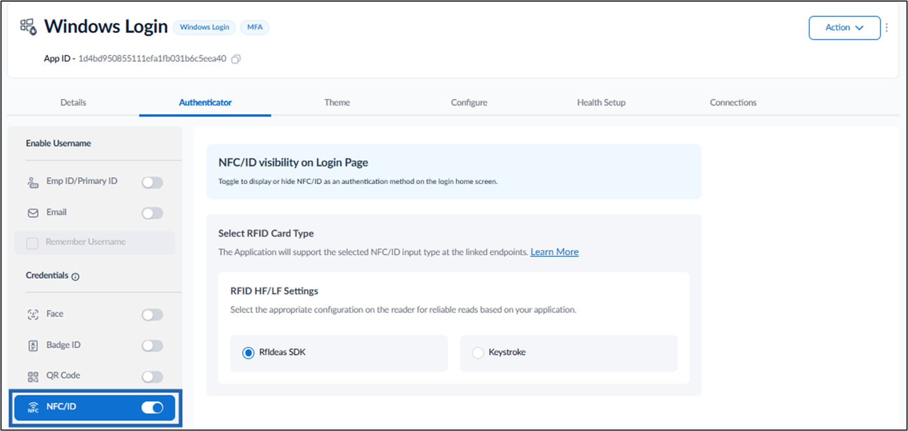
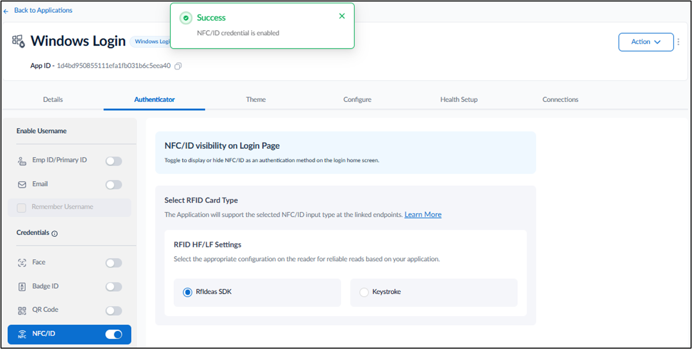
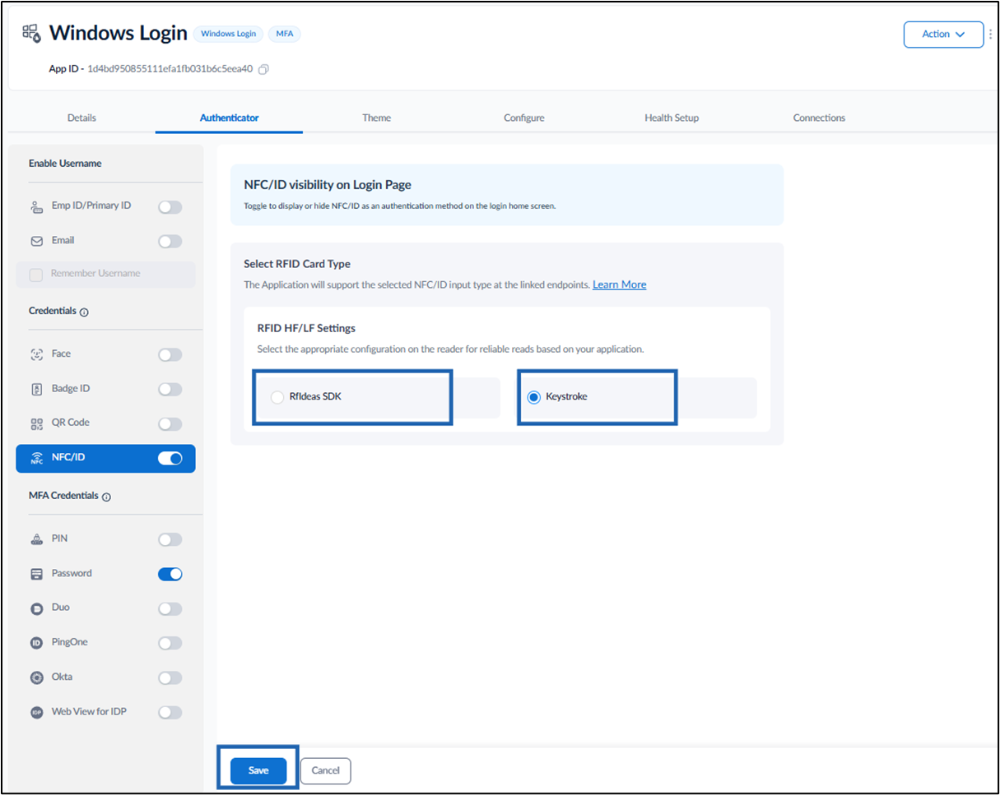
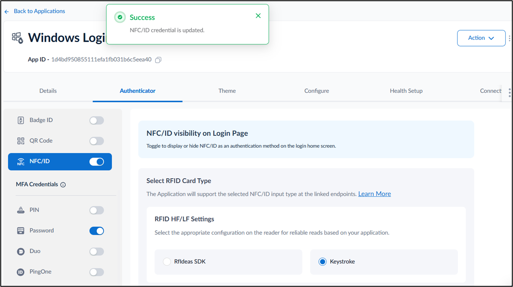

{/* Source: Intercom article 11484465 - https://oloid.help/en/articles/11484465-windows-login-how-to-enable-and-configure-nfc-id-credential-for-windows-login-in-tenant-admin-portal */}
{/* Generated by intercom_to_mintlify.py - re-running overwrites this file. */}

## Introduction

The NFC/ID credential feature in the Tenant Admin Portal allows admin to enable NFC-based authentication for the Windows Login application. Once enabled, users can log in to Windows endpoints by scanning an NFC card or tag.

## Prerequisite

You must have Tenant Admin Access.

## Steps to Enable NFC/ID credential

1. Log in to the **Tenant Admin Portal**.
2. On the **Applications** page, click the **Windows Login** application.

   

   The application page is displayed.
3. Go to the **Authenticato**r tab.

   

   The Authenticator page is displayed.
4. Turn on the **NFC/ID** toggle.

   

   The **NFC/ID** is enabled successfully.

   

## Configure the NFC/ID

1. Under **RFID HF/LF Settings**, do one of the following:
   1. **RfIdeas SDK:** Select this option to authenticate users using an NFC card or tag.

      <Note>
        **Note:** NFC/ID enrollment is supported only through the **Supervisor app**.
      </Note>

   2. **Keystroke:** Select this option to authenticate users using an NFC card or tag, or through keyboard input.

      <Note>
        **Note:** NFC/ID enrollment is supported through both the **Supervisor app** and the **Tenant Admin Portal**.
      </Note>

2. Click **Save**.

   

The NFC/ID is configured successfully.

#### Sync Configuration to Apply Changes

After enabling and configuring the **NFC/ID**, you must sync the configuration in the **Supervisor App** to apply the changes. For detailed steps, see [How to sync configuration in Supervisor App](/platforms/windows/supervisor-app/how-to-sync-configuration-in-supervisor-app).
