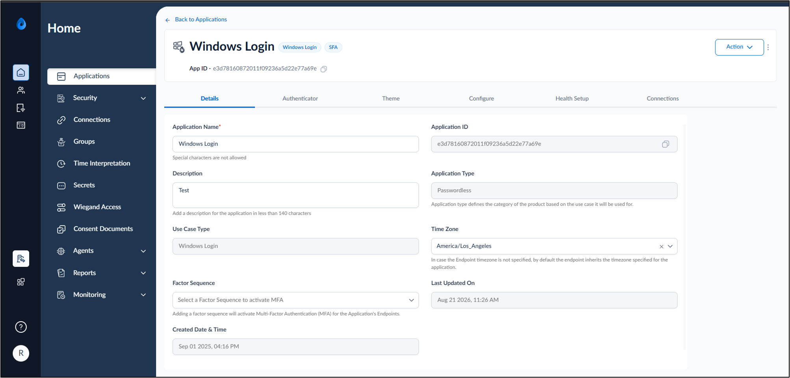
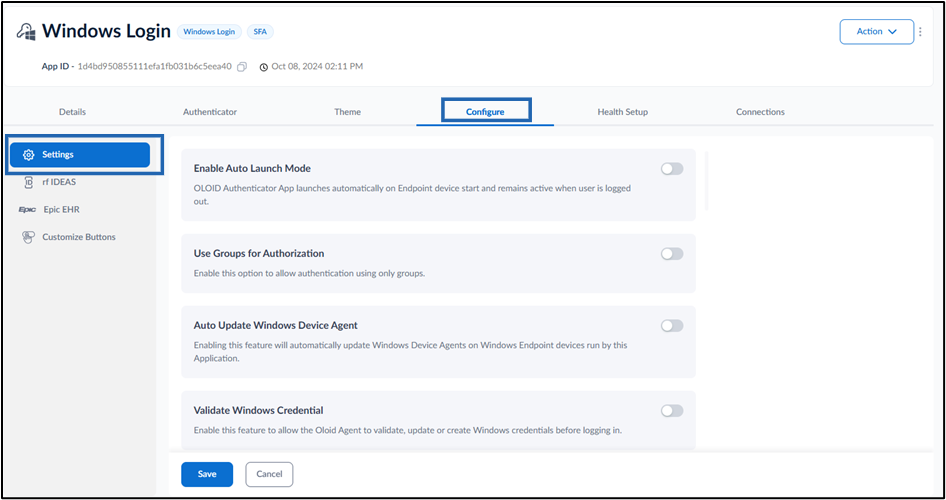
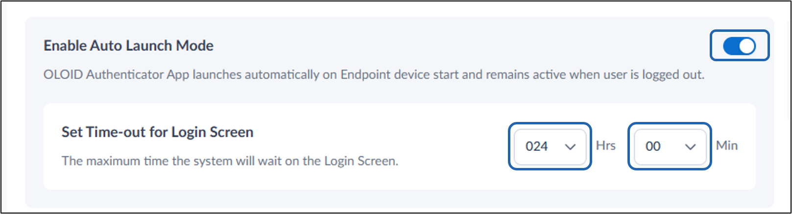
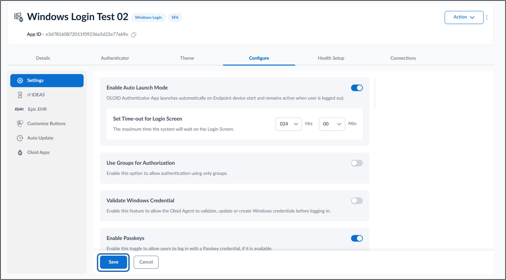
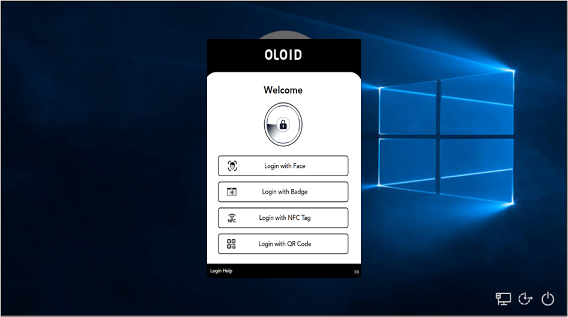

{/* Source: Intercom article 10852057 - https://oloid.help/en/articles/10852057-windows-login-how-to-enable-auto-launch-mode-in-windows-login-application */}
{/* Generated by intercom_to_mintlify.py - re-running overwrites this file. */}

## Introduction

This document provides step-by-step instructions for enabling Auto Launch Mode in the Windows Login application. When enabled, the Windows Login app automatically launches on the Windows pre-login screen, allowing users to access the configured Oloid authentication options without manually launching the application.

## Prerequisites

- You must have Tenant Admin Access.
- Windows Login Application must be created in the Tenant Admin Portal. For more information, refer: [How to create and configure Windows Login application in the Tenant Admin Portal](/platforms/windows/windows-login/windows-login-how-to-create-and-configure-windows-login-application)

## Steps to enable Auto Launch Mode

1. Log in to the **Tenant Admin Portal**.
2. On the **Applications** page, select the application paired in the Supervisor App (Windows Authenticator App).

   

   The application page is displayed.

   

3. Go to **Configure** > **Settings** tab.

   

4. Turn on **Enable Auto Launch Mode** toggle button to automatically launch the Windows Login app on the pre-login screen.
   1. Set Time-Out for Login screen. This duration will define the time the system will wait on login screen.

      

5. Click **Save**.

The configuration is saved successfully. See, [Sample screen for Auto Launch Mode](#sample-screen-for-auto-launch-mode)

<Note>
  **Note:** Note: This note applies only to Windows Login Version 1. In the Windows Authenticator app, you must sync the configuration for the function to work. For more information, refer [How to sync configuration in Supervisor App](/platforms/windows/supervisor-app/how-to-sync-configuration-in-supervisor-app)
</Note>

---

##### Sample Screen for Auto Launch Mode

---

##### Video Tutorial

Watch the video [How to enable Auto Launch Mode in Windows Login Application-Video Tutorial](/platforms/windows/videos/how-to-enable-auto-launch-mode-in-windows-login-application-video)
