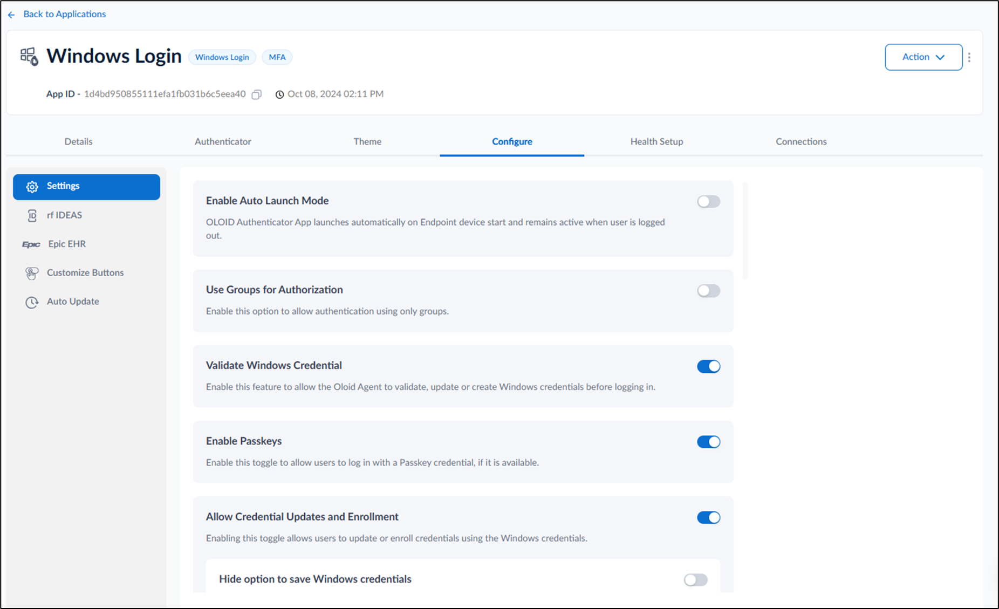
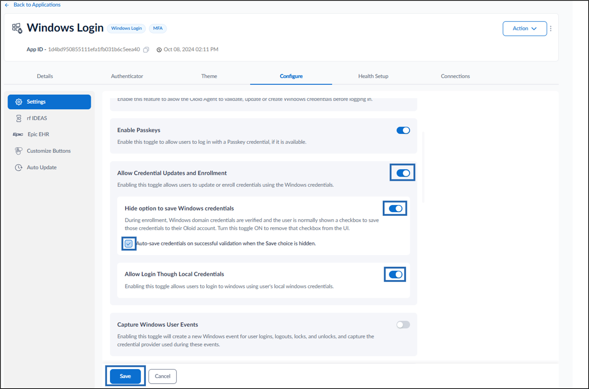
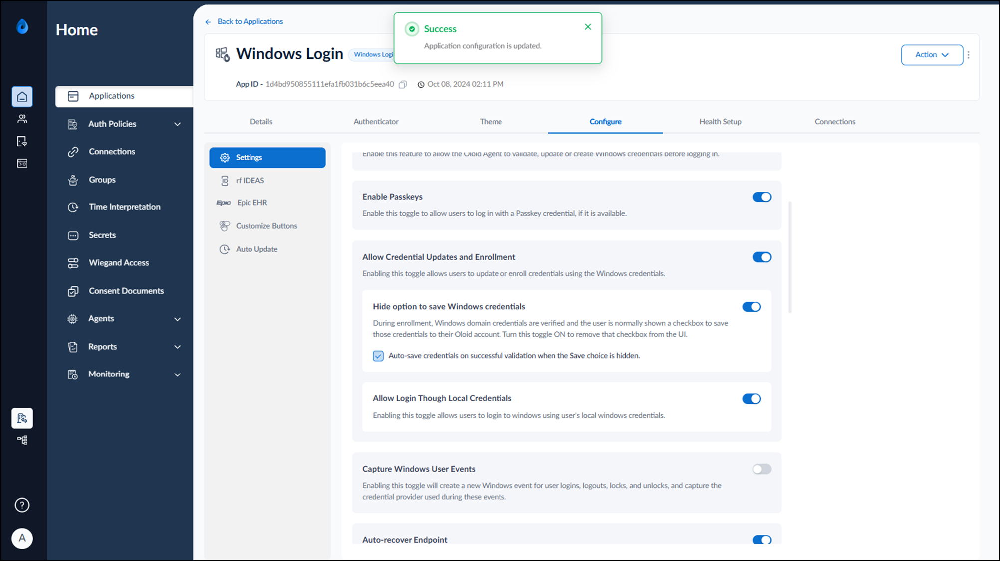
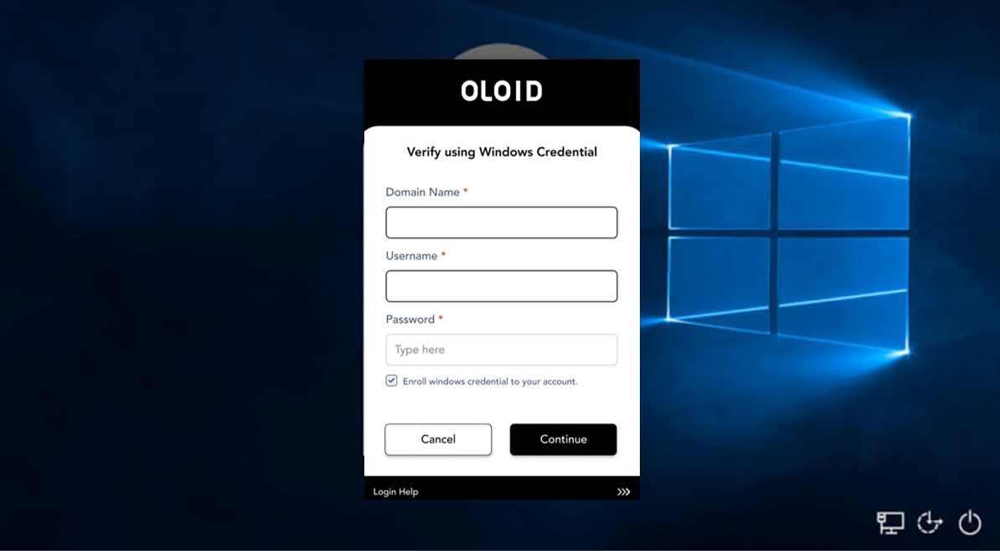

{/* Source: Intercom article 10912821 - https://oloid.help/en/articles/10912821-windows-login-how-to-enable-credential-updates-and-enrollment-for-windows-login */}
{/* Generated by intercom_to_mintlify.py - re-running overwrites this file. */}

### Introduction

In Tenant Admin Portal, enabling Credential Updates and Enrollment feature allows users to update existing credentials or enroll new credentials using their Windows credentials in the Windows Login app.

### Prerequisites

You must create a Windows Login application. For further details, refer [How to create a Windows Login Application](/platforms/windows/windows-login/windows-login-how-to-create-and-configure-windows-login-application).

### Steps to Allow Credential Updates and Enrollment

1. Log in to the **Tenant Admin Portal**.
2. On the **Applications** page, select the application paired in the Supervisor App (Windows Authenticator App).

   

   The application page is displayed.

   

3. Go to **Configure** > **Settings** tab.

   

4. Turn on **Allow Credential Updates and Enrollment** toggle button to allow users to enroll or update credentials in the Windows Login App and do the following:
   1. Enable **Hide option to save Windows credentials** toggle to remove the checkbox for saving Windows domain credentials to the Oloid account during enrolment.
   2. Select **Auto-save credentials on successful validation** checkbox to automatically save credentials when the Save option is hidden.
   3. Enable **Allow Login Through Local Credentials** toggle to allow users to log in to Windows using their local Windows credentials.

Click **Save**.

The Allow Credential Updates and Enrollment is enabled successfully.

The configuration is saved successfully. See, [Sample screen for Credential Updates and Enrollment](#sample-screen)

<Note>
  **Note:** In **Windows Authenticator** app, you must sync the configuration to Allow Credential Updates and Enrollment work properly. For more details, refer [How to sync configuration in Supervisor App](/platforms/windows/supervisor-app/how-to-sync-configuration-in-supervisor-app)
</Note>

## Sample screen

5. 

**Related Document:**

[How to enroll credentials using Windows Login app](/platforms/windows/windows-login/windows-login-how-to-enroll-credentials)

## Video Tutorial

Watch the video [How to enable Credential Updates and Enrollment in Windows Login application- Video Tutorial](/platforms/windows/videos/windows-login-how-to-enable-credential-updates-and-enrollment-in-the)
