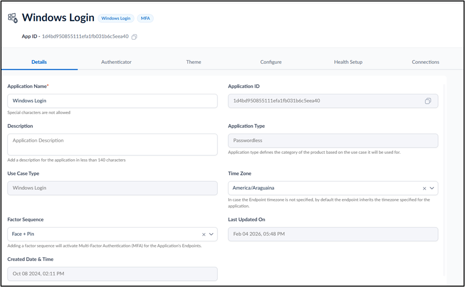
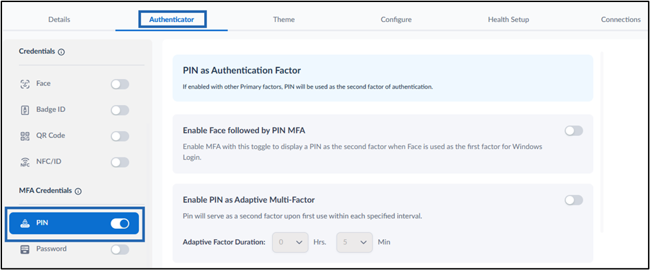
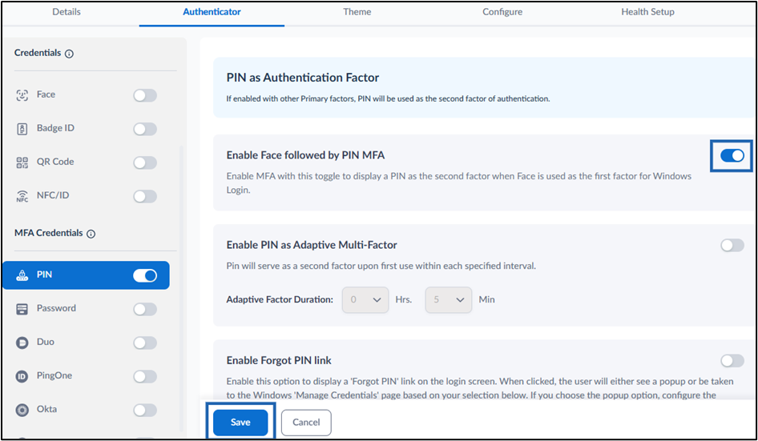
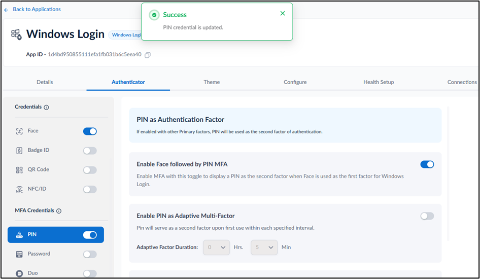

{/* Source: Intercom article 13644652 - https://oloid.help/en/articles/13644652-windows-login-how-to-enable-face-followed-by-pin-mfa-in-tenant-admin-portal */}
{/* Generated by intercom_to_mintlify.py - re-running overwrites this file. */}

## Introduction

This document provides instructions to enable **Face followed by PIN multi-factor authentication (MFA)** for the Windows Login application in the Tenant Admin Portal. When enabled, users must authenticate using Face as the primary factor and then enter a PIN as the secondary factor during Windows login.

## Prerequisites

- You must create and configure Windows Login application. For More, refer to [How to create and configure Windows Login application in the Tenant Admin Portal](/platforms/windows/windows-login/windows-login-how-to-create-and-configure-windows-login-application)
- You Must enable Face credential in the Windows Login application. For more, refer to [How to configure Face credential for Windows Login Application in the Tenant Admin Portal](/platforms/windows/windows-login/windows-login-how-to-configure-face-credential-for-windows-login-in)

## Steps toEnable Face Followed by PIN MFA

1. Log in to the Tenant Admin Portal.
2. Go to **Applications** > select **Windows Login** application.

   

   The **Details** page is displayed.

   

3. Go to **Authenticator** > enable **PIN** credential.

   

4. In **PIN as Authentication Factor**, turn on **Enable Face followed by PIN MFA**.

   <Note>
     **Note:** When this option is enabled, users must authenticate using **Face as the first factor** and then enter a **PIN as the second factor (MFA)** during Windows Login.
   </Note>

5. Click **Save.**

   

   The **Face followed by PIN MFA** is configured successfully.

   

### Sync Configuration to Apply Changes

You must sync the configuration in the **Supervisor App** to apply the changes. For detailed steps, see [How to sync configuration in Supervisor App](/platforms/windows/supervisor-app/how-to-sync-configuration-in-supervisor-app).

##### Related Document

[Windows Login - How to Enroll Face and PIN Credential](/platforms/windows/windows-login/windows-login-how-to-enroll-a-face-and-pin-credential-for-mfa-from)
