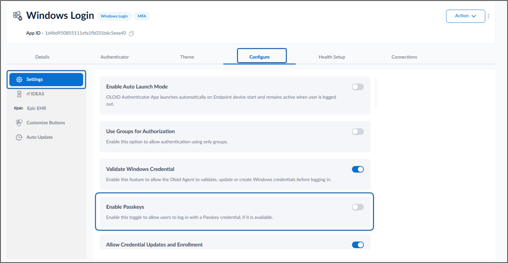
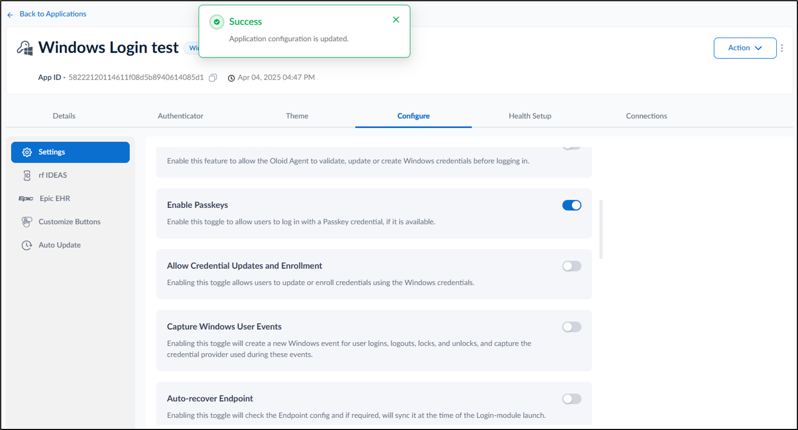

{/* Source: Intercom article 11035277 - https://oloid.help/en/articles/11035277-windows-login-how-to-enable-passkey-in-tenant-admin-portal-for-windows-login */}
{/* Generated by intercom_to_mintlify.py - re-running overwrites this file. */}

## Introduction

The Passkey feature enables secure, passwordless authentication for users accessing a Windows application. This article explains how an admin can enable Passkey login for a Windows application from the Tenant Admin Portal.

## Prerequisite

- You must have Tenant Admin Access.
- Windows Login Application must be created in the Tenant Admin Portal. For more information, refer: [How to create and configure Windows Login application in the Tenant Admin Portal](/platforms/windows/windows-login/windows-login-how-to-create-and-configure-windows-login-application)

## Steps to Enable Passkey

1. Log in to the **Tenant Admin Portal**.
2. On the **Applications** page, click on the Windows application to edit.

   

   The application page is displayed.

   

3. Go to **Configure** > **Settings** tab.

   

4. Turn on **Enable Passkeys** toggle button to allow users to log in using Passkey credential.

   

Click **Save**.

The application is configured successfully.

---

##### Related Articles

[Oloid Platform - How to create Windows Passkey as credential for users in Tenant Admin Portal](/platform/tenant-admin-portal/tenant-admin-portal-how-to-create-windows-passkey-as-credential-for)
