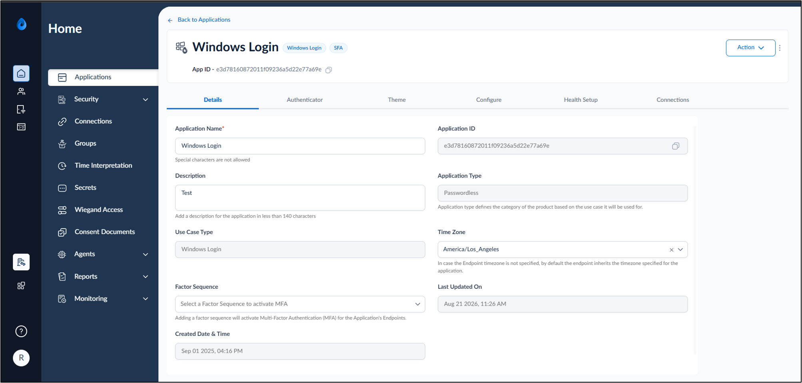
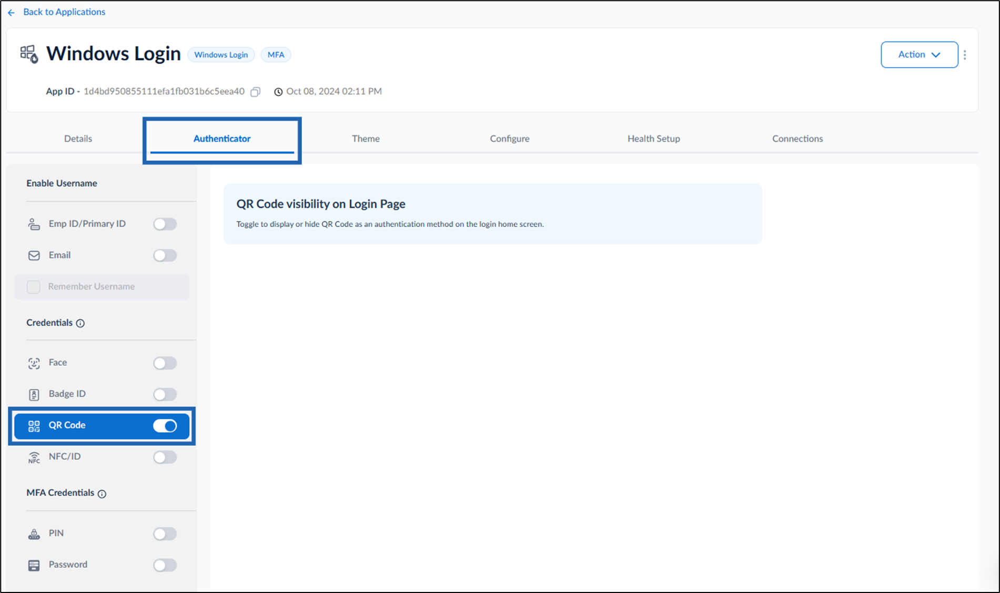
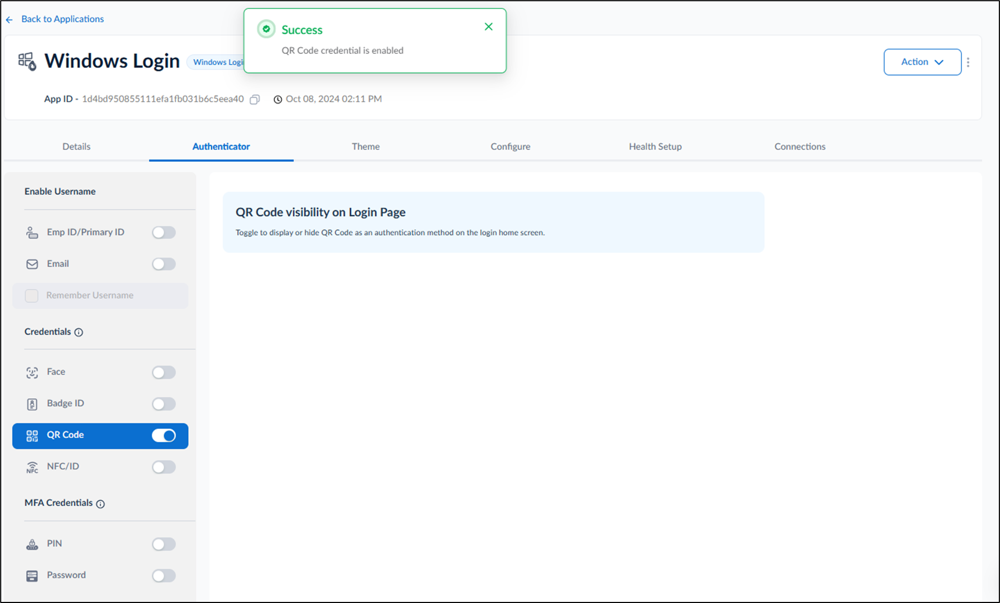

{/* Source: Intercom article 11484322 - https://oloid.help/en/articles/11484322-windows-login-how-to-enable-qr-code-credential-for-windows-login-in-the-tenant-admin-portal */}
{/* Generated by intercom_to_mintlify.py - re-running overwrites this file. */}

## Introduction

The QR Code credential feature in the Tenant Admin Portal allows admin to enable QR code-based single factor authentication and multi-factor authentication (MFA) for the Windows Login application. Once enabled, users can log in to Windows endpoints by scanning a QR code.

## Prerequisites

- You must have Tenant Admin Access.
- Windows Login Application must be created in the Tenant Admin Portal. For more information, refer: [How to create and configure Windows Login application in the Tenant Admin Portal](/platforms/windows/windows-login/windows-login-how-to-create-and-configure-windows-login-application)

## Steps to Enable QR Code

1. Log in to the **Tenant Admin Portal**.
2. On the **Applications** page, select the preferred Windows Login application.

   

   The application page is displayed.

   

3. Go to **Authenticato**r tab.
4. Turn on **QR Code** toggle.

   

   The QR code authenticator for Windows Login application is enabled successfully.

   
