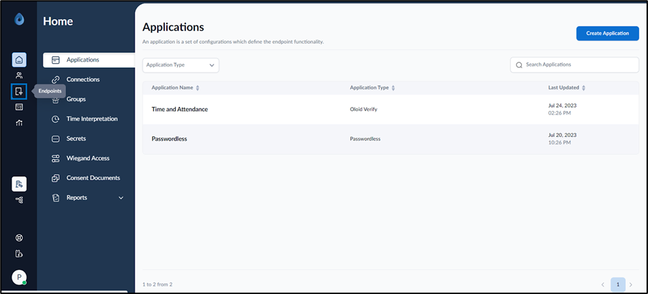
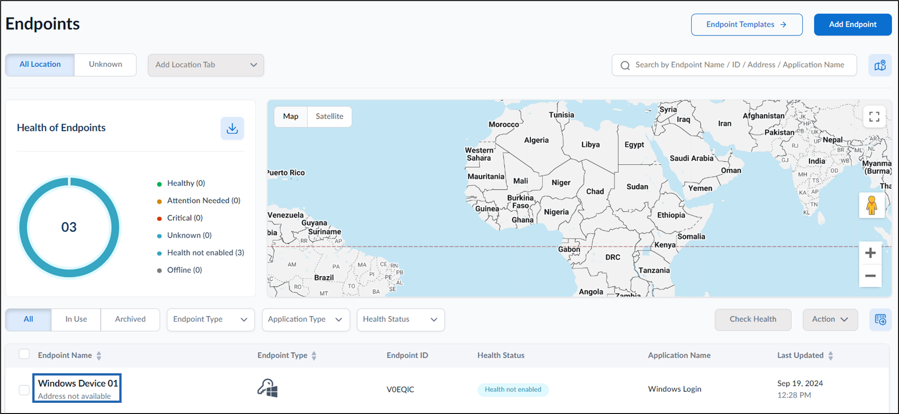
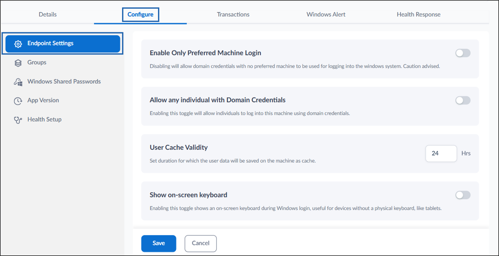
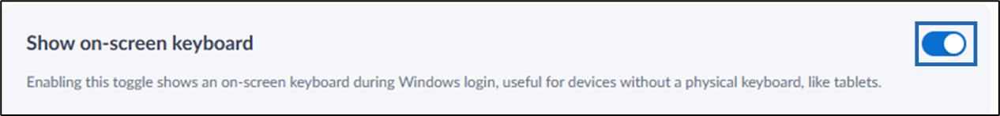
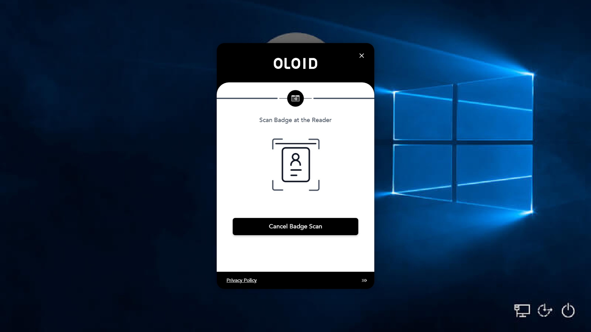
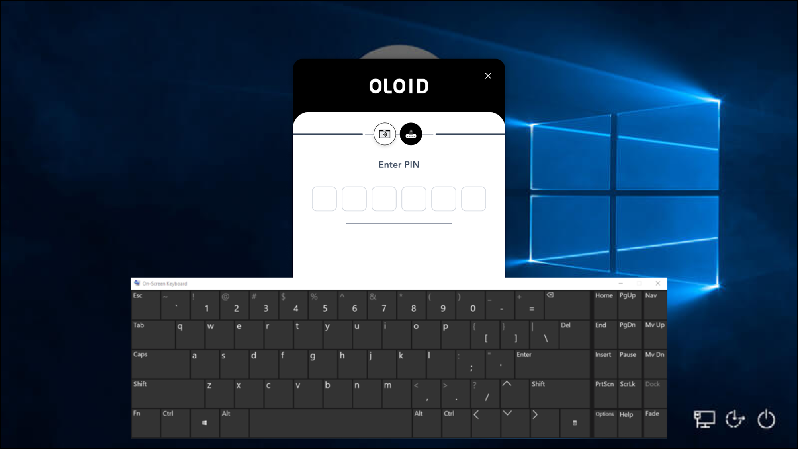
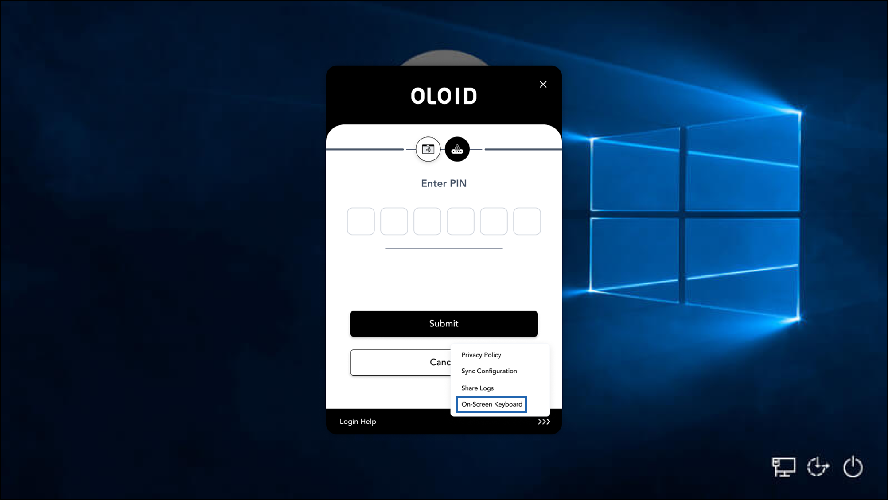

{/* Source: Intercom article 10259846 - https://oloid.help/en/articles/10259846-windows-login-how-to-enable-show-on-screen-keyboard-in-tenant-admin-portal */}
{/* Generated by intercom_to_mintlify.py - re-running overwrites this file. */}

## Introduction

The On-Screen Keyboard feature in the Tenant Admin Portal allows admins to enable a virtual keyboard for Windows Login endpoints. Once enabled, users can use the touchscreen keyboard to enter their PIN during Windows authentication.

## Prerequisites

- You must have Tenant Admin Access.
- Windows Login Application must be created in the Tenant Admin Portal. For more information, refer: [How to create and configure Windows Login application in the Tenant Admin Portal](/platforms/windows/windows-login/windows-login-how-to-create-and-configure-windows-login-application)

## Steps to Enable On-Screen Keyboard Configuration

1. Log in to **Tenant Admin Portal**.
2. On the homepage of the portal, click **Endpoints** on the left panel menu.

   

   The Endpoints page is displayed.
3. Select the endpoint to be configured.

   

4. Go to **Configure** tab > **Endpoint Settings** tab.

   

5. Turn on **Show on-screen keyboard** option to display an on-screen keyboard during Windows login. This option is useful for devices without a physical keyboard, such as tablets.

   

6. Click **Save**.
   The touchscreen is configured for the endpoint.

## To use the touchscreen keyboard for the Windows login app

1. On the Windows lock screen, tap **Login with OLOID**.

   

   The Windows login app opens and the **Scan Badge** page is displayed.
2. Tap the **Badge** on the **Badge Reader** to scan it.

   

   After Badge authentication, the **Enter PIN** pop-up box is displayed, and the onscreen keyboard automatically appears.

   

   <Note>
     **Note:** In case you are unable to view the onscreen keyboard or is accidentally closed, then tap the more  option > **On-screen Keyboard**.
   </Note>

   

3. Enter the **PIN**, then tap **Enter**.
   On PIN authentication, you are signed in to the Windows device.

---

**Related Document**

[How to configure endpoint for Windows Login](/platform/tenant-admin-portal/how-to-configure-endpoint-for-windows-login)

---

### Video Tutorial

Watch the video [Touch screen configuration on Oloid Platform for Windows Login](/platforms/windows/videos/touch-screen-configuration-on-oloid-platform-for-windows-login-video)
