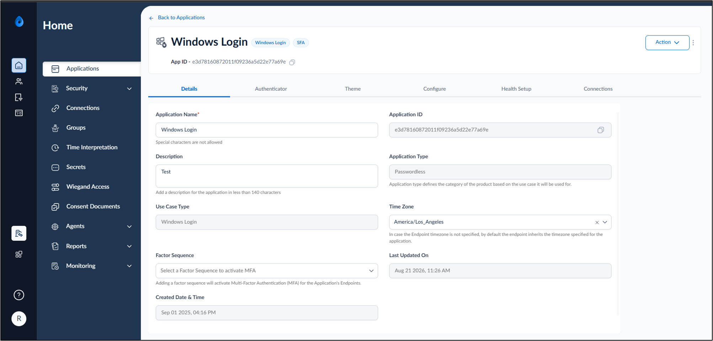
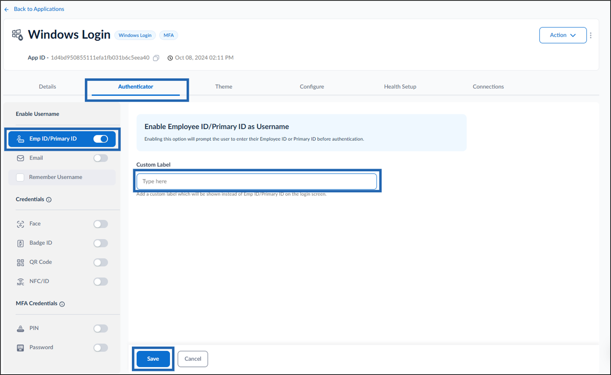
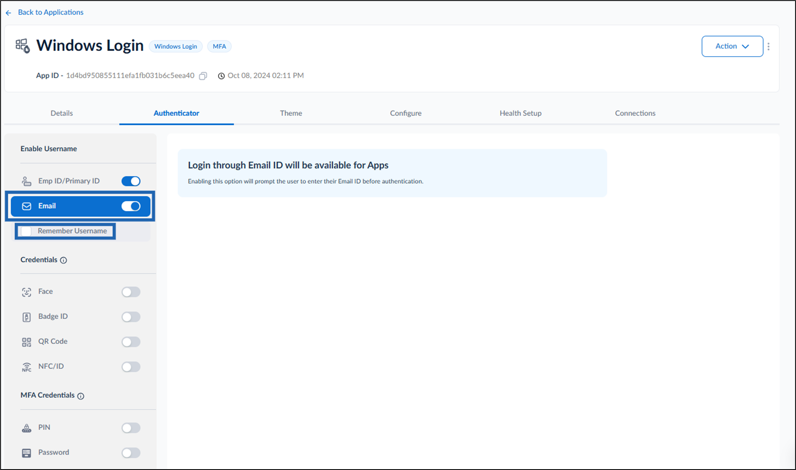
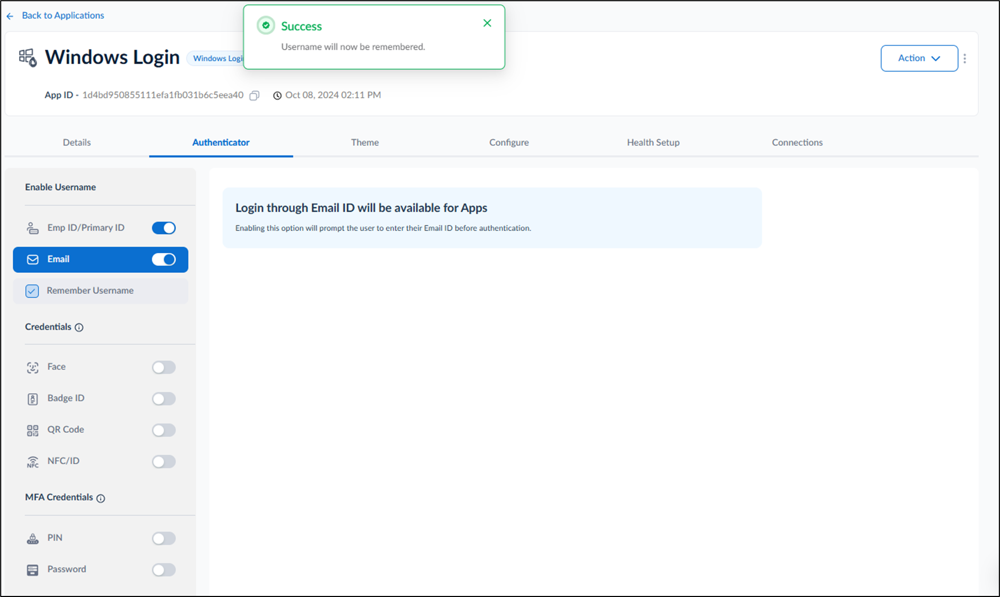

{/* Source: Intercom article 11891786 - https://oloid.help/en/articles/11891786-windows-login-how-to-enable-username-for-windows-login-in-the-tenant-admin-portal */}
{/* Generated by intercom_to_mintlify.py - re-running overwrites this file. */}

## Introduction

The Enable Username feature in the Tenant Admin Portal allows admins to enable Employee ID/Primary ID and Email as credential for the Windows Login application. Once enabled, users will be prompted to enter their selected credential (Employee ID, Primary ID, or Email) before proceeding with authentication on Windows endpoints.

## Prerequisites

- You must have Tenant Admin Access.
- Windows Login Application must be created in the Tenant Admin Portal. For more information, refer: [How to create and configure Windows Login application in the Tenant Admin Portal](/platforms/windows/windows-login/windows-login-how-to-create-and-configure-windows-login-application)

## Steps to Enable Username

1. Log in to the **Tenant Admin Portal**.
2. On the **Applications** page, select the preferred Windows Login application.

   

   The application page is displayed.

   

3. Go to **Authenticato**r tab.
4. Turn on **Emp ID/Primary ID** toggle.

   <Note>
     **Note:** Enabling this option will prompt the user to enter their Employee ID or Primary ID before authentication.
   </Note>

5. Enter a **custom label** to show instead of Emp ID/Primary ID on the login screen (optional).
6. Click **Save**.

   

7. Turn on **Email** toggle.

   <Note>
     **Note:** Enabling this option will prompt the user to enter their Email ID before authentication.
   </Note>

8. Select **Remember Username** option to allow the application to remember your Employee ID and Email.

The Emp ID/Primary ID and Email for Windows Login application is configured successfully.

