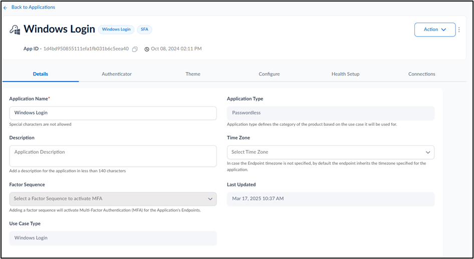
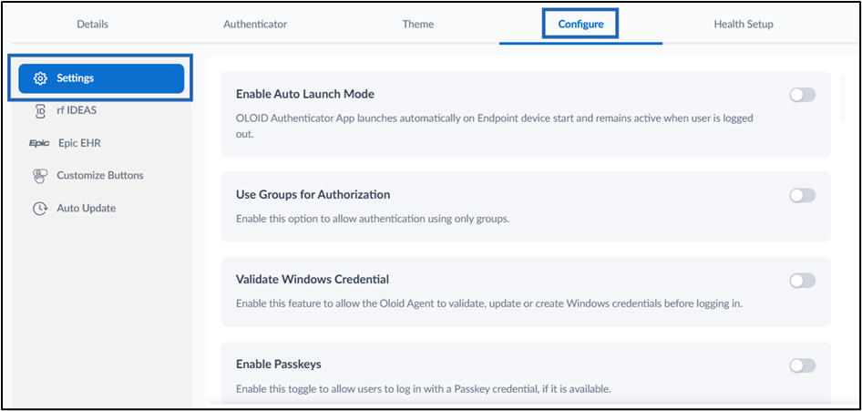
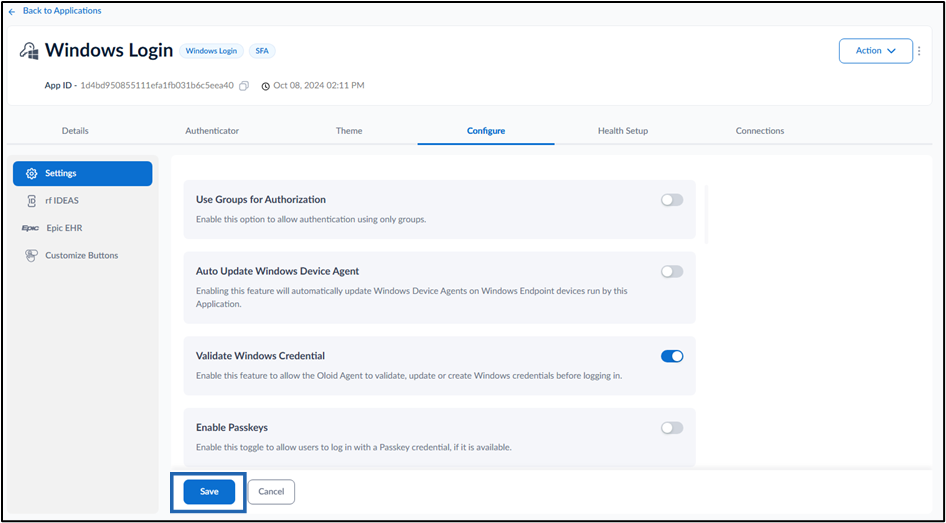
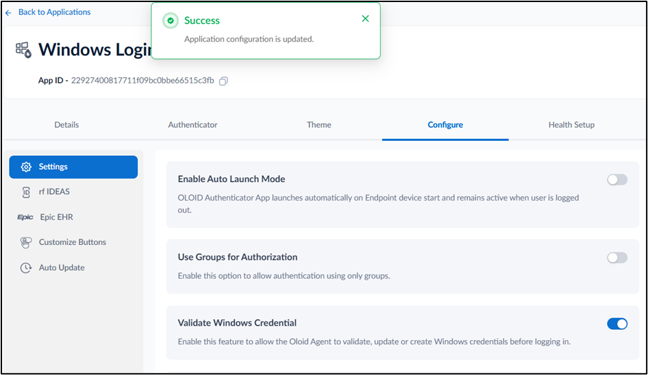
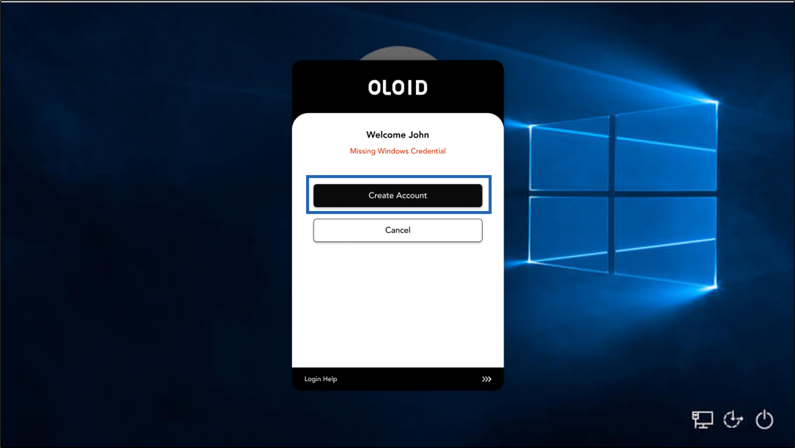
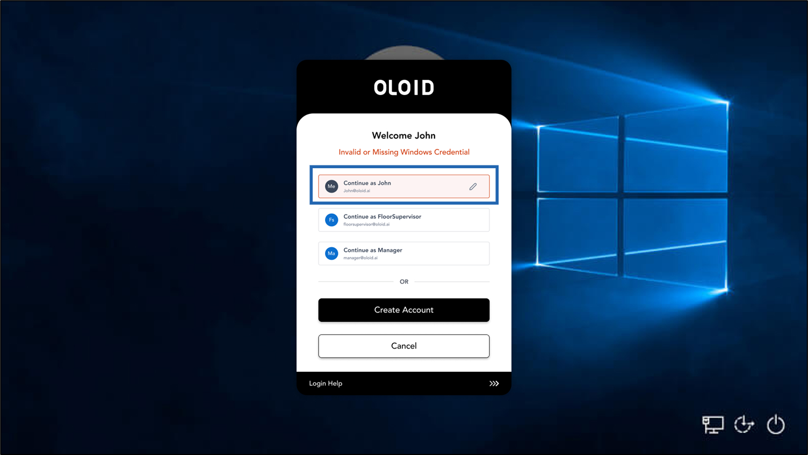

{/* Source: Intercom article 10900687 - https://oloid.help/en/articles/10900687-windows-login-how-to-enable-validate-windows-credential-for-windows-login */}
{/* Generated by intercom_to_mintlify.py - re-running overwrites this file. */}

## Introduction

Enabling the Validate Windows Credential feature in the Tenant Admin Portal allows users to create Windows credentials. It also enables users to update their account information in the Windows Login application if their Windows password has changed or expired.

## Prerequisite

You must create and configure Windows Login Application in the Tenant Admin Portal. For more details, refer [How to create and configure Windows Login Application](/platforms/windows/windows-login/windows-login-how-to-create-and-configure-windows-login-application).

## Steps to Enable Validate Windows Credential

1. Log in to the **Tenant Admin Portal**.
2. Select the application that is configured in the Supervisor App (Windows Authenticator App).

   

   The application page is displayed.

   

3. Go to **Configure** > **Settings** tab.

   

4. Turn on **Validate Windows Credential** toggle button to validate, update, or create Windows credentials in the Windows Login app before logging in to the system. See, [Sample Screen for Create Windows Credential and Missing Windows Credential](#sample-screen)

   

5. Click **Save**.

   

   The configuration is saved successfully.

   

   <Note>
     **Note:** In **Windows Authenticator** app, you must sync the configuration to Validate Windows Credential to work properly. For more details, refer [How to sync configuration in Supervisor App](/platforms/windows/supervisor-app/how-to-sync-configuration-in-supervisor-app)
   </Note>

## Sample Screen

**Scenario 1:** Create Windows Credential

- If your Windows credential is missing, the **Missing Windows Credential** screen is displayed.
- Select **Create Account** to create Windows Credential.
  For further details, refer [How to Create missing Windows Credential](/platforms/windows/windows-login/windows-login-how-to-create-missing-windows-credential)

**Scenario 2:** Missing Windows Credential

- If your Windows password is changed or expired, the **Invalid or Missing Windows Credential** screen is displayed.
- Select the account you want to update.
  For further details, refer [How to update expired Windows Credential](/platforms/windows/windows-login/how-to-update-expired-windows-credential)
