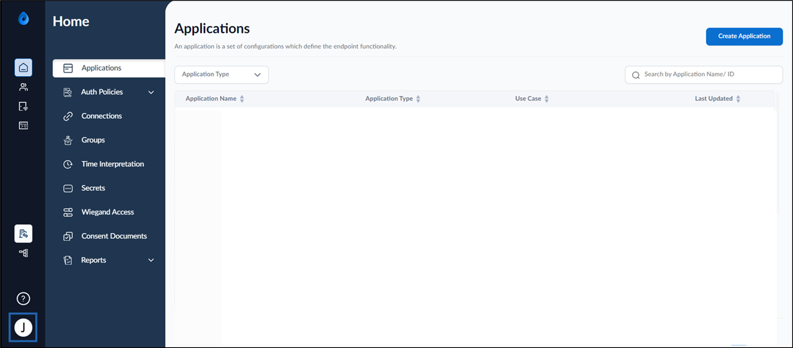
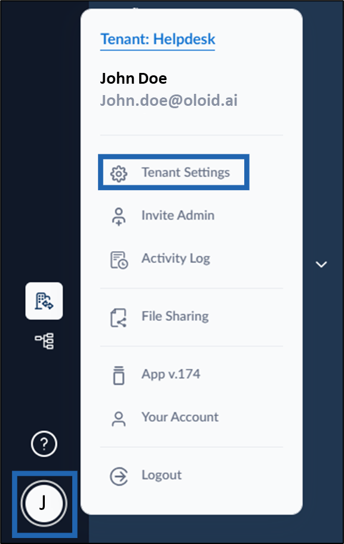
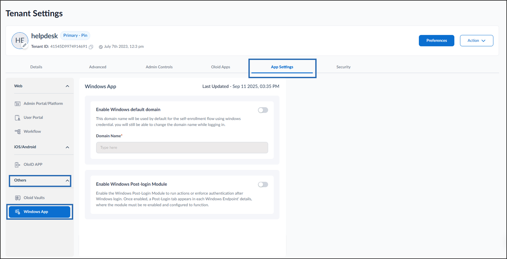
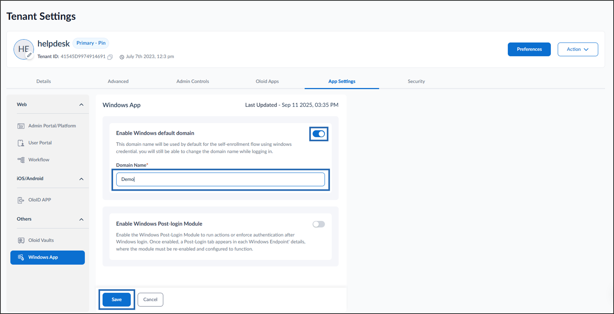
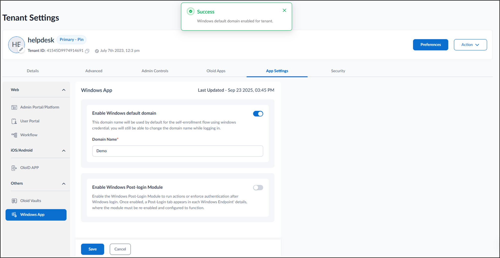
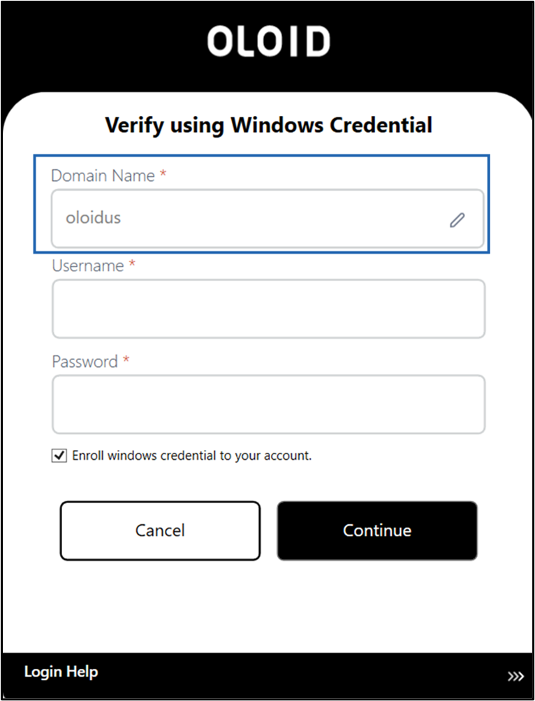

{/* Source: Intercom article 12266470 - https://oloid.help/en/articles/12266470-windows-login-how-to-enable-windows-default-domain-for-windows-login-in-the-tenant-admin-portal */}
{/* Generated by intercom_to_mintlify.py - re-running overwrites this file. */}

## Introduction

The Oloid Windows Login application enables secure, passwordless sign-in. Tenant Admins can configure a default Windows domain in the Tenant Admin Portal to streamline logins in domain-connected environments. Once set, users are automatically directed to the specified domain, making the login process faster and error-free.

## Prerequisites

The **Allow Credential Updates and Enrollment** toggle must be enabled for the application. For more details refer the **configure** section of this document [How to create and configure Windows Login application](/platforms/windows/windows-login/windows-login-how-to-create-and-configure-windows-login-application).

## Steps to enable Windows default domain

1. Log in to the **Tenant Admin Portal**.
2. On the homepage of the portal, click **user profile icon** on the bottom left corner of the menu panel.

   

   The user profile menu is displayed.
3. Go to **Tenant Settings**.

   

   The **Tenant Settings** page is displayed.
4. Go to **App Settings** tab > **others** > **Windows App**.

   

5. Do the following:
   1. Turn on **Enable Windows default domain** toggle.
   2. Enter Domain name in the text field.
   3. Click **Save**.

The Windows default domain is enabled successfully.

### Sync Configuration to Apply Changes

After enabling the **Windows Default Domain**, you must sync the configuration in the **Supervisor App** to apply the changes. For detailed steps, see [How to sync configuration in Supervisor App](/platforms/windows/supervisor-app/how-to-sync-configuration-in-supervisor-app).

Once the configuration is synced, you can view the changes during login. A sample preview screen is shown below for reference.

---

   Keywords
   | Windows default Domain Configuration | Enable Default Domain for Windows Login |
