{/* Source: Intercom article 13666085 - https://oloid.help/en/articles/13666085-windows-login-how-to-enroll-a-face-and-pin-credential-for-mfa-from-windows-lock-screen */}
{/* Generated by intercom_to_mintlify.py - re-running overwrites this file. */}

## Introduction

The credential enrollment option in the Windows Login app allows users to enroll **Face** and **PIN** credentials for **multi-factor authentication (MFA)** from the Windows lock screen. Once enrolled, users can log in using face verification followed by PIN authentication.

## Prerequisites

- You must have admin access to the **Tenant Admin Portal**.
- **Allow Credential Updates and Enrollment must be enabled in the Windows Login application. For more, refer to** [Windows Login - How to enable Credential Updates and Enrollment for Windows Login](/platforms/windows/windows-login/windows-login-how-to-enable-credential-updates-and-enrollment-for)
- Face and PIN credentials must be **enabled** in the Windows Login application. For more, refer to [Windows Login - How to Configure Face Credential for Windows Login in the Tenant Admin Portal](/platforms/windows/windows-login/windows-login-how-to-configure-face-credential-for-windows-login-in) **and** [Windows Login - How to Configure PIN Credential in the Tenant Admin Portal](/platforms/windows/windows-login/windows-login-how-to-configure-pin-credential-in-the-tenant-admin)
- The **Face followed by PIN** MFA toggle must be enabled in the Windows Login application. For more, refer to [Windows Login - How to Enable Face Followed by PIN MFA in Tenant Admin Portal](/platforms/windows/windows-login/windows-login-how-to-enable-face-followed-by-pin-mfa-in-tenant-admin)
- The user’s Primary ID or email ID must match the username configured in the Tenant Admin Portal.

## Steps to Enroll Face

1. On the Windows lock screen, click **Login with OLOID**.

   

   The Windows login app opens, and the **Welcome** page is displayed.
2. Select **Login with Face**.

   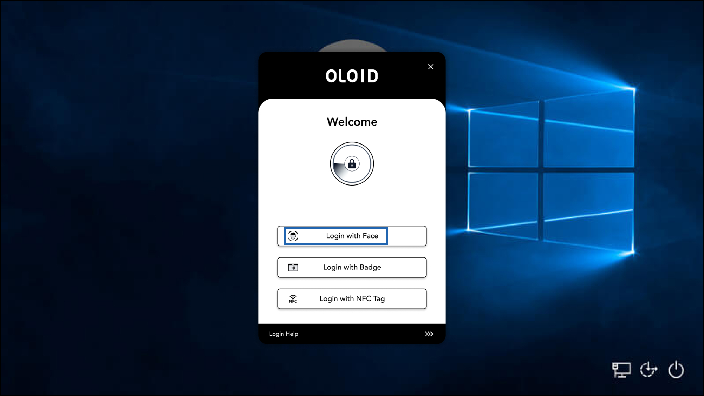

   The Windows login app opens and the camera turns on.
3. Place your face in front of the camera for facial authentication.

   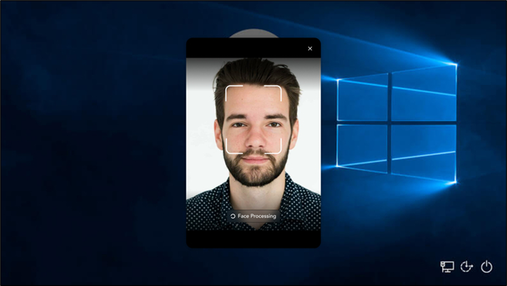

   The Face authentication fails and the **Missing Credentials** screen is displayed.
4. Click **Enroll Credential**.

   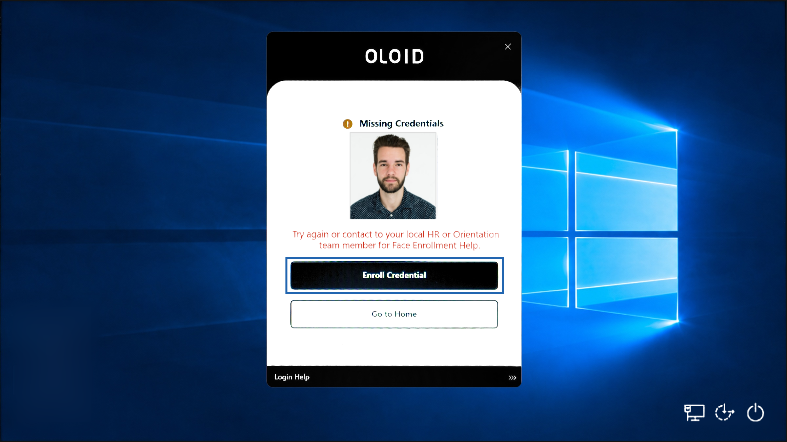

   The **Verify using Windows Credential** screen is displayed.
5. Do the following:
   1. Enter **Domain Name**
      Enter your Windows domain name.
   2. Enter **Username**.
      Use your Windows account username.
   3. Enter **Password**.
      Use your Windows account password.
   4. Select **Enroll Windows credential to your account**. (Optional)
   5. Click **Continue**.

      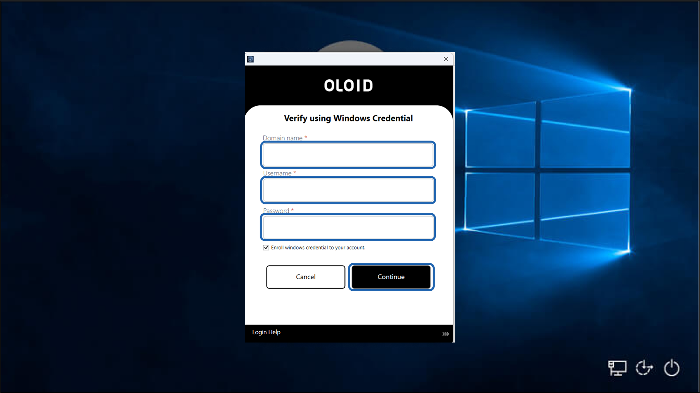

      The **Select Credential to Enroll or Update** screen is displayed.
6. Select **Face**.

   <Note>
     **Note:** If connection is enabled, user consent is requested before uploading the picture.
   </Note>

   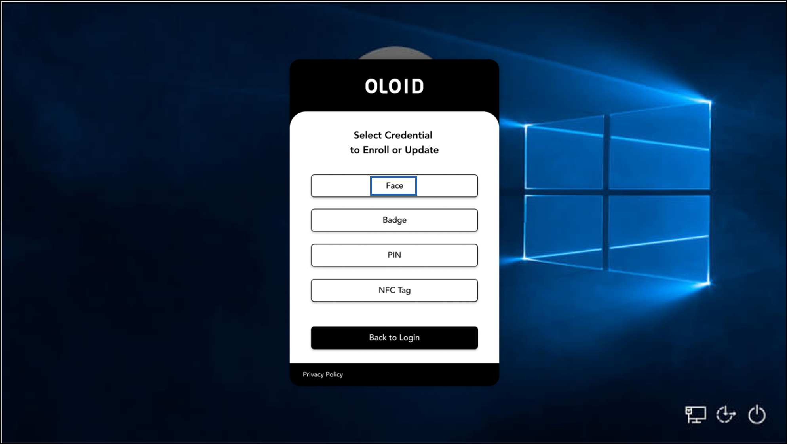

   The camera turns on.
7. Place your face in front of the camera for face authentication.

   

   **Are you happy with picture** pop-up box is displayed.
8. Click **Yes, Submit.**

   <Note>
     **Note:** Click **No, Retake** if you want to retake the picture.
   </Note>

   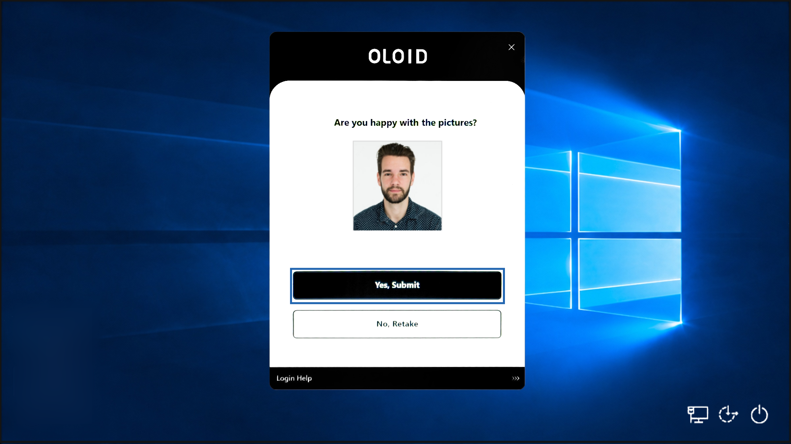

   The Face credential is enrolled successfully, and **Enrollment Successful** pop-up is displayed.

   <Note>
     **Note:** You can enroll up to **5 Face credentials** for a single user.
   </Note>

   

## Steps To Enroll PIN

1. Click **Credential Face, Badge OR NFC**.

   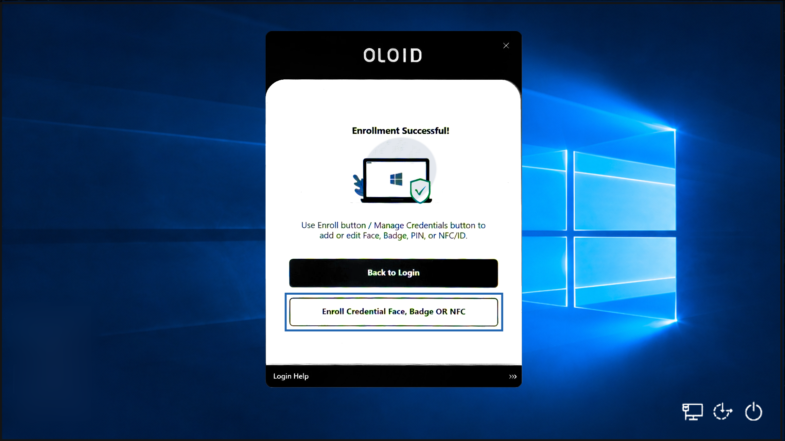

   The **Select Credential to Enroll or Update** Pop up is displayed.
2. Select **PIN**.

   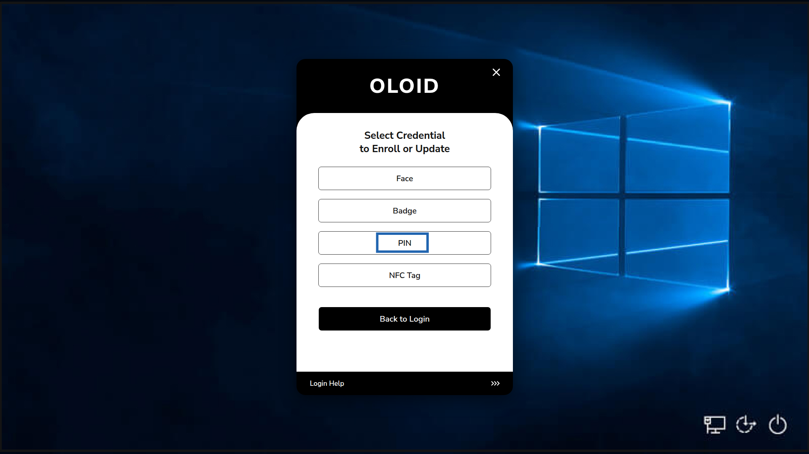

3. Do the following:
   1. Enter new PIN.
   2. Re-enter new PIN.
   3. Click **Submit**.

<Note>
  **Note:** You can configure PIN credentials in the Tenant Admin Portal. For more details, refer to [How to configure PIN](/platform/tenant-admin-portal/tenant-admin-portal-how-to-configure-pin)
</Note>

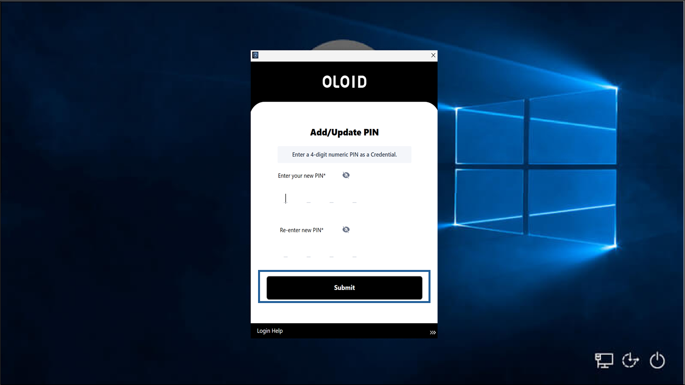

The PIN credential is enrolled successfully.

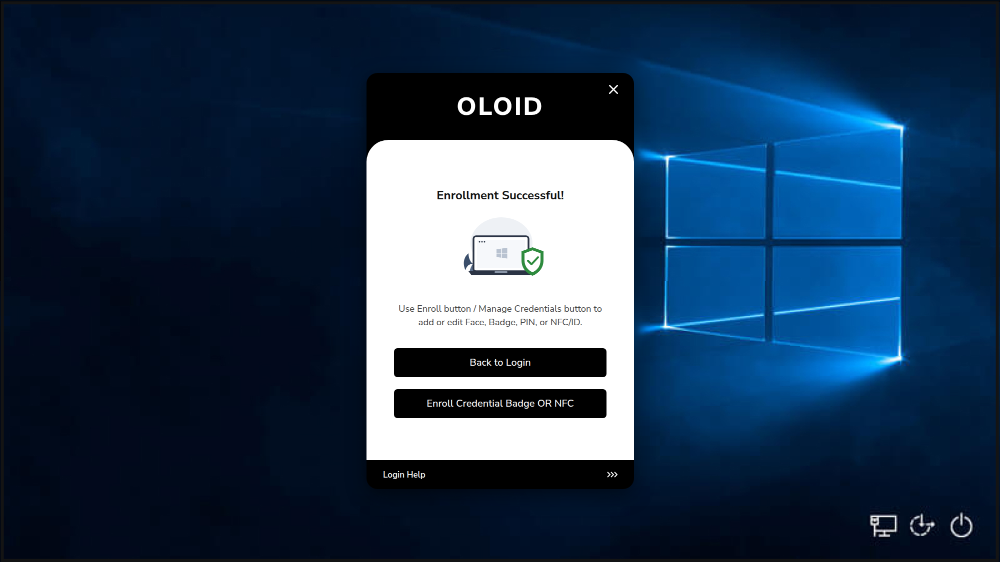

---

##### Sample Screen

   <Note>
     **Note:** If the Face is already enrolled and PIN is not enrolled then Missing Credentials screen is displayed. Click **Enroll Credential** to Enroll the PIN.
   </Note>

   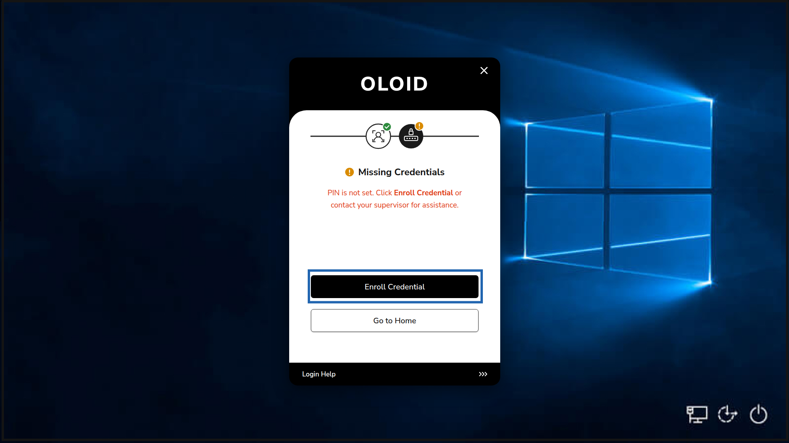
