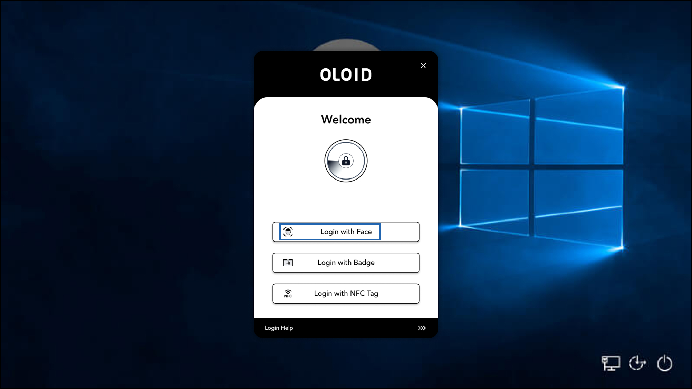
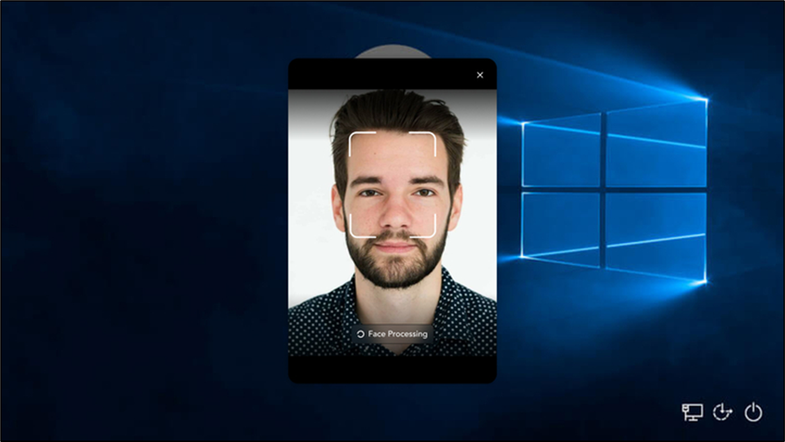
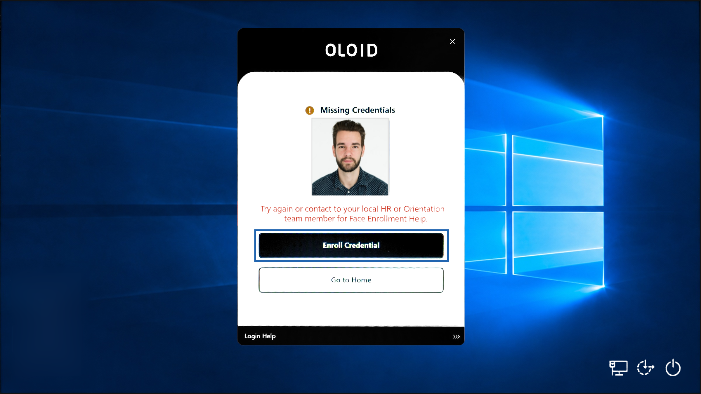
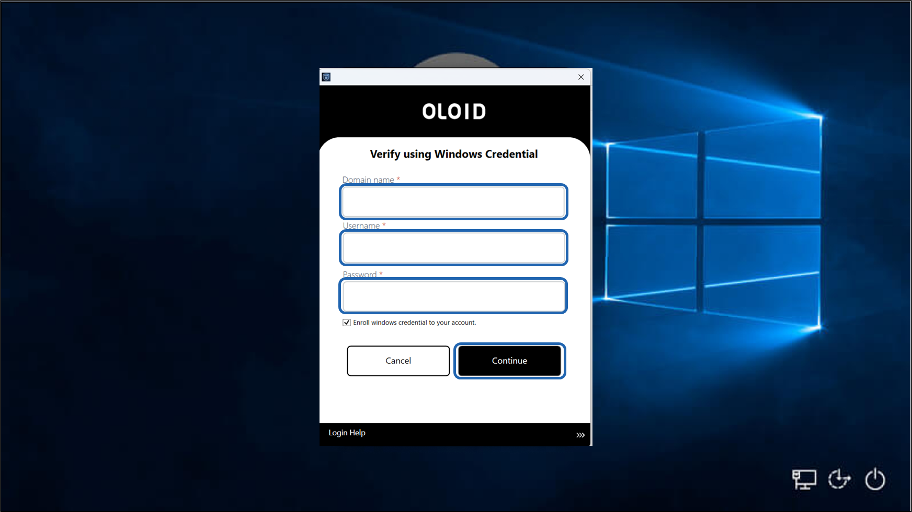
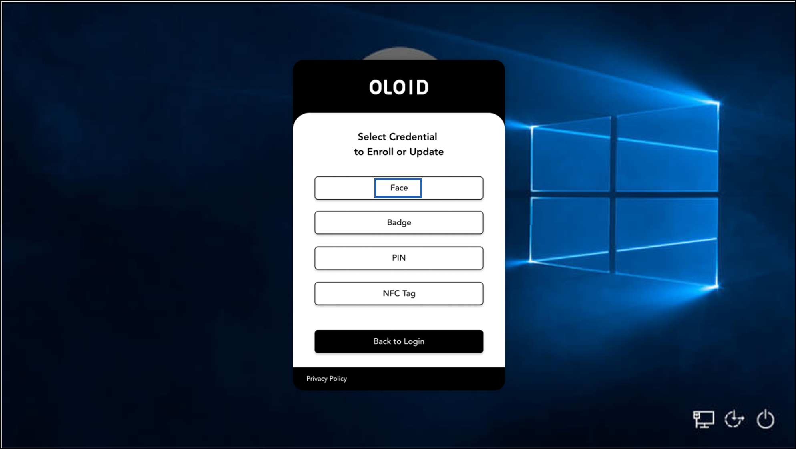
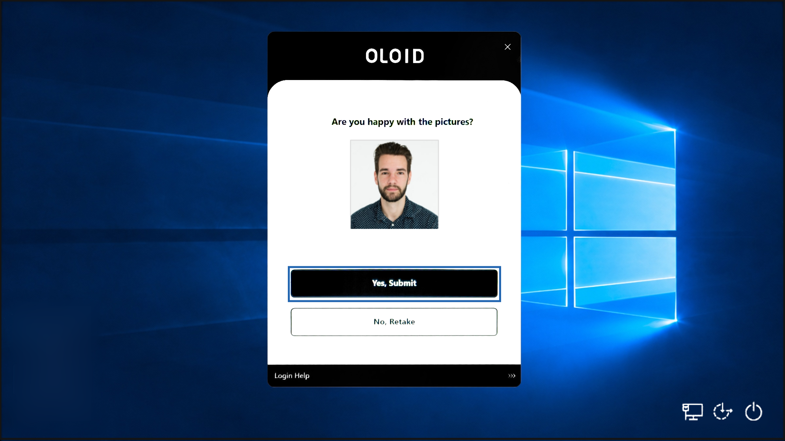
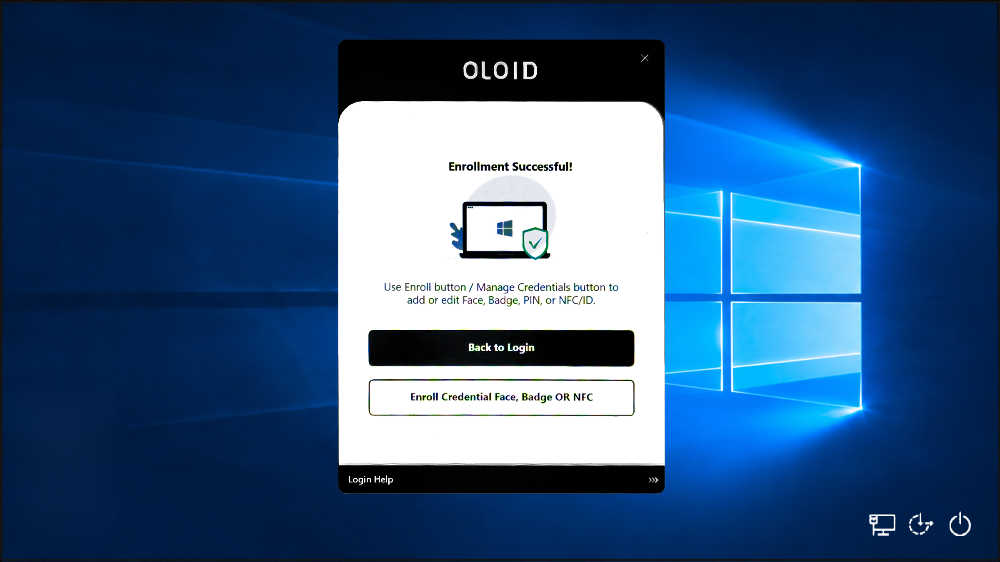

{/* Source: Intercom article 10006252 - https://oloid.help/en/articles/10006252-windows-login-how-to-enroll-a-face-credential-from-windows-lock-screen */}
{/* Generated by intercom_to_mintlify.py - re-running overwrites this file. */}

## Introduction

This document provides step-by-step instructions for enrolling a **Face credential** through the **Windows Login application**. It explains how to verify your Windows credentials and complete Face enrollment for authentication

## Prerequisites

- Windows Login Application must be created in the **Tenant Admin Portal**, refer to [How to create and configure Windows Login application in the Tenant Admin Portal](/platforms/windows/windows-login/windows-login-how-to-create-and-configure-windows-login-application)
- Ensure the endpoint is paired with the **Windows Login application**, refer to [Windows Login - How to Manually Pair the Supervisor App](/platforms/windows/supervisor-app/windows-login-how-to-manually-pair-the-supervisor-app)
- In **Tenant Admin Portal**, enable **Allow Credential Updates and Enrollment** to enroll credentials in Windows Login app, refer to [How to enable Allow Credential Updates and Enrollment in Windows Login application](/platforms/windows/windows-login/windows-login-how-to-enable-credential-updates-and-enrollment-for)
- Ensure the **Enable Windows default domain** toggle is turned on. For more details, refer to [How to enable Windows Default Domain for Windows Login application in the Tenant Admin Portal](/platforms/windows/windows-login/windows-login-how-to-enable-windows-default-domain-for-windows-login)
- Make sure either the user's Primary ID or email ID matches your System Account Name.

## Steps to Enroll Face

1. On the Windows lock screen, click **Login with OLOID**.

   

   The Windows login app opens and the **Welcome** page is displayed.
2. Select **Login with Face**.

   

   The Windows login app opens and the camera turns on.
3. Place your face in front of the camera for facial authentication.

   

   The Face authentication fails and the **Missing Credentials** screen is displayed.
4. Click **Enroll Credential**.

   

   The **Verify using Windows Credential** screen is displayed.
5. Do the following:
   1. Enter **Domain Name**
      Enter your Windows domain name.
   2. Enter **Username**.
      Use your Windows account username.
   3. Enter **Password**.
      Use your Windows account password.
   4. Select **Enroll Windows credential to your account**. (Optional)
   5. Click **Continue**.

      

      The **Select Credential to Enroll or Update** screen is displayed.
6. Select **Face**.

   <Note>
     **Note:** If connection is enabled, user consent is requested before uploading the picture.
   </Note>

   

   The camera turns on.
7. Place your face in front of the camera for face authentication.

   

   **Are you happy with picture** pop-up box is displayed.
8. Click **Yes, Submit.**

   <Note>
     **Note:** Click **No, Retake** if you want to retake the picture.
   </Note>

   

   The Face credential is enrolled successfully, and **Enrollment Successful** pop-up is displayed.

   <Note>
     **Note:** You can enroll up to **5 Face credentials** for a single user.
   </Note>

9. Click **Back to Login**.

   <Note>
     **Note:** You can now log in with your enrolled face.
   </Note>

   
