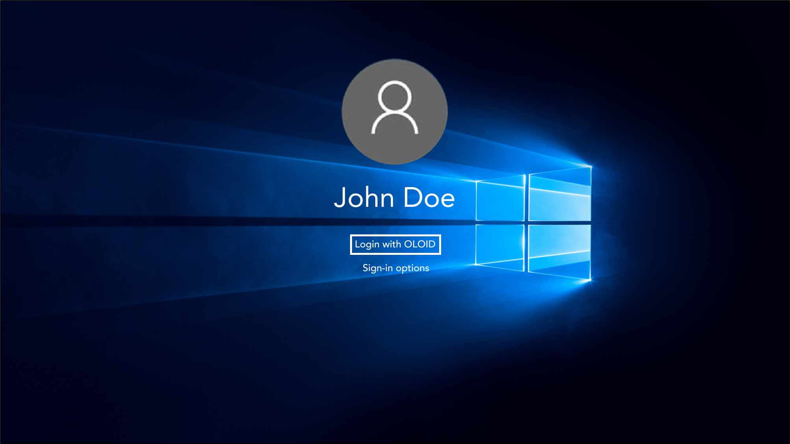
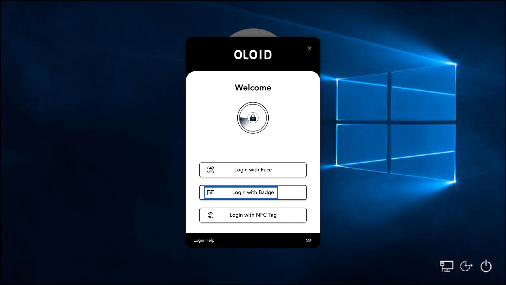
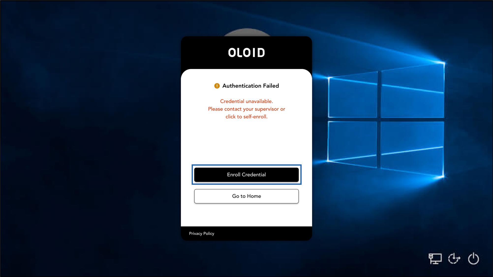
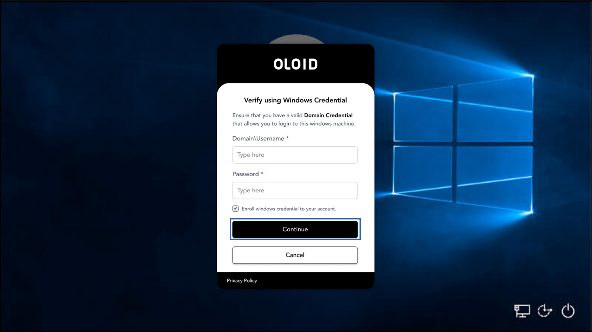
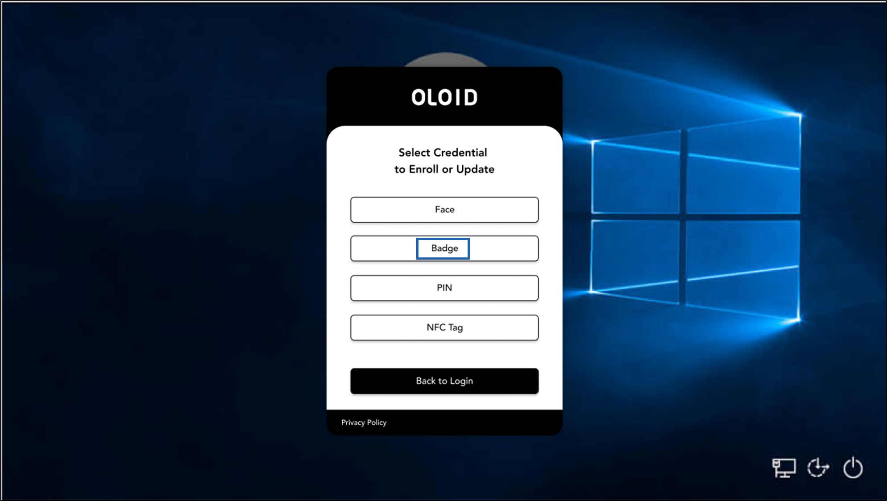
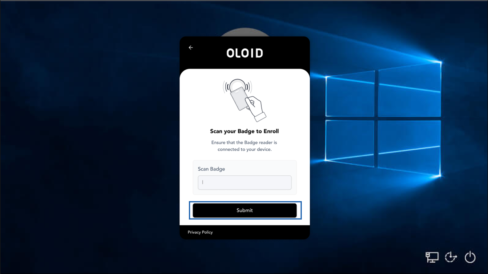
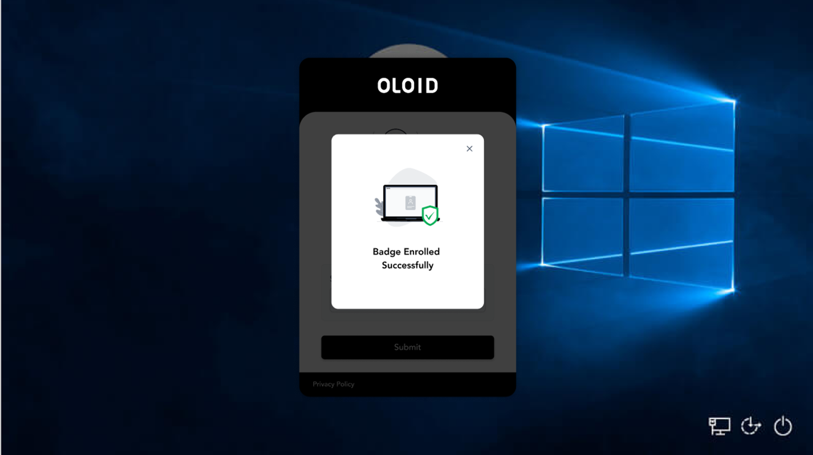

{/* Source: Intercom article 9991972 - https://oloid.help/en/articles/9991972-windows-login-how-to-enroll-badge */}
{/* Generated by intercom_to_mintlify.py - re-running overwrites this file. */}

**Introduction**

This document provides step-by-step instructions for enrolling badge through Windows Login app.

Steps to enroll badge through Windows Login app:

1. On the Windows lock screen, click **Login with OLOID**.

   

   The Windows login app opens and the **Welcome** page is displayed.
2. Select **Login with Badge**.

   

3. Tap the **Badge** on the **Badge Reader** to scan it.

   <Note>
     **Note:** The badge reader must be connected to the computer.
   </Note>

   

   The badge authentication fails and the Enroll Credential option is displayed.
4. On the **Authentication Failed** screen, select **Enroll Credential**.

   

   The **Verify using Windows Credential** screen is displayed.
5. Do the following:
   1. Enter **Domain\Username**.
      Enter your Windows domain and username in the format `Domain\Username`.
   2. Enter **Password**.
      Use your Windows account password.
   3. Select **Enroll Windows credential to your account**. (Optional)
   4. Click **Continue**.

      

      The **Select Credential to Enroll or Update** screen is displayed.
6. Select **Badge**.

   <Note>
     **Note:** You can also update the badge credential.
   </Note>

   

   The **Scan your Badge to Enroll** screen is displayed.
7. Scan your badge in the Badge Reader.

   

8. Click **Submit**.
   The badge is enrolled successfully.

   
