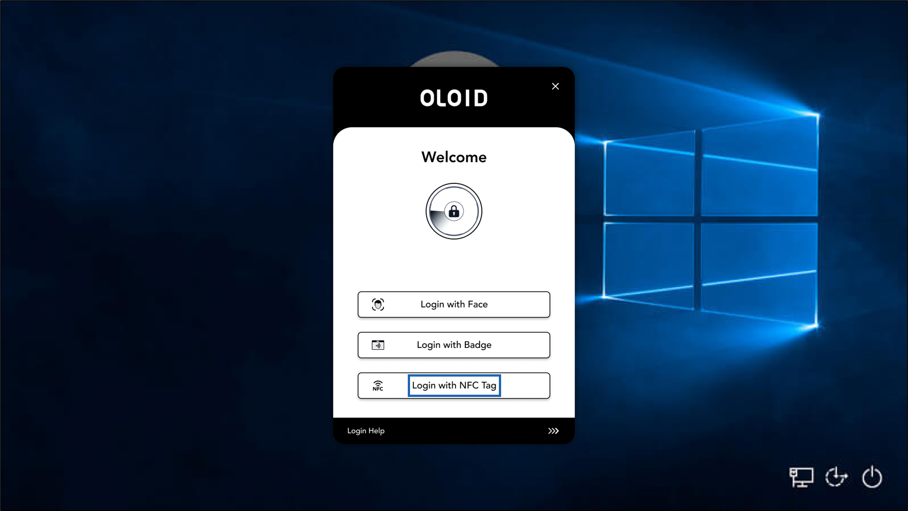
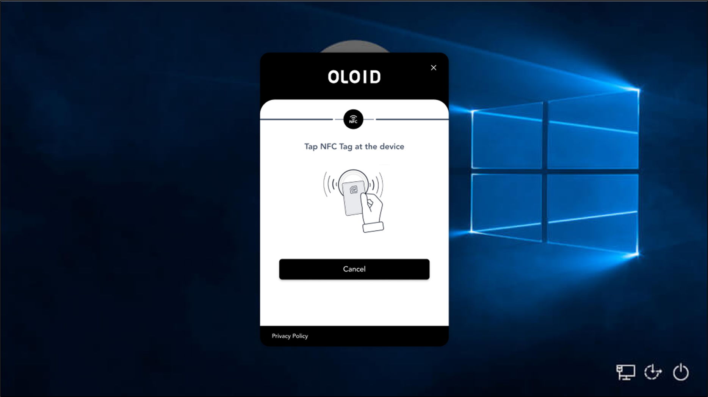
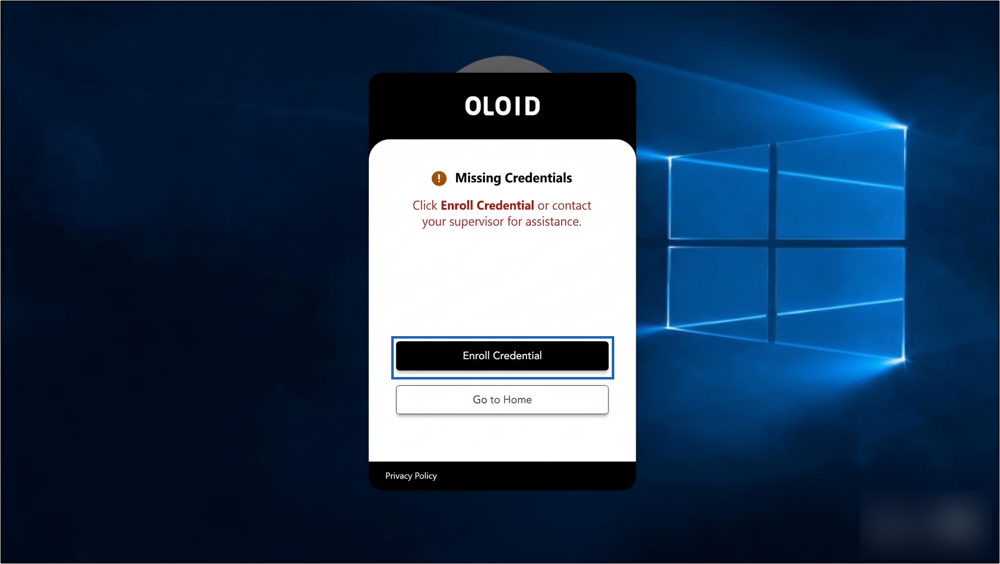
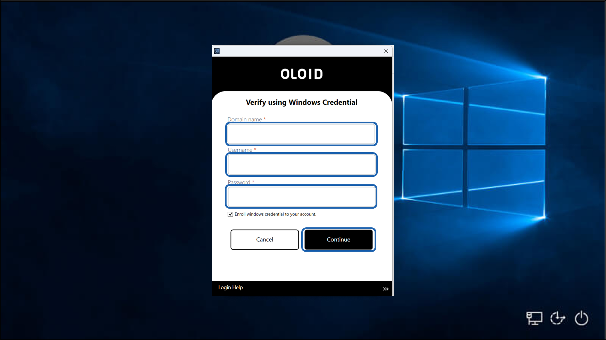
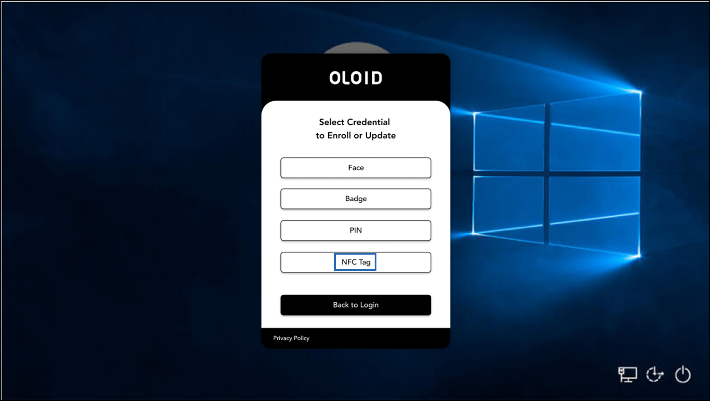
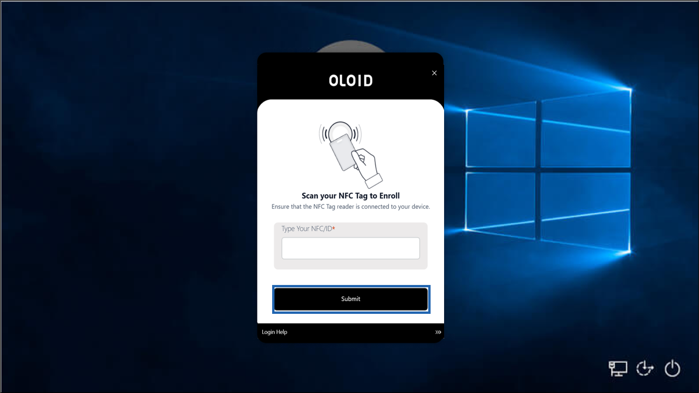
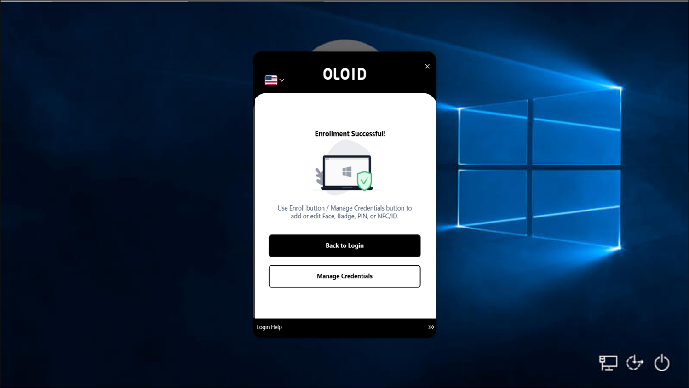

{/* Source: Intercom article 10002126 - https://oloid.help/en/articles/10002126-windows-login-how-to-enroll-nfc-tag-from-the-windows-lock-screen */}
{/* Generated by intercom_to_mintlify.py - re-running overwrites this file. */}

## Introduction

The NFC enrollment option in the Windows Login app allows users to register their NFC tag as a credential from the Windows lock screen. Once enrolled, users can log in to their Windows system by tapping their NFC tag on the card reader.

## Prerequisites

- Windows Login Application must be created in the Tenant Admin Portal. For more refer [Windows Login - How to create and configure Windows Login application in the Tenant Admin Portal](/platforms/windows/windows-login/windows-login-how-to-create-and-configure-windows-login-application)
- Enable NFC as an authenticator in the Windows application. For more refer [Windows Login - How to enable NFC/ID credential for Windows Login in the Tenant Admin Portal](/platforms/windows/windows-login/windows-login-how-to-enable-nfc-id-credential-for-windows-login-in)
- **Allow Credential Updates and Enrollment** must be enabled in the Windows Login application. For more, refer to [Windows Login - How to enable Credential Updates and Enrollment for Windows Login](/platforms/windows/windows-login/windows-login-how-to-enable-credential-updates-and-enrollment-for)
- A card reader must be connected to the computer.

## Steps to Enroll NFC through Windows Login App

1. On the Windows lock screen, click **Login with OLOID**.

   

   The Windows login app opens, and the **Welcome** page is displayed.
2. Select **Login with NFC Tag**.

   

3. Tap the **NFC Tag** on the **Card Reader** to scan it.

   <Note>
     **Note:** The card reader must be connected to the computer.
   </Note>

   

   The NFC authentication fails and the Enroll Credential option is displayed.
4. On the **Authentication Failed** screen, select **Enroll Credential**.

   

   The **Verify using Windows Credential** screen is displayed.
5. Do the following:
   1. Enter **Domain Name**
      Enter your Windows domain name.
   2. Enter **Username**.
      Use your Windows account username.
   3. Enter **Password**.
      Use your Windows account password.
   4. Select **Enroll Windows credential to your account**. (Optional)
   5. Click **Continue**.

      

      The **Select Credential to Enroll or Update** screen is displayed.
6. Select **NFC Tag**.

   

   The **Scan your NFC Tag to Enroll** screen is displayed.
7. Scan your **NFC Tag** in the Card Reader.
8. Click **Submit**.

   

   The NFC Tag is enrolled successfully.

   
