{/* Source: Intercom article 10449230 - https://oloid.help/en/articles/10449230-windows-login-how-to-install-and-auto-pair-windows-authenticator-app-through-mdm */}
{/* Generated by intercom_to_mintlify.py - re-running overwrites this file. */}

## Introduction

Oloid's Windows Authenticator App is a secure and user-friendly authentication method that allows Enterprise employees to log into Windows Laptops/Desktops/Servers using physical identity factors (like Face, Badge, NFC tags, and PIN). The Physical Identity factors can be combined in any order using factor sequencing for Multi-factor Authentication.

### Preparation Steps

1. Generate the AutoPairConfig file in the Oloid Platform, then download and save it to your local device as **AutoPairConfig.json**.
   For more details, see [How to generate auto-pair config file for Windows Login in Oloid Portal](/platform/tenant-admin-portal/windows-login-how-to-generate-and-download-auto-pair-config-file-for)
2. Download **OloidPasswordlessSupervisor.Setup.zip** file on your device.

   <Note>
     **Note:** Select the version as advised by your Oloid Rep. For instructions to download the file, refer **How to download Supervisor App** > [Steps to download from Tenant](/platforms/windows/supervisor-app/how-to-download-supervisor-app)
   </Note>

   If any previous version of Windows Authenticator app is installed, you need to remove it before installing the new version.

   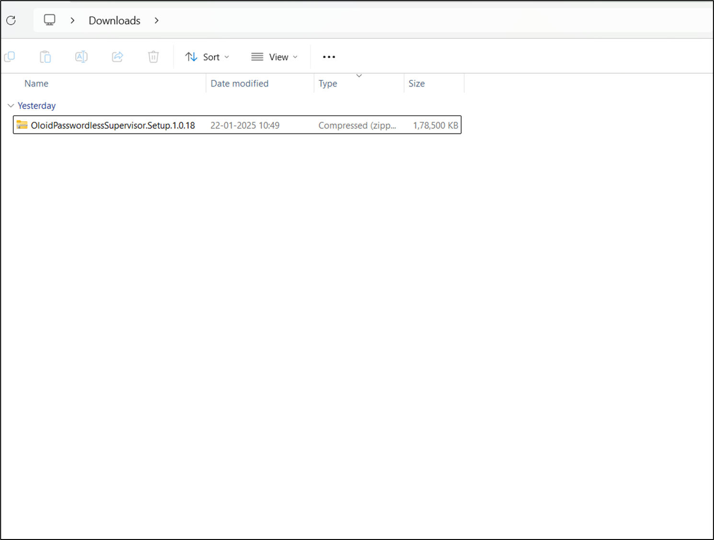

3. Right-click and select **Extract All** >**OloidPasswordlessSupervisor.Setup.zip** folder.

   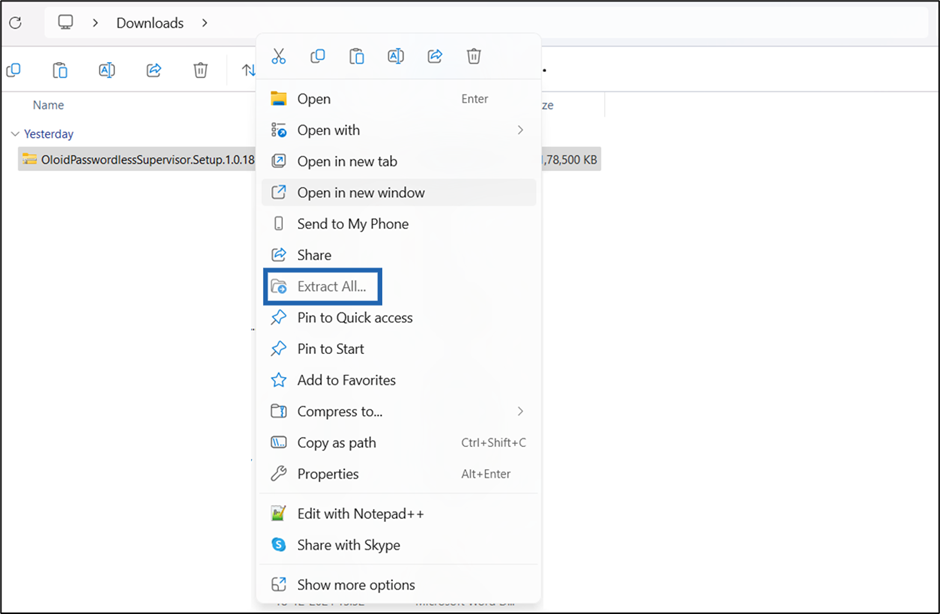

   The extracted files will be saved in the same folder as the original zipped file.

   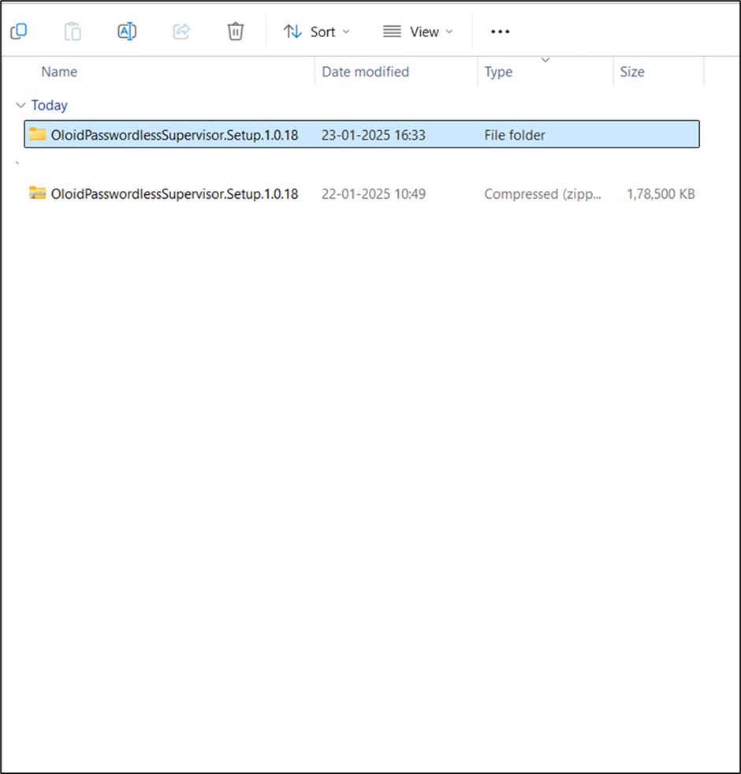

4. Copy the **AutoPairConfig.json** file to the extracted folder.

   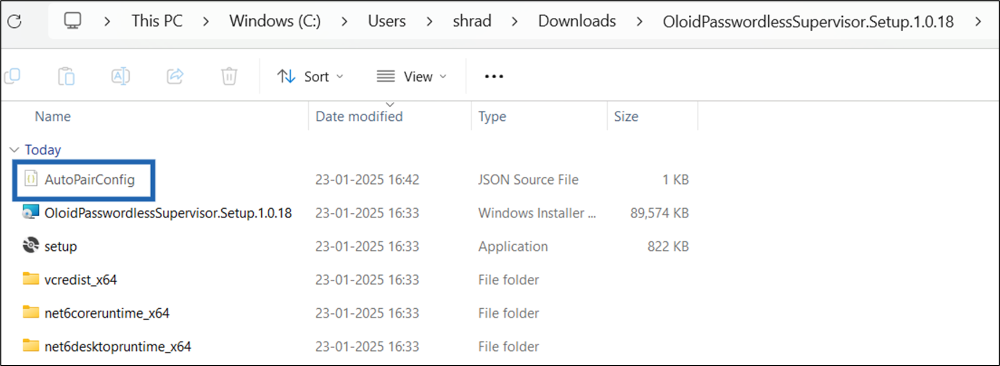

5. Right-click and select **OloidPasswordlessSupervisor.Setup.1.0.18** folder > **Compress to** > **ZIP File**.

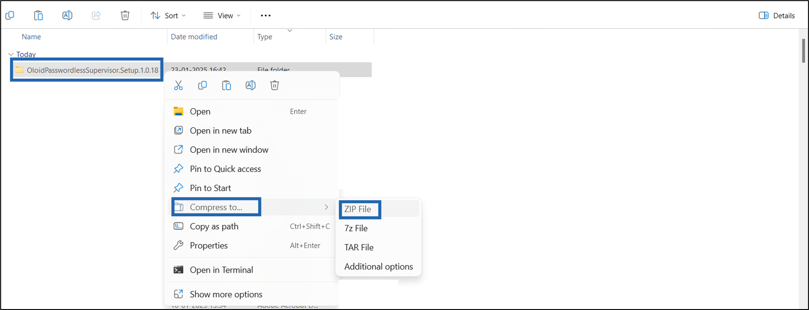

The folder is zipped and ready to be shared.

### Steps to install and auto-pair the Windows Authenticator app on end-user machines

1. Push the zipped file (**OloidPasswordlessSupervisor.Setup.1.0.18.zip**) through the MDM for the end-user machines.

   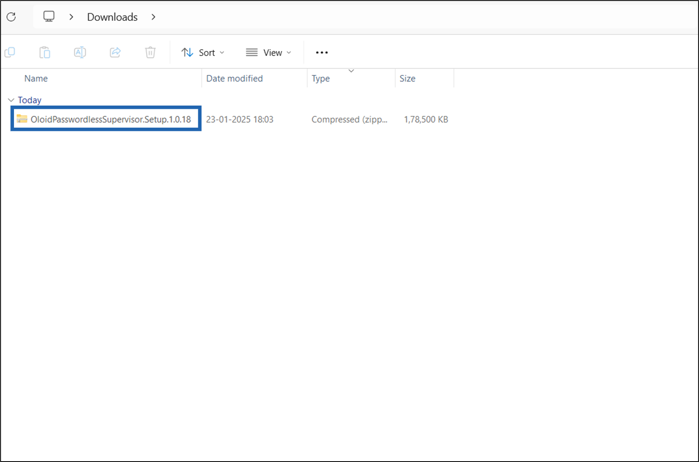

2. Right-click and select **Extract All** > **OloidPasswordlessSupervisor.Setup.zip** folder.

   

   The unzipped OloidPasswordlessSupervisor.Setup1.0.18 folder is displayed.

   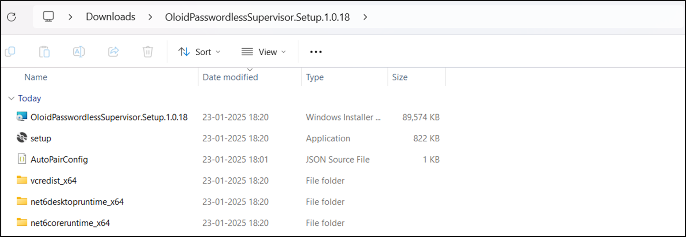

   <Note>
     **Note:** Make sure the AutoPairConfig.json file is present in the folder.
   </Note>

3. Double-click on **setup.exe** file.

   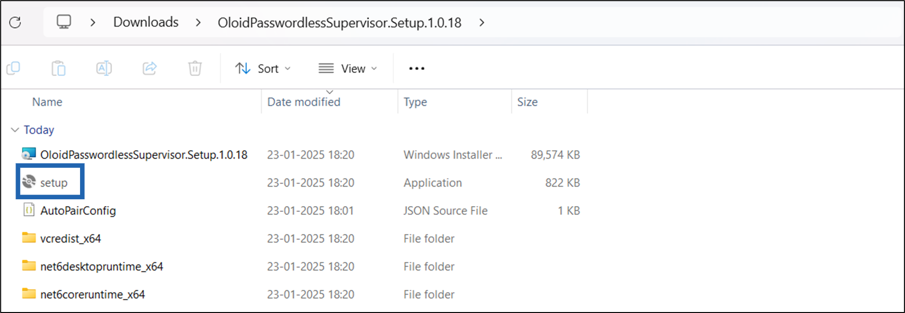

   The **Oloid Passwordless Supervisor Setup** window is displayed.

   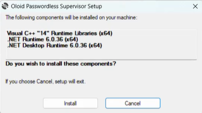

4. Review the listed components and click **Install** to proceed.

   <Note>
     **Note:** If any of the files are missing, the application prompts to install the missing component.
   </Note>

5. On the **Oloid Passwordless Supervisor** Setup wizard, click **Next**.

   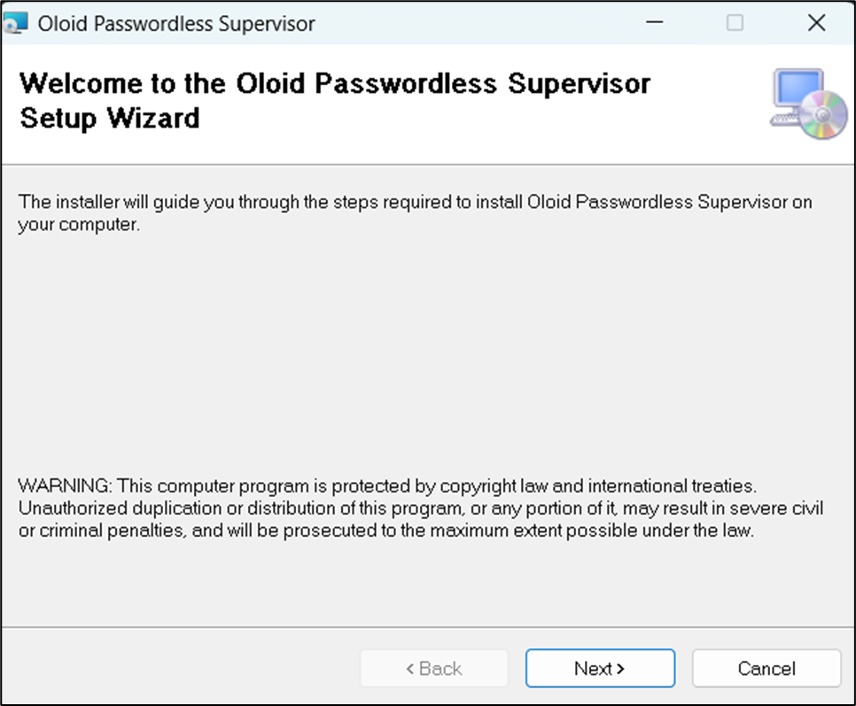

6. Use the default path to install the application and click **Next**.

   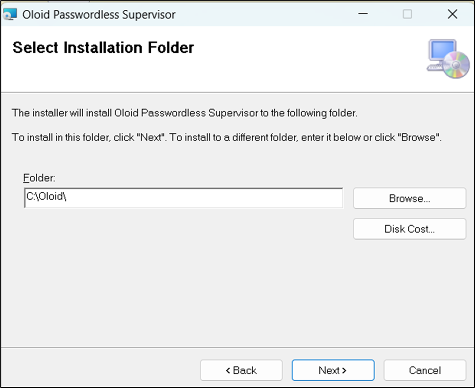

7. Click **Next** to confirm the installation.

   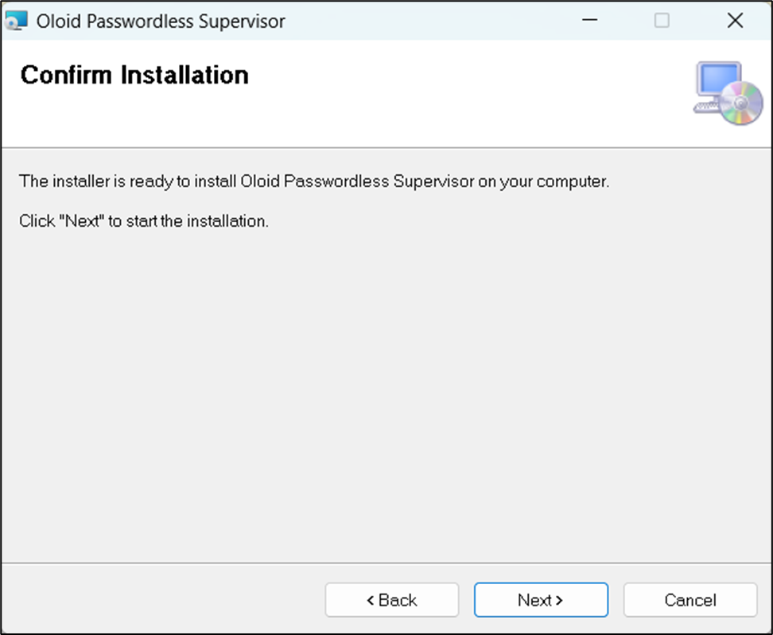

8. Click **Close** after the installation is complete.

   

   You can find the app icon on your desktop.
9. You must restart your system.
10. After restarting, on the Windows lock screen, click **Login with OLOID**.

    

    The Windows login app opens.
11. Select **Yes, pair my device** to auto-pair the device.

    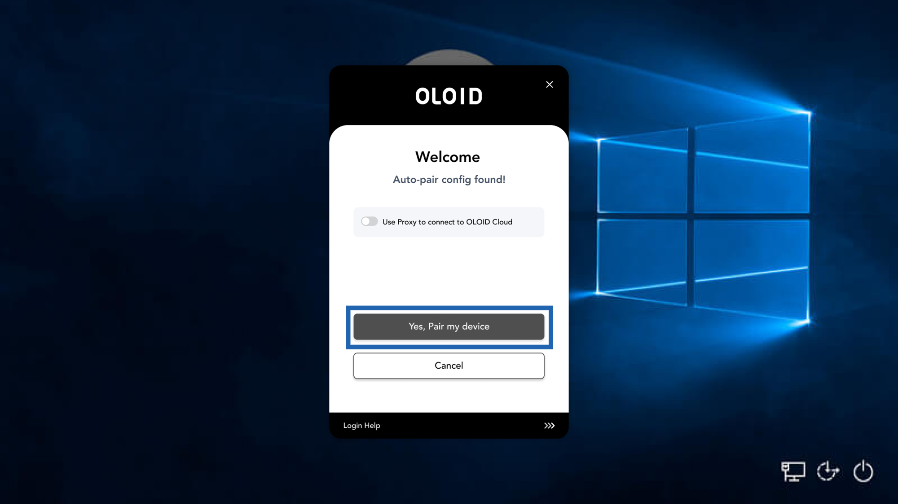

    The device is paired successfully. Now, the device is ready to be used.

## Video Tutorial

Watch the video[How to Install and Auto-Pair Windows Authenticator App through MDM- Video Tutorial](/platform/supervisor-portal/videos/how-to-install-and-auto-pair-windows-authenticator-app-through-mdm)
