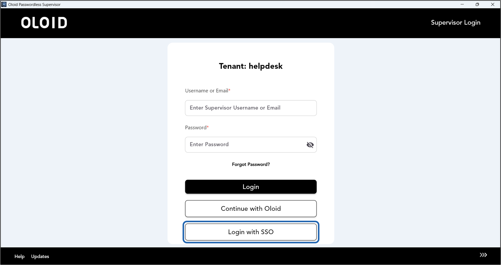
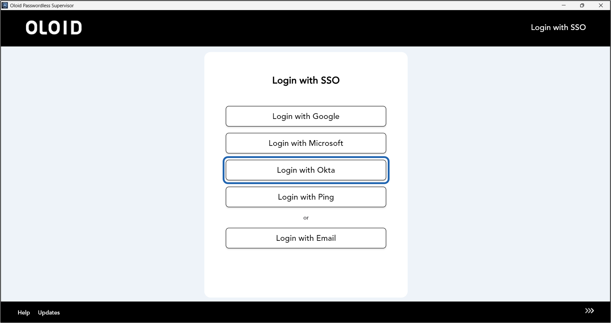
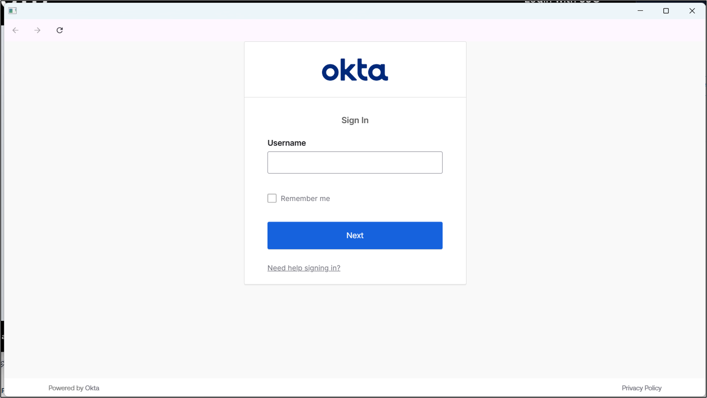
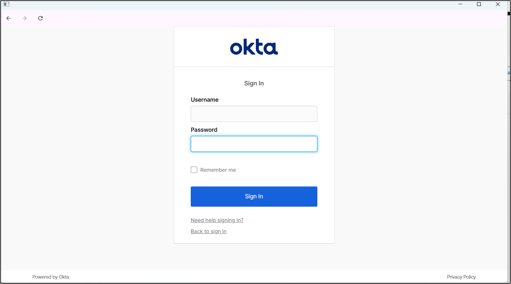
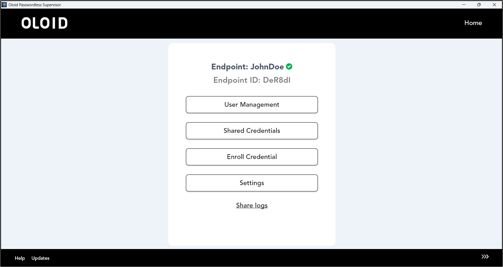

{/* Source: Intercom article 9555730 - https://oloid.help/en/articles/9555730-windows-login-how-to-log-in-to-supervisor-app-with-okta-sso-via-login-with-sso-option */}
{/* Generated by intercom_to_mintlify.py - re-running overwrites this file. */}

## Introduction

This document provides step-by-step instructions for logging in to the Supervisor App using Okta SSO. When SSO is enabled, users can authenticate using their Okta account credentials to securely access the Supervisor App.

## Prerequisites

- You must have an Admin or Supervisor account access.
- Windows Login Application must be created in the Tenant Admin Portal. For more information, refer: [How to create and configure Windows Login application in the Tenant Admin Portal](/platforms/windows/windows-login/windows-login-how-to-create-and-configure-windows-login-application)
- Ensure the endpoint is paired with the Windows Login application. refer [Windows Login - How to Manually Pair the Supervisor App](/platforms/windows/supervisor-app/windows-login-how-to-manually-pair-the-supervisor-app)
- You must have a valid **Okta account**.
- Ensure SSO is enabled in the Tenant Admin Portal. For more information, refer: [Windows Login - How to Enable OKTA Multi-Factor Authentication (MFA) Credential for Windows Login in the Tenant Admin Portal](/more/sso-and-mfa/windows-login-how-to-enable-okta-multi-factor-authentication-mfa)

## Steps to login with Okta SSO

1. Double-click on the **Supervisor App** to start.

   

   The Login screen is displayed.
2. Click **Login with SSO.**

   

   The configured Login options are displayed.
3. Select **Login with Okta** to log into Supervisor app.

   

   The **Sign in** page is displayed.
4. Enter **Username.**
5. Click **Next.**
   The **Welcome** page is displayed.

   

6. Enter **Password.**
7. Click **Sign in.**

   

   You are logged into the Supervisor app.

   
