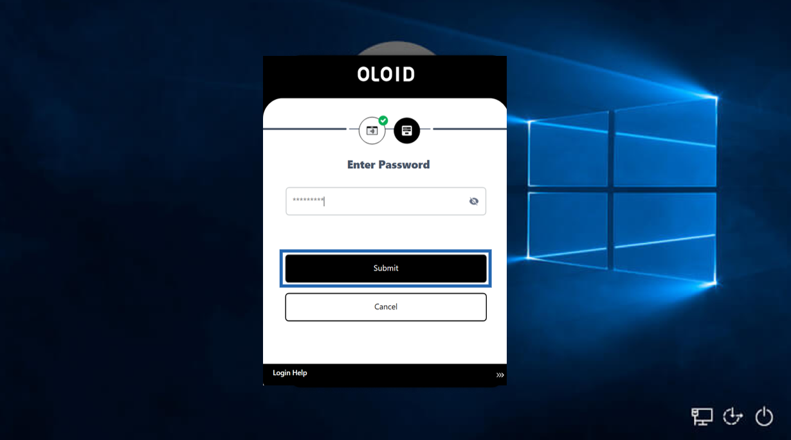

{/* Source: Intercom article 11848536 - https://oloid.help/en/articles/11848536-windows-login-how-to-log-in-to-windows-device-using-badge-and-password */}
{/* Generated by intercom_to_mintlify.py - re-running overwrites this file. */}

## Introduction

The authentication process requires users to scan their assigned Badge and enter their Password to securely access the Windows device.

## Prerequisites

- Windows Login Application must be created in the Tenant Admin Portal. For more information, refer: [How to create and configure Windows Login application in the Tenant Admin Portal](/platforms/windows/windows-login/windows-login-how-to-create-and-configure-windows-login-application)
- Ensure the endpoint is paired with the Windows Login application. refer [Windows Login - How to Manually Pair the Supervisor App](/platforms/windows/supervisor-app/windows-login-how-to-manually-pair-the-supervisor-app)
- In the Tenant Admin Portal, you must do the following:
  - Assign Badge ID to the user. For more details, refer [How to assign Badge ID as credential to users](/platform/tenant-admin-portal/how-to-assign-badge-id-as-credential-to-users).
  - Enable Badge authenticator in the Windows application. For more details, refer [How to enable Badge in Windows application](/platforms/windows/windows-login/windows-login-how-to-create-and-configure-windows-login-application).
  - Configure password credential for Windows Login Application. For more details refer [How to configure Password credential in Windows Login Application](/platforms/windows/windows-login/windows-login-how-to-configure-password-credential-for-windows-login).

    <Note>
      **Note:** If you don't see the login option reach out to [Oloid Support](mailto:support@oloid.ai).
    </Note>

## Steps to sign in to Windows device

1. On the Windows lock screen, do the following:
   1. Click **Sign-in options**.

      

      The Windows login app is displayed.
   2. Select **Windows login app**.

      

   3. Select **Login with OLOID**.

      

      The Windows login app opens and the **Scan Badge** pop-up box is displayed.
2. Tap the **Badge** on the **Badge Reader** to scan it.

   

   After Badge authentication, the **Enter Password** pop-up box is displayed.
3. Enter the **Password** > click **Submit**.

You have logged in to Windows device using Badge and Password credential through Windows Login app successfully.
