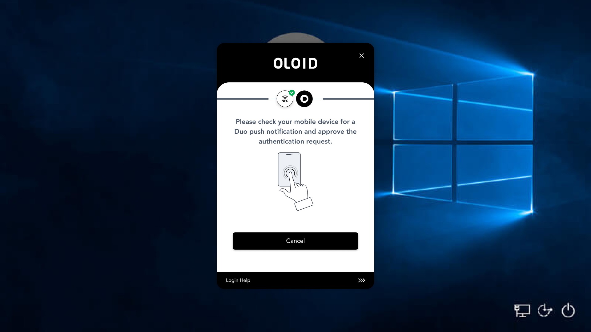
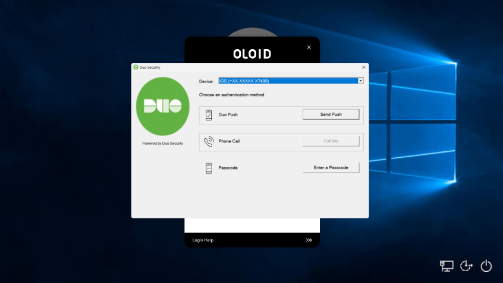
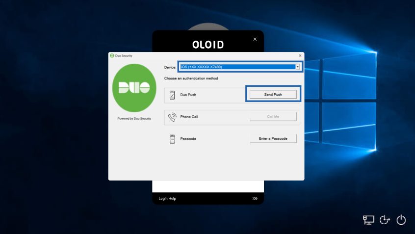
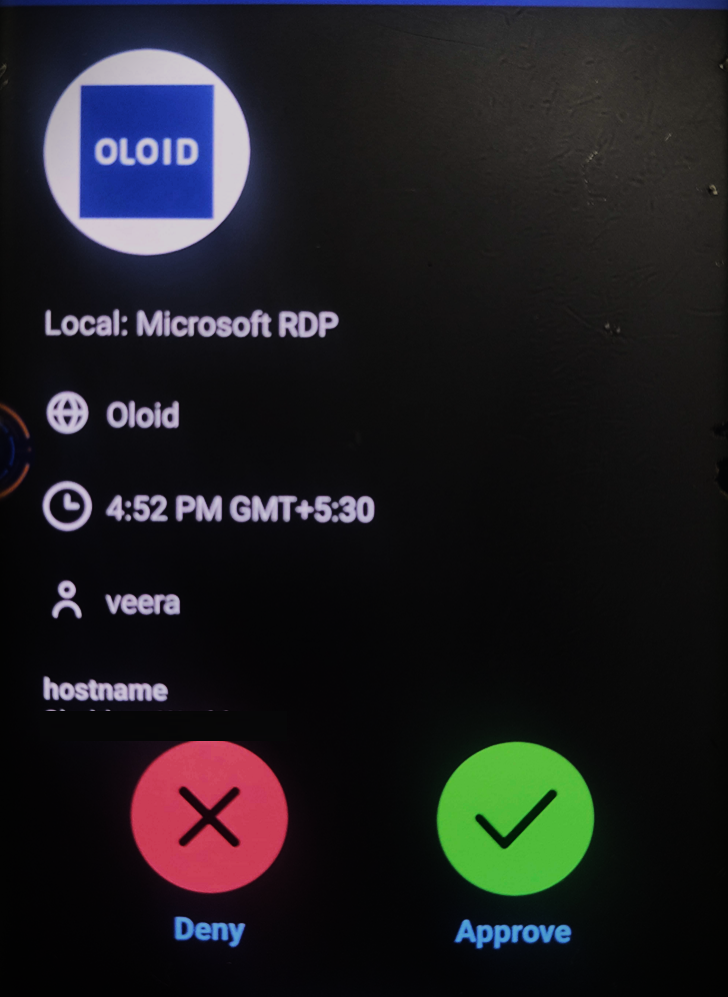
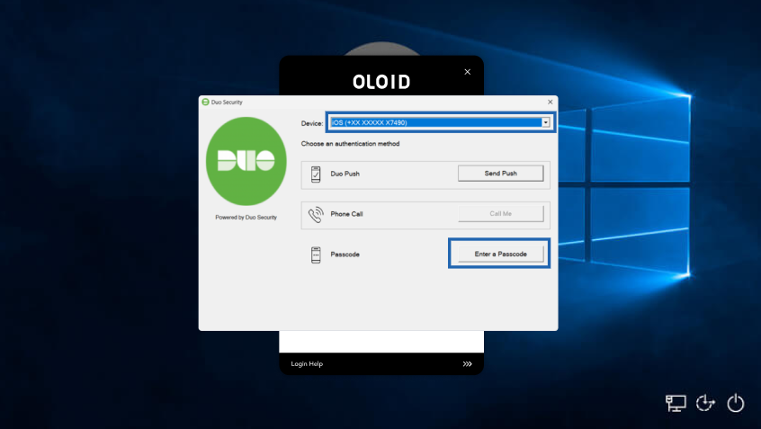
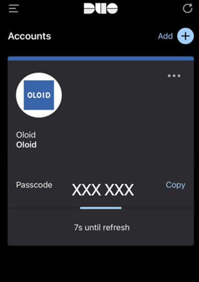
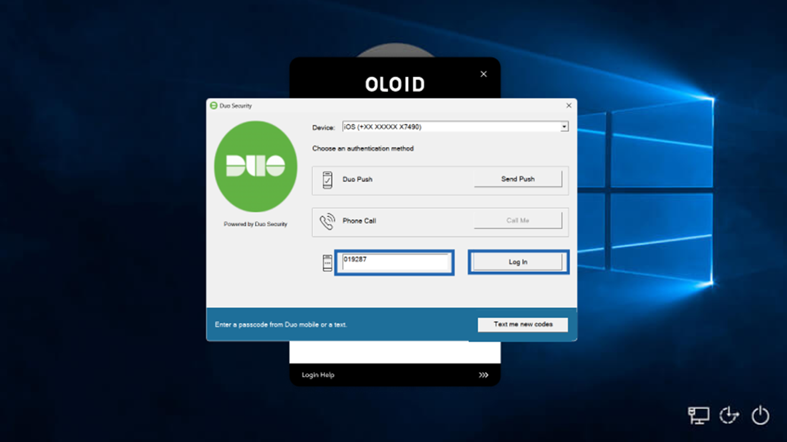
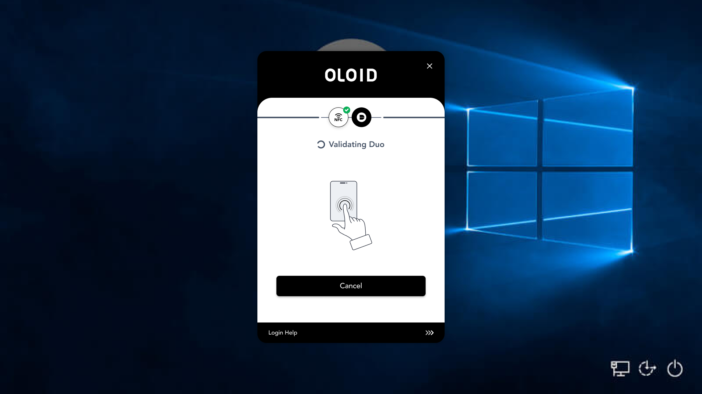
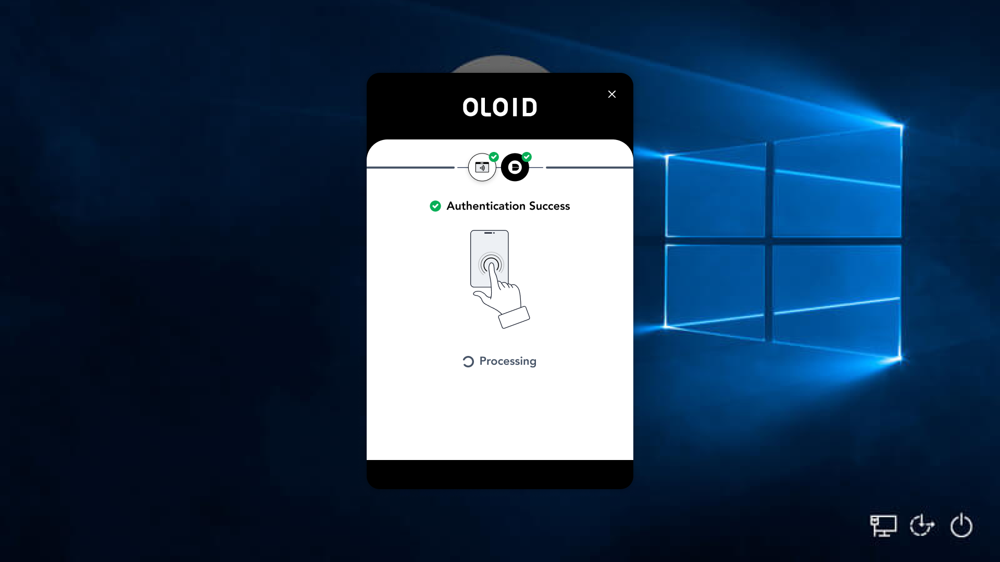

{/* Source: Intercom article 12421947 - https://oloid.help/en/articles/12421947-windows-login-how-to-log-in-to-windows-device-using-badge-id-and-duo */}
{/* Generated by intercom_to_mintlify.py - re-running overwrites this file. */}

## Introduction

This document explains how to sign in to a Windows device using a badge and Duo authentication in the Windows Login app. This passwordless, multi-factor login combines badge verification with Duo two-factor authentication, so it’s faster and more secure than signing in with a password.

## Prerequisites

- A Badge ID must be assigned to you. For more details, refer [Supervisor App: Assign Badge](/platforms/windows/supervisor-app/windows-login-how-to-enroll-assign-badge).
- Duo must be enabled as the second factor in the **Authenticator** tab of the Windows Login application in the Tenant Admin Portal.
- You must have access to your registered mobile device.
- Your External Username or Duo ID must be added as an identifier on the **User Details** page and registered in the Duo app.

  <Note>
    **Note:** If you don’t see the login option, contact [Oloid Support](mailto:support@oloid.ai).
  </Note>

## Steps to login to Windows Device

1. On the Windows lock screen, do the following:
   1. Click **Sign-in options**.

      

      The Windows login app is displayed.
   2. Select **Windows login app**.

      

   3. Select **Login with OLOID**.

      

      The **Scan Badge** pop-up box is displayed.
2. Tap the **Badge** on the **Badge Reader** to scan it.

   

   The **Choose Your Account** pop-up box is displayed.

   <Note>
     **Note:** If the user has multiple passwords configured in the Oloid Portal, they can select a specific account to sign in. If the user has only one account configured, **Choose Your Account** pop-up box will not be displayed.
   </Note>

3. Select the account to sign in.

   

   The message “Please check your mobile device for a Duo push notification and approve the authentication request” is displayed.

   

   The **Duo Security** pop-up box is displayed.

   

4. Select the user’s phone number from the **Device** dropdown in the **User Details** section.

   <Note>
     **Note:** The **Device** dropdown displays multiple phone numbers only if the user has more than one phone number configured in the system.
   </Note>

5. Do one of the following:
   1. **Duo Push**:
      1. Select **Send push** to send a notification to the registered mobile number.

         

         The Push notification is displayed in your registered device.
      2. Tap **Approve**.

         

         OR
   2. **Passcode:**
      1. Select **Enter a Passcode** to send a Passcode to the registered mobile number.

         

         A Passcode is displayed on the Duo mobile application.

         

      2. Enter the passcode in the passcode field and click **Log In**.

         

         The **Validating Duo** screen is displayed.

         

         After authentication succeeds, the **Authentication Success** screen is displayed.

         
