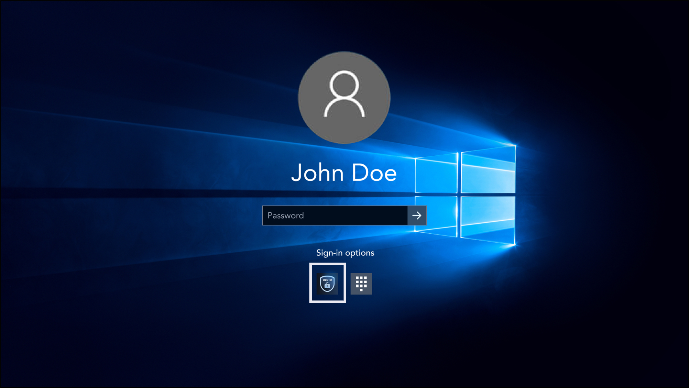

{/* Source: Intercom article 8641938 - https://oloid.help/en/articles/8641938-windows-login-how-to-log-in-to-windows-device-using-badge */}
{/* Generated by intercom_to_mintlify.py - re-running overwrites this file. */}

**Introduction**

This document provides step-by-step instructions for logging in with badge to Windows device.

**Pre-requisite**

- In the Oloid Portal, you must do the following:
  - Assign Badge ID to the user. For more details, refer [How to assign Badge ID as credential to users](/platform/tenant-admin-portal/how-to-assign-badge-id-as-credential-to-users)
  - Enable Badge as an authenticator in the Windows application. For more details, refer [How to enable Badge in Windows application](/platforms/windows/windows-login/windows-login-how-to-create-and-configure-windows-login-application)

**Steps to sign in to Windows device:**

1. On the Windows lock screen, do the following:
   1. Click **Sign-in options**.

      

      The Windows login app is displayed.
   2. Select **Windows login app**.

      

   3. Select **Login with OLOID**.

      

      The Windows login app opens and the **Scan Badge** screen is displayed.
2. Tap the **Badge** on the **Badge Reader** to scan it.

   

   On Badge authentication, you are signed in to the Windows device.

   <Note>
     **Note:** If the user has multiple passwords configured in the Oloid Portal, then the **Choose Your Account** page is displayed. You can select a specific account to sign in successfully.
   </Note>

   

   <Note>
     **Note:** The user can also perform offline badge authentication after completing at least one successful online badge authentication.
   </Note>

## Video Tutorial

Watch the video **[How to log in to Windows device using Badge - Video Tutorial](/platforms/windows/videos/how-to-log-in-to-windows-device-using-badge-video-tutorial)**
