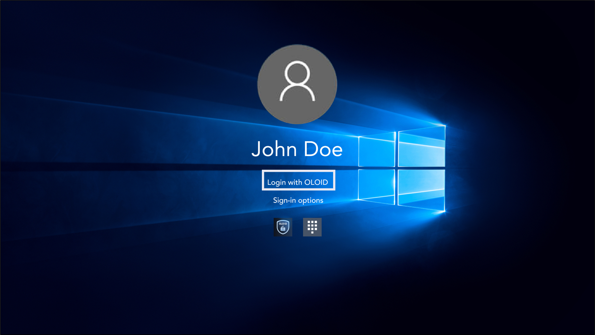
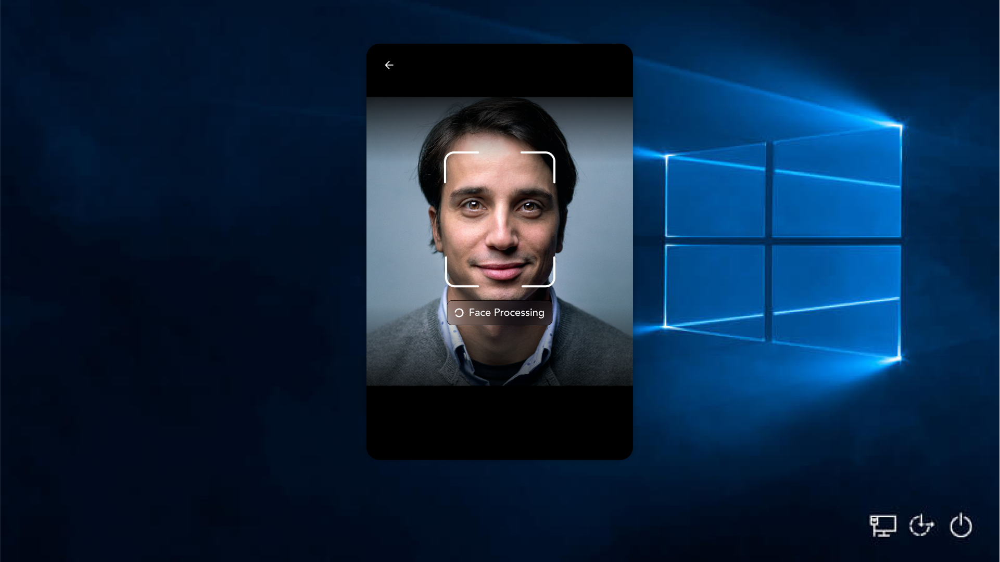
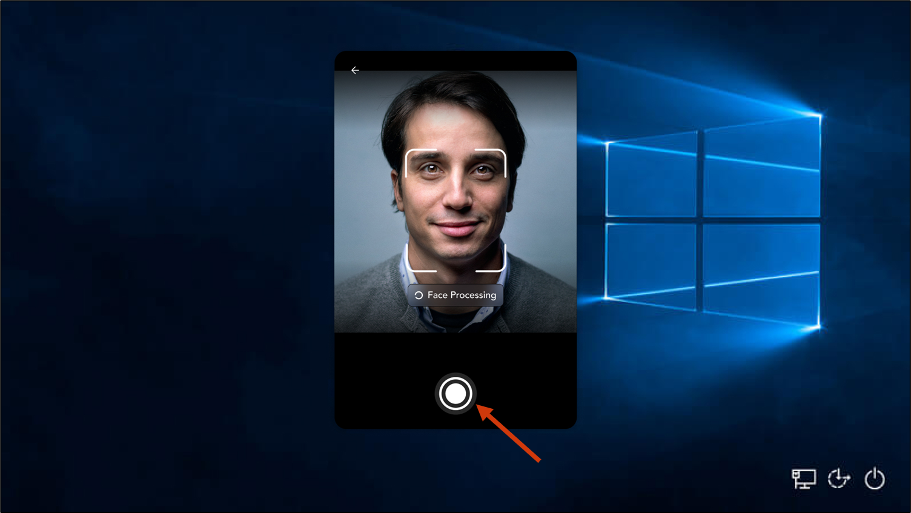

{/* Source: Intercom article 8637172 - https://oloid.help/en/articles/8637172-windows-login-how-to-log-in-to-windows-device-using-face */}
{/* Generated by intercom_to_mintlify.py - re-running overwrites this file. */}

## Introduction

This document provides step-by-step instructions for logging in with face to Windows device.

### Pre-requisite

- In the Oloid Portal, you must do the following:
  - Add Face to the user. For more details, refer [How to onboard face of a single user](/platform/tenant-admin-portal/tenant-admin-portal-how-to-add-face-of-a-single-user)
  - Enable Face under the Windows application. For more details, refer [How to create and configure Windows application](/platforms/windows/windows-login/windows-login-how-to-create-and-configure-windows-login-application)
  - Manual face capture (as per the requirement) must be configured in Oloid Portal. You need to turn on [Enable Manual Capture Accessibility](/platforms/windows/windows-login/windows-login-how-to-create-and-configure-windows-login-application)toggle buttonin Windows Configuration.

    <Note>
      **Note:** If you don't see the login option reach out to [Oloid Support](mailto:support@oloid.ai).
    </Note>

Steps to sign in to Windows device:

1. On the Windows lock screen, do the following:
   1. Click **Sign-in options**.

      

      The Windows login app is displayed.
   2. Select **Windows login app**.

      

   3. Select **Login with OLOID**.

      

      The Windows login app opens and the camera turns on.
2. Place your face in front of the camera for facial authentication.

   

   The camera auto-captures the user's face.
   If manual capture is enabled, press **Enter or Spacebar,** or click on the camera icon.

   

   On successful facial authentication, you are signed in to the Windows system.

   <Note>
     **Note:** If the user has multiple passwords configured in the Oloid Portal, then the **Choose Your Account** page is displayed. You can select a specific account to sign in successfully.
   </Note>

   

## Video Tutorial

Watch the video [How to log in to Windows device using Face - Video Tutorial](/platforms/windows/videos/how-to-log-in-to-windows-device-using-face-video-tutorial)
