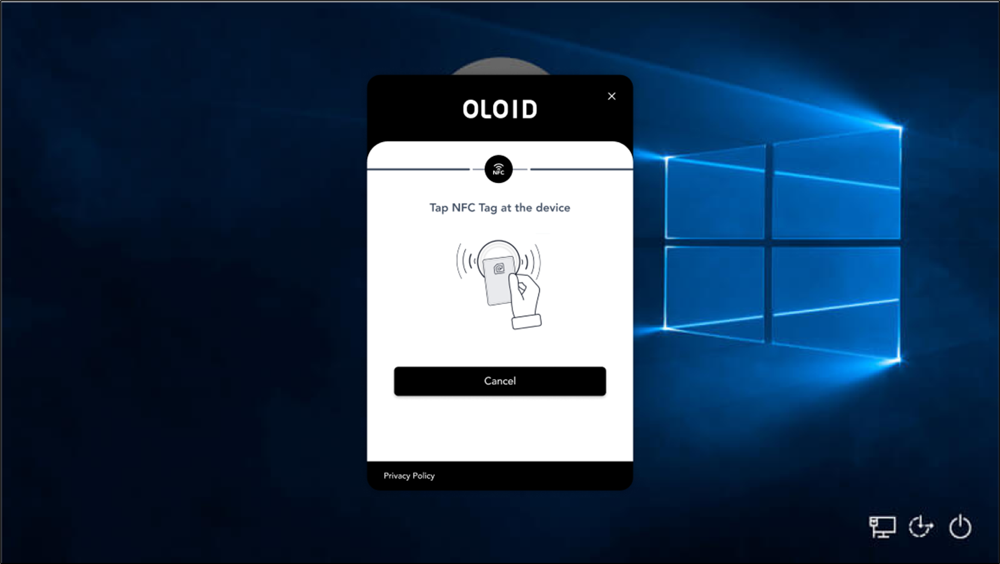
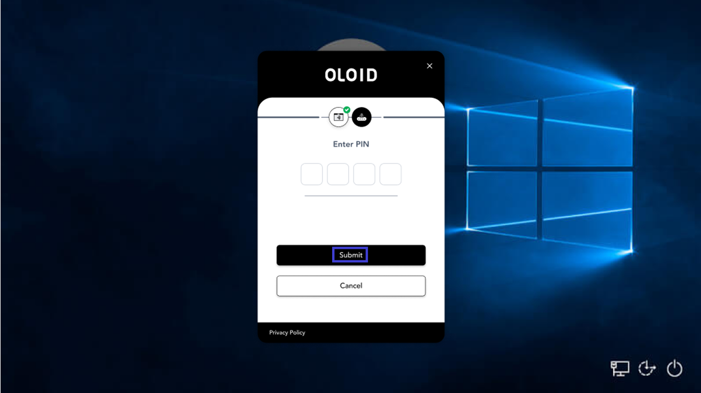

{/* Source: Intercom article 9550441 - https://oloid.help/en/articles/9550441-windows-login-how-to-log-in-to-windows-device-using-nfc-and-pin */}
{/* Generated by intercom_to_mintlify.py - re-running overwrites this file. */}

## Introduction

This document provides step-by-step instructions for logging in with NFC and PIN to Windows device.

## Prerequisites

In the Tenant Admin Portal, you must do the following:

- Windows Login Application must be created in the Tenant Admin Portal. For more information, refer: [How to create and configure Windows Login application in the Tenant Admin Portal](/platforms/windows/windows-login/windows-login-how-to-create-and-configure-windows-login-application)
- Assign NFC ID to the user. For more details, refer [How to assign NFC/ID as credential to users](/platform/tenant-admin-portal/how-to-assign-nfc-id-as-a-credential-to-the-user)
- Enable NFC as an authenticator in the Windows application. For more details, refer [Windows Login - How to enable NFC/ID credential for Windows Login in the Tenant Admin Portal](/platforms/windows/windows-login/windows-login-how-to-enable-nfc-id-credential-for-windows-login-in)
- Add PIN access to the user. For more details, refer [How to add PIN as credential to users](/platform/tenant-admin-portal/tenant-admin-portal-how-to-add-pin-credential-for-user)
- Enable PIN as an authenticator in the Windows application. For more details, refer [How to enable PIN in Windows application](/platforms/windows/windows-login/windows-login-how-to-create-and-configure-windows-login-application)

<Note>
  **Note:** If you don't see the login option reach out to [Oloid Support](mailto:support@oloid.ai).
</Note>

## Steps to sign in to Windows device

1. On the Windows lock screen, do the following:
   1. Click **Sign-in options**.

      

      The Windows login app is displayed.
   2. Select **Windows login app**.

      

   3. Select **Login with OLOID**.

      

      The Windows login app opens and the **Tap NFC Tag at the device** screen is displayed.
2. Tap the **NFC Tag** on the **Reader** to scan it.

   

   On NFC authentication, the **Enter PIN** pop-up box is displayed.
3. Enter the **PIN** then click **Submit**.

On PIN authentication, you are signed in to the Windows device.

<Note>
  **Note:** If the user has multiple passwords configured in the Oloid Portal, then the **Choose Your Account** page is displayed. You can select a specific account to sign in successfully.
</Note>

---

##### Video Tutorial

Watch the video **[How to log in to Windows device using NFC and PIN in Windows Login app- Video Tutorial](/platforms/windows/videos/how-to-log-in-to-windows-device-using-nfc-and-pin-in-windows-login)**
