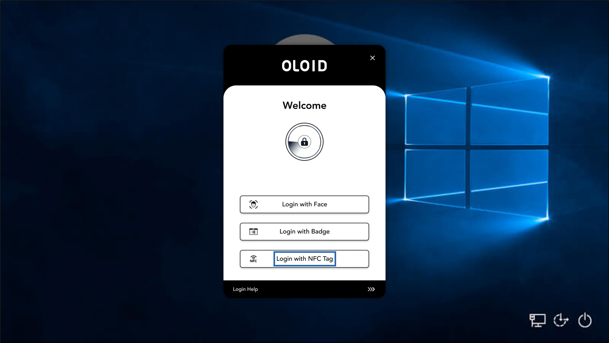
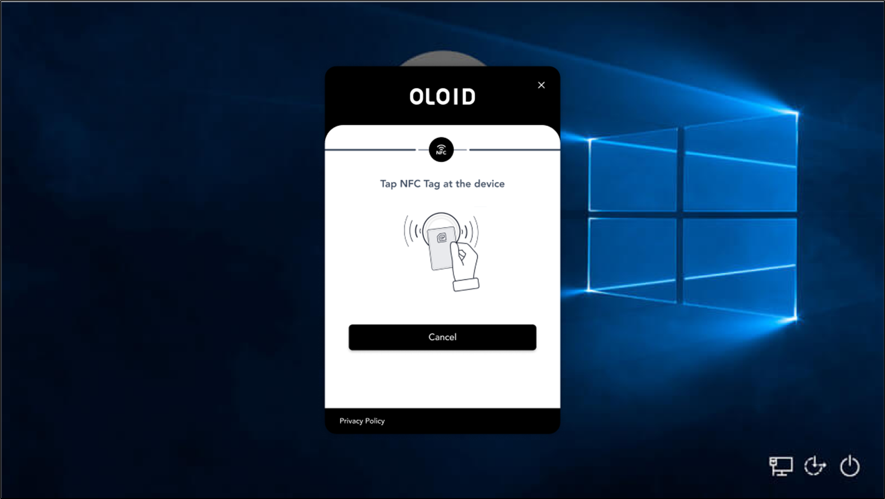

{/* Source: Intercom article 9720651 - https://oloid.help/en/articles/9720651-windows-login-how-to-log-in-to-windows-device-using-nfc */}
{/* Generated by intercom_to_mintlify.py - re-running overwrites this file. */}

## Introduction

This document provides step-by-step instructions for logging in with NFC to Windows device.

## Prerequisites

In the Tenant Admin Portal, you must do the following:

- Windows Login Application must be created in the Tenant Admin Portal. For more information, refer: [How to create and configure Windows Login application in the Tenant Admin Portal](/platforms/windows/windows-login/windows-login-how-to-create-and-configure-windows-login-application)
- Assign NFC ID to the user. For more details, refer [How to assign NFC/ID as credential to users](/platform/tenant-admin-portal/how-to-assign-nfc-id-as-a-credential-to-the-user)
- Enable NFC as an authenticator in the Windows application. For more details, refer [Windows Login - How to enable NFC/ID credential for Windows Login in the Tenant Admin Portal](/platforms/windows/windows-login/windows-login-how-to-enable-nfc-id-credential-for-windows-login-in)

<Note>
  **Note:** If you don't see the login option reach out to [Oloid Support](mailto:support@oloid.ai).
</Note>

## Steps to sign in to Windows device

1. On the Windows lock screen, do the following:
   1. Click **Sign-in options**.

      

      The Windows login app is displayed.
   2. Select **Windows login app**.

      

   3. Select **Login with OLOID**.

      

      The Windows login app opens and the Welcome screen is displayed.
2. Select **Login with NFC Tag**.

   

3. Tap the **NFC Tag** on the **Reader** to scan it.

   <Note>
     **Note:** The card reader must be connected to the computer.
   </Note>

   

   On NFC authentication, you are signed in to the Windows device.

   <Note>
     **Note:** If the user has multiple passwords configured in the Oloid Portal, then the **Choose Your Account** page is displayed. You can select a specific account to sign in successfully.
   </Note>

   

   <Note>
     **Note:** The user can also perform offline NFC authentication after completing at least one successful online NFC authentication.
   </Note>

---

##### Video Tutorial

Watch the video [How to log in to Windows device using NFC through Windows Login app](/platforms/windows/videos/how-to-log-in-to-windows-device-using-nfc-through-windows-login-app)
