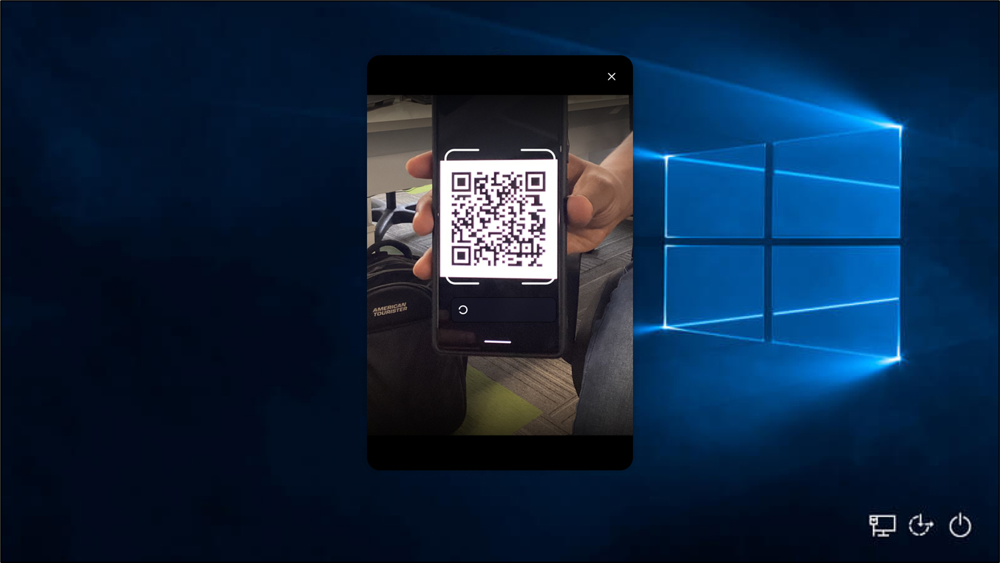
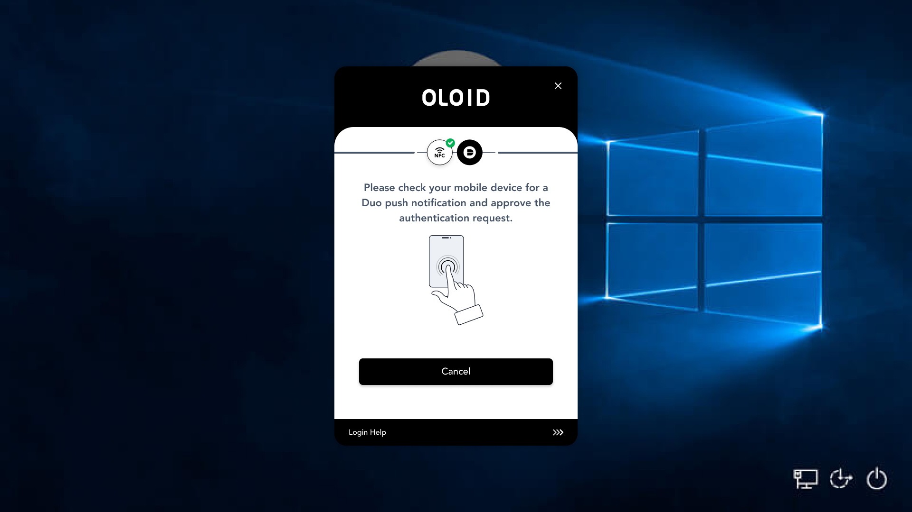
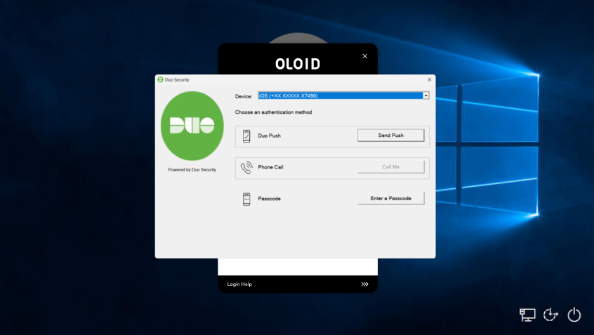
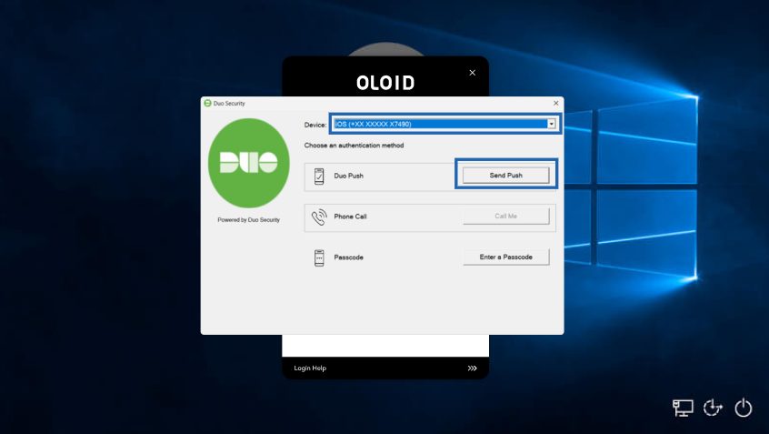
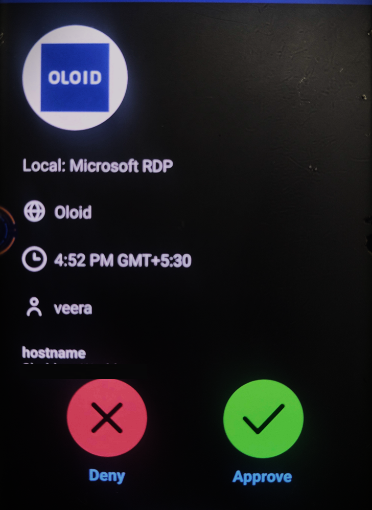
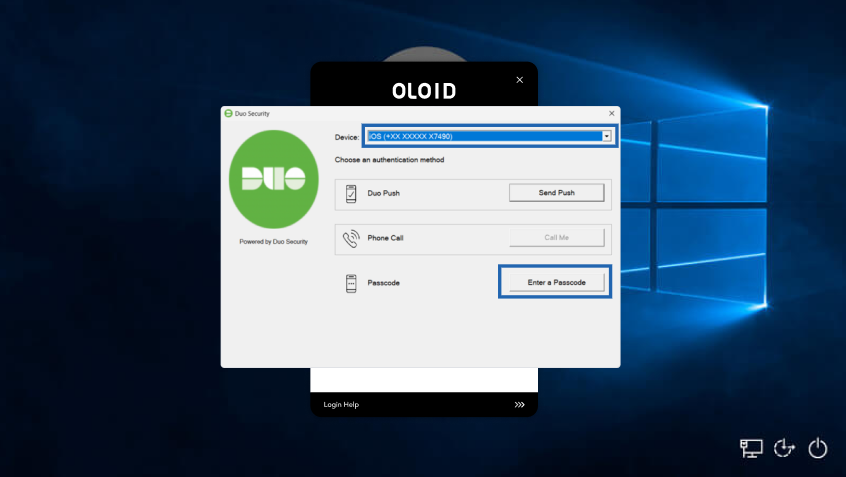
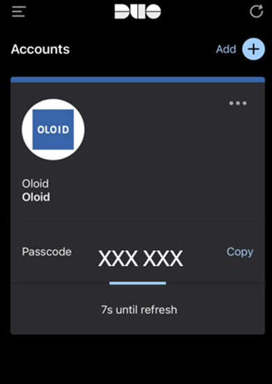
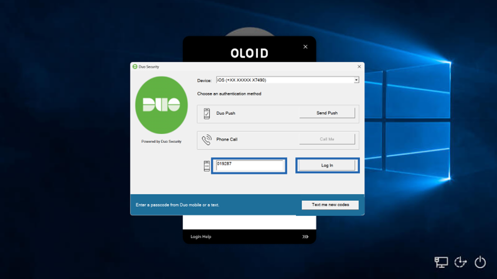
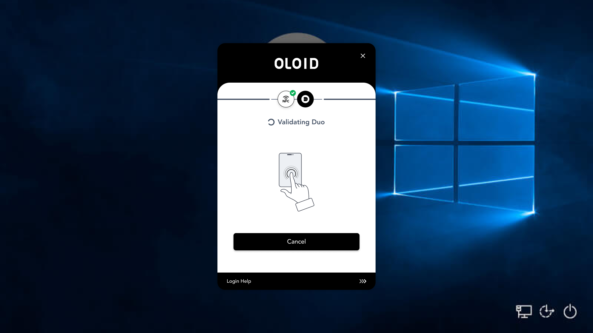
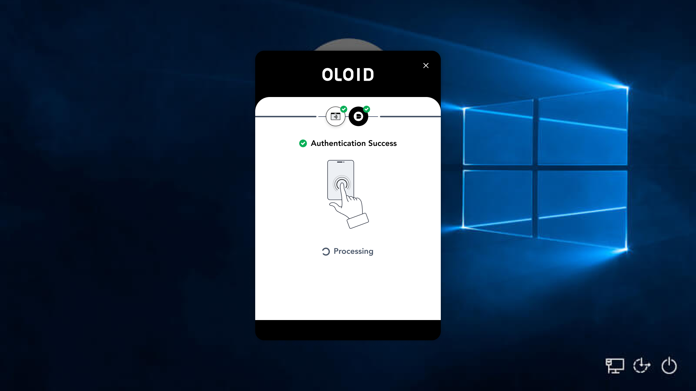

{/* Source: Intercom article 12421962 - https://oloid.help/en/articles/12421962-windows-login-how-to-log-in-to-windows-device-using-qr-code-and-duo */}
{/* Generated by intercom_to_mintlify.py - re-running overwrites this file. */}

## Introduction

This document explains how to sign in to a Windows device using a QR code and Duo authentication in the Windows Login app. This passwordless, multi-factor login is faster and more secure than signing in with a password.

## Prerequisites

- A QR Code must be assigned to you. For more information, refer [Windows Login - How to Add QR Code using Supervisor App](/platforms/windows/supervisor-app/windows-login-how-to-add-qr-code-using-supervisor-app)
- Duo must be enabled as the second factor in the **Authenticator** tab of the Windows Login application in the Tenant Admin Portal.
- You must have access to your registered mobile device.
- Your External Username or Duo ID must be added as an identifier on the **User Details** page and registered in the Duo app.

  <Note>
    **Note:** If you don’t see the login option, contact [Oloid Support](mailto:support@oloid.ai).
  </Note>

## Steps to login to Windows device

1. On the Windows lock screen, do the following:
   1. Click **Sign-in options**.

      

      The Windows login app is displayed.
   2. Select **Windows login app**.

      

   3. Select **Login with OLOID**.

      

      The **camera** turns on.
2. Show your QR Code in front of the camera to capture the QR code.

   

   The **Choose Your Account** pop-up box is displayed.

   <Note>
     **Note:** This pop-up appears only if you have more than one account configured in the Oloid Portal. If you have only one account, this step is skipped.
   </Note>

3. Select the account you want to sign in to.

   

   The message “Please check your mobile device for a Duo push notification and approve the authentication request” is displayed.

   

   The **Duo Security** pop-up box is displayed.

   

4. Select the user’s phone number from the **Device** dropdown in the **User Details** section.

   <Note>
     **Note:** The **Device** dropdown displays multiple phone numbers only if the user has more than one phone number configured in the system.
   </Note>

5. Do **one** of the following:
   1. **Send Push**:
      1. Select **Send push** to send a notification to the registered mobile number.

         

         The Push notification is displayed in your registered device.
      2. Tap **Approve**.

         

         OR
   2. **Passcode:**
      1. Select **Enter a Passcode** to send a Passcode to the registered mobile number.

         

         A Passcode is displayed on the Duo mobile application.

         

      2. Enter the passcode in the passcode field and click **Log In**.

         

         The **Validating Duo** screen is displayed.

         

         After authentication succeeds, the **Authentication Success** screen is displayed.

         
