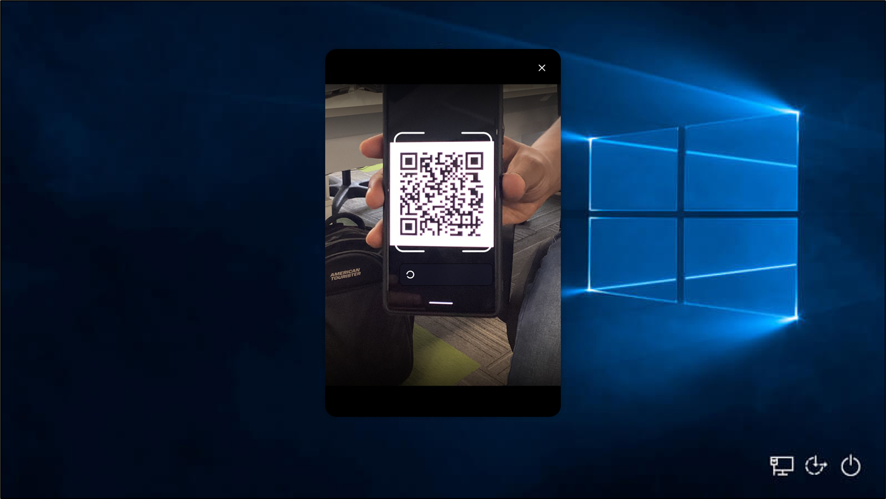

{/* Source: Intercom article 10626849 - https://oloid.help/en/articles/10626849-windows-login-how-to-log-in-to-windows-device-using-qr-code */}
{/* Generated by intercom_to_mintlify.py - re-running overwrites this file. */}

**Introduction**

This document provides step-by-step instructions for logging in with QR Code to Windows device.

**Pre-requisite**

- In the Oloid Portal, you must do the following:
  - Assign QR Code to the user. For more details, refer [How to create QR Code as credential for users](/platform/tenant-admin-portal/tenant-admin-portal-how-to-create-and-share-qr-code-credential-with)
  - Enable QR Code as an authenticator in the Windows application. For more details, refer [How to enable QR Code in Windows application](/platforms/windows/windows-login/windows-login-how-to-create-and-configure-windows-login-application)

    <Note>
      **Note:** If you don't see the login option reach out to [Oloid Support](mailto:support@oloid.ai).
    </Note>

Steps to sign in to Windows device:

1. On the Windows lock screen, do the following:
   1. Click **Sign-in options**.

      

      The Windows login app is displayed.
   2. Select **Windows login app**.

      

   3. Select **Login with OLOID**.

      

      The Windows login app opens and the camera turns on.

Show your QR Code in front of the camera for QR Code authentication.

On successful QR Code authentication, you are signed in to the Windows device.

<Note>
  **Note:** If the user has multiple passwords configured in the Oloid Portal, then the **Choose Your Account** page is displayed. You can select a specific account to sign in successfully.
</Note>

## Video Tutorial

2. Watch the video [How to log in to Windows device using QR Code through Windows Login app-Video Tutorial](/platforms/windows/videos/how-to-log-in-to-windows-device-using-qr-code-through-windows-login)
