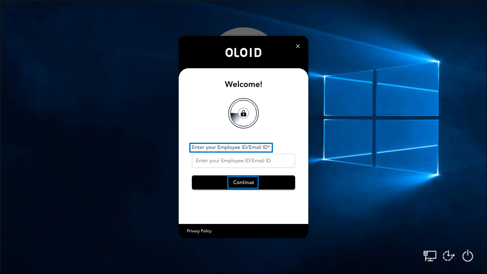
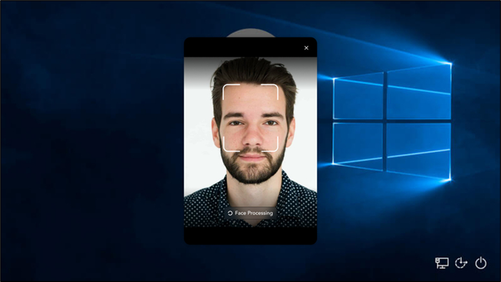
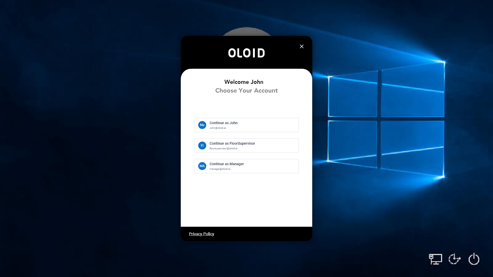

{/* Source: Intercom article 8893874 - https://oloid.help/en/articles/8893874-windows-login-how-to-log-in-to-windows-device-using-username-and-face */}
{/* Generated by intercom_to_mintlify.py - re-running overwrites this file. */}

## Introduction

This document provides step-by-step instructions for logging in with username to Windows device.

## Pre-requisite

- You must have an Oloid account.
- You must add face to the user. For more details, refer [How to onboard face of a single user](/platform/tenant-admin-portal/tenant-admin-portal-how-to-add-face-of-a-single-user)

## Steps to sign in to Windows device

1. On the Windows lock screen, do the following:
   1. Click **Sign-in options**.

      

      The Windows login app is displayed.
   2. Select **Windows login app**.

      

   3. Select **Login with OLOID**.

      

      The **Welcome** screen is displayed.
2. Enter your employee ID / email ID in **Enter your Employee ID / Email ID** textbox, then click **Continue**.

   

   The camera turns on.
3. Place your face in front of the camera for facial authentication.

   <Note>
     **Note:** Face credential must be enabled in the Oloid Portal. For more details, refer [How to create and configure Windows application](/platforms/windows/windows-login/windows-login-how-to-create-and-configure-windows-login-application)
   </Note>

   

4. On successful facial authentication, you are signed in to the Windows device.

   <Note>
     **Note:** If the user has multiple passwords configured in the Oloid Portal, then the **Choose Your Account** page is displayed. You can select a specific account to sign in successfully.
   </Note>

   

## Video Tutorial

Watch the video [How to log in to Windows device using username and face - Video Tutorial](/platforms/windows/videos/how-to-log-in-to-windows-device-using-username-and-face-video-tutorial)
