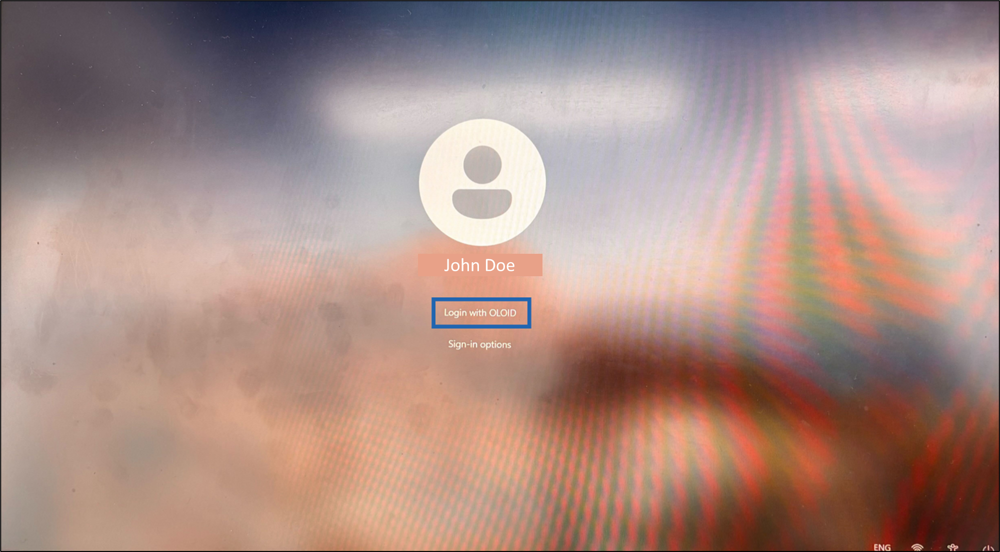
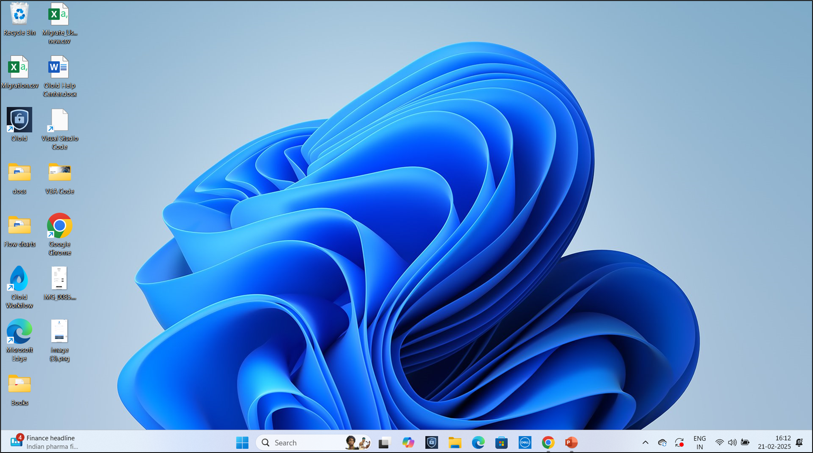
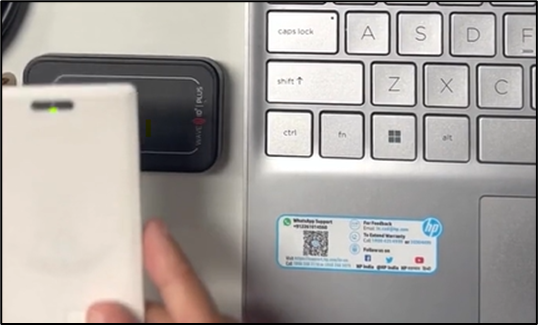
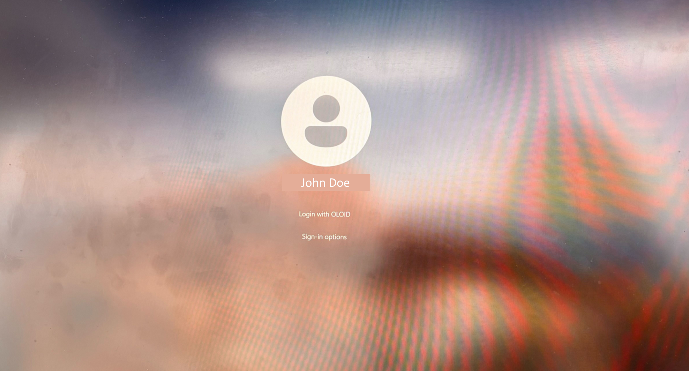
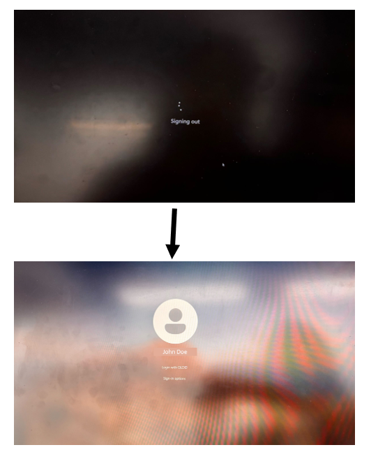

{/* Source: Intercom article 10616223 - https://oloid.help/en/articles/10616223-windows-login-how-to-log-out-of-windows-system-using-badge */}
{/* Generated by intercom_to_mintlify.py - re-running overwrites this file. */}

## Introduction

This document provides step-by-step instructions for logging out of a Windows system using a badge through the Windows Login app. When configured, users can scan their assigned badge to lock or sign out of the Windows system, based on the configured logout action.

## Prerequisites

- Windows Login Application must be created in the Tenant Admin Portal. For more information, refer: [How to create and configure Windows Login application in the Tenant Admin Portal](/platforms/windows/windows-login/windows-login-how-to-create-and-configure-windows-login-application)
- Ensure the endpoint is paired with the Windows Login application. refer [Windows Login - How to Manually Pair the Supervisor App](/platforms/windows/supervisor-app/windows-login-how-to-manually-pair-the-supervisor-app)
- The badge must be assigned to the user. For more details, refer [Supervisor App: Assign Badge](/platforms/windows/supervisor-app/windows-login-how-to-enroll-assign-badge).
- The **Enable Badge Out** option must be enabled in the Windows Login application. For details see, [Windows Login - How to enable Badge out option](/platforms/windows/windows-login/windows-login-how-to-configure-badge-out-option)
- The badge reader must be connected to the Windows system..

## Steps to log out of Windows System using Badge

1. On the Lock screen, select **Login with OLOID**.

   

   The Welcome screen of the Windows Login App is displayed.
2. Enter your credentials to log in to the system..
   The Windows homepage is displayed.

   

Scan the badge on the badge reader to lock your Windows system

Your Windows system is successfully locked, and the **Lock** screen appears.

<Note>
  **Note:** If the Windows Login application is configured with the **Sign out of Windows** option, all open applications in the system will close, and the **Lock** screen will appear.
</Note>

---

##### Video Tutorial

Watch the video [How to log out of Windows System using Badge - Video Tutorial](/platforms/windows/videos/how-to-log-out-of-windows-system-using-badge-video-tutorial)
