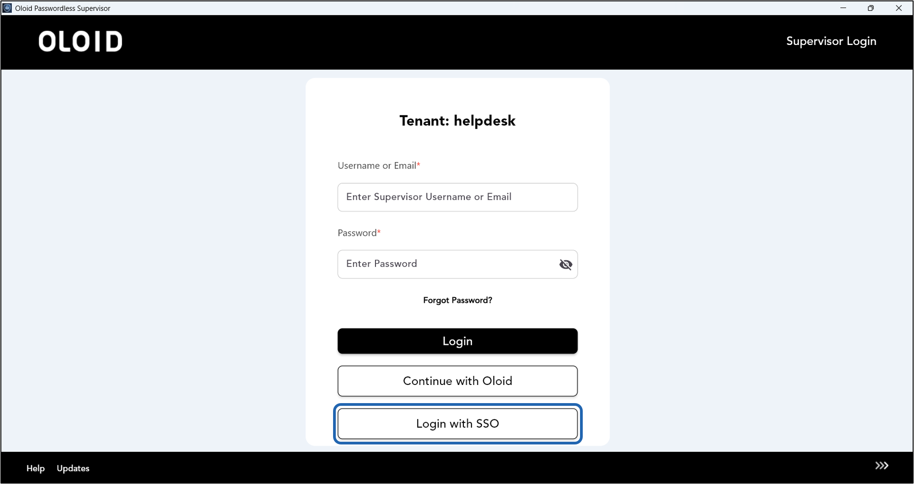
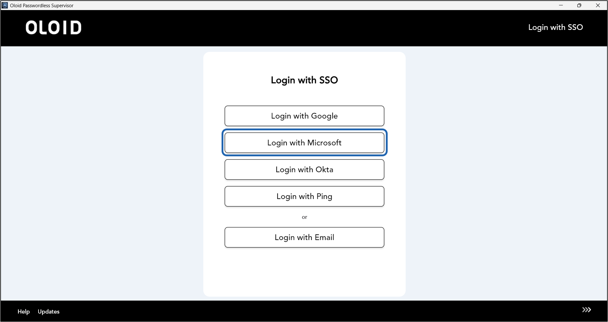
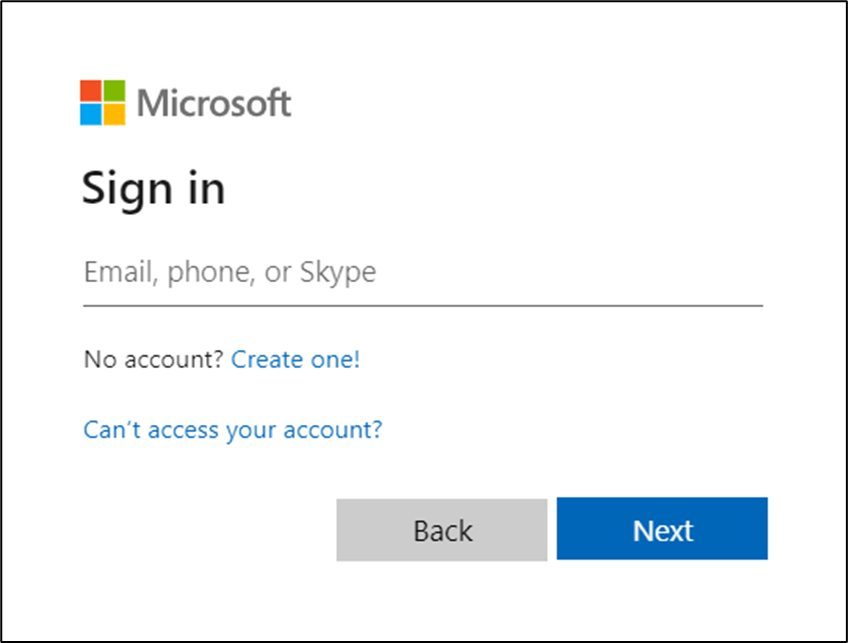
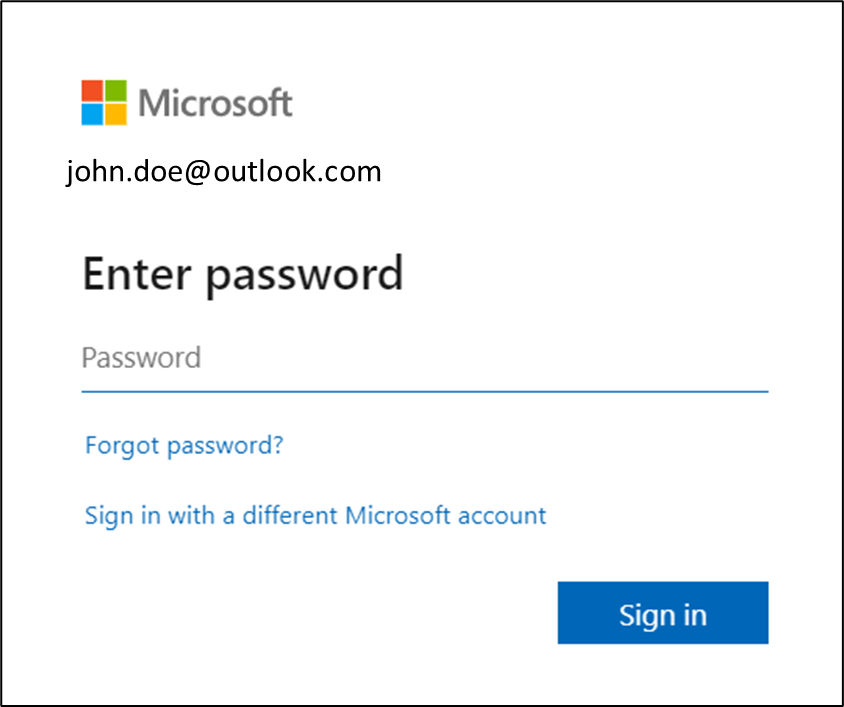
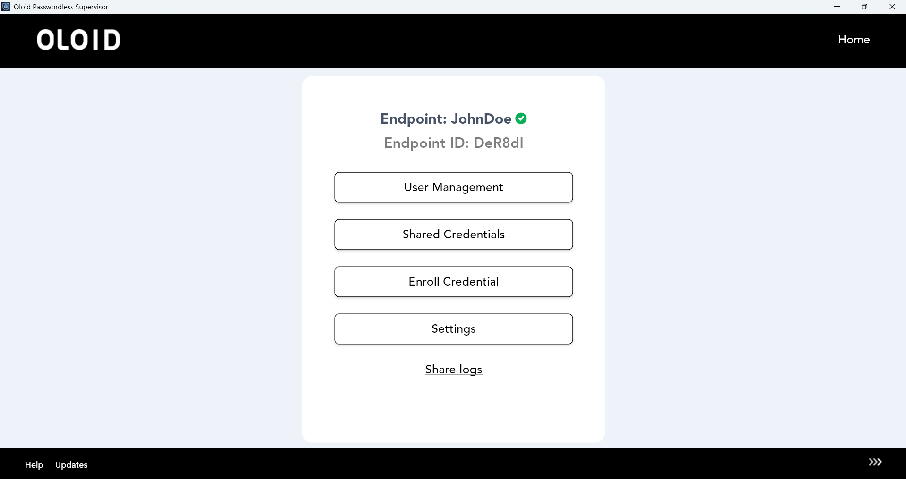

{/* Source: Intercom article 9727795 - https://oloid.help/en/articles/9727795-windows-login-how-to-login-to-supervisor-app-with-microsoft-via-login-with-sso-option */}
{/* Generated by intercom_to_mintlify.py - re-running overwrites this file. */}

## Introduction

This document provides step-by-step instructions for logging in to the Supervisor App using Microsoft SSO. When SSO is enabled, users can authenticate using their Microsoft account credentials to securely access the Supervisor App.

## Prerequisites

- You must have an Admin or Supervisor account access.
- Windows Login Application must be created in the Tenant Admin Portal. For more information, refer: [How to create and configure Windows Login application in the Tenant Admin Portal](/platforms/windows/windows-login/windows-login-how-to-create-and-configure-windows-login-application)
- Ensure the endpoint is paired with the Windows Login application. refer [Windows Login - How to Manually Pair the Supervisor App](/platforms/windows/supervisor-app/windows-login-how-to-manually-pair-the-supervisor-app)
- Ensure User has a Microsoft account.
- Ensure SSO is enabled in the Tenant Admin Portal. For more information, refer: [Tenant Admin Portal - How to Enable Entra ID SSO](/integrations/entra-id/tenant-admin-portal-how-to-enable-entra-id-sso)

## Steps to login with Microsoft

1. Double-click on the **Supervisor App** to start.

   

   The Login screen is displayed.
2. Click **Login with SSO.**

   

   The **Login with SSO** page is displayed.
3. Select **Login with Microsoft.**

   

   The **Sign in** page is displayed.

   

4. Enter **Email, phone, or Skype.**
5. Click **Next.**
   The **Enter password** page is displayed.

   

6. Enter **Password.**
7. Click **Sign in.**
   You are logged into the Supervisor app.

   
