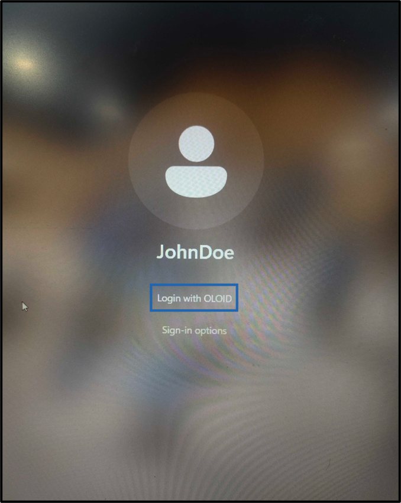
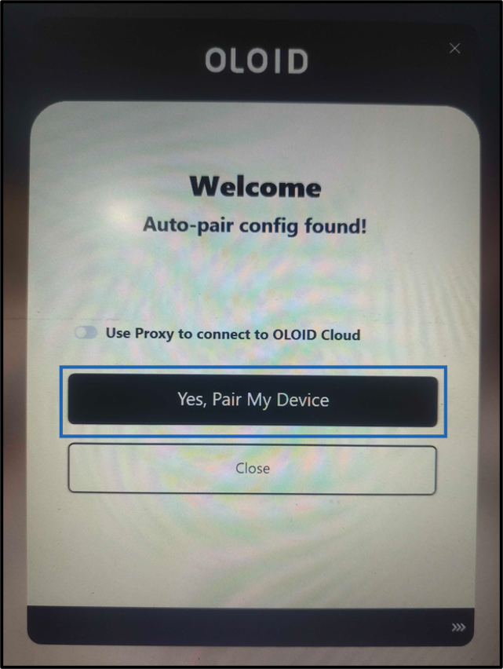

{/* Source: Intercom article 17087934 - https://oloid.help/en/articles/17087934-windows-login-how-to-pair-windows-login-app-in-lock-screen-using-auto-pair-config-file */}
{/* Generated by intercom_to_mintlify.py - re-running overwrites this file. */}

## Introduction

This document explains how to auto-pair the Windows Login (Authenticator) app directly from the Windows lock screen using the Auto-Pair Config File.

## Prerequisite

- You must have the Auto-Pair Config File in JSON format. To download the Auto-Pair Config File, refer to [Windows Login - How to Generate and Download Auto-Pair config file for Windows Login in Tenant Admin Portal](/platform/tenant-admin-portal/windows-login-how-to-generate-and-download-auto-pair-config-file-for).

## Steps to Auto-Pair Windows Login App from the Lock Screen

1. On the Windows lock screen, select **Login with OLOID**.

   

   The Windows Login pairing screen is displayed.
2. Select **Yes, pair my device** to auto-pair the endpoint.

   

   The Windows machine is paired successfully and ready for sign-in with Oloid.

<Note>
  **Note:** If auto-pair doesn't appear or fails at this step, the device can also be paired manually. Refer: [Windows Login - How to Manually Pair the Supervisor App](/platforms/windows/supervisor-app/windows-login-how-to-manually-pair-the-supervisor-app)
</Note>
